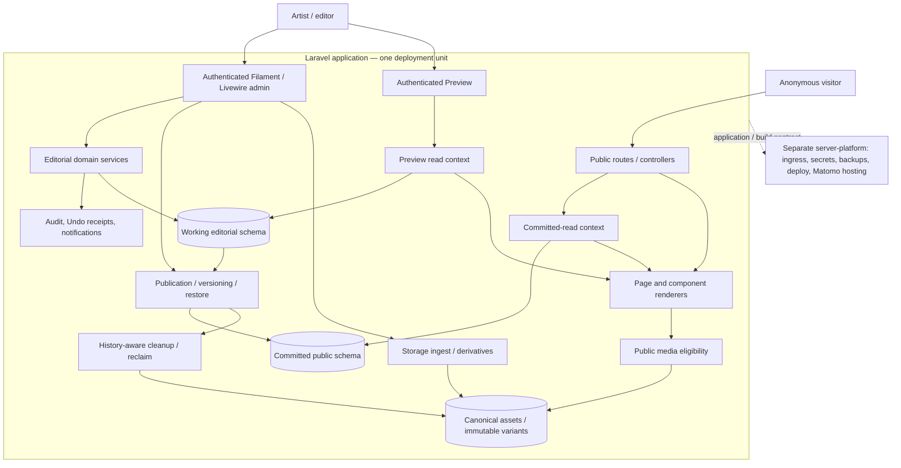
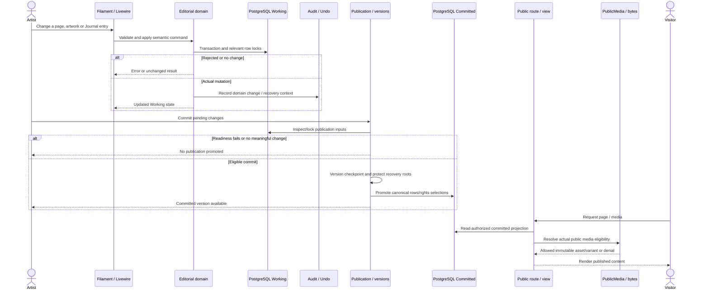

# System architecture

This document explains **how the artist website works as a system**: which parts own state, how an edit travels into public delivery, and where concurrency, security and recovery boundaries sit. It is a design map for understanding or changing the application—not an inventory of classes or a collection of per-page UI requirements. Read the diagram and flows together; the linked contracts and source traces carry finer details.

**Source boundary:** application code was compared against `dev@0200407133ce4696817271d2141fceaca82f8aff` (25 October 2026). This is a source-based design interpretation, **not** proof of running-browser behavior, a fresh test run or current deployed configuration. Newer source changes require rechecking their affected owners. Historical generated class/route diagrams in [architecture evidence](architecture/README.md) have their own older source versions.

## 1. What is the system and what is outside it?

The application is one Laravel 13 modular monolith (PHP 8.3+, Filament 5/Livewire for authenticated administration, Blade/Livewire navigation for public pages, PostgreSQL for editorial/publication data, private media storage and generated derivatives). The artist edits the same content that visitors eventually read, but **editing, publishing, previewing, navigating and delivering media are different operations with different permissions and sources of truth**.

The public site is server-rendered; Livewire may replace page documents and trigger page-scoped JavaScript initialization/disposal. It is not a separate browser-only application or separately deployed frontend.

**How to read the view:** arrows are conceptual ownership/data dependencies, *not* a statement that each arrow is a direct synchronous call. The logical Working/Committed boundary is backed by real PostgreSQL schemas (`public` and `committed`); binary originals/derivatives have their own lifetime. The platform is outside this repository: [runtime boundaries](architecture/application-runtime-boundaries.md), [release](RELEASE.md), [server boundary](SERVER-OPERATIONS-BASELINE.md). The application is one deployable unit; boxes in the diagram are not separate microservices or Docker containers.

## 2. Domain composition and canonical ownership

The public information structure is rooted in `SiteSection`, whose typed domain identity determines routes and editorial presentation. The navigation tree is **not** the content store for every page. Its children and page contents are composed from the owning domains:

| Domain / identity | What it owns | Essential composition |
| --- | --- | --- |
| Site tree | Home, Gallery, Journal, Custom Page and non-public Navigation Nodes; hierarchy, slugs and ordering | `SiteSectionType`, `SiteSectionEditorialService`, `SiteNodeRoute`; public versus admin navigation derive different filtered projections |
| Home | One root page and independently controlled routing/skip behavior | Home presentation may use Artwork, Under Construction or structured Custom content; Skip Home is not a content template |
| Gallery / Artwork | Gallery identity and published Artwork, ordering and primary media | `ArtworkCategory` is the historical Gallery persistence model; Artwork/media/eligibility do not collapse into a SiteSection row |
| Journal | One Journal section with one active Blog or Exhibitions template at a time | Switching template preserves inactive content rows; Exhibition state, cover/gallery/map and venue/organizer visibility have independent owners |
| Custom Page / components | Ordered reusable content blocks (text, image, list, divider, contact, legal notice) | Home and Custom Page share parts of the component and rich-text pipelines; contact is a component, not a sixth SiteSection type |
| Reusable media | Original asset, references, variants, availability, public eligibility, rights and deletion protection | A saved media reference does **not** mean the asset is currently public or physically safe to delete |
| Publication / history | Working-to-committed promotion, checkpoints, recovery and audit association | Current editorial, committed projection, historical restore roots and Undo receipts serve different purposes |

The key design pattern is **composition without duplicate persistence/behavior owners**. An editor can arrange a Journal gallery, but media ingest still belongs to Storage and public delivery still passes eligibility. Gallery and Journal may share a viewer primitive while keeping distinct navigation scope. For exact persisted columns and relations, use [data model](DATA-MODEL.md); for product behavior, use [Public](PUBLIC-IMPLEMENTATION-CONTRACT.md), [Admin](ADMIN-UI.md), [Rich Text](EDITORIAL-RICH-TEXT.md), [Exhibition](EXHIBITION-EDITORIAL-CONTRACT.md), and [Media](MEDIA.md).

## 3. The central transaction: edit → audit → publication → read

**Editing is not publication.** Filament actions select a domain service, validate semantic state, and persist a Working change with appropriate transaction/row locks. Audit and user feedback have their own contracts; a no-op or validation failure does not become a successful mutation. A separate artist Commit promotes the agreed state into the committed public projection.

**The important architectural decisions are the separations, not the number of call arrows.** `PublicationService::pendingSummary()` compares rows across `public` and `committed` and also considers separately selected media-rights revisions. `CommittedRead` sets a committed read context and repeatable-read transaction. Public controllers use the selected read context and typed content queries; the protected Preview has a distinct editorial visibility exception. `PublicMedia::isPublicAsset()` checks media availability *and* the appropriate published consumer, including publication/template/feature flags. This is why “record exists”, “referenced”, “published” and “deliverable” cannot be reduced to one Boolean.

The diagram summarizes an end-to-end lifecycle; it does **not** claim the exact ordering or transaction nesting of every specialized domain's audit/callback path. Before modifying a particular writer, review [editorial mutations](architecture/editorial-mutation-paths.md), [publication/read model](architecture/publication.md), [working operations](architecture/publication-working-operations.md), [audit/Undo](architecture/activity-undo-lifecycle.md) and the normative [Publication and Activity contract](ADMIN-ACTIVITY-PUBLICATION-CONTRACT.md). Do not infer that an HTTP success, toast, audit event and committed public change are the same event.

### Recovery and concurrency make this a system, not a simple CRUD application

A restore or revert may target a prior checkpoint while other editorial changes occur. It must distinguish **which state the artist selected** from the latest persisted state; locks, snapshot identities, stale-action rejection and protected history roots matter. Publication checkpoints use retained immutable payload references; deleting an unused current row must not destroy media still needed by a restorable historical version. A rollback or Undo cannot blindly assume that an old public projection is still current.

Historical and concurrent behavior is traced in [Publication working operations](architecture/publication-working-operations.md), [activity/Undo lifecycle](architecture/activity-undo-lifecycle.md), [media reference/cleanup](architecture/media-reference-and-cleanup.md) and [migration invariants](MIGRATION-INVARIANTS.md). Tests must establish meaningful invariants, races and negative paths; cosmetic markup or pixel assertions do not establish this architecture.

## 4. Cross-feature orchestration: shared editors, media and public presentation

The largest integration risks are changes to **shared primitives with different consumers**:

| Change center | Cross-boundary consequences to inspect |
| --- | --- |
| `AdminRichText`, `RichTextDocument`, `SafeRichTextRenderer` | Journal, Home, Custom Page/CV, embedded media, link and formatting policy; editor representation and public sanitized output must agree |
| `MediaAssetSelect`, ingest, `MediaReferenceQuery`, `PublicMedia` | Storage references, Home media, Gallery Artwork, Journal cover/gallery, legal/favicons, preview permissions, quota and cleanup; sharing an asset must not clone it |
| `SiteSection`, public navigation and Home routing | Admin can display drafts that Public cannot; nested site structure, skipped Home, public routes and template switching have distinct filters |
| `PublicAppearance`, shared layout, page components and browser navigation | Header/menu/divider/paper frame across Home, Gallery, Artwork, Journal and Custom Pages; single-page navigation must reinitialize/dispose media/viewers without duplicate listeners |
| Publication, notifications and audit | A persisted semantic mutation, recipient-scoped notification, reversible action and public commit are different operations; a fix in one affects others |
| Rights and historical media variants | New metadata or regenerations cannot mutate bytes behind immutable public URLs or release historical references accidentally |

For an Exhibition example, an artist may edit organizer, venue, address, opening dates, cover, gallery and optional Map separately. The Journal's active template gates display, public publication gates entry visibility, `gallery_enabled` gates whether stored gallery media is publicly exposed, and Map and media loading may involve external services. A viewer opens a *scoped* image set; a video follows the shared inline playback owner rather than image navigation. This single page therefore crosses editorial state, publication, file eligibility, rendering, browser lifecycle and privacy.

For Home/Custom Page, the same reusable structured content and rich-text media IDs enter a different public wrapper with its own layout rules. A change to image layout or modal geometry must be inspected across all consumers; local CSS patches do not establish a separate architectural owner.

Use [cross-feature compositions](architecture/cross-feature-compositions.md) for additional traces and risk seams, [Journal lifecycle](architecture/journal-content-lifecycle.md), [Public page/document lifecycle](architecture/public-spa-lifecycle.md), [exhibition/map](architecture/exhibition-map.md), [structured content](architecture/structured-components.md), and [Public implementation](PUBLIC-IMPLEMENTATION-CONTRACT.md). This is the **system integration map**; those documents provide detailed traces and evidence rather than alternate normative architectures.

## 5. Security, failure and ownership boundaries

| Boundary | Design implication |
| --- | --- |
| Anonymous public ↔ authenticated admin/Preview | Public routes/content/media are not a shortcut to draft state. Preview is an authorized different read context, not an unpublish operation. |
| Database ↔ filesystem/media | Ingest can finish before an Artwork transaction; failed Artwork validation must not leave an untracked physical file. Physical deletion is constrained by Working, committed and historical references. |
| Rich-text input ↔ rendered HTML | Shared validation/sanitization, safe protocols and Storage image references must agree across edit/render surfaces; Content Security Policy adds a separate browser load restriction. |
| Single server-rendered page ↔ Livewire document navigation | Shared header, document-level initialization and page-scoped disposers must not accumulate stale listeners; viewer/media navigation scope is content dependent. |
| Application repository ↔ server-platform | Release artifact, configuration contract and health are here; actual ingress, deployment, backups, runtime secrets and Matomo infrastructure are separately operated and require independent verification. |
| Versioned documentation ↔ runtime evidence | Code review, authored tests, executed tests, real browser behavior and artist acceptance are different evidence levels; a generated class graph is not a run-time execution trace. |

Useful deep owners: [Public security and privacy](architecture/public-security-privacy-boundaries.md), [rights and consent](PUBLIC-RIGHTS-AND-PRIVACY.md), [media cleanup](architecture/media-reference-and-cleanup.md), [application/runtime boundary](architecture/application-runtime-boundaries.md), [release](RELEASE.md), [testing](TESTING.md).

## 6. Finding the right depth of information

Read **this document** for the system's design and cross-domain consequences. Continue from a **question**, not from a pile of generated diagrams:

| Question | Reference and authority |
| --- | --- |
| Which entities are persisted and how do they relate? | [Domain/data model](DATA-MODEL.md), [schema evolution evidence](architecture/schema-evolution.md) |
| What makes a page or media asset public? | [Public contract](PUBLIC-IMPLEMENTATION-CONTRACT.md), [publication trace](architecture/publication.md), [media reference and cleanup](architecture/media-reference-and-cleanup.md) |
| How do Commit, Undo, Reset, Restore and Revert interact? | [Publication/Activity contract](ADMIN-ACTIVITY-PUBLICATION-CONTRACT.md), [recovery traces](architecture/publication-working-operations.md) |
| How are admin controls, dialogs and responsive surfaces actually shared? | [Admin design grammar](ADMIN-UI.md), [control](ADMIN-CONTROL-CONTRACT.md), [dialog](ADMIN-DIALOG-CONTRACT.md), [table](ADMIN-TABLE-CONTRACT.md) |
| How do Home, Journal, Gallery and Custom content compose? | [Public contract](PUBLIC-IMPLEMENTATION-CONTRACT.md), [structured components](architecture/structured-components.md), [journal lifecycle](architecture/journal-content-lifecycle.md) |
| Where do framework routes/classes/import relations really begin? | [Runtime entrypoints](architecture/runtime-entrypoints.md), [historical structural evidence catalog](architecture/README.md) |
| What is unverified, historic or waiting for actual testing? | [Completion and evidence matrix](architecture/completion-criteria.md), [Testing policy](TESTING.md) |

The [architecture evidence index](architecture/README.md) separates curated explanatory traces from reproducible historical inventories. Its many data files and diagrams do **not** define a competing current design.
