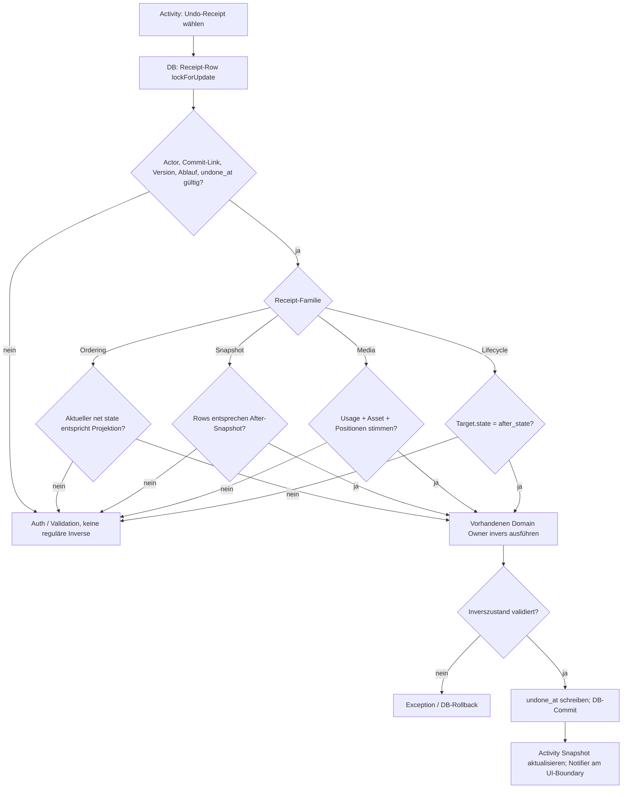

# Activity, Undo-Receipts und Ordering-Projektionen

**Quellstand:** `dev@f69e0e7e3d857e717e9ed86102b0ee830ed9ebb0` (Merge in `docs`). Dieses Dokument rekonstruiert **einzelne Admin-Undo-Aktionen und Activity-Projektionen**, nicht das Stage-Restore/-Revert einer Publication-Version. Normative Regeln: [Activity-/Publication-Vertrag](../ADMIN-ACTIVITY-PUBLICATION-CONTRACT.md), [Audit und Notification](../ADMIN-NOTIFICATION-CONTRACT.md); separate [Stage-/Commit-Flows](publication-working-operations.md). Testdateien wurden **gelesen, nicht ausgeführt**.

## Drei Speicherebenen, vier reversible Familien

**AuditEvent:** Dauerhafte fachliche Ereignisaufzeichnung mit separatem Activity-Presentation- und Notification-Context. [`AdminAuditService::record()`](../../app/Domain/Admin/AdminAuditService.php) kann nach einer echten Domainänderung eine neue Receipt erzeugen; die Notification wird **nicht automatisch** mit dem Audit übermittelt. [`AdminAuditService::recordOrdering()`](../../app/Domain/Admin/AdminAuditService.php) vergleicht erst normalisiertes Before/After; bei Identität liefert es `null`, statt ein neues Ordering-Audit zu schreiben.

**AdminActionReceipt:** Persönlicher, **zeitlich und zahlenmäßig begrenzter** Kurzzeit-Undo-Beleg, der einen unveränderlichen AuditEvent referenziert. Er enthält Action-/Inverse-Key, Version, Ablaufzeit und Status `undone_at` und optional Snapshots/Medienpositionen. Ein AuditEvent bleibt auch dann bestehen, wenn sein Receipt abgelaufen, gelöscht oder bereits verwendet wurde. [`AdminActionReceiptService`](../../app/Domain/Admin/AdminActionReceiptService.php) validiert beim Erzeugen Actor-/Event-/Entity-Übereinstimmung und begrenzt die pro User verfügbaren Receipts; `AdminSnapshotReceiptService` speichert bei geeigneten Änderungsaktionen den **atomaren** Vorher-/Nachher-Row-Snapshot. Staged Änderungen, die bereits an einen `PublicationCheckpointEvent` gebunden sind, dürfen nicht mehr durch ein individuelles Receipt rückgängig gemacht werden.

**Ordering-Projektion:** Eine eigenständige fachliche Projektion über **eine zusammenhängende Permutationsfolge im selben Scope**. [`AdminActivityOrderingProjector::record()`](../../app/Domain/Admin/AdminActivityOrderingProjector.php) kann auf die letzte Projektion nur dann aufsetzen, wenn Scope und Action übereinstimmen, der Actor derselbe ist, die vorige `after_state` der neuen `before_state` entspricht und die letzte Event-ID noch nicht Teil eines Publication-Checkpoints ist. Ein neuer Eintrag erhöht `event_count`, zeigt auf die neueste AuditEvent-ID und schreibt eine zugehörige `AdminActivityOrderingEvent`-Sequenzkante. Sobald der Nettozustand wieder der Ausgangsreihenfolge entspricht (`isIdentity()`), entsteht kein verfügbarer Ordering-Undo-Beleg. Für einen echten Nettozustand werden ältere Receipts dieser Projektionsfolge entfernt und höchstens **ein** aktuelles Receipt an den letzten AuditEvent gebunden, sofern `orderingState.current(scope)` noch der Projektion entspricht.

| Undo-Familie | Zustandsguard vor Mutation | Rücksetz-Eigentümer |
| --- | --- | --- |
| Ordering | Aktuelle Projektionsfolge nicht Identity; `last_audit_event_id` ist exakt die Receipt-Event-ID; gespeicherter Scope wird gegen tatsächliche aktuelle Permutation geprüft | [`AdminOrderingState::restore()`](../../app/Domain/Admin/AdminOrderingState.php) mit vertauschten Before/After; darauf neues Ordering-Audit und `admin.undo_applied` |
| Snapshot | Der über das Receipt gespeicherte **After**-Satz entspricht den aktuell per Row-Lock gelesenen Rows | [`AdminSnapshotReceiptService::restore()`](../../app/Domain/Admin/AdminSnapshotReceiptService.php): vom ursprünglichen Vorgang erstellte Rows löschen, gelöschte Rows wiederherstellen, aktualisierte Rows zurücksetzen, am Ende **Before** erneut prüfen |
| Artwork-Media Attach/Detach | Artwork ist noch gültiges Ziel; referenziertes Usage, MediaAsset, Position und Nachbarfolge entsprechen dem erwarteten Receipt-Zustand | [`AdminUndoService`](../../app/Domain/Admin/AdminUndoService.php) ruft die vorhandenen Artwork-Editorial-Operationen auf und prüft danach die erwartete Medienrelation |
| Artwork-/Exhibition-Lifecycle | Ziel existiert im aktuellen Editorial-Modell; persistierter Status entspricht **`after_state`** des Receipts | [`AdminLifecycleRegistry::applyInverse()`](../../app/Domain/Admin/AdminLifecycleRegistry.php) delegiert Publish/Unpublish an vorhandene Artwork-/Exhibition-Services; danach ist **`before_state`** zu prüfen |

**Alle vier** durchlaufen [`AdminUndoService::undo()`](../../app/Domain/Admin/AdminUndoService.php) unter `DB::transaction`. Die **Receipt-Row** wird per `lockForUpdate` gesperrt. Vor dem Reverse sind folgende Belege zwingend: gleiche Admin-Identität, noch **nicht** im Commit verknüpfter AuditEvent, unterstützte `receipt_version`, `undone_at IS NULL` und `expires_at` noch in der Zukunft. Fehlt einer, wird eine Auth-/ValidationException geworfen. Die Operation läuft innerhalb von `AdminUndoContext::withoutReceipts()`, damit die eigene Inverse nicht eine zweite Undo-Receipt-Kette aufbaut. Nach erfolgreicher Inverse setzt der Service `undone_at` im gleichen Transaktionskontext. Fehler oder nachgelagerte Zustands-Assertion sollen die gesamte **einzelne** DB-Transaktion abbrechen. Ob zusätzlich ausgelöste externe Nebenwirkungen rücksetzbar sind, muss je betroffener Domain-Operation geprüft werden; DB-Rollback allein ist kein genereller Dateisystem-Rollback.

## Eine einzelne Activity-Aktion vs ausgewähltes Batch

[`Activity::performUndo()`](../../app/Filament/Pages/Activity.php) ruft `AdminUndoService::undo(receiptId)` einmal auf und aktualisiert danach den Activity-Snapshot und meldet `Change undone`. Eine gefangene `ValidationException` führt zu `Undo unavailable` (Warning), nicht zu Success. **Autorisierungs- oder unerwartete technische Ausnahmen sind nicht dieselbe gefangene ValidationException.**

[`Activity::performUndoSelectedActivity()`](../../app/Filament/Pages/Activity.php) bildet dagegen die ausgewählten **Event-IDs absteigend** und bearbeitet jede mit **einem eigenen** `undo(receiptId)`-Aufruf. Ohne passendes Receipt oder bei `ValidationException` wird das Element als `skipped` gezählt. Erfolgreiche vorherige Undo-Operationen werden **nicht** durch einen späteren `skipped`-Fall des Batches zurückgerollt. Die finale UI-Meldung fasst `undone` und `skipped` zusammen; sie ist **kein Beleg einer Batch-Transaktion**. Unerwartete andere Exceptions sind in dieser Schleife nicht ausdrücklich als `skipped` behandelt.

### Warum Commit-Restore/Revert kein individuelles Undo ist

- Ein **Receipt-Undo** prüft eine konkrete frühere Arbeitsaktion und restauriert einen geeigneten, noch aktuell passenden lokalen Before-Zustand; es erzeugt **keinen neuen LIVE-Checkpoint**.
- Ein [**Restore**](publication-working-operations.md) kopiert einen restorable historischen Publication-Snapshot in Working und setzt einen speziellen Publication-Working-Context.
- Ein [**Revert**](publication-working-operations.md) kopiert den Parent des aktuellen LIVE in Working und setzt den Revert-Source; die aktuelle bekannte Pre-Lock-Lesegrenze bleibt gesondert offen.
- Erst **Commit** erzeugt bei tatsächlichem Working/LIVE-Diff einen neuen LIVE-Checkpoint und verknüpft bis dahin ungebundene Audit-Events mit der veröffentlichten Generation. Für solche Ereignisse ist individuelles Undo explizit verboten.
- Der [Storage-Reclaim](media-reference-and-cleanup.md) kann Restorability-/Receipt-Daten absichtlich freigeben, ohne die Audit-/Checkpoint-Metadaten zu löschen.

## Konkrete Negativfälle und Grenzen

| Fall | Durch Source abgesicherte Regel | Späterer isolierter Nachweis |
| --- | --- | --- |
| Gleiches Ordering-Scope kehrt zur Ausgangspermutation zurück | `recordOrdering` oder Projection kann Identity feststellen; es existiert keine legitime Netto-Undo-Receipt | Mehrere Permutationszyklen, Interleaving unterschiedlicher Actions/Actors |
| Nachfolgeraktion verändert Rows nach Snapshot-Receipt | `snapshotsMatchCurrentState(lock:true)` verweigert die Rücknahme statt veraltete Rows blind zu schreiben | Gleichzeitige Transaktion und FK-gerechter Delete/Restore |
| Commit schließt Audit-Event an Checkpoint an | `PublicationCheckpointEvent`-Link sperrt individuelles Undo | Commit und knapp vorher gestartete Undo-Session |
| Receipts unter Actor B angefordert | `admin_user_id`-Guard vor Mutationspfad | Guard-/Frontend-Sichtbarkeit und Unauthorized |
| Batch: erstes Undo gelingt, zweites scheitert wegen veraltetem Receipt | Einzelne Undo-Transaktion bleibt erfolgreich, der fehlgeschlagene Schritt wird übersprungen | Notification-Kardinalität, DB-Zustände und Feedback nach Partial Success |
| Gallery Unpublish rückgängig machen | `AdminLifecycleRegistry` nutzt für Inverse `ArtworkEditorialService::publish()`; dessen Readiness kann von ursprünglicher Gallery-Publication abweichen | ALT-Override/Video/Thumbnail-Matrix aus [Importgrenzen](import-boundaries.md) |
| Snapshot-Undo mit zusätzlichen relatierten Änderungen | Snapshot-Owner verifiziert Row-Zustände und Reihenfolge, keine pauschale Tabellenrestauration | Transaction-Rollback bei FK-/QueryException, unveränderte andere Rows |
| Receipt läuft ab oder Budget entfernt Receipt | Ein AuditEvent bleibt sichtbar, obwohl die Undo-Berechtigung verschwunden ist | Budget-/Retention-/Historienquellen unter Belastung |

**Testbelege (nur gelesen):** [`ActivityHistoryAndAtomicUndoTest.php`](../../tests/Feature/Admin/Activity/ActivityHistoryAndAtomicUndoTest.php), [`ActivitySnapshotUndoTest.php`](https://github.com/Wiiii90/moeller-lars/blob/f69e0e7e3d857e717e9ed86102b0ee830ed9ebb0/tests/Feature/Admin/Activity/ActivitySnapshotUndoTest.php), [`ActivityUndoRetentionBudgetTest.php`](../../tests/Feature/Admin/Activity/ActivityUndoRetentionBudgetTest.php) und [`AdminActivitySemanticsArchitectureTest.php`](https://github.com/Wiiii90/moeller-lars/blob/f69e0e7e3d857e717e9ed86102b0ee830ed9ebb0/tests/Architecture/Admin/AdminActivitySemanticsArchitectureTest.php) enthalten Fälle zu stabiler Historie, veraltetem Snapshot, Atomizität der *einzelnen* Rücknahme, Receipt-Retention und Deklarationen. Diese Dateien wurden **nicht ausgeführt**; Datenbank-Serialisierung, Browserdialoge, Dateisystem- und Notification-Transport sind separat offen.
