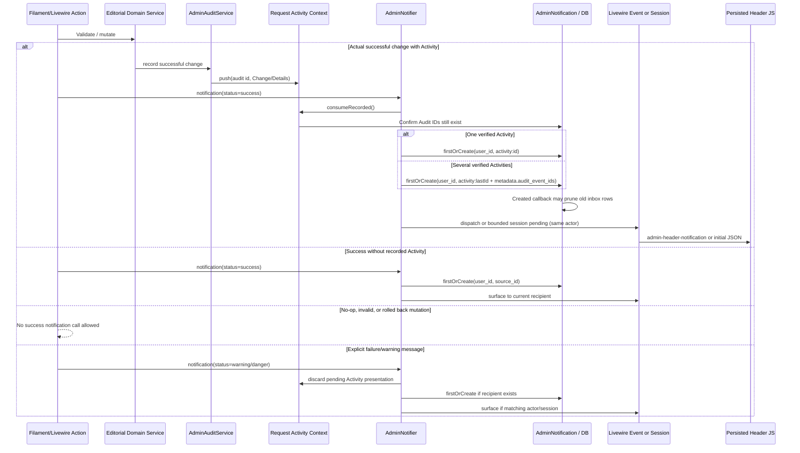

# Admin-Notifications: Transport, Grenzen und Negativpfade

**Quellstand:** Notification-/Audit- und Testquellen erneut gelesen auf **`dev@fbc93f71cecc2eacde63466b9988bc9296ec4645`** nach der Integration des früheren `testing`-Branches. Alle Befunde sind **statische Code-/Assertion-Prüfung**, keine ausgeführten Livewire-/DB-/Browser-Tests. Die normative Produktregel bleibt ausschließlich im [Notification-Vertrag](../ADMIN-NOTIFICATION-CONTRACT.md); dieser Architekturbeleg beschreibt ihren Quellpfad und bekannte Grenzen.

## Eingänge und Speichergrenzen

| Ebene | Verantwortlicher Quellcode | Zustand / Bedeutung |
| --- | --- | --- |
| Editorial Mutation | konkrete Filament Action oder Livewire Callback | Muss den erfolgreichen **tatsächlichen** Domain-Change erkennen und explizit `AdminNotifier::notification()` rufen; die Domain-Speicherung oder ein Audit-Event genügt nicht |
| Audit/Presentation | [`AdminAuditService::record()`](../../app/Domain/Admin/AdminAuditService.php), [`AdminActivityNotificationContext`](../../app/Domain/Admin/AdminActivityNotificationContext.php) | Audit bleibt append-only; die request-lokale Presentation wird nach validem Audit-ID gesammelt, maximal neun Einträge, pro ID ersetzt |
| Notification / Persistence | [`AdminNotifier`](../../app/Domain/Admin/AdminNotifier.php) | `success` konsumiert validierte Audit-Presentations: ein Event behält seine kanonische Darstellung, mehrere werden **zu einer** Notification mit `metadata.audit_event_ids` zusammengefasst; ein Aufruf führt zu einem `recordAndSurface()` |
| Dauerhafte Inbox | [`AdminNotification`](../../app/Models/AdminNotification.php) | `firstOrCreate` nach `(user_id, source_id)`, Metadaten und Read-State; Created-Callback ruft Retention; kein SMTP-/E-Mail-Versand in diesem Pfad |
| Live-Transport | `AdminNotifier::surfaceNotification()` | Nur wenn aktueller authentifizierter Browser-Akteur der Empfänger ist: Livewire-Component-Event `admin-header-notification`, sonst bei Sessionverfügbarkeit begrenzte Pending-Liste |
| Browser-Presentation | [Admin-Panel `BODY_END`-Hook](../../app/Providers/Filament/AdminPanelProvider.php), [persistiertes Header-Partial](../../resources/views/filament/partials/admin-header-notification.blade.php), [`admin-notifications.js`](../../resources/js/admin-notifications.js) | UI-Queue mit max. acht wartenden IDs, Seen-Liste max. 48, Countdown und Dismiss. Kein zusätzlicher Inbox-Write, keine Löschung durch Header-Dismiss |
| Mailbox-Lesen | [`DashboardFeed`](../../app/Domain/Admin/DashboardFeed.php), [`DashboardFeedPins`](../../app/Domain/Admin/DashboardFeedPins.php), [`DashboardNotificationRetention`](../../app/Domain/Admin/DashboardNotificationRetention.php) | Filter nach `user_id`; Pin, Read/Unread, Delete und Retention sind Inbox-Operationen ohne neue Notification |

## Code-owned Changelog/Announcement ist **keine** AdminNotification

**Quellprüfung `dev@20ecbc6e`, keine ausgeführte Dashboard-/Livewire-/Pest-Prüfung.** Die seit v0.1–v0.3 eingetragenen [Release-Notizen](../../CHANGELOG.md) haben **einen anderen Speicher- und Veröffentlichungsowner** als das persistente Notification-Postfach: [`config/dashboard-feed.php`](../../config/dashboard-feed.php) definiert stabile `static:`-Schlüssel und `body_file`-Pfade; [`DashboardFeed::staticItems()`](../../app/Domain/Admin/DashboardFeed.php) akzeptiert dafür nur `versions/vX.Y.Z.md` oder `announcements/[a-z0-9-]+.md` unter `resources/release-notes`, lehnt fehlende/unlesbare Dateien und Bodies über 64 KiB ab und projiziert sie im gemeinsamen paginierten Feed. Diese statischen Meldungen erzeugen **keine** neue `AdminNotification`-, `AuditEvent`- oder `ContactMessage`-Row; `DashboardFeedPins` kann deren stabile Schlüssel dennoch unabhängig in der Benutzer-Pin-Reihenfolge halten.

[`dashboard-feed-dialog.blade.php`](../../resources/views/filament/pages/partials/dashboard-feed-dialog.blade.php) zeigt nur diese Typen als Markdown über den zentralen [`SafeRichTextRenderer`](../../app/Domain/Content/SafeRichTextRenderer.php), mit `assertValid(..., allowEmbeddedMedia: false)`. Kontakt-/Notification-Bodies bleiben stattdessen escaped Plain Text. [`Dashboard::openRelatedFeedEntry()`](../../app/Filament/Pages/Dashboard.php) darf nur auf ein vorhandenes Changelog-Ziel wechseln; der Announcement-Link nutzt `replaceMountedAction` statt einen zweiten Dialog-Owner. Das Anwender-Label **Changelog** oder **Announcement** impliziert keine Production-Auslieferung: Die historischen v0.1–v0.3-Daten sind Milestone-Abschlussdaten, keine belegten Release-Tags. Die **fachliche Kommunikationspflicht** liegt ausschließlich beim [Release-Vertrag](../RELEASE.md#release-notes-and-dashboard-announcements).

**Nachweise offen:** Manifest-Pfad-Whitelist, Fehler fehlender/zu großer Datei, kein Markdown-Embedded-Media, sanitized interne/externe Links, stabiler Pin/Unpin-Schlüssel, Announcement→Changelog-Aktion und Scroll-/Focus-Lifecycle im realen Dialog. Die [Dashboard-Featuretests](../../tests/Feature/Admin/Dashboard/DashboardFeedTest.php) prüfen im Quelltext Dateien/Manifest/Renderer/Links, wurden hier aber nicht ausgeführt. Ob die historischen Textinhalte die tatsächlich freigegebene v0.4-Release-Kommunikation zutreffend beschreiben, erfordert redaktionelle Prüfung.

## Nachvollziehbare Sequenz

## Fallunterscheidung und tatsächlich verbleibende Risiken

- **Datenbankspeicherung vs. Erfolgsmeldung:** Weder `AdminAuditService::record()` noch `AdminNotification::firstOrCreate()` beweisen, dass eine konkrete UI-Action bei No-op/Fehlschlag korrekt unterdrückt. Der Change-Guard liegt **beim Aufrufer**. Es gibt im Notifier selbst keinen generischen Changed-Result-Check.
- **Erfolg mit mehreren Audit-Ereignissen:** `AdminActivityNotificationContext::push()` dedupliziert gleiche Audit-IDs und hält höchstens neun Präsentationen. `consumeRecorded()` filtert auf vorhandene Audit-IDs und nichtleere Change-Texte. Ein einzelner Success-Aufruf erzeugt **eine** Action-Notification auch bei mehreren passenden Audits; deren IDs stehen in `metadata.audit_event_ids`. Mehrere getrennte Success-Aufrufe bleiben eigenständige Aktionen.
- **Idempotenz ist nur auf die Mailbox beschränkt:** `firstOrCreate()` kann einen vorhandenen Datensatz zurückgeben; der danach gebildete Header-Payload besitzt **jedes Mal eine neue UUID**. Die JS-Seen-Liste unterdrückt Wiederholung **derselben Payload-UUID**, nicht eine Wiederholung von `source_id`. Mehrfache Header-Anzeige bei wiederholtem stabilen Source ist ein quellenbelegter, **nicht runtimegetesteter** Risikofall.
- **Empfänger-/Session-Grenze:** Explizit anderer User erhält keinen unmittelbaren Header im aktuellen Browser. Ohne gültigen Adminempfänger ist keine dauerhafte Inbox möglich; ohne Session und außerhalb des Livewire-Components gibt es auch keine Pending-Header-Übergabe. Eine Benachrichtigung kann damit einen validen API-Aufruf darstellen, ohne sichtbar zugestellt zu werden.
- **Retention-Grenzfall:** `AdminNotification::created()` startet `pruneFor()`. Bei bereits `limit` gepinnten Notifications ergibt sich `keepUnpinned = 0`; damit kann selbst die gerade gespeicherte ungepinnte Nachricht sofort wieder aus der Inbox entfernt werden. Das ist eine statisch ableitbare Bedingung, noch kein beobachteter Produktfehler. Die Response-/Header-Nachricht kann in diesem Fall eine bereits entfernte `notification_id` enthalten. Dies benötigt einen gezielten Fixture-/Runtime-Test im **einzigen aktuellen `dev`-Testsystem**, keine ungetestete Korrektur auf `docs`.
- **Browser-Dismiss vs. Mailbox:** Header-Dismiss beendet nur den sichtbaren Präsentations-Lebenszyklus, während Read/Unread/Delete über den `DashboardFeed` auf einen nach `user_id` eingeschränkten Record gehen. Header-`@persist` und bounded `sessionStorage` der Navigation sind unterschiedliche Zustände; die Notification-Queue ist ausschließlich JS-intern.
- **E-Mail ist ein getrenntes Produkt:** Der Admin-Notification-Pfad enthält keinen Mail-Transport. Website-Contact versendet über die Contact-/Mailer-Pipeline und projiziert Kontaktnachrichten gegebenenfalls in den DashboardFeed. Das ist **nicht** die semantische Zustellung von `AdminNotifier`.

## Vereinheitlichter dev-Owner: ein Action-Erfolg, mehrere Audit-Referenzen

Aktueller [`AdminNotifier::notification()`](../../app/Domain/Admin/AdminNotifier.php) auf `dev@fbc93f71`: Bei `count=1` bewahrt er den Activity-Text; bei `count>1` erzeugt er **eine** Action-Notification mit dem letzten `audit_event_id` und `metadata.audit_event_ids` aller bestätigten Events. Die [authored Feature-Assertion](https://github.com/Wiiii90/moeller-lars/blob/fbc93f71cecc2eacde63466b9988bc9296ec4645/tests/Feature/Admin/Notifications/AdminNotificationTest.php) erwartet nach zwei General-Settings-Updates der [Livewire-Probe](https://github.com/Wiiii90/moeller-lars/blob/fbc93f71cecc2eacde63466b9988bc9296ec4645/tests/Feature/Admin/Notifications/AdminHeaderNotificationProbe.php) eine Notification mit beiden IDs. **Nicht ausgeführt.** Es existieren nicht zwei aktive Test-/Notifier-Systeme.

**Getrennte Transaktionen:** Die zwei `AdminSettingsService::updatePublicContent()`-Aufrufe der Probe sind jeweils eigenständige Domaintransaktionen. Ein Aggregat-Feedback ist keine atomare Gruppenmutation. `firstOrCreate()` dedupliziert nur die Mailbox-Zeile; die aktuelle Implementierung ruft `surfaceNotification()` auch bei Wiederholung derselben `source_id` auf und vergibt jedes Mal eine neue Präsentations-UUID. Das beweist kein exactly-once Header-Delivery.

## Noch auszuführende Nachweise (nicht CI)

Auf einer ausdrücklich isolierten Testdatenbank und einer echten Filament-/Livewire-Instanz: je eine Erfolgsmutation mit einem und mit mehreren Audit-Kontexten; No-op und Validation-Fehler; zurückgerollte Mutation; Wiederholung mit gleicher `source_id` und doppeltem Header-Versuch; fremder User und fehlende Session; vollständiger Retention-Pin-Grenzfall; Livewire-Navigation mit Header-Queue; Dismiss und getrennte Read-/Delete-Änderung. Erwartete Message-Anzahlen werden aus den tatsächlich erzeugten Events abgeleitet, nicht aus der bloßen Anzahl der `notification()`-Aufrufe.

**Abdeckungsgrenze:** Keine Behauptung über tatsächliche Event-Zustellung, Livewire-Queue, Browser-Ankerposition, PostgreSQL-Constraints oder ausgelieferte E-Mails allein aus diesen Quellen.
