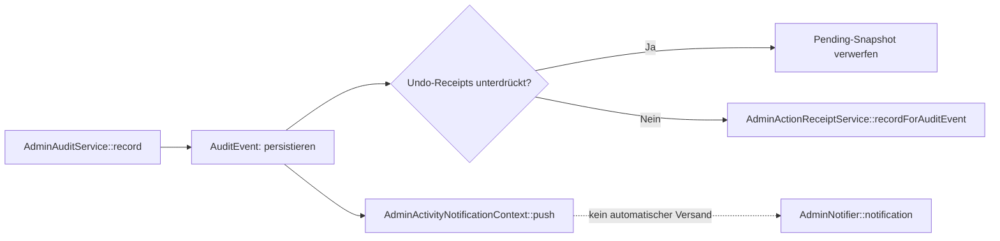

# Admin, Undo und Publication: belegte Methodenaufrufe

**Stand:** Quellcode von `dev` bei `a71ec7d1b28d09cec1399998239b09bdaefdea11`; auf `docs` geholt. Der [maschinenlesbare Katalog](admin-publication-calls.json) enthält **21 explizite Aufrufstellen** zwischen **14 projektseitigen Klassen** in **fünf quellgeprüften Implementierungen**, mit Pfad und Zeilennummer. Der [Mermaid-Gesamtgraph](generated/admin-publication-calls.mmd) wird aus dem Katalog erzeugt. Das ist **ein wichtiger Querschnitt, noch nicht alle Aufrufbeziehungen** des Systems.

## Unterschied: tatsächlicher Aufruf gegen bloße Abhängigkeit

Ein `__construct(AdminAuditService $audit)` belegt eine getypte strukturelle Abhängigkeit. Eine belegte Zeile `$this->audit->record(...)` zeigt dagegen eine konkrete **Aufrufstelle**. Beides darf nicht zu einem untypisierten „uses“-Pfeil zusammengeschmolzen werden. Der Graph enthält hier nur Letzteres. Die Quellzeilen sind an genau diesen Git-Stand gebunden; nach `dev`-Merges muss neu geprüft werden.

### Audit → Activity und Undo-Receipt



[`AdminAuditService.php`](../../app/Domain/Admin/AdminAuditService.php) prüft zuerst autorisierten Actor, registrierten Action/Entity-Typ und zulässige Audit-Metadaten. Es erzeugt den append-only Audit-Event; die Receipt-Erfassung ist von `AdminUndoContext` abhängig. Ordering geht zusätzlich durch `AdminActivityOrderingProjector` und besitzt eine eigene Undo-Projektionsroute.

[`AdminNotifier.php`](../../app/Domain/Admin/AdminNotifier.php) ist kein Automatismus, der jedes Eloquent-Update begleitet. Ein expliziter Erfolgsaufruf konsumiert aufgezeichnete Activity-Nachrichten und kann **mehrere** `recordAndSurface`-Aufrufe auslösen; andere Statusmeldungen verwerfen diesen Activity-Puffer. Auf Empfängerseite gibt es persistierte `AdminNotification`-Einträge und Livewire-Dispatch (`admin-header-notification`) beziehungsweise sessiongebundene Pending-Nachrichten. Die Menge der gespeicherten Einträge hängt außerdem von Empfänger und `firstOrCreate`-Deduplication ab. **Nicht** pauschal 1 Mutation = 1 Notification.

### Undo besitzt mehrere Inversen

[`AdminUndoService::undo()`](../../app/Domain/Admin/AdminUndoService.php) lädt einen Receipt innerhalb der Transaktion mit Row-Lock, prüft Actor, Version, Ablauf, bereits erledigte Inverse und die **Commit-Grenze**: An einen PublicationCheckpoint gebundene Audit-Events dürfen nicht mehr einzeln rückgängig gemacht werden.

Anschließend werden unterschiedliche Pfade unterschieden:

| Receipt-Familie | Tatsächlicher Rückweg | Notwendiger Guard |
| --- | --- | --- |
| Ordering | `AdminOrderingState::restore` und `AdminAuditService::recordOrdering` | Ordering-Projektion muss aktuelle Nichtidentität und letzten Event repräsentieren |
| Snapshot | `AdminSnapshotReceiptService::restore` | Snapshot muss weiterhin verfügbar/restituierbar sein |
| Artwork-Medienaktion | spezifische Media-Inverse | erwartete Referenz- und Medienvorbedingungen |
| Einfache Entity-State-Mutation | `AdminLifecycleRegistry::applyInverse` | aktueller State muss Receipt-`after_state` entsprechen; restaurierter Wert muss `before_state` sein |

Die eigentliche Inverse läuft innerhalb `AdminUndoContext::withoutReceipts`, damit Undo nicht unkontrolliert neue Undo-Receipts erzeugt. Erst bei erfolgreicher Rückabwicklung wird `undone_at` gesetzt. Ein ungültiger Receipt oder eine konkurrierende spätere Änderung bricht transaktional ab.

### Publication trennt Stage und Commit

[`PublicationVersionService`](../../app/Domain/Publication/PublicationVersionService.php) stellt die Methoden `stageVersion`, `resetStagedChanges` und `stageRevertOfCurrent` bereit. Die Operationen arbeiten auf **Working**, nicht direkt auf LIVE. Sie benutzen den gemeinsamen Advisory Lock, prüfen den Publication-Schema-Stand, merken aufzugebende Medien vor und melden fachliche Activity.

[`PublicationService::commit()`](../../app/Domain/Publication/PublicationService.php) übernimmt geänderte Working-Daten in die 15 getrackten LIVE-Tabellen und ruft `PublicationVersionService::capture` auf, **nur bei realem Diff**. Checkpoint-gebundene Audit-Events entwerten individuelle Undo-Receipts. `PublicationMediaCleanupService::drain` läuft außerhalb der erfolgreichen Commit-Transaktion.

Ein vergangener Commit ist also nicht automatisch „rückgängig“ im selben Sinn wie ein einzelnes Edit-Undo: ein **Restore/Revert staged eine neue Working-Version**, die ihrerseits bewusst veröffentlicht werden muss. Siehe auch [Publication-Lebenszyklus](publication.md) und [Schemahistorie](schema-evolution.md).

## Regenerierung und Prüfung

```sh
php scripts/generate-architecture-call-graph.php --write
php scripts/generate-architecture-call-graph.php --check
```

Das Skript überprüft die **genauen Quellzeilen und Anker** jeder aufgeführten Call-Site und erzeugt die Mermaid-Quelle deterministisch. Es bootet weder Laravel noch Datenbank. Der Generator wurde separat mit einem kleinen PHP-Quellfixture einschließlich eines negativen Stale-Anker-Falles tatsächlich geprüft. Am 19.10.2026 besteht der native `--check` mit PHP 8.3.33 auf `docs@8c9bd0a0`: 14 Nodes, 21 Call-Sites, fünf Quelldateien. Manifest und Diagramm blieben unverändert; der historische Manifest-SHA bleibt erhalten. Ein Anker auf einer korrekten Zeile ist **kein Beweis**, dass der Call bei jedem Lauf ausgeführt wird, und keine vollständige Trace-Analyse.

**Nächste Abdeckung:** Alle weiteren Domain-Module und Filament-Actions, statische und dynamische Container-Bindings, Events/Listeners, Jobs und Middleware-Einstiegspunkte. Für jede Kante Caller, Callee, Relationstyp, Quelle und Unsicherheit erfassen. Keine zusätzlichen dekorativen Diagramme ohne belegte Semantik.
