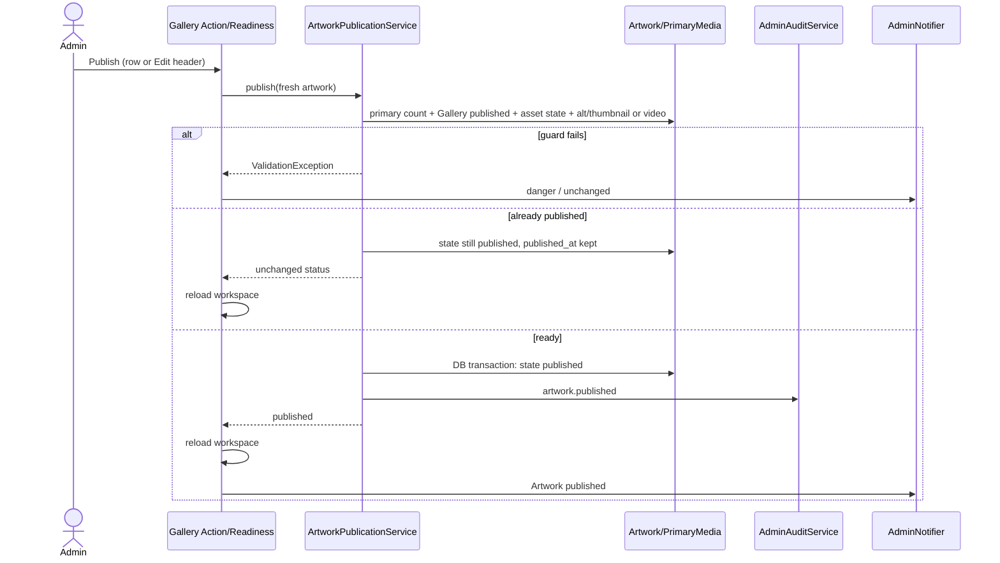

# Gallery / Artwork: Veröffentlichung, öffentliche Eligibility und Undo-Inverse

**Quellstand:** `dev@470f2daa900f2d68db9c7e5fe2b227db20e44bc7` (bereits in `docs`). Diese Architekturanalyse ist **deskriptiv**; die normative Artist-Gallery-/Viewer-Regel steht im [Public-Vertrag](../PUBLIC-IMPLEMENTATION-CONTRACT.md), Admin-Dialogaktion im [Dialog-Vertrag](../ADMIN-DIALOG-CONTRACT.md). Die genaue alternative Publish-Guard-Fallmatrix besitzt [`import-boundaries.md`](import-boundaries.md) und wird hier **nicht** dupliziert. Keine hier ausgeführten PHP-/DB-/Browser-/Viewer-Tests.

## 1. Admin-Einstieg → Readiness → Domain-Mutation

[`GalleryWorkspaceReadinessSupport::isReadyToPublish()`](../../app/Filament/Pages/Concerns/GalleryWorkspaceReadinessSupport.php) prüft vor der UI-Darstellung: sichtbarer Artwork-`title` und `slug`, genau **ein** primäres ArtworkMedia, existierendes MediaAsset, [`ArtworkPublicationService::mediaReady()`](../../app/Domain/Artwork/ArtworkPublicationService.php) und **published Gallery SiteSection**. Die abgeleitete Readiness-Zeile wählt eigene Erklärlabels (z. B. »Primary media ambiguous«, »ALT text required«, »Gallery must be published«). Diese UI-Heuristik ist **keine alleinige Publikationsautorisierung**.

Einzelaktionen laufen über [`GalleryWorkspaceArtworkActions::publishArtworkInGallery()`](../../app/Filament/Pages/Concerns/GalleryWorkspaceArtworkActions.php), das sich sowohl von der Tabellenzeile als auch aus dem Edit-Header nutzen lässt. Es liest das Artwork neu, ruft den **gleichen** `ArtworkPublicationService::publish()` auf und sendet bei `ValidationException` eine Gefahr-/Fehlernotification, ohne Erfolg zu melden. Nach Domain-Erfolg lädt es die Workspace-Projektion neu; ein `Artwork published`-Erfolg erfolgt nur beim **Statuswechsel**, nicht beim No-op. `unpublishArtworkAction()` nutzt `ArtworkPublicationService::unpublish()` nach Bestätigung und ebenfalls Changed-Guard für den Erfolg.

Die Domain-Publish-Methode lädt Artwork, Category/SiteSection, Primärrelation und MediaAsset inkl. Variants erneut. Sie verlangt publizierte Gallery-SiteSection, genau **eine** Primary-Usage, verfügbares MediaAsset und gültigen Medienguard. `mediaReady()` akzeptiert nichtleeren **Asset-ALT oder primäres `alt_text_override`**; zulässiges Video benötigt keinen Image-Thumbnail; unterstütztes Image verlangt **genau eine verfügbare** Thumbnail-Variante mit dem aktuellen Transformprofil. Anschließend speichert sie innerhalb einer `DB::transaction` `state=published` und setzt `published_at` nur, wenn vorher null; ein `artwork.published`-Audit entsteht **nur bei vorher nicht Published**. Die Readiness wird **vor** dieser Transaktion aus zuvor geladenen Relations gelesen; eine ausdrückliche `lockForUpdate()`-Kette über Artwork/Media/Category ist hier nicht vorhanden. Eine vollständig serialisierte Publish-vs-Media-Delete-/Gallery-Status-Interleaving-Garantie darf daher aus der bloßen Transaktion **nicht** behauptet werden.

[`GalleryWorkspaceBatchActions::publishSelectedArtworksAction()`](../../app/Filament/Pages/Concerns/GalleryWorkspaceBatchActions.php) kapselt die komplette ausgewählte Artwork-Iteration **in einer äußeren `DB::transaction`**. Jeder Publish hat seine eigene innere Transaction, die in Laravel auf derselben Verbindung als verschachtelter Savepoint/Transaktionsstand wirkt. Eine `ValidationException` an einer Position verlässt die äußere Transaction und unterbricht die Auswahl; vorherige DB-Schritte werden zurückgerollt. Es ist **kein** per-Element-success/skip-Verfahren. Ein erfolgreiches Batch notifiziert einmal zusammengefasst bei `changed > 0`. Unpublish Selected folgt demselben äußeren Transaktions-Ansatz. Das unterscheidet sich ausdrücklich vom [Activity Selection Undo](activity-undo-lifecycle.md#eine-einzelne-activity-aktion-vs-ausgewähltes-batch), das einzelne Undo-Transaktionen nacheinander ausführt und ValidationFailures teilweise überspringt.

## 2. Öffentlicher Lesepfad: kein blindes `state=published`

[`PublicArtworkQuery::publicQuery()`](../../app/Domain/Artwork/PublicArtworkQuery.php) ist der gemeinsame öffentliche/Preview-Karten- und Detail-Query. Er verlangt in beiden Kontexten genau **eine** Primärrelation sowie ein verfügbares Image/Video mit geeigneter ALT-Quelle; bei Bild muss exakt **eine** passende verfügbare Thumbnail-Variante existieren. Ein unvollständiger Draft bleibt im Admin bearbeitbar, ist aber **auch in Preview** nicht zwingend als öffentliches Artwork renderbar.

- In **normalem Public** filtert der Query `Artwork.state=published` und für die Gallery-Ansicht die `category.siteSection.state=published`; GET/HEAD liest über [`UseCommittedPublicState`](../../app/Http/Middleware/UseCommittedPublicState.php) den LIVE-Kontext. Die Reihenfolge der Gallery bleibt `position`, bei doppelten sichtbaren Positionen wirft `PublicArtworkQuery::category()` einen LogicException-Invariantfehler statt heimlich eine willkürliche Reihenfolge zu wählen.
- In **Admin-Preview** darf der Query neben Published auch nicht archivierte Drafts anzeigen, **wenn** sie die Medien-Renderbedingungen erfüllen. `ProtectArtistPreview` authentisiert vorab, und der SiteSection-Read schließt die allgemeine Publication-Filterung aus, nicht die Medienqualitäts-Guards. Preview liefert Medien über die authentisierten Preview-/AdminMedia-Routen.
- [`PublicArtworkController::show()`](../../app/Http/Controllers/PublicArtworkController.php) lädt per `publishedBySlug()`, prüft anschließend vorhandene passende Gallery-SiteSection und übergibt `viewerArtworks = PublicArtworkQuery::category(category.slug)` an [`pages/artworks/show.blade.php`](../../resources/views/pages/artworks/show.blade.php). Viewer-Reihenfolge und Details basieren dadurch auf demselben Query mit den gleichen allgemeinen Eligibility-Guards; dies beweist noch **keine** Browser-Einhaltung aller Keyboard-/Zoom-/Prefetch-Verträge.
- [`PublicMedia::isPublicAsset()`](../../app/Domain/Media/PublicMedia.php) entscheidet davon getrennt, ob ein MediaAsset über aktuelle **öffentlich berechtigte** Inhalte ausgeliefert werden darf. Für primäre ArtworkMedia verlangt es einen veröffentlichten Artwork-Status und eine veröffentlichte Gallery-SiteSection; für Varianten zusätzlich `MediaVariant.state=available`. Der Controller prüft außerdem Existenz/Lesbarkeit der Datei und liefert sie mit Cache-/ETag-/X-Sendfile-Headern aus. **Eine Preview-URL oder bloß persistierte ArtworkMedia-Referenz erteilt keine globale Media-Public-Freigabe.**

## 3. Unpublish → Audit-/Receipt-Undo → abweichender Publish-Owner

Reguläres Gallery-Unpublish nutzt `ArtworkPublicationService::unpublish()`, setzt `state=draft` und schreibt `artwork.unpublished` nur nach einem echten Statuswechsel. Ein verfügbarer [`AdminActionReceipt`](../../app/Models/AdminActionReceipt.php) für diesen AuditEvent kann vor Commit, Ablauf oder anderweitiger Target-Änderung individuell rückgängig gemacht werden. [`AdminUndoService::undo()`](../../app/Domain/Admin/AdminUndoService.php) sperrt Receipt und gegebenenfalls Artwork, prüft Eigentümer, Event-Commit-Link, Ablauf und `after_state` und delegiert die Inverse `artwork.published` über [`AdminLifecycleRegistry::applyInverse()`](../../app/Domain/Admin/AdminLifecycleRegistry.php) an **`ArtworkEditorialService::publish()`** – **nicht** an `ArtworkPublicationService`.

Diese zweite Publish-Methode verlangt ebenfalls Published Gallery, genau eine Primary-Usage und verfügbares MediaAsset, prüft aber **nichtleeren `MediaAsset.alt_text` selbst** sowie **genau eine passende verfügbare Thumbnail-Variante unabhängig von Video/ALT-Override**. Für zulässiges Video ohne Thumbnail oder Artwork mit nur ALT-Override kann deshalb der reguläre Gallery-Publish erfolgreich sein, während die spätere Rücknahme einer Unpublication am engeren Guard scheitert. Die bereits belegte [MIME-/ALT-Negativmatrix](import-boundaries.md#negativfallmatrix-für-eine-kanonische-publish-readiness) bleibt die zentrale Quelle für alle konkreten Permutationen.

**Auf Erfolg:** Die Domain-Inverse setzt die erwartete `before_state`, `AdminUndoService` verifiziert den Zustand, markiert das Receipt als `undone_at` und zeichnet die inversen Audits ohne neue Undo-Receipt-Kette auf. **Auf Guard-Fehler:** `ValidationException` bricht die einzelne Undo-DB-Transaktion ab; es darf weder `undone_at` noch eine erfolgreiche Publikation behauptet werden. UI-Notification und ein realer Datenbank-/Browser-Nachweis des Video-/ALT-Falls sind weiterhin ausdrücklich offen.

## 4. Quell-/Runtime-Negativfälle und angestrebter Owner

| Fall | Source-Erwartung | Noch auszuführende Verifikation |
| --- | --- | --- |
| Publish einer nicht Published Gallery-SiteSection | Domain-ValidationException; keine neue Publication-Mutation | Admin-Fehler-Notification; kein Audit/Receipt |
| Video mit erlaubtem ALT-Override, ohne Thumbnail | `ArtworkPublicationService` kann Publish erlauben; Undo-Inverse kann an `ArtworkEditorialService` scheitern | Integrierter Media-/Undo-/Receipt-Test |
| Image mit ALT nur im Primary Override, gültigem Thumbnail | Gallery-Publish bereit, alternative Domain-Publish-Methode nicht | Einheitliche Readiness nach künftigem Dev-Fix |
| Bereits publiziertes Artwork erneut publish | Kein neuer `artwork.published`-Audit und kein UI-Success bei unverändertem Status | Aktuelle Zielversion und Notification-Counts |
| Eine ungültige Media-Row mitten im Gallery-Batch | Äußere Transaction verwirft DB-Mutationen der gesamten Auswahl | Mehrere DB-Sessions, Audits und Inbox-Counts |
| Unvollständiger Draft unter Preview | Kann wegen Primary-/ALT-/Thumbnail-Readmodel auch in Preview nicht gerendert werden | Preview-Status, Gallery-Karten/Details, Medienzugriff |
| Zwei sichtbare Artwork-Positionen gleich | `PublicArtworkQuery::category()` wirft Invariantfehler | Datenmigration/Restore/Browser-Ausgabe prüfen |
| Publish parallel zu Media-Löschung/Gallery-Hide | Guard-Relationen vor eigentlicher Domain-Transaction, keine umfassende `lockForUpdate`-Recheck-Kette nachgewiesen | Isolierte Concurrent-Session-Tests; nicht als bestätigter Race-Verlust deklarieren |

**Quellen der vorhandenen Tests, nicht ausgeführt:** [`ArtworkPublicationTest.php`](../../tests/Integration/Artwork/ArtworkPublicationTest.php), [`GalleryWorkspaceTest.php`](../../tests/Feature/Admin/Gallery/GalleryWorkspaceTest.php), [`AdminGalleryMediaLifecycleArchitectureTest.php`](../../tests/Architecture/Admin/AdminGalleryMediaLifecycleArchitectureTest.php). Die Nutzerabnahme des vollen Artwork Viewers ist ein davon getrennter Public-Browservertrag.

Der fachliche zukünftige Root-Fix gehört zu **einer** gemeinsamen Domain-Publish-Readiness (kein drittes UI-Flag und keine zweite Undo-Heuristik). Dieser Architekturzweig ändert weder Publish-Code noch dessen Tests, setzt kein CI in Gang und markiert diesen Quellenbefund nicht als bereits produktiv reproduzierten Fehler.

## Gallery-/Artwork-Vertrag am Quellstand dev@434975e1bd09

`GalleryPresentation` ist der gemeinsame Source-Owner für Gallery-Sortierung (Manual oder jüngstes Werksdatum), Endnavigation (Disabled/Hidden/Cyclic), Artwork-Divider (None und `DividerVariant`), Caption-Sichtbarkeit und -Seitenwechsel sowie die Erlaubnis des Video-Tons. `GalleryEditorialService`/der Gallery-Workspace speichern diese Entscheidungen im Working-Zustand, die zugehörigen Migrationen ergänzen `artwork_categories` und `committed.artwork_categories`. Der Public-Reader verwendet dieselbe Sortierung; ein manueller Move bei aktivem Datumssortiermodus ist kein zulässiger alternativer Sortierpfad.

`ArtworkDraftService` löscht einen noch unveröffentlichten Artwork-Entwurf transaktional mit seinen Zuordnungen und Audit. Optionale Medienlöschung ist separat durch Referenzschutz und die dauerhafte Cleanup-Outbox begrenzt; `ArtworkPrimaryMediaService::detachPrimary()` trennt das primäre Medium eines unveröffentlichten Entwurfs nachvollziehbar, löscht damit aber keine Storage-Bytes. Die konkrete Public-Caption bleibt `artwork-caption.blade.php` (Titel/Material, darunter Jahr/Maße); eine Gallery kann zusätzliche Datei-Credits und effektive Copyright-Hinweise unabhängig zuschalten. Das ist Quellbeobachtung, keine Künstler-/Browserabnahme.

