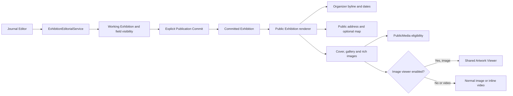
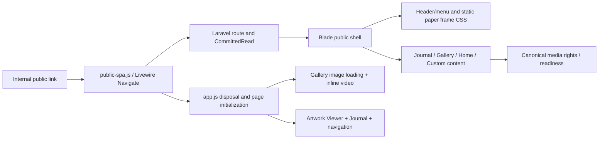

# Cross-feature compositions and ownership boundaries

**Source basis:** selected PHP, Blade and JavaScript owners inspected at `dev@b289a9102a3b91c15ad2e182372d074fb64ce239` reviewed through 25 October 2026. These are **logical end-to-end compositions**, not a runtime-call profiler or proof of an executed browser/database transaction. Normative requirements stay in the linked owner contracts. The 20 older import/class diagrams are intentionally a versioned **structural inventory**, not the primary explanation of how the website works.

## 1. Artist edit -> Working -> Publication -> Public

```mermaid
sequenceDiagram
    actor Artist
    participant UI as Filament Edit / AdminRichText
    participant Storage as MediaAssetSelect
    participant Domain as Editorial service
    participant Audit as Audit + AdminNotifier
    participant Work as Working content
    participant Pub as PublicationService
    participant Live as committed schema
    participant Web as Public Blade + safe renderer
    participant Media as PublicMedia

    Artist->>UI: Edit a Journal / Home / Custom Page
    opt Reuse a Storage image
        UI->>Storage: select existing available MediaAsset
        Storage-->>UI: canonical media ID + preview
    end
    UI->>Domain: submit semantic edit/change
    Domain->>Domain: validate; transaction; relevant row lock
    alt No-op or rejected input
        Domain-->>UI: no success mutation
    else Changed editorial state
        Domain->>Work: persist canonical record or rich text
        Domain->>Audit: record audit + optional Undo context
        Domain-->>UI: changed
        UI->>Audit: one logical successful-action message
    end
    Artist->>Pub: explicitly Commit pending changes
    Pub->>Pub: lock; readiness; compare and version
    Pub->>Live: update committed projection atomically
    Web->>Live: authorized published GET or HEAD
    Web->>Web: SafeRichTextRenderer / Blade
    opt Embedded eligible Storage image
        Web->>Media: resolve allowed variant / original
        Media-->>Web: authorized immutable media URL
    end
```

**Do not merge these boundaries:** inserting an image never uploads or deletes a second file; an Edit save never equals Publication Commit; Audit is not a browser toast; an authored Test is not a runtime check. A current Media reference is not automatically eligible for public delivery. Correctness depends on accepted product/working state, source eligibility and actual preview/commit context. The transaction and notification calls in the diagram are conceptual; inspect the **concrete** current owner's callback before claiming precise call order or a same-transaction guarantee.

Normative owners: [Editorial Rich Text](../EDITORIAL-RICH-TEXT.md), [Admin dialog](../ADMIN-DIALOG-CONTRACT.md), [Media](../MEDIA.md), [Publication/Activity](../ADMIN-ACTIVITY-PUBLICATION-CONTRACT.md), [Notification](../ADMIN-NOTIFICATION-CONTRACT.md), [Public](../PUBLIC-IMPLEMENTATION-CONTRACT.md). Detailed historical traces: [Editorial mutations](editorial-mutation-paths.md), [Publication](publication.md), [Media references](media-reference-and-cleanup.md).

## 2. Exhibition/Journal composition and editorial visibility



The Exhibition has **three distinct identities**: Organizer attribution, physical Venue and geocoded address. Each opted-out field remains in editable Working data. Hiding a textual address does not automatically disable the OpenStreetMap dialog; public map exposure must be reviewed separately. Opening/vernissage display is controlled by both an editorial flag and date, whereas Exhibition chronology uses start/end dates. The locale of the authenticated editor is **not** the public regional format and never translates saved artist text.

Owners: [Exhibition Editorial](../EXHIBITION-EDITORIAL-CONTRACT.md), [Journal read/preview](journal-content-lifecycle.md), [Admin localization](../ADMIN-LOCALIZATION-CONTRACT.md), [Public](../PUBLIC-IMPLEMENTATION-CONTRACT.md), [Public rights](../PUBLIC-RIGHTS-AND-PRIVACY.md).

## 3. Public document and shared presentation owners



The shared source owners establish a **fan-out risk**: `PublicAppearance` and General color controls influence Header, divider, frame, menu, Page and responsive preview; `AdminRichText` changes influence Journal, Home and Custom Pages; `MediaAssetSelect` affects all media consumers. A CSS change that fixes a divider on one template may break another. In source from this audit the Public paper is intrinsic **CSS geometry**, not the retired observer-driven `public-paper-frame.js`. Gallery initial image loading, SPA disposal, Content Security Policy nonces and viewer scopes remain separate invariants.

Owners: [Public implementation](../PUBLIC-IMPLEMENTATION-CONTRACT.md), [Public SPA lifecycle](public-spa-lifecycle.md), [UI source composition](ui-surfaces.md), [Public security](public-security-privacy-boundaries.md).

## 4. Regression-risk seams and evidence

| Changed owner or shared primitive | Consumers requiring an impact check | Correct acceptance authority |
| --- | --- | --- |
| `AdminRichText` / `MediaAssetSelect` / `SafeRichTextRenderer` | Journal Cover/Body, Home, Custom Page root and children, Storage, Gallery | Semantic edit/blur, picker close, valid ALT and Public/Preview rendering; browser review for popup/focus |
| `AdminDialog`, shared backdrop and Edit lifecycle | Pages, General, Gallery, Journal, Home, Custom Pages, Account | Viewport-wide click-away, no nested modal, no duplicate write, preserved original editor state |
| `PublicAppearance`, `public-header.js`, Public CSS | Beside/Inside/Above/Below Title, Menu/full-width divider, separated sheets, gradients, live preview | Same-source cross-template layout comparison, artist browser acceptance |
| `SitePages` native sorting / `CustomPageEditorialService` | Root reorder, parent/child moves, single-child/root groups, selection | Real target gestures; database sort-unit tests alone cannot prove drop behavior |
| `PublicMedia` / `MediaPreviewVariant` / `PublicationService` | Working/LIVE, Gallery/Artwork, Journal, Home, History/Undo, immutable rights | Reference/readiness/rollback/byte protection in isolated tests and independent publication review |
| `AdminNotifier` / Dashboard feed | Admin mutation, no-op, Activity audit, Release notes, localized header | One logical message per actual action; stored English activity never translated in place |

This is a **review index** rather than a second product specification. Product invariants are owned by linked contracts. [Worker startup and preservation gate](../agents/README.md) describes how an agent uses these seams before editing code.
