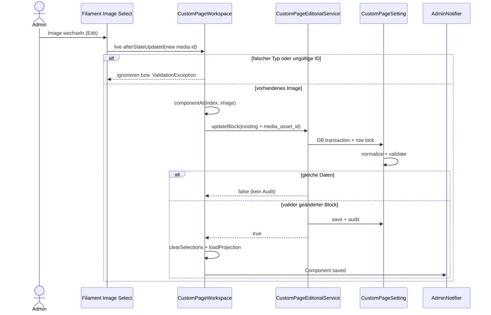

# Editorial-Mutationspfade: Home-Menüsichtbarkeit und Custom-Page-Bildwechsel

**Quellstand:** `dev@f69e0e7e3d857e717e9ed86102b0ee830ed9ebb0` (auf `docs` durch Zwei-Eltern-Merge übernommen). Dies ist **deskriptive Source-Tracing-Dokumentation**, keine zweite UI-Norm: [Dialog-Owner](../admin/dialogs.md), [Notification-Owner](../admin/notifications.md), [Public-Navigationsvertrag](../public/site.md). Tests sind nur als **gelesene Belege** zitiert; keine Ausführung oder Browserprüfung.

## Grundlegende Rollen

Die geänderten Editorial-Oberflächen besitzen mindestens vier getrennte Zuständigkeiten: Form/Livewire löst ein Ereignis aus; die Domain entscheidet innerhalb einer Datenbanktransaktion über Änderung und Audit; der UI-Boundary aktualisiert seine Projektion; `AdminNotifier` sendet eine fachliche Erfolgsmeldung **nur bei wirklichem Change**. Audit-Ausgabe allein erzeugt keine UI-Notification. Das ist in den beiden konkreten Source-Pfaden nachvollzogen, keine pauschale Aussage über alle Actions.

## Home: »Show in public navigation«

**Schreibpfad:**

1. [`ManagesSitePageEditDialog::editHomeAction()`](../../app/Filament/Pages/Concerns/ManagesSitePageEditDialog.php) montiert `HomeSettingsDialog::fill()/schema()`. Das Feld `show_in_navigation` gehört dem **Home-SiteSection**-Datensatz, nicht `HomePresentationSetting.configuration` und nicht dem globalen `skip_home`-Flag.
2. [`HomeSettingsDialog::schema()`](../../app/Filament/Support/HomeSettingsDialog.php) zeigt den live Toggle nur, wenn `skip_home` im Formzustand nicht aktiv ist. Sein `afterStateUpdated` ruft **`saveNavigationVisibility()`** auf; bei `true` folgt genau an dieser Stelle `AdminNotifier::notification('Home navigation updated')`. `HomeSettingsDialog::save()` konsumiert denselben Wert beim allgemeinen Edit-Save ebenfalls, sofern das Feld in den Daten enthalten ist, über die **gleiche Domain-Methode**, nicht eine eigene Update-Implementierung.
3. [`SiteSectionEditorialService::updateHomeNavigationVisibility()`](../../app/Domain/Content/SiteSectionEditorialService.php) eröffnet `DB::transaction`, lädt die konkrete SiteSection per `lockForUpdate()`, verlangt `nodeType() === Home` und setzt nur `show_in_navigation`. Bei unverändertem booleschen Wert: **`false`, kein Save, kein Audit**. Bei echter Änderung: `save()` plus `AdminAuditService::record('site_section.updated')`, anschließend `true`. Validierungs-/Actorfehler verlassen den Transaktionspfad ohne reguläre Success-Rückgabe.
4. Die allgemeine `editHomeAction()`-Mutation führt bei `dialog->save() === true` außerdem `loadSections(navigationChanged: true)` und **`Home settings saved`** als eigenes UI-Feedback aus. Bei einer zuvor erfolgreich live gespeicherten identischen Field-Änderung liefert der spätere Domain-No-op `false`. **Die vollständige Ereigniskardinalität bei kombinierten gleichzeitigen Änderungen/Livewire-Remounts ist ein Browser-/Featuretest-Thema**, nicht aus zwei Callback-Deklarationen allein bewiesen.

**Öffentlicher Lesepfad:**

[`PublicNavigationService::items()`](../../app/Domain/Content/PublicNavigationService.php) filtert im Normalbetrieb zunächst `state='published'`. Danach schließt es **Home** aus, sofern `show_in_navigation` nicht wahr ist, und **immer** bei aktivem Skip Home. Für andere SiteSection-Typen ist dieser zusätzliche Home-Guard nicht maßgeblich. In der Preview entfällt die allgemeine Publication-Filterung; Home-Switch und Skip-Home-Bedingung bleiben im Code unverändert. Ausgewählte Sections werden geordnet und zu Wurzeln/Kindergruppen projiziert: Fehlt ein publizierter Editorial-Parent im gefilterten Satz, fällt das Kind auf die Root-Ebene zurück. Dieser Projektionsschritt ändert keine Persistenz. Die Route `/` bleibt unabhängig von der Menüentscheidung erreichbar; Skip-Home-Routing ist ein separater Resolve-/Redirect-Owner.

[`SitePages::loadSections()`](../../app/Filament/Pages/SitePages.php) berechnet den **Navigation-Metric** nach Publication sowie den Sonderguards für Home, während die Admin-Seitenzeile sichtbar bleibt. Eine Metric ist keine zweite Veröffentlichungspersistenz.

| Zustand (normaler öffentlicher Kontext) | Home-Menüeintrag | Zugriff auf `/` |
| --- | --- | --- |
| `show_in_navigation=false`, `skip_home=false` | nein | Home-Routing unverändert |
| `show_in_navigation=true`, `skip_home=false`, Home publiziert | ja | Home-Routing unverändert |
| `show_in_navigation=true`, `skip_home=true` | nein | separater Skip-Home-Resolver entscheidet Ziel/Fallback |
| andere veröffentlichte SiteSection | eigene Publication-Bedingung | Home-Switch ohne Wirkung auf diesen Typ |

**Negativbelege:** [`HomeRoutingSettingsTest.php`](https://github.com/Wiiii90/moeller-lars/blob/f69e0e7e3d857e717e9ed86102b0ee830ed9ebb0/tests/Feature/Public/Home/HomeRoutingSettingsTest.php) enthält No-op-/Audit-Prüfung, Skip-Toggle-Unabhängigkeit, Home-Root-Erreichbarkeit und einen Filament-Edit-Ablauf mit Notification-Zählung. Das sind **Testdefinitionen**, keine durch diesen Workstream durchgeführten Tests. Zusätzlich nötig: Toggle erst auf `true`, anschließend Skip Home im noch offenen Modal ändern; umgekehrte Reihenfolge; Browser-Close/Reopen; Preview/Site-Navigation; mögliche Doppelemission bei Livewire-Field-Update und späterem Gesamt-Save.

## Custom Page: Image Selection im geöffneten Edit-Dialog

**Einzige Domain-Mutation, zwei mögliche Livewire-Grenzen:** [`CustomPageWorkspaceForms::imageSelectField()`](../../app/Filament/Pages/Concerns/CustomPageWorkspaceForms.php) aktiviert im **Edit**-Modus `live()->afterStateUpdated($onImageChange)`, weil die Filament-Searchable-Select-Wertänderung den normalen nativen `change` des übergeordneten Edit-Dialogs nicht zuverlässig auslöst. Beim **Create**-Formular fehlt dieser Callback: erst die bestätigte Create-Action erzeugt einen Block. Andere Felder behalten ihren bestehenden Edit-Action-Persistenzpfad. Es gibt damit zwei UI-Ereignisgrenzen, aber **keinen zweiten Domain-Service**.

**Konkrete Select-Kette:**

1. [`CustomPageWorkspaceComponentActions::componentEditingAction()`](../../app/Filament/Pages/Concerns/CustomPageWorkspaceComponentActions.php) erhält `componentIndex` und `componentType` über `actionComponentTarget()`. Ist der Typ nicht `image`, kehrt der Bild-Callback sofort zurück.
2. Der ausgewählte Media-Wert muss als positive Ganzzahl validierbar sein, sonst entsteht ein Feldfehler `Choose an image from Storage`. Ein positiver Index allein belegt noch keine gültige Image-MediaAsset-Referenz.
3. `componentAt(index, 'image')` liest den aktuell vorhandenen Block und bewahrt dessen **published**, `image_decorative`, `image_scale_percent` und weitere Persistenzfelder. Es wird **nur** `media_asset_id` auf den neuen Wert gesetzt.
4. [`CustomPageEditorialService::updateBlock()`](../../app/Domain/Content/CustomPageEditorialService.php) sperrt die frische `CustomPageSetting`-Zeile mit `lockForUpdate()`, prüft `index+expectedType`, ersetzt den Block und ruft `persist()`. Der Model-Saving-Hook normalisiert, und [`validateImageComponent()`](../../app/Models/CustomPageSetting.php) prüft insbesondere: ganzzahlige Größe 25–200; existierender MediaAsset mit `image/`-MIME; bei öffentlich erforderlicher Readiness auch Verfügbarkeit und ALT-Text (außer dekorativ). Editable-Persistenz und Public-Readiness sind **getrennte Phasen**.
5. `persist()` liefert bei `!isDirty()` **`false`**; andernfalls speichert es die Blocks und verzeichnet `site_section.updated` als Audit. Bei Domain-`true`: `clearSelections()`, `loadComponentProjection()`, eine `AdminNotifier`-Meldung `Component saved`. Ein No-op sendet hier keine Erfolgsmeldung. Der Dialog bleibt für Folgebearbeitung montiert.
6. Der normale `->action(...)`-Save-Pfad verwendet denselben `updateBlock()`, jedoch `componentPayload()` aus dem vollständigen Editzustand und `reloadWorkspace()`. Ein nach erfolgreicher Bildauswahl unverändert abgeschicktes Formular ist beim Domain-Save ein **No-op**, sofern kein anderes Feld verändert wurde. Das erfordert die tatsächliche Livewire-Event-Reihenfolge und Testabdeckung, keine Vermutung.

**Konkrete Race-/Fehlergrenze:** `componentAt()` und die Domain-`assertTarget()` kontrollieren beide **Index + Persistenztyp**, **keine stabile Komponentennummer oder Row-Revision**. Tauscht ein anderer Bearbeiter während eines geöffneten Dialogs zwei `image`-Blöcke, kann die Typprüfung den falschen Image-Block trotzdem akzeptieren. Ein transaktionaler DB-Lock verhindert dieses **stale semantic target**-Problem nicht. Der oben belegte `componentAt()`-Leseweg liegt außerdem vor dem Domain-Lock, dessen zweite Prüfung wiederum nur index+type kennt. Dieser Befund ist quellenbasiert; ein reproduzierender Zweifenster-Test bleibt erforderlich und die eigentliche Produktreparatur gehört zu `dev`.

**Testquelle:** [`CustomPageWorkspaceTest.php`](https://github.com/Wiiii90/moeller-lars/blob/f69e0e7e3d857e717e9ed86102b0ee830ed9ebb0/tests/Feature/Admin/SitePages/CustomPageWorkspaceTest.php) definiert einen Livewire-Test, der den Bildwechsel im weiterhin geöffneten Modal, Erhalt von 50-%-Scale und Decorative, **eine** neue Audit-/Mailbox-Zeile, Header-Event und keine zweite Erfolgsmeldung beim anschließenden Action-Aufruf prüfen soll. Ohne lokalen Testlauf gilt die Ausführung **nicht** als bestanden.

## Zusammenfassende Fehler- und Rückkopplungsgrenzen

| Vorgang | Persistenz | Audit | Notification |
| --- | --- | --- | --- |
| Home-Toggle real geändert | `SiteSection.show_in_navigation` | eine `site_section.updated`-Aufzeichnung | live Boundary `Home navigation updated`; allgemeiner Home-Action-Save nur bei eigenem realen Change |
| Home-Toggle No-op | keine | keine | keine aus dem Feldcallback |
| Home-Toggle auf anderen Seitentyp | ValidationException; kein normaler Save | keine reguläre erfolgreiche Aufzeichnung | keine Erfolgsmeldung aus diesem Boundary |
| Image Select valider neuer Bildwert | `CustomPageSetting.blocks[index]` | `site_section.updated` | eine `Component saved`-Meldung am Action-Callback |
| Image Select gleicher Wert | Domain-`false` | keine | keine |
| Image Select ungültig oder stale/type mismatch | ValidationException | keine erfolgreiche Domainaufzeichnung | keine Success-Notification |
| Zwei gleiche Image-Typen während parallelem Reorder | Guard nur `index+type` | **Semantik nicht garantiert** | Regressionstest und stabiler Target-Owner offen |

**Quell-/Tests-/Runtime-Trennung:** Domaintransaktionen, Guard-Pfade und Notifier-Aufrufstellen wurden hier aus PHP gelesen. Aus der Existenz von Livewire/Pest-Tests folgt weder ein erfolgreich durchlaufener Test noch eine Browser- oder DB-Verifikation. Dieses Dokument erweitert keine normative UI-Vorgabe und führt keine zusätzlichen Notification-/Persistence-Owner ein.
