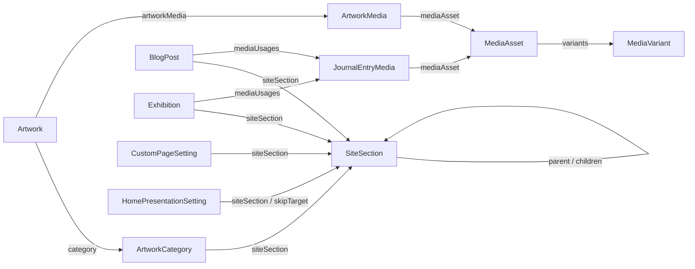
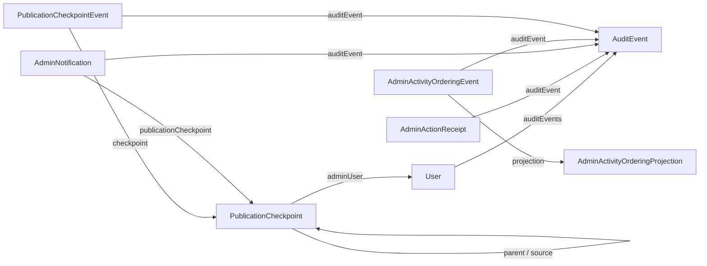

# Eloquent-Relationen: Quellkatalog

**Nativer Vollkatalog auf `docs@8c9bd0a0f0fca46b1aa5637049372726d6970c4c`:** [eloquent-relationships.json](generated/eloquent-relationships.json) enthält 26 Modelpfade und 48 typisierte Relation-Kanten mit PHP-Zeilennummern; [eloquent-relationships.mmd](generated/eloquent-relationships.mmd) zeigt dieselben Kanten. Am 19.10.2026 wurden mit PHP 8.3.33 die fünf Selbsttest-Fixtures sowie `--write` und `--check` des [Generators](../../scripts/generate-architecture-eloquent.php) tatsächlich ausgeführt. Sieben Zeilenanker waren veraltet und wurden regeneriert; Typen, Ziele, Anzahl und Mermaid bleiben unverändert.

Der enge Tokenizer berücksichtigt Kommentare/Zeilenumbrüche, `self::class` und direkte Rückgabe mit nachfolgender Methodenkette. Er erfasst nur öffentliche parameterlose Methoden mit passendem Relation-Rückgabetyp und literalem Ziel. Dynamische Ziele, abweichende Rückgabetypen und nicht unterstützte Syntax werden nicht geraten. Die früheren unabhängigen GitHub-Aufnahmen und PHP-8.4-Fixtures sind historische Provenienz; der nun eingecheckte JSON-Stand ist nativ reproduziert. Die Tabellen erläutern die deklarierte Modellstruktur, nicht Laufzeitdaten.
**Wichtig:** Die Tabelle zeigt explizite **PHP-Methoden**, keine aus der Datenbank verifizierten Fremdschlüssel, NOT-NULL-Constraints oder tatsächliche Datensätze. Sie ist deshalb ausdrücklich **kein physisches ERD**. Quellpfade verweisen auf die betreffenden Modelklassen. Der [statische Beziehungs-Generator](../../scripts/generate-architecture-relations.php) enthält dieselben 48 expliziten Eloquent-Kanten im größeren Strukturgraphen.

## Public Content, Artwork und Media

| Model (Quelle) | Deklarierte Relation-Methoden und Ziele |
| --- | --- |
| [`SiteSection`](../../app/Models/SiteSection.php) | `parent(): belongsTo(self)` · `children(): hasMany(self)` · `artworkCategory(): belongsTo(ArtworkCategory)` · `customPageSetting(): hasOne(CustomPageSetting)` · `journalSetting(): hasOne(JournalSetting)` |
| [`ArtworkCategory`](../../app/Models/ArtworkCategory.php) | `siteSection(): hasOne(SiteSection)` · `artworks(): hasMany(Artwork)` |
| [`Artwork`](../../app/Models/Artwork.php) | `category(): belongsTo(ArtworkCategory)` · `artworkMedia(): hasMany(ArtworkMedia)` · `mediaAssets(): belongsToMany(MediaAsset)` via `artwork_media` |
| [`ArtworkMedia`](../../app/Models/ArtworkMedia.php) | `artwork(): belongsTo(Artwork)` · `mediaAsset(): belongsTo(MediaAsset)` |
| [`MediaAsset`](../../app/Models/MediaAsset.php) | `variants(): hasMany(MediaVariant)` · `cvEntries(): hasMany(CvEntry)` (Legacy) · `siteIdentitySettings(): hasMany(PublicContentSetting)` · `journalEntryMedia(): hasMany(JournalEntryMedia)` · `artworks(): belongsToMany(Artwork)` via `artwork_media` |
| [`MediaVariant`](../../app/Models/MediaVariant.php) | `mediaAsset(): belongsTo(MediaAsset)` |
| [`BlogPost`](../../app/Models/BlogPost.php) | `siteSection(): belongsTo(SiteSection)` · `mediaUsages(): hasMany(JournalEntryMedia)` |
| [`Exhibition`](../../app/Models/Exhibition.php) | `siteSection(): belongsTo(SiteSection)` · `mediaUsages(): hasMany(JournalEntryMedia)` |
| [`JournalEntryMedia`](../../app/Models/JournalEntryMedia.php) | `blogPost(): belongsTo(BlogPost)` · `exhibition(): belongsTo(Exhibition)` · `mediaAsset(): belongsTo(MediaAsset)` |
| [`JournalSetting`](../../app/Models/JournalSetting.php) | `siteSection(): belongsTo(SiteSection)` |
| [`CustomPageSetting`](../../app/Models/CustomPageSetting.php) | `siteSection(): belongsTo(SiteSection)` |
| [`HomePresentationSetting`](../../app/Models/HomePresentationSetting.php) | `siteSection(): belongsTo(SiteSection)` · `skipTargetSection(): belongsTo(SiteSection)` via `skip_target_section_id` |
| [`PublicContentSetting`](../../app/Models/PublicContentSetting.php) | `faviconMediaAsset(): belongsTo(MediaAsset)` via `favicon_media_asset_id` |
| [`CvEntry`](../../app/Models/CvEntry.php) | `imageMediaAsset(): belongsTo(MediaAsset)` (Legacy; keine aktive `cv_entries`-Runtime-Tabelle) |
| [`ArtworkMaterialPreset`](../../app/Models/ArtworkMaterialPreset.php) | Keine explizite Eloquent-Relation |
| [`Redirect`](../../app/Models/Redirect.php) | Keine explizite Eloquent-Relation |

### Ausschnitt: unmittelbare Content-/Medienbeziehungen

Das ist ein **lesbarer Ausschnitt** aus den oben vollständig aufgelisteten Eloquent-Relationen. Die tatsächlichen Fremdschlüssel-Kardinalitäten werden hier bewusst nicht behauptet.

## Administration, Activity und Commit-Historie

| Model (Quelle) | Deklarierte Relation-Methoden und Ziele |
| --- | --- |
| [`User`](../../app/Models/User.php) | `auditEvents(): hasMany(AuditEvent)` via `admin_user_id` |
| [`AuditEvent`](../../app/Models/AuditEvent.php) | `adminUser(): belongsTo(User)` · `activityOrderingEvent(): hasOne(AdminActivityOrderingEvent)` · `publicationCheckpointEvent(): hasOne(PublicationCheckpointEvent)` |
| [`AdminActionReceipt`](../../app/Models/AdminActionReceipt.php) | `auditEvent(): belongsTo(AuditEvent)` · `adminUser(): belongsTo(User)` |
| [`AdminActivityOrderingEvent`](../../app/Models/AdminActivityOrderingEvent.php) | `auditEvent(): belongsTo(AuditEvent)` · `projection(): belongsTo(AdminActivityOrderingProjection)` |
| [`AdminActivityOrderingProjection`](../../app/Models/AdminActivityOrderingProjection.php) | Keine explizite Eloquent-Relation |
| [`AdminNotification`](../../app/Models/AdminNotification.php) | `user(): belongsTo(User)` · `auditEvent(): belongsTo(AuditEvent)` · `publicationCheckpoint(): belongsTo(PublicationCheckpoint)` |
| [`PublicationCheckpoint`](../../app/Models/PublicationCheckpoint.php) | `adminUser(): belongsTo(User)` · `auditEventLinks(): hasMany(PublicationCheckpointEvent)` · `parent(): belongsTo(self)` · `source(): belongsTo(self)` |
| [`PublicationCheckpointEvent`](../../app/Models/PublicationCheckpointEvent.php) | `checkpoint(): belongsTo(PublicationCheckpoint)` · `auditEvent(): belongsTo(AuditEvent)` |
| [`ContactMessage`](../../app/Models/ContactMessage.php) | Keine explizite Eloquent-Relation |
| [`DailyMetric`](../../app/Models/DailyMetric.php) | Keine explizite Eloquent-Relation |

### Ausschnitt: Commit, Audit und Undo

## Drei besonders wichtige Befunde

1. **Self-Relations sind fachlich relevant.** `SiteSection.parent/children` bildet die redaktionelle Hierarchie. `PublicationCheckpoint.parent/source` modelliert die Veröffentlichungslinie beziehungsweise die Quelle von Restore/Revert. Der Generator muss `self::class` explizit erfassen; dies ist in der jetzigen Version berücksichtigt.
2. **Eloquent und physisches Schema können absichtlich auseinanderliegen.** Die PHP-Relation `MediaAsset::cvEntries()` besteht weiter, obwohl `cv_entries` durch eine Forward-Migration als aktive Tabelle aufgegeben wurde. Wer daraus blind eine FK-Kante ins aktuelle SQL-ERD zeichnet, erzeugt eine falsche Architektur.
3. **Persistenzbeziehungen außerhalb von Eloquent sind nicht abgebildet.** JSON-Komponenten mit `media_asset_id`, Snapshot-Manifeste, History-Payloads und einzelne technische Datenbanksichten müssen aus Domain-Validierung und der PostgreSQL-Katalogaufnahme kommen.

## Verifikation und Abdeckung

- Alle 26 Modeldateien wurden für ihre expliziten Eloquent-Relation-Aufrufe am genannten Quellstand durchgesehen.
- **48** gefundene Aufrufe; **5** Modelle ohne explizite Relation dieser Familie.
- **Nicht geprüft:** tatsächliche Datenbankreferentialität, alle indirekten Beziehungen, dynamische Relation-Definitionen, runtime-abhängige Constraints sowie das vollständige Resultat des neuen lokalen Beziehungsextraktors.
- Jede gefundene PHP-Beziehung bleibt im Inventar sichtbar, auch wenn sie historisch ist; **aktives Laufzeitmodell** und **Legacy-Rest** werden getrennt klassifiziert.
