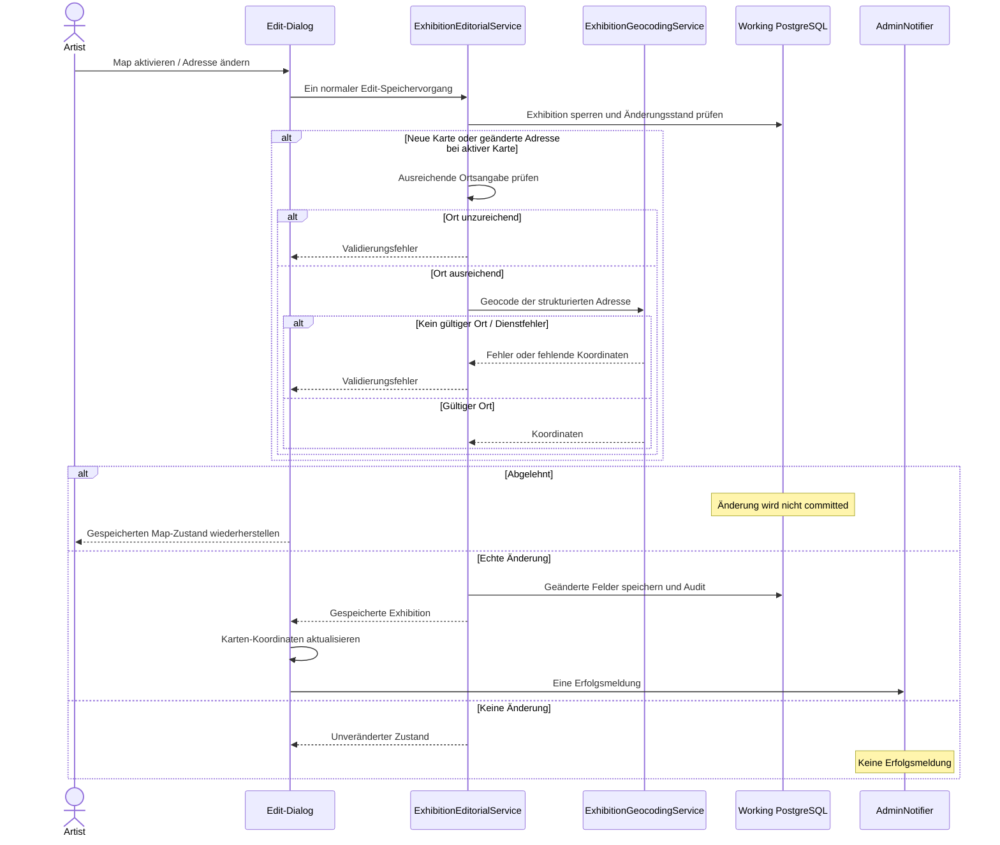

# Exhibition Map: Edit-Autosave, Geocoding und Fehlergrenzen

**Quellgrenze:** gezielter Abgleich von `dev@dee05e4d7bc0ac70081a4c8f998442701bc7d630` mit `JournalEntryEditorSchema`, `JournalWorkspace`, `ExhibitionMapAddress`, `ExhibitionEditorialService` und dem bestehenden [Feature-Test](../../tests/Feature/Admin/Journal/ExhibitionMapAutosaveTest.php). Die Testdatei wurde gelesen, **nicht ausgeführt**. Dies ist eine Architektur- und Ablaufbeschreibung, keine neue Abnahme.

**Fachliche Regeln und öffentliche Darstellung:** [Exhibition editorial](../content/exhibitions.md). **Allgemeines Edit-/Dialog-Verhalten:** [Admin dialogs](../admin/dialogs.md). **Geocoding und Medien sind keine separaten Journal-Persistenzsysteme.**

## Autoritätsgrenzen

| Verantwortung | Bestehender Owner |
| --- | --- |
| Toggle und Vorschau im gleichen Edit-Formular | `JournalEntryEditorSchema::mapFields()` |
| Vorbedingung für neue Karten | `ExhibitionMapAddress::isSufficient()`: Country und mindestens City oder Postal code |
| Gemeinsames Änderungsereignis und Filament-Edit-Lifecycle | `AdminControl` / `AdminDialog::edit()` |
| Transaktion, Adresssignatur, Sperre, Re-Geocoding und Audit | `ExhibitionEditorialService::update()` |
| Anfrage, Antwort und Fehler des externen Geocoders | `ExhibitionGeocodingService::locate()` |
| Koordinaten und abgelehnten Toggle im geöffneten Dialog korrigieren | `JournalWorkspace::editExhibitionAction()` |
| Meldung bei einer tatsächlichen erfolgreichen Änderung | `JournalWorkspace` über `AdminNotifier` |

Die Benutzeroberfläche deaktiviert **das erstmalige Aktivieren** einer Karte, solange die strukturierte Adresse nicht genügt. Ein bereits aktiver Schalter darf auch bei inzwischen unvollständiger Adresse wieder ausgeschaltet werden. Die UI-Vorprüfung ist keine Sicherheitsgrenze: der Domain-Service validiert beim Aktivieren ebenfalls.

Das Toggeln verwendet den **bereits vorhandenen Edit-`change`-Pfad**. Ein zusätzliches eager `->live()` am Map-Toggle würde eine zweite konkurrierende Anfrage ermöglichen und darf nicht eingeführt werden. Der Geocoder verwendet nur die strukturierten Adressfelder; Venue und Organizer sind dafür keine Ersatzadressen.

## Sequenz mit Abzweigungen

## Wichtige Unterscheidungen

- `map_enabled` ist unabhängig von `gallery_enabled`. Beide sind Präsentationsentscheidungen und bleiben fachlich getrennt.
- `latitude`, `longitude` und `geocoded_at` werden durch den Domain-Service bestimmt. Die Hidden-Felder im Dialog sind **nur UI-Projektionen**, nicht gespeicherte Autorität; bei einer Adressänderung werden alte Vorschaukoordinaten zunächst ungültig.
- Eine geänderte Adresssignatur leert alte Koordinaten; bei aktivierter Karte werden sie neu bestimmt. Schlägt Geocoding oder Validierung fehl, darf weder eine scheinbar aktive Karte noch ein fiktiver Pin gespeichert werden. `JournalWorkspace` synchronisiert dann den zuletzt gespeicherten Toggle und die Koordinaten gezielt zurück, **ohne den restlichen fokussierten Formularinhalt zu überschreiben**.
- Publikationsstatus und Map-Readiness sind eigenständige Grenzen. Ein Working-`map_enabled=true`, eine Admin-Vorschau oder der bloße Karten-Preview-Container beweisen weder gültige öffentliche Koordinaten noch eine erfolgreiche Publikation in Committed.
- Versteckte Organizer-/Adresslabels sind unabhängig vom Map-Schalter. Eine aktive Karte kann Ortsinformationen weiterhin über OpenStreetMap sichtbar machen; für das Verbergen des Ortes muss sie separat deaktiviert werden (siehe Exhibition-Vertrag).

## Abgleich mit bestehenden Testfällen

Der noch vorhandene [Journal Feature-Test](../../tests/Feature/Admin/Journal/ExhibitionMapAutosaveTest.php) formuliert Szenarien für Aktivieren/Deaktivieren ohne Dialogschluss, Aktualisierung der Koordinaten, Addressänderung ohne doppeltes Geocoding, fehlendes Country mit anschließender Aktivierung, unzureichende Adresse, Rücksetzen des abgelehnten Toggles und konkurrierende bzw. fehlgeschlagene Änderungen. Das sind **geschriebene Testfälle**, keine in diesem Dokumentationslauf bestandenen Tests.

Die früher referenzierte `tests/Architecture/Admin/AdminExhibitionMapAutosaveTest.php` ist **kein aktueller Test-Owner mehr**: `tests/Architecture/Admin` existiert im überprüften `dev`-Quellbaum nicht mehr. Für neue Prüfungen gilt die [eine kuratierte Teststrategie](../operations/testing.md); keine zweite Architektur-Suite oder historische Testliste wiederherstellen.
