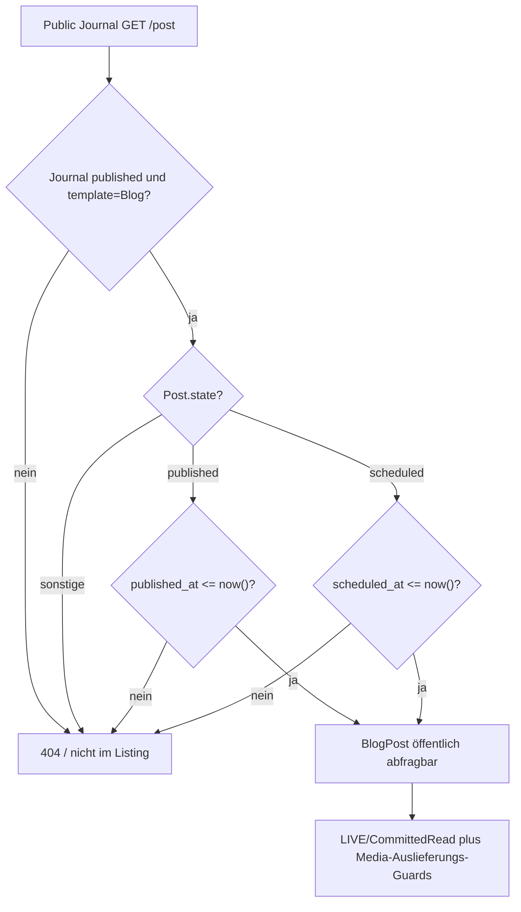

# Journal-Inhalte: Blog-/Exhibition-Lifecycle, Medien und öffentlicher Lesepfad

**Quellstand:** `dev@54a6810cefc610630b7305f9db49a32c2d9b4630` (auf `docs` als Zwei-Eltern-Merge aufgenommen). Diese Untersuchung rekonstruiert die **Entry-Operationen** und ihre öffentlichen Guards. Die davon unabhängige **Journal-Templatewahl** ist im [Lifecycle-Dokument](lifecycles.md#8-journal-templatewechsel-präsentation-statt-inhaltsmigration) erklärt, der gemeinsame Media-Cleanup unter [Medienreferenzen](media-reference-and-cleanup.md) und die konkrete Exhibition-Geocoding-Autosave-Kette unter [Exhibition Map](exhibition-map.md). Keine hier ausgeführte PHP-/Datenbank-/Browser-Validierung.

## Getrennte Zustandsachsen statt eines vereinheitlichten „Journal-Status“

Beide Eintragstypen gehören über `site_section_id` zu einem typisierten Journal Site Node. `SiteSection.template` bestimmt, **welche Eintragsfamilie** gerade öffentlich dargestellt und im Admin-Journal bearbeitet wird; das Umschalten löscht weder BlogPosts noch Exhibitions. Zusätzlich entscheidet der SiteSection-Publikationsstatus über öffentliche Seiten-Eligibility. Ein BlogPost-/Exhibition-Status ist **Working-Domainpersistenz** und erst nach [explizitem Publication-Commit](publication.md) für normale Public-GETs in `committed.*` sichtbar.

| Dimension | BlogPost | Exhibition |
| --- | --- | --- |
| Persistierte Editorial-States | `draft`, `scheduled`, `published`, `unpublished`, `archived` | `draft`, `published`, `archived` |
| Public-Visibility ohne Preview | `published AND published_at <= now()` **oder** `scheduled AND scheduled_at <= now()`, zusätzlich aktives Blog-Journal und publizierter Site Node | `state=published`, zusätzlich aktives Exhibitions-Journal und publizierter Site Node |
| Preview-Visibility | Nicht archivierte Posts im aktuell gewählten Blog-Template; eigenes Preview-Auth/Working | Nicht archivierte Exhibitions im aktuell gewählten Exhibitions-Template |
| Abgeleitete Zeitachse | Bei `scheduled` ist der Fälligkeitszeitpunkt Lesefilter, **keine automatische persistierte Transition** | `temporalState(now)` ist `upcoming/current/past/unknown` nach Beginn/Ende, **unabhängig** von `draft/published/archived` |
| Strukturierte Medien | `JournalEntryMedia` für Cover/Gallery, plus Rich-Text-Body | Derselbe `JournalEntryMedia`-Owner für Cover/Gallery, plus Rich-Text-Description; Gallery nur bei `gallery_enabled` |
| Live-Grenze | `committed.blog_posts`, `committed.journal_entry_media` usw. erst nach Commit | `committed.exhibitions`, gemeinsame getrackte Relationen erst nach Commit |

Das ist **keine gleichförmige Status-Maschine**: Fälligkeit eines Scheduled Posts wird **nicht** durch eine Cron- oder Timerstatusänderung in `published` überführt; Exhibition-`past` ist keine Unpublication. [`BlogPost::scopePubliclyVisible()`](../../app/Models/BlogPost.php) und [`Exhibition::temporalState()`](../../app/Models/Exhibition.php) sind die jeweiligen Leseowner.

## 1. BlogPost: Editorial-Transaktion, Schedule und Read-Guard

[`BlogEditorialService::publish()`](../../app/Domain/Content/BlogEditorialService.php) nimmt unter `DB::transaction` einen `lockForUpdate` auf dem aktuellen Post, akzeptiert Draft/Scheduled/Unpublished, setzt `state=published`, entfernt `scheduled_at` und ruft `prepareLifecycle()` auf. Diese Methode verlangt nichtleeren Body, validierbaren Rich Text und `JournalEntryMediaService::assertPublicReady()`; bei erstmaliger Veröffentlichung wird `published_at` gesetzt. Ein erneutes Publish bei bereits Published kehrt ohne Audit als **No-op** zurück. Der echte Wechsel schreibt `blog_post.published`-Audit.

[`schedule()`](../../app/Domain/Content/BlogEditorialService.php) validiert zunächst einen **zukünftigen** Zeitpunkt. Innerhalb der gesperrten DB-Transaktion akzeptiert es Draft/Scheduled/Unpublished, speichert `state=scheduled`, `scheduled_at` und denselben Public-Readiness-Guard und auditiert `blog_post.scheduled`. Der aktuelle Domaincode enthält an dieser Stelle **keinen Same-Date-No-op-Guard**. Auch wenn bereits `state=scheduled` und derselbe zukünftige Termin gespeichert sind, ruft er erneut `save()` und anschließend ausdrücklich `AdminAuditService::record('blog_post.scheduled')` auf. [`AdminAuditService::record()`](../../app/Domain/Admin/AdminAuditService.php) erzeugt eine neue `AuditEvent`-Row auch ohne `change_summary`; ein nicht schmutziger Post-Rowzustand verhindert dieses Audit nicht. **Dies ist quellenbasiert nicht idempotent** – anders als `publish()` und die generische `transition()`. Der tatsächliche Doppel-Audit-/Undo-/Pending-Receipt-Ausgang muss an der echten DB verifiziert werden, statt eine ausgeführte Reproduktion zu behaupten.

[`unpublish()`](../../app/Domain/Content/BlogEditorialService.php) akzeptiert aus `published` die Transition zu `unpublished`; `archive()` und `restoreDraft()` haben eigene Quell-Guards; `restoreDraft` aus `scheduled/unpublished/archived` setzt Draft. Die generische `transition()` kehrt bei identischem Zustand oder nicht erlaubter Herkunft ohne Änderung zurück und löscht bei Nicht-Scheduled `scheduled_at`. Löschen ist **verboten für Published oder Scheduled**. Beim [`update()`](../../app/Domain/Content/BlogEditorialService.php) sind veröffentlichte/zeitgeplante Slugs nach erster Veröffentlichung/Scheduling unveränderlich; Wechsel zwischen Journals bedarf einer eigenen Workflow-Operation. Änderungen an Metadaten und strukturierten Medien erhalten einen Audit nur bei Dirty-Row oder `mediaChanged`; ein sonstiger Edit-No-op ist kein Success-Audit.

**Read-Timing** ist eine rein zeitliche Query-Achse:

Ein Future Scheduled Post wird nicht sichtbar, aber sobald `scheduled_at <= now()` ist, kann seine öffentliche Readquery ihn zulassen **ohne** persistierte Statusumstellung. Ob die fällige Version überhaupt in LIVE enthalten ist, hängt gesondert vom erfolgten Publication-Commit ab. Public SEO und Rich-Text-Media-Eligibility verwenden dieselbe `publiclyVisible()`-Semantik, dürfen aber nicht mit einem pauschalen `state=published` ersetzt werden.

### Journal-UI: Schedule, Notification und Metrics sind andere Projektionen

[`JournalWorkspace::schedulePostAction()`](../../app/Filament/Pages/JournalWorkspace.php) übergibt den `DateTimePicker`-Wert `scheduled_at` an die Domain. Bei `ValidationException` wird `Post was not scheduled` angezeigt, die Action angehalten und keine Erfolgsnotification versandt. **Jeder erfolgreiche Rücksprung** aus `BlogEditorialService::schedule()` lädt jedoch Posts neu und versendet die Success-Notification `Publication scheduled` – ohne eigenen Vorher-/Nachher- oder No-op-Vergleich. Zusammen mit dem Domain-Audit folgt daraus beim gültigen zweiten Aufruf mit demselben künftigen Datum quellenbasiert **ein weiterer Schedule-Receipt-Pfad und eine erneute Success-Notification**, obwohl die sachlichen State-/Date-Werte unverändert sind. Aus dem sourcebasierten Aufrufpfad ist keine tatsächliche User-Interaktion oder Receipt-Undo-Kardinalität bewiesen.

[`JournalWorkspace::loadBlogMetrics()`](../../app/Filament/Pages/JournalWorkspace.php) zählt die Kennzahl `Scheduled` nach persistiertem `state='scheduled'` und bezeichnet diese Gruppe als `Queued posts`. [`BlogPost::scopePubliclyVisible()`](../../app/Models/BlogPost.php) kann aber ein solches Entry nach `scheduled_at <= now()` bereits öffentlich zeigen, **während der Status weiterhin `scheduled` heißt**. `Queued` ist daher kein Nachweis einer noch ausstehenden Queue-/Cron-Aktion. Die Admin-Metrik ist derzeit eine **persistierte Statuszählung**, keine Zeit-/LIVE-Eligibility-Zählung. Die richtige UI-Semantik ist eine Produktfrage, nicht durch eine Dokumentations-Korrektur automatisch umgesetzt.

**Isolation für spätere Regression:** Ein Blog in einem aktiven Journal mit public-ready Body und Media, `scheduled_at = T` in ferner Zukunft, einmal `schedule(T)`, danach unter stabiler Testuhr erneut `schedule(T)`: Vorher-/Nachher-Rowdaten, genau Anzahl `blog_post.scheduled`-AuditEvent/Receipts, Admin-Notification-Ausgabe sowie `PublicationService::hasPendingChanges()` kontrollieren. Separat `T-ε` / `T+ε` bei unverändertem persistiertem `scheduled`-State und nach LIVE-Commit vergleichen: Listing, Einzelroute, Sitemap, PublicMedia, Admin-Metrik und Preview. **Nicht** mit einer Scheduler-Ausführung gleichsetzen. Diese Testvorschläge sind nicht durchgeführt.

## 2. Exhibition: Editorial-/Temporal-State und Maps

**Aktueller Exhibition-Owner (dev@2ad31502ea4e):** Die normative [Exhibition-Editorial-Regel](../EXHIBITION-EDITORIAL-CONTRACT.md) trennt `organizer` (öffentliche attribution) von `venue` (physischer Ort) und der strukturierten Adresse. `Exhibition::publicByline()` wählt Organizer, nur bei historischen Datensätzen Venue als Fallback, ohne die Stadt automatisch anzuhängen. Geocoding nutzt Straße/PLZ/Ort/Land, niemals Organizer oder Veranstaltungsortnamen. Die neue Migration kann `venue` nur dort sicher nach `organizer` übernehmen, wo `legacy-public-vita` die frühere Bedeutung `organisation` nachweist; übrige historische Einträge müssen redaktionell überprüft werden. `show_vernissage` ist eine eigenständige, persistierte Wahl: strukturierter `vernissage_at` wird nur bis zum Beginn angezeigt, altes freies Opening-Textformat ohne Uhrzeit nur bei Upcoming. Zeitliche Ausstellungsklassifikation verbleibt bei `starts_on/ends_on`. Die neue Exhibition Cover/Gallery akzeptiert Bilder **und Videos**; Blog-Cover bleibt bildgebunden. Diese Quelldaten wurden hier nicht migriert oder im Browser geprüft.

[`ExhibitionEditorialService::publish()`](../../app/Domain/Content/ExhibitionEditorialService.php) wechselt aus Draft oder Archived zu Published unter `DB::transaction` und Row-Lock. [`assertPublicReady()`](../../app/Domain/Content/ExhibitionEditorialService.php) fordert einen gültig anzeigbaren Zeitraum; für neue nicht-legacy Entries einen strukturierten `starts_on`, bei `map_enabled` valide Koordinaten, dazu Medien-/Rich-Text-Readiness. Ein identischer Published-Request kehrt ohne Audit zurück; ein echter Wechsel setzt `published_at` nur wenn zuvor null und auditiert `exhibition.published`.

`unpublish()` setzt Published → Draft, kein separates persistiertes `unpublished`-Enum. `archive()` merkt sich `archived_from_state` (Draft oder Published) und setzt Archived. `restore()` verlangt Archived, zielt zunächst auf den vorherigen State oder einen auf `published_at` basierten Fallback; soll Published restauriert werden, führt der Service `assertPublicReady()` **erneut** aus und fällt bei ValidationException bewusst auf Draft zurück. Ein Restore ist deshalb nicht automatisch eine garantierte Wiederveröffentlichung. `delete()` verweigert Published, weitere FK-/Relationseffekte bleiben Domain-/SQL-Grenzen.

[`Exhibition::temporalState()`](../../app/Models/Exhibition.php) verwendet `starts_on`/`ends_on` und den aktuellen Kalendertag: vor Start `upcoming`, mit Enddatum von Beginn bis einschließlich Ende `current`, danach `past`; ohne `ends_on` ist ausschließlich der Starttag `current`, danach `past`; fehlender Start ergibt `unknown`. Dieser abgeleitete Zustand kann bei Draft und Published auftreten und wird **nicht** als Lifecycle-Audit gespeichert.

**Geocoding-/Map-Grenze:** [`ExhibitionEditorialService::update()`](../../app/Domain/Content/ExhibitionEditorialService.php) sperrt den aktuellen Entry. Geänderte Standortfelder invalidieren bestehende Latitude/Longitude/GeocodedAt. Bei `map_enabled` und neuen/fehlenden Koordinaten wird Geocoding ausgeführt, bevor der neue Rowzustand akzeptiert wird; ein bereits Published-Entry muss nach dem Update wieder `assertPublicReady()` erfüllen. Das konkret behandelte Browser-/Livewire-Autosave-/Notification-Verhalten gehört unverändert der [Exhibition-Map-Untersuchung](exhibition-map.md), nicht einem neuen Map-UI-Owner.

## 3. Geteilte JournalEntryMedia und mittelbare Zustandsänderungen

[`JournalEntryMediaService::syncStructuredMedia()`](../../app/Domain/Content/JournalEntryMediaService.php) akzeptiert für BlogPost **oder** Exhibition dieselbe Cover- und Gallery-Auswahl. Ein vorhandener `cover_media_asset_id`- beziehungsweise `gallery_images`-Eingabekey kann die dazugehörigen Relations verändern. Nur bei tatsächlicher Media-Änderung wird die zuvor geladene `mediaUsages`-Relation invalidiert; ein Save kann also auch **media-only** sein. Der SQL-Owner bleibt die explizite genau-eine-Eigentümer-Relation `blog_post_id XOR exhibition_id` in [Schema Evolution](schema-evolution.md), kein frei erfundener morph.

[`JournalEntryMediaService::assertPublicReady()`](../../app/Domain/Content/JournalEntryMediaService.php) betrachtet die relevanten strukturierten Cover-/Gallery-Usages und den Rich-Text-Body beziehungsweise Exhibition-Description. Gallery-Usages einer Exhibition mit `gallery_enabled=false` werden beim Readiness-Check gezielt übersprungen, **nicht** automatisch aus der Datenbank gelöscht. Dadurch sind diese Daten beim Wiederaktivieren potentiell erneut relevant. Ein öffentlich bereiter Eintrag benötigt geeignete verfügbare MediaAssets und für interne Markdownbilder deren Alt-/Thumbnail-Readiness.

**Media-Delete ist keine isolierte Media-Row-Operation:** [`detachAsset()`](../../app/Domain/Content/JournalEntryMediaService.php) entfernt strukturierte Usages, bereinigt kanonische `media:<id>`-Rich-Text-Referenzen, normalisiert Galeriepositionen und auditiert die betroffenen Entry-Owner. Falls ein zuvor Published Blog seinen einzigen Body-Inhalt durch die Entfernung verliert, kann er dabei **zu `unpublished`**, ein Scheduled Blog **zu `draft`** herabgestuft werden; `scheduled_at` wird gelöscht. Diese indirekte Mutation gehört zum [Medienlösch-/Referenzflow](media-reference-and-cleanup.md), der zusätzlich die LIVE-/History-Schutzentscheidung vor physischer Dateilöschung behandelt. Für Exhibition muss die Authoring-/Map-/Media-Verfügbarkeit nach Entfernen neuer Referenzen separat geprüft werden; **kein** pauschal behaupteter Rücksprung auf Draft ohne konkreten Codebeleg.

### Aktuelle Journal-Präsentation: Disclosure und Medien-Captions

**Quellstand `dev@f58db29e`, nicht browserabgenommen:** [`exhibitions.blade.php`](../../resources/views/pages/exhibitions.blade.php) behält ein natives `details/summary` **nur wenn tatsächlich weitere Details existieren**; die aufklappbare Überschrift ist für Pointer der **einzige** aktivierte Bereich, keine `Open/Close`-Beschriftung. [`public-presentation.css`](../../resources/css/public-presentation.css) begrenzt die zwei Linien auf die **geöffnete Gesamt-Exhibition** und richtet Cover, Besuchsinformationen und Beschreibung innerhalb eines `flow-root` mit einem maximal 15rem breiten, bei ausreichendem Container-Breite gefloateten Cover aus. Das visuelle Öffnen darf nicht mit der gespeicherten Exhibition-`state`/`temporalState`-Achse verwechselt werden.

[`JournalMediaRenderer::render()`](../../app/Domain/Content/JournalMediaRenderer.php) erhält als reinen Renderparameter `showCaption` (Default `true`). [Blog-Index](../../resources/views/pages/blog/index.blade.php), [Blog-Detail](../../resources/views/pages/blog/show.blade.php), [Exhibitions](../../resources/views/pages/exhibitions.blade.php) und [shared Gallery-Blade](../../resources/views/components/journal-gallery.blade.php) setzen ihn für Cover/Gallery auf `false`. [`journal-presentation.css`](../../resources/css/journal-presentation.css) führt Slideshow-Bilder in einer einzigen Grid-Zeile/stabilen Stage und Controls in einer **zweiten Zeile darunter**; Gallery-Grid und Mosaic bleiben eigenständige Präsentationen. **Die Asset-`credit`-/`copyright_notice`-Felder und ALT bleiben erhalten**; keine Medienreferenz-/PublicMedia-/DB-Berechtigungsänderung. Regressionen: Closed/Opened Exhibition mit nur Titel/Datum/Ort, Tastatur-Disclosure/Focus und Pointer-Click nur auf Title; genau zwei Open-Folio-Trennlinien; Cover/Slideshow/Mosaic/Grid ohne sichtbare Figcaptions, mit weiterhin korrektem ALT und bei anderswo default-`showCaption=true` unverändertem Verhalten. Keine Browser-/Node-/Livewire-Tests im Docs-Workstream ausgeführt. Normativer [Public-Vertrag](../PUBLIC-IMPLEMENTATION-CONTRACT.md#exhibition-chronology-and-detail-disclosure).

## 4. Öffentlicher Controller und Template-Eligibility

[`PublicSiteSectionController::journal()`](../../app/Http/Controllers/PublicSiteSectionController.php) wählt ausschließlich anhand des **aktiven JournalTemplate** zwischen `blogJournal()` und `exhibitionsJournal()`. Er filtert Blog-Journal-Public-Inhalte über `BlogEditorialService::publicQuery()`; Exhibitions über `state=published`. Die Preview (nur als Admin) zeigt nicht archivierte Entries statt der normalen Public-State-Filter. Einzelne Blog-Detailrouten `/{section}/{slug}` verlangen ausdrücklich `JournalTemplate::Blog` und einen passenden Post; bei Wechsel zu Exhibitions existiert der ursprüngliche Post weiterhin, ist über diese öffentliche Detailroute aber nicht aufrufbar.

[`PublicMedia::isPublicAsset()`](../../app/Domain/Media/PublicMedia.php) prüft bei Journal-Cover-/Galeriebildern wiederum State, aktives Template und SiteSection-Publikationsstatus sowie – bei Exhibitions Gallery – das `gallery_enabled`-Flag. Die Media-Auslieferung ist folglich ein **separater** öffentlich autorisierter Read-Owner. Eine inaktive/Preview-referenzierte Datei muss dadurch nicht ohne weiteres als gewöhnliches PublicMedia abrufbar sein.

## 5. Noch fehlende, präzise Nachweise

| Isolierter Fall | Erwartete Invariante / zu untersuchende Abweichung |
| --- | --- |
| Blog Scheduled noch in Zukunft, nach Zeitablauf und nach LIVE-Commit | Zeitablauf ändert `scheduled_at`-/`state`-DB-Werte nicht; Query-Eligibility ändert sich ausschließlich mit Clock und LIVE-Inhalt |
| Blog `schedule()` zweimal mit identischem zukünftigem Zeitwert | Quellpfad ruft erneut `AuditEvent::save()` und UI-Success auf; prüfen, ob diese Doppel-Events/Receipts fachlich gewollt sind und ob ein No-op vor Audit benötigt wird |
| Blog `publish()` bereits Published | Domain No-op ohne zusätzliches Publish-Audit |
| Exhibition archived-from-published, inzwischen fehlende Map-Koordinaten oder Medien | Restore fällt bei fehlender Public-Readiness auf Draft zurück; Source und Audit unterscheiden diese Downshift-Transition |
| Exhibition Datum `starts_on`/nur Start/mit Endzeit/legacy `date_text` | Temporale Anzeige vs Domain-Publish-Guard vs gespeicherte Zeitzone exakt vergleichen |
| Media-only Blog-Edit und Media-Delete eines einzigen eingebetteten Rich-Text-Images | eigener Audit trotz gleicher Blog-Row; nach Löschung kein öffentlich Published/Scheduled mit leerem Body |
| Exhibition `gallery_enabled=false` mit vorhandenen Gallery-Usages | gespeicherte Medien erhalten, Public/Readiness ausgeschlossen; spätere Aktivierung erneut validieren |
| Inaktives Journal-Template, Child-Entry noch publiziert | kein Aufruf des falschen Public-Listings/Blog-Detailroutes; Daten und interne Storage-Referenzen bleiben erhalten |
| Preview-/Public-/LIVE-Commit und Medienasset-URL | Preview und normales Public nicht dieselbe Auth/Read-Kontext, keine implizite Veröffentlichung |

**Test-Evidenz:** Vorhandene Blog-/Exhibition-/Journal-Media-Tests und Source-Controller wurden betrachtet, aber keine Tests tatsächlich ausgeführt. Ein Quellkommentar, `scheduled_at`-Wert oder persistierter `published`-Status ist kein Beleg für erfolgreich ausgeliefertes öffentliches HTML oder Mail/Medienbytes. Diese Dokumentation erfordert keine Timer/Polling-Automation und nimmt keinen CI-Zugriff vor.

## Canonical Journal-Media-Projektion (dev@434975e1bd09)

`JournalMediaRenderer` verwendet bei Video dieselbe `MediaPreviewVariant::videoPoster()`-Auswahl wie die übrigen Consumer und gibt das Originalvideo mit verifiziertem Poster, intrinsischen Poster-Dimensionen und stummem, schleifenfähigem Inline-Playback aus. Für Bilder bleibt der canonical Thumbnail-Reader maßgeblich. Die Credits kommen aus `MediaAsset` samt effektivem Copyright-Modus; die sichtbare Caption ist pro aufrufender Presentation steuerbar und darf nicht mit unabhängig gepflegten Journal-Dateirechten dupliziert werden. Kein realer Video-/Browser-/Mail-/DB-Lauf erfolgte im Docs-Audit.

## Shared Rich Text and optional Journal image viewer (source `dev@74e629274ac2`)

Journal Body uses the same `AdminRichText` visual editing and `SafeRichTextRenderer` public validation as Home/Custom Pages; legacy Markdown still reads correctly. `JournalMediaRenderer` renders the structured Cover/Gallery via the same `PublicMedia` authorization, ALT and preview variants; rich images use the same central media reference reader. `image_viewer_enabled` is a **per-entry opt-in** for images in Cover, structured Gallery and Rich Text. For enabled images the shared Artwork Viewer receives shared content-scoped `data-viewer-*` source/ALT/sequence attributes, but the public Journal presentation must not accidentally reintroduce a Gallery-Artwork detail link. Videos remain inline players, not image-viewer items. This is one viewer consumer, **not** a duplicate modal, media delivery route or file model. Current `PublicImageViewer` also serves enabled Home image instances and decorates **already-safe** `SafeRichTextRenderer` output. A journal content viewer must not reveal the Gallery Artwork detail link or cross into another Journal entry's images; videos remain normal inline media.

The Exhibition-specific organizer, venue, address and per-field visibility rules live only in [Exhibition Editorial](../EXHIBITION-EDITORIAL-CONTRACT.md); the editor/audit/Preview/Public sequencing described here remains the architecture owner. Author-written Journal text and the published template are not translated by the editor's locale. Source reviewed, not freshly browser-accepted in this docs pass.
