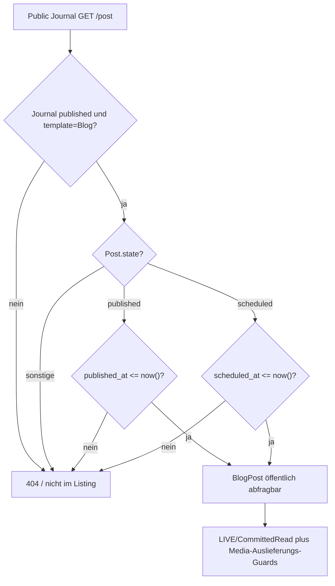

# Journal-Inhalte: Blog-/Exhibition-Lifecycle, Medien und öffentlicher Lesepfad

**Quellstand:** `dev@54a6810cefc610630b7305f9db49a32c2d9b4630` (auf `docs` als Zwei-Eltern-Merge aufgenommen). Diese Untersuchung rekonstruiert die **Entry-Operationen** und ihre öffentlichen Guards. Die davon unabhängige **Journal-Templatewahl** ist im [Lifecycle-Dokument](lifecycles.md#8-journal-templatewechsel-präsentation-statt-inhaltsmigration) erklärt, der gemeinsame Media-Cleanup unter [Medienreferenzen](media-reference-and-cleanup.md) und die konkrete Exhibition-Geocoding-Autosave-Kette unter [Exhibition Map](exhibition-map.md). Keine hier ausgeführte PHP-/Datenbank-/Browser-Validierung.

## Getrennte Zustandsachsen statt eines vereinheitlichten „Journal-Status“

Beide Eintragstypen gehören über `site_section_id` zu einem typisierten Journal Site Node. `SiteSection.template` bestimmt, **welche Eintragsfamilie** gerade öffentlich dargestellt und im Admin-Journal bearbeitet wird; das Umschalten löscht weder BlogPosts noch Exhibitions. Zusätzlich entscheidet der SiteSection-Publikationsstatus über öffentliche Seiten-Eligibility. Ein BlogPost-/Exhibition-Status ist **Working-Domainpersistenz** und erst nach [explizitem Publication-Commit](publication.md) für normale Public-GETs in `committed.*` sichtbar.

| Dimension | BlogPost | Exhibition |
| --- | --- | --- |
| Persistierte Editorial-States | `draft`, `scheduled`, `published`, `unpublished`, `archived` | `draft`, `published`, `archived` |
| Public-Visibility ohne Preview | `published AND published_at <= now()` **oder** `scheduled AND scheduled_at <= now()`, zusätzlich aktives Blog-Journal und publizierter Site Node | `state=published`, zusätzlich aktives Exhibitions-Journal und publizierter Site Node |
| Preview-Visibility | Nicht archivierte Posts im aktuell gewählten Blog-Template; eigenes Preview-Auth/Working | Nicht archivierte Exhibitions im aktuell gewählten Exhibitions-Template |
| Abgeleitete Zeitachse | Bei `scheduled` ist der Fälligkeitszeitpunkt Lesefilter, **keine automatische persistierte Transition** | `temporalState(now)` ist `upcoming/current/past/unknown` nach Beginn/Ende, **unabhängig** von `draft/published/archived` |
| Strukturierte Medien | `JournalEntryMedia` für Cover/Gallery, plus Rich-Text-Body | Derselbe `JournalEntryMedia`-Owner für Cover/Gallery, plus Rich-Text-Description; Gallery nur bei `gallery_enabled` |
| Live-Grenze | `committed.blog_posts`, `committed.journal_entry_media` usw. erst nach Commit | `committed.exhibitions`, gemeinsame getrackte Relationen erst nach Commit |

Das ist **keine gleichförmige Status-Maschine**: Fälligkeit eines Scheduled Posts wird **nicht** durch eine Cron- oder Timerstatusänderung in `published` überführt; Exhibition-`past` ist keine Unpublication. [`BlogPost::scopePubliclyVisible()`](../../app/Models/BlogPost.php) und [`Exhibition::temporalState()`](../../app/Models/Exhibition.php) sind die jeweiligen Leseowner.

## 1. BlogPost: Editorial-Transaktion, Schedule und Read-Guard

[`BlogEditorialService::publish()`](../../app/Domain/Content/BlogEditorialService.php) nimmt unter `DB::transaction` einen `lockForUpdate` auf dem aktuellen Post, akzeptiert Draft/Scheduled/Unpublished, setzt `state=published`, entfernt `scheduled_at` und ruft `prepareLifecycle()` auf. Diese Methode verlangt nichtleeren Body, validierbaren Rich Text und `JournalEntryMediaService::assertPublicReady()`; bei erstmaliger Veröffentlichung wird `published_at` gesetzt. Ein erneutes Publish bei bereits Published kehrt ohne Audit als **No-op** zurück. Der echte Wechsel schreibt `blog_post.published`-Audit.

[`schedule()`](../../app/Domain/Content/BlogEditorialService.php) validiert zunächst einen **zukünftigen** Zeitpunkt. Innerhalb der gesperrten DB-Transaktion akzeptiert es Draft/Scheduled/Unpublished, speichert `state=scheduled`, `scheduled_at` und denselben Public-Readiness-Guard und auditiert `blog_post.scheduled`. Der aktuelle Domaincode enthält an dieser Stelle **keinen eigenen Same-Date-No-op-Guard**: auch erneutes Setzen desselben Future-Zeitpunkts erreicht Save/Audit; das ist anders als `publish` und die generische `transition()` und gehört in einen gezielten Regressionstest statt als selbstverständlich idempotent zu gelten.

[`unpublish()`](../../app/Domain/Content/BlogEditorialService.php) akzeptiert aus `published` die Transition zu `unpublished`; `archive()` und `restoreDraft()` haben eigene Quell-Guards; `restoreDraft` aus `scheduled/unpublished/archived` setzt Draft. Die generische `transition()` kehrt bei identischem Zustand oder nicht erlaubter Herkunft ohne Änderung zurück und löscht bei Nicht-Scheduled `scheduled_at`. Löschen ist **verboten für Published oder Scheduled**. Beim [`update()`](../../app/Domain/Content/BlogEditorialService.php) sind veröffentlichte/zeitgeplante Slugs nach erster Veröffentlichung/Scheduling unveränderlich; Wechsel zwischen Journals bedarf einer eigenen Workflow-Operation. Änderungen an Metadaten und strukturierten Medien erhalten einen Audit nur bei Dirty-Row oder `mediaChanged`; ein sonstiger Edit-No-op ist kein Success-Audit.

**Read-Timing** ist eine rein zeitliche Query-Achse:

Ein Future Scheduled Post wird nicht sichtbar, aber sobald `scheduled_at <= now()` ist, kann seine öffentliche Readquery ihn zulassen **ohne** persistierte Statusumstellung. Ob die fällige Version überhaupt in LIVE enthalten ist, hängt gesondert vom erfolgten Publication-Commit ab. Public SEO und Rich-Text-Media-Eligibility verwenden dieselbe `publiclyVisible()`-Semantik, dürfen aber nicht mit einem pauschalen `state=published` ersetzt werden.

## 2. Exhibition: Editorial-/Temporal-State und Maps

[`ExhibitionEditorialService::publish()`](../../app/Domain/Content/ExhibitionEditorialService.php) wechselt aus Draft oder Archived zu Published unter `DB::transaction` und Row-Lock. [`assertPublicReady()`](../../app/Domain/Content/ExhibitionEditorialService.php) fordert einen gültig anzeigbaren Zeitraum; für neue nicht-legacy Entries einen strukturierten `starts_on`, bei `map_enabled` valide Koordinaten, dazu Medien-/Rich-Text-Readiness. Ein identischer Published-Request kehrt ohne Audit zurück; ein echter Wechsel setzt `published_at` nur wenn zuvor null und auditiert `exhibition.published`.

`unpublish()` setzt Published → Draft, kein separates persistiertes `unpublished`-Enum. `archive()` merkt sich `archived_from_state` (Draft oder Published) und setzt Archived. `restore()` verlangt Archived, zielt zunächst auf den vorherigen State oder einen auf `published_at` basierten Fallback; soll Published restauriert werden, führt der Service `assertPublicReady()` **erneut** aus und fällt bei ValidationException bewusst auf Draft zurück. Ein Restore ist deshalb nicht automatisch eine garantierte Wiederveröffentlichung. `delete()` verweigert Published, weitere FK-/Relationseffekte bleiben Domain-/SQL-Grenzen.

[`Exhibition::temporalState()`](../../app/Models/Exhibition.php) verwendet `starts_on`/`ends_on` und den aktuellen Kalendertag: vor Start `upcoming`, mit Enddatum von Beginn bis einschließlich Ende `current`, danach `past`; ohne `ends_on` ist ausschließlich der Starttag `current`, danach `past`; fehlender Start ergibt `unknown`. Dieser abgeleitete Zustand kann bei Draft und Published auftreten und wird **nicht** als Lifecycle-Audit gespeichert.

**Geocoding-/Map-Grenze:** [`ExhibitionEditorialService::update()`](../../app/Domain/Content/ExhibitionEditorialService.php) sperrt den aktuellen Entry. Geänderte Standortfelder invalidieren bestehende Latitude/Longitude/GeocodedAt. Bei `map_enabled` und neuen/fehlenden Koordinaten wird Geocoding ausgeführt, bevor der neue Rowzustand akzeptiert wird; ein bereits Published-Entry muss nach dem Update wieder `assertPublicReady()` erfüllen. Das konkret behandelte Browser-/Livewire-Autosave-/Notification-Verhalten gehört unverändert der [Exhibition-Map-Untersuchung](exhibition-map.md), nicht einem neuen Map-UI-Owner.

## 3. Geteilte JournalEntryMedia und mittelbare Zustandsänderungen

[`JournalEntryMediaService::syncStructuredMedia()`](../../app/Domain/Content/JournalEntryMediaService.php) akzeptiert für BlogPost **oder** Exhibition dieselbe Cover- und Gallery-Auswahl. Ein vorhandener `cover_media_asset_id`- beziehungsweise `gallery_images`-Eingabekey kann die dazugehörigen Relations verändern. Nur bei tatsächlicher Media-Änderung wird die zuvor geladene `mediaUsages`-Relation invalidiert; ein Save kann also auch **media-only** sein. Der SQL-Owner bleibt die explizite genau-eine-Eigentümer-Relation `blog_post_id XOR exhibition_id` in [Schema Evolution](schema-evolution.md), kein frei erfundener morph.

[`JournalEntryMediaService::assertPublicReady()`](../../app/Domain/Content/JournalEntryMediaService.php) betrachtet die relevanten strukturierten Cover-/Gallery-Usages und den Rich-Text-Body beziehungsweise Exhibition-Description. Gallery-Usages einer Exhibition mit `gallery_enabled=false` werden beim Readiness-Check gezielt übersprungen, **nicht** automatisch aus der Datenbank gelöscht. Dadurch sind diese Daten beim Wiederaktivieren potentiell erneut relevant. Ein öffentlich bereiter Eintrag benötigt geeignete verfügbare MediaAssets und für interne Markdownbilder deren Alt-/Thumbnail-Readiness.

**Media-Delete ist keine isolierte Media-Row-Operation:** [`detachAsset()`](../../app/Domain/Content/JournalEntryMediaService.php) entfernt strukturierte Usages, bereinigt kanonische `media:<id>`-Rich-Text-Referenzen, normalisiert Galeriepositionen und auditiert die betroffenen Entry-Owner. Falls ein zuvor Published Blog seinen einzigen Body-Inhalt durch die Entfernung verliert, kann er dabei **zu `unpublished`**, ein Scheduled Blog **zu `draft`** herabgestuft werden; `scheduled_at` wird gelöscht. Diese indirekte Mutation gehört zum [Medienlösch-/Referenzflow](media-reference-and-cleanup.md), der zusätzlich die LIVE-/History-Schutzentscheidung vor physischer Dateilöschung behandelt. Für Exhibition muss die Authoring-/Map-/Media-Verfügbarkeit nach Entfernen neuer Referenzen separat geprüft werden; **kein** pauschal behaupteter Rücksprung auf Draft ohne konkreten Codebeleg.

## 4. Öffentlicher Controller und Template-Eligibility

[`PublicSiteSectionController::journal()`](../../app/Http/Controllers/PublicSiteSectionController.php) wählt ausschließlich anhand des **aktiven JournalTemplate** zwischen `blogJournal()` und `exhibitionsJournal()`. Er filtert Blog-Journal-Public-Inhalte über `BlogEditorialService::publicQuery()`; Exhibitions über `state=published`. Die Preview (nur als Admin) zeigt nicht archivierte Entries statt der normalen Public-State-Filter. Einzelne Blog-Detailrouten `/{section}/{slug}` verlangen ausdrücklich `JournalTemplate::Blog` und einen passenden Post; bei Wechsel zu Exhibitions existiert der ursprüngliche Post weiterhin, ist über diese öffentliche Detailroute aber nicht aufrufbar.

[`PublicMedia::isPublicAsset()`](../../app/Domain/Media/PublicMedia.php) prüft bei Journal-Cover-/Galeriebildern wiederum State, aktives Template und SiteSection-Publikationsstatus sowie – bei Exhibitions Gallery – das `gallery_enabled`-Flag. Die Media-Auslieferung ist folglich ein **separater** öffentlich autorisierter Read-Owner. Eine inaktive/Preview-referenzierte Datei muss dadurch nicht ohne weiteres als gewöhnliches PublicMedia abrufbar sein.

## 5. Noch fehlende, präzise Nachweise

| Isolierter Fall | Erwartete Invariante / zu untersuchende Abweichung |
| --- | --- |
| Blog Scheduled noch in Zukunft, nach Zeitablauf und nach LIVE-Commit | Zeitablauf ändert `scheduled_at`-/`state`-DB-Werte nicht; Query-Eligibility ändert sich ausschließlich mit Clock und LIVE-Inhalt |
| Blog `schedule()` zweimal mit identischem zukünftigem Zeitwert | Quellpfad ruft weiterhin Save/Audit; testen, ob doppeltes Audit entsteht und ob dies gewollt ist |
| Blog `publish()` bereits Published | Domain No-op ohne zusätzliches Publish-Audit |
| Exhibition archived-from-published, inzwischen fehlende Map-Koordinaten oder Medien | Restore fällt bei fehlender Public-Readiness auf Draft zurück; Source und Audit unterscheiden diese Downshift-Transition |
| Exhibition Datum `starts_on`/nur Start/mit Endzeit/legacy `date_text` | Temporale Anzeige vs Domain-Publish-Guard vs gespeicherte Zeitzone exakt vergleichen |
| Media-only Blog-Edit und Media-Delete eines einzigen eingebetteten Rich-Text-Images | eigener Audit trotz gleicher Blog-Row; nach Löschung kein öffentlich Published/Scheduled mit leerem Body |
| Exhibition `gallery_enabled=false` mit vorhandenen Gallery-Usages | gespeicherte Medien erhalten, Public/Readiness ausgeschlossen; spätere Aktivierung erneut validieren |
| Inaktives Journal-Template, Child-Entry noch publiziert | kein Aufruf des falschen Public-Listings/Blog-Detailroutes; Daten und interne Storage-Referenzen bleiben erhalten |
| Preview-/Public-/LIVE-Commit und Medienasset-URL | Preview und normales Public nicht dieselbe Auth/Read-Kontext, keine implizite Veröffentlichung |

**Test-Evidenz:** Vorhandene Blog-/Exhibition-/Journal-Media-Tests und Source-Controller wurden betrachtet, aber keine Tests tatsächlich ausgeführt. Ein Quellkommentar, `scheduled_at`-Wert oder persistierter `published`-Status ist kein Beleg für erfolgreich ausgeliefertes öffentliches HTML oder Mail/Medienbytes. Diese Dokumentation erfordert keine Timer/Polling-Automation und nimmt keinen CI-Zugriff vor.
