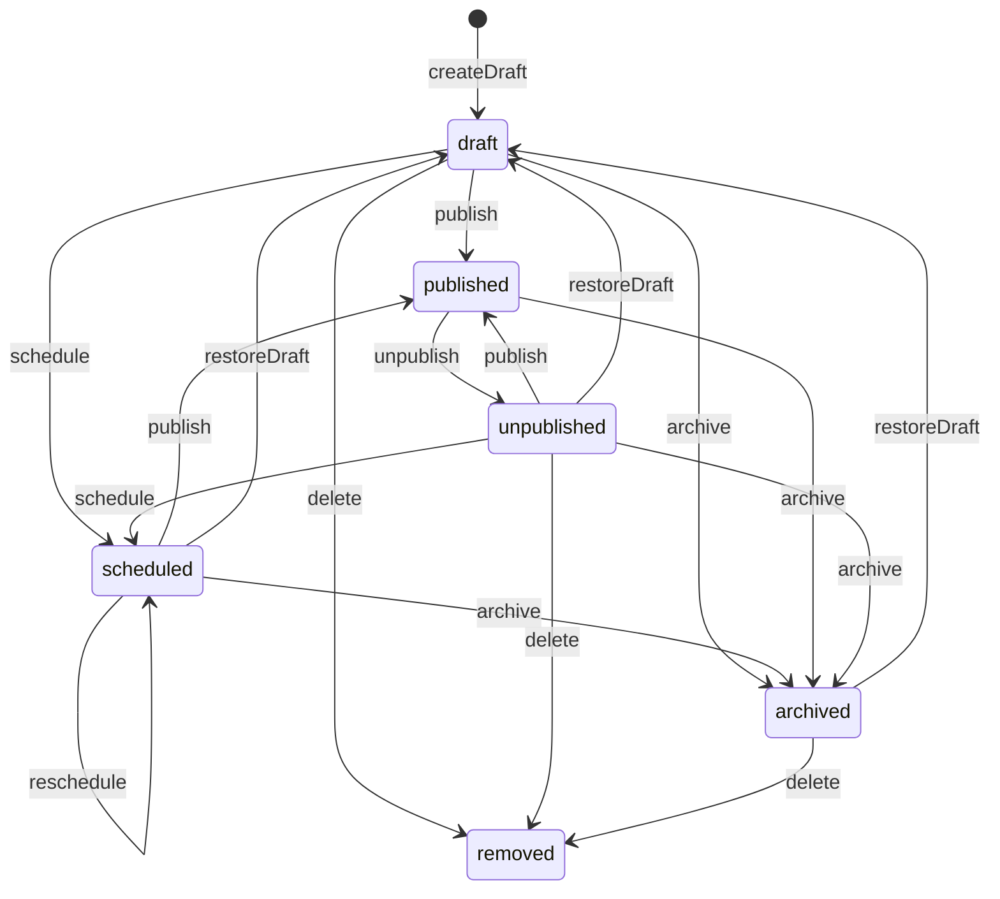
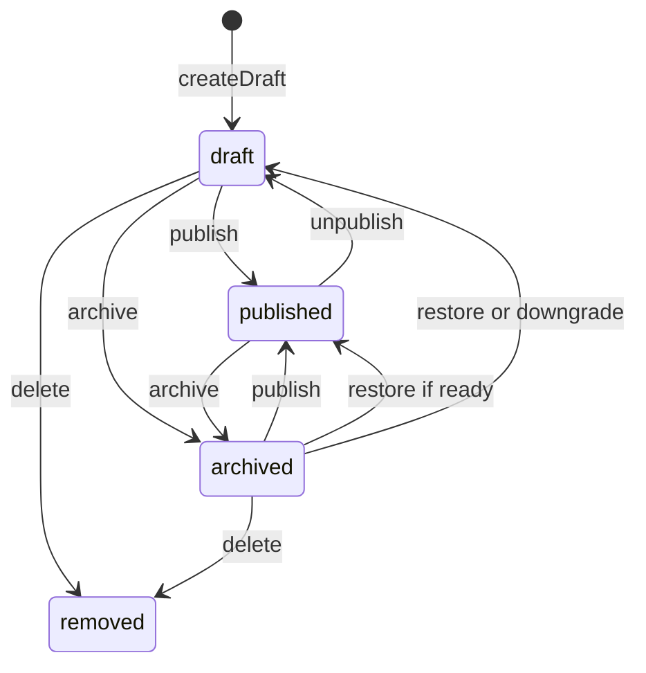
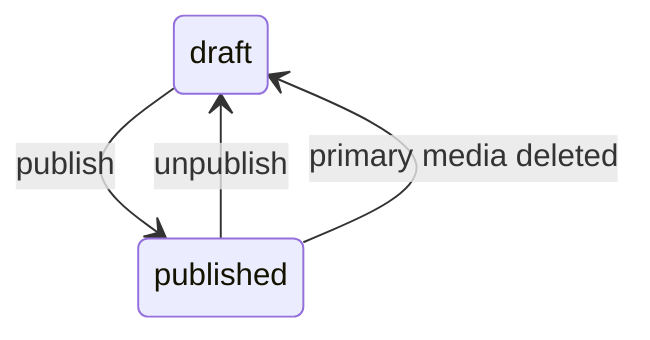
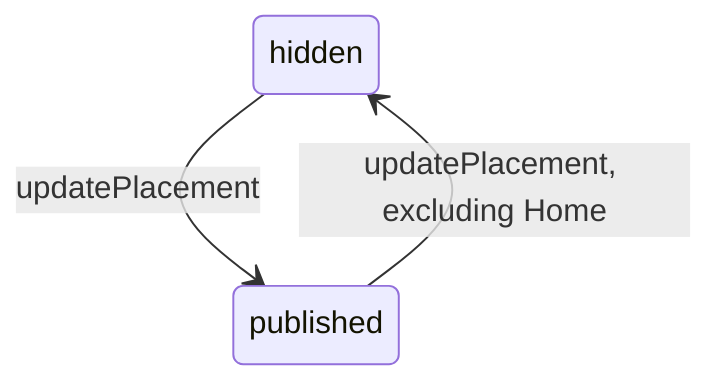
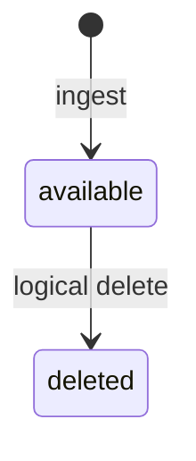
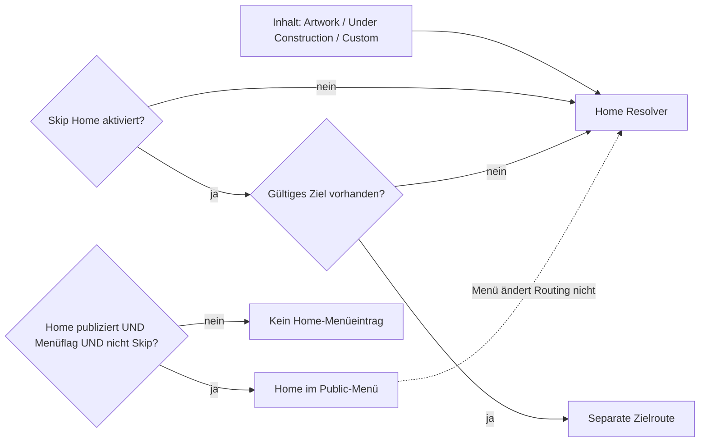
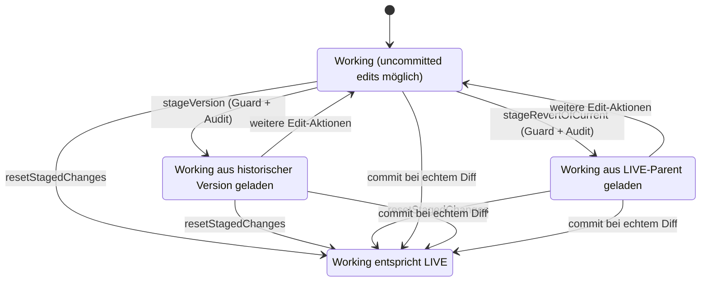
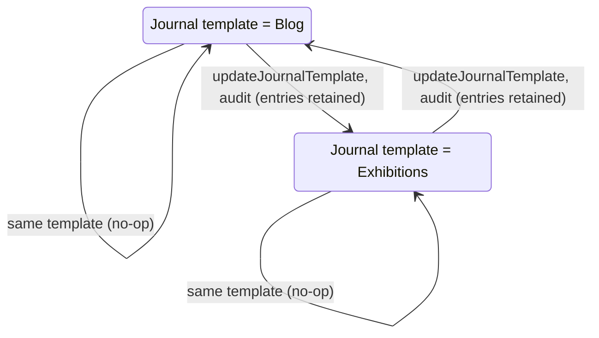

# Fachliche Lebenszyklen: Zustände, Guards und Seiteneffekte

Die fünf hier begonnenen Zustandsautomaten sind in [lifecycles.json](lifecycles.json) mit konkreten PHP-Quellpfaden und Textankern abgelegt. [generate-architecture-lifecycles.php](../../scripts/generate-architecture-lifecycles.php) erzeugt daraus reproduzierbare [Mermaid-Diagramme](generated/lifecycles). Die Textanker werden geprüft, die **fachliche Korrektheit ist weiterhin manuell gegen die Methoden zu überprüfen**. Am 19.10.2026 besteht der native `--check` mit PHP 8.3.33 auf `docs@8c9bd0a0`: fünf Modelle, 35 Übergänge, sechs Quelldateien; Manifest und Diagramme unverändert. Das bestätigt Textanker und Rendering, keine erneute vollständige Semantikprüfung gegenüber neuerem `dev` und keine dynamische Laufzeitanalyse.

## 1. BlogPost



**Guards** ([BlogEditorialService](../../app/Domain/Content/BlogEditorialService.php)): Publish nur von Draft, Scheduled oder Unpublished, mit geeignetem Body und öffentlichen Medien. Schedule setzt ein zukünftiges Datum voraus. Aus Archived ist nur Restore-to-Draft möglich, bevor erneut publiziert werden kann. Delete verweigert Published und Scheduled.

**No-ops:** Die gemeinsame `transition()`-Methode gibt bei einem nicht erlaubten `onlyFrom`-Ausgangszustand einfach den unveränderten Datensatz zurück. Insbesondere kann ein falsches `unpublish()` oder `restoreDraft()` ohne Ausnahme enden. Bereits Published bei `publish()` ist ebenfalls ein No-op. `removed` im Diagramm bedeutet **gelöschte Zeile**, keinen gespeicherten Zustandswert.

**Unabhängige öffentliche Eligibility:** [BlogPost::scopePubliclyVisible()](../../app/Models/BlogPost.php) liefert Published mit `published_at <= now()` oder Scheduled mit `scheduled_at <= now()`. Ein fälliger Scheduled Post **wechselt nicht automatisch seinen gespeicherten Status**. Die zugehörige veröffentlichte SiteSection, das aktive Journal und Working/LIVE sind weitere Sichtbarkeitsgrenzen.

## 2. Exhibition



Die Grundlage ist [ExhibitionEditorialService](../../app/Domain/Content/ExhibitionEditorialService.php). Publish von Draft oder Archived erfordert `assertPublicReady()`: insbesondere gültige Datumsevidenz, Koordinaten für aktivierte Maps und geeignete Public-Medien. Unpublish setzt Draft, keinen eigenständigen Unpublished-Status. Archive speichert `archived_from_state`. Restore berücksichtigt die frühere Veröffentlichung, führt aber bei mangelnder aktueller Readiness sicher auf Draft zurück. Published kann nicht gelöscht werden.

**Eine zweite, unabhängige Achse** liefert [Exhibition::temporalState()](../../app/Models/Exhibition.php):

| Zeitbedingung | Präsentationswert |
| --- | --- |
| Kein `starts_on` | `unknown` |
| Vor Start | `upcoming` |
| Start erreicht, noch nicht nach `ends_on` | `current` |
| Nach Ende | `past` |
| Nur Startdatum, genau am Starttag | `current` |
| Nur Startdatum, nach dem Starttag | `past` |

Dies ist keine Datenbanktransitionsfolge. Eine Draft-Exhibition kann Upcoming sein; eine Published-Exhibition kann Past sein.

## 3. Artwork



Die Gallery-Action-Aufrufstellen in [GalleryWorkspaceArtworkActions](../../app/Filament/Pages/Concerns/GalleryWorkspaceArtworkActions.php) und [GalleryWorkspaceBatchActions](../../app/Filament/Pages/Concerns/GalleryWorkspaceBatchActions.php) verwenden den [ArtworkPublicationService](../../app/Domain/Artwork/ArtworkPublicationService.php). Publish erfordert eine Gallery mit publizierter SiteSection, genau ein Primärmedium, verfügbaren MediaAsset und passenden ALT-Text. Bilder brauchen die passende verfügbare Thumbnail-Variante; die Medienprüfung behandelt Video getrennt. Bereits Published erzeugt kein neues Publish-Audit-Ereignis.

**Indirekte Änderung:** [MediaAssetEditorialService](../../app/Domain/Media/MediaAssetEditorialService.php) kann bei der Löschung des Primärmediums ein veröffentlichtes Artwork auf Draft zurücksetzen und aus der Gallery lösen. Dieser bereichsübergreifende Übergang gehört ins Modell.

**Tatsächlich zwei verwendete Publish-Pfade:** Die Gallery nutzt `ArtworkPublicationService`, während `AdminLifecycleRegistry` als Undo-Inverse `ArtworkEditorialService::publish()` verwendet. Beide besitzen derzeit **nicht identische Medien-Readiness-Guards**: Asset-ALT versus ALT-Override sowie die Video-/Thumbnail-Anforderung. Belege, Auswirkungen und die noch ausstehende Testverifikation stehen unter [Importgrenzen und Undo-Publish](import-boundaries.md).

## 4. SiteSection



[SiteSectionEditorialService::updatePlacement()](../../app/Domain/Content/SiteSectionEditorialService.php) lässt `published` und `hidden` zu. Home muss Published bleiben. Parent-Validierung und Umpositionierungen gehören zur selben Mutation; ein unveränderter Zustand erzeugt keinen Audit-Eintrag. `published` in **Working** ist noch kein vollständiger LIVE-Commit.

## 5. MediaAsset



[MediaIngestService](../../app/Domain/Media/MediaIngestService.php) schreibt Original und gegebenenfalls Variante vor der DB-Erstellung und versucht bei einem Fehler die schon angelegten Binärdateien zu bereinigen. [MediaAssetEditorialService::delete()](../../app/Domain/Media/MediaAssetEditorialService.php) markiert den Datensatz und Varianten logisch als Deleted, trennt nötigenfalls Referenzen und kann andere Entitäten mitändern. Physische Löschung erfolgt gesondert mit Schutz von LIVE- und historisch restorablem Zustand. Ein `MediaAsset`-State ist nicht gleich der Existenz einer Datei im Storage.

**Hinweis zu weiteren persistierten Werten:** Die ursprünglichen DB-CHECK-Constraints erlaubten für Artworks und Exhibitions zusätzlich Hidden/Archived sowie für MediaAssets Quarantined. Die obigen Graphen zeigen **nachverfolgte aktuelle Workflow-Transitionen**, nicht bereits sämtliche historisch oder physisch zulässigen Werte. Details und ausstehende Endschema-Verifikation stehen in [Schemaentwicklung](schema-evolution.md).

## 6. Home: drei orthogonale Zustandsachsen (neu, `dev@f69e0e7e`)

Home ist **keine einzelne vierwertige Zustandsmaschine**. Aktueller Source in [`HomePresentationSetting`](../../app/Models/HomePresentationSetting.php), [`HomeRoutingSettingsService`](../../app/Domain/Content/HomeRoutingSettingsService.php), [`HomePresentationResolver`](../../app/Domain/Content/HomePresentationResolver.php), [`SiteSectionEditorialService`](../../app/Domain/Content/SiteSectionEditorialService.php) und [`PublicNavigationService`](../../app/Domain/Content/PublicNavigationService.php) besitzt drei unabhängige Achsen:

| Achse | Gespeichert in | Werte/Guard | No-op/Seiteneffekt |
| --- | --- | --- | --- |
| Inhaltstemplate | `home_presentation_settings.template` | `artwork`, `under_construction`, `custom`; historische `skip_home`-Enum-Form wird auf Artwork-Inhalt + separates Routing abgebildet | `changeTemplate()` ersetzt **nicht** die separat gespeicherte Skip-Home-Zielwahl |
| Root-Routing | `home_presentation_settings.skip_home`, `skip_target_section_id` | aktiv/inaktiv; explizites Ziel nur **publizierte** top-level SiteSection mit öffentlichem Pfad und Content-Seite, nie Home/Navigation Node | `HomeRoutingSettingsService::update()` sperrt Row, prüft `isDirty`, speichert und auditiert nur bei Änderung; bei inaktivem Skip wird Ziel-ID auf null gesetzt |
| Menüzugehörigkeit | `site_sections.show_in_navigation` **nur Home** | eigener Bool; Publikum sieht Home im Menü nur bei `published && show_in_navigation && !skip_home` | separater Domain-Lock + Audit/No-op; weder Root-Routing noch Template werden geändert |

`skipTargetForSettings()` nimmt zuerst ein **zur Lesezeit noch gültiges** explizites Ziel. Andernfalls sucht es ab der Position von Home in `position/id`-Reihenfolge die nächste veröffentlichte Top-Level-Content-Seite. Fehlt eine, gibt es `null` zurück; der öffentliche Resolver muss entsprechend den Home-Content-Fallback statt einer Endlosschleife verwenden. Die Vorschau hat eine eigene URL-Projektion. Die Menüprojektion enthält weiterhin veröffentlichte Kinder auch dann, wenn deren Editorial-Parent nicht in ihrer gefilterten Ergebnismenge enthalten ist; diese werden zu sichtbaren Root-Items **nur im projizierten Menü**, nicht in der Datenbank umgehängt.



Die parallelen Wege sind **bewusst keine zeitliche Sequenz**: Der Renderer liest Template/Routing; der Navigator entscheidet eine separate Menüsichtbarkeit. Die Source-Fallmatrix zur Livewire-Action, Transaktion, Audit und Notification steht unter [Editorial-Mutationspfade](editorial-mutation-paths.md).

## 7. Publication: Working-Context, LIVE-Head und Snapshot-Verfügbarkeit

**Quellen:** [`PublicationService::commit()`](../../app/Domain/Publication/PublicationService.php), [`PublicationVersionService`](../../app/Domain/Publication/PublicationVersionService.php), [`PublicationCheckpoint`](../../app/Models/PublicationCheckpoint.php). Diese drei Aspekte dürfen nicht zu einem einzigen `published`-Boolean zusammengeschoben werden:

- **Working (public-Schema):** bearbeitbare fachliche Tabellen. Ihre Unterschiede gegenüber `committed.*` sind ein **abgeleiteter Row-Diff**, kein zwingend persistierter Dirty-Boolean.
- **LIVE:** Inhalt der Tabellen unter `committed.*` plus neuester `PublicationCheckpoint` nach Commit; **vorherige** Working-Edits werden durch einen normalen öffentlichen Request nicht automatisch ausgeliefert.
- **Version/History:** `publication_checkpoints`, `publication_version_rows`, `schema_hash`, `snapshot_available`, Parent- und Source-Checkpoint sind eigenständige Provenienz-/Recovery-Daten. Ein History-Metadatensatz mit `snapshot_available=false` bleibt historisch existent, ist aber **nicht restorable**.

| Operation | Transaktion, Guard und Änderung | No-op/Fehler/Seitenwirkung |
| --- | --- | --- |
| `stageVersion(old)` | Advisory Lock und Schema-Parität; `assertRestorable()` verlangt Snapshot + kompatiblen Hash; ersetzt Working aus dem Version-JSON und markiert Working-Context `operation=restore` mit Source `old.id` | Auch wenn die Diffzahl null ist: Working-Context und `publication.version_restored`-Audit werden gesetzt; Media-Cleanup wird nach dem DB-Commit gedraint |
| `stageRevertOfCurrent()` | Aktuellen LIVE und Parent lesen, anschließend unter Advisory Lock Parent-Kompatibilität und Working-Replacement; Kontext `operation=revert`, Source = alter LIVE | Erste Version ohne Parent / fehlender Snapshot werfen ValidationException; **LIVE/Parent wurden vor Lock gelesen** und unter Lock nicht erneut gegen HEAD geprüft: Interleaving-Risiko |
| `resetStagedChanges()` | Advisory Lock, Schema-Parität, Working-Diff; bei echtem Diff Working aus LIVE restaurieren, Context löschen und `publication.stage_reset` auditieren | Diff=0: nur Context-Clear, keine neue Reset-Audit-Aufzeichnung; kein Cleanup-Drain. Historische Snapshots werden nicht gelöscht |
| `commit()` | Advisory Lock, Schema-Parität, SHARE TABLE Lock, neue Working/LIVE-Diff-Berechnung; nur bei echtem Diff `committed.*` atomar ersetzen, Checkpoint/Versionrows erfassen, Audit-Lebenszyklus an Checkpoint binden und zugehörige Undo-Receipts freigeben | Diff=0: Context-Clear, Rückgabe `null`, **kein** neuer Checkpoint. `mediaCleanup->drain()` läuft bei echtem Commit **nach** Ende der DB-Transaktion; Dateisystemfehler sind nicht ein DB-Rollback |



**Graph-Geltungsgrenze:** Die Zustände sind **fachliche Working-Relationen und Kontextmarker**, nicht gespeicherte diskrete Enum-Zustände. Auch nach einem Stage mit null ermittelten Änderungszeilen kann ein `restore/revert`-Kontext bestehen; nach `commit` mit null Diff wird er entfernt. `commit` ist der einzige hier dargestellte Übergang, der LIVE neu erzeugt; Reset/Restore/Revert tun das **nicht**. Für die tatsächliche historische Version und Transaktionsrace siehe die bereits detaillierte [Restore-/Revert-/Reset-Untersuchung](publication-working-operations.md). Kein synchroner Snapshot- oder Dateisystemerfolg wird über diese Grenzen hinaus behauptet.

## 8. Journal-Templatewechsel: Präsentation statt Inhaltsmigration

[SiteSectionEditorialService::updateJournalTemplate()](../../app/Domain/Content/SiteSectionEditorialService.php) akzeptiert ausschließlich `JournalTemplate::Blog` oder `JournalTemplate::Exhibitions`. Unter `DB::transaction` und `SiteSection::lockForUpdate()` validiert er zuerst `nodeType=Journal`. Derselbe Wert führt zu einem **No-op** ohne Template-Audit. Bei wirklichem Wechsel stellt `ensureJournalSetting()` die bestehende Settings-Relation bereit, setzt nur `site_sections.template`, speichert und zeichnet `site_section.journal_template_updated` auf. **Weder `blog_posts` noch `exhibitions` werden gelöscht, verschoben oder konvertiert.**

[`JournalSettingsService::update()`](../../app/Domain/Content/JournalSettingsService.php) kombiniert diesen bestehenden Template-Owner mit der [`SiteSectionIdentityService`](../../app/Domain/Content/SiteSectionIdentityService.php) für `title`, `navigation_label` und `slug`. Die äußere Transaktion umfasst beide Suboperationen und damit die Identitäts-/Redirect-Arbeit. War das Navigationslabel unmodifiziert mit dem früheren Titel identisch, darf es den neuen Titel übernehmen; bewusst getrennte Labels werden erhalten. Dies ist von der bereits dokumentierten möglichen [Pages-Edit-Titel/Label-Abweichung](ui-surfaces.md#pages--edit-titel-navigation-label-und-no-op-statischer-negativpfad) zu unterscheiden. Journal-Settings und allgemeines Pages-Edit können unterschiedliche Eingangsprojektionen haben; die Existenz einer korrekten Domain-Methode beweist nicht alle UI-Eingangspfade.

**Zwei getrennte Leser des aktuellen Templates:**

1. Der [Admin-`JournalWorkspace`](../../app/Filament/Pages/JournalWorkspace.php) lädt bei `mount()` den aktuellen SiteSection-`template`-Enum und wählt in `getView()` entweder die Blog- oder Exhibitions-Arbeitsfläche. Nicht aktive Datensätze bleiben im jeweiligen Domain-Modell erhalten. Ein bereits offenes anderes Browserfenster muss bei Templatewechsel gesondert auf Stale-State geprüft werden; die statische `mount()`-Abfrage allein synchronisiert keine Livewire-Instanz automatisch.
2. Der [öffentliche Controller](../../app/Http/Controllers/PublicSiteSectionController.php) verzweigt in `journal()` ebenfalls nach dem **aktuellen** Template. `blogJournal()` filtert Posts über `BlogEditorialService::publicQuery()` bzw. in der Preview alle nicht archivierten BlogPosts; `exhibitionsJournal()` verwendet veröffentlichte bzw. Preview-nichtarchivierte Exhibitions. Die Blog-Detailroute `journalEntry()` verlangt **ausdrücklich** `template=blog`. Bei aktivem Exhibition-Template hat ein früheres Blog-Detail unter derselben Journal-Slug daher keinen passenden Controller-Eintrag und liefert 404, auch wenn der BlogPost-Datensatz fortbesteht.



Die Zustandsmaschine betrifft **nur das gespeicherte Template des Site Nodes**, nicht die Publication-/Archived-/Scheduled-States der Einträge und nicht das Working/LIVE-Commit. Die zugehörige physische Medienreferenz `JournalEntryMedia` gehört entweder einem BlogPost **oder** einer Exhibition (kein zweiter Storage-Katalog beim Templatewechsel). Der [Schema-Beleg](schema-evolution.md) beschreibt den genau-ein-Owner-CHECK.

**Fehler-/Regressionstest-Matrix (nur Testquellen, nicht ausgeführt):**

| Fall | Erwartete Domain-/Öffentlichkeitsfolge |
| --- | --- |
| Blog → Exhibitions → Blog | Original-BlogPosts einschließlich Body/IDs erhalten; erneutes Blog-Mount verwendet die vorhandenen Posts |
| Inaktives Blog-Detail bei Exhibition-Template | Kein öffentliches Blog-Detail unter dieser Journal-Route, nicht ein stilles Delete |
| Unverändertes Template | Kein `site_section.journal_template_updated`-Audit aus diesem Domain-Owner |
| Templatewechsel mit aktualisiertem Titel/Slug | Identität/Redirect und Template im selben äußeren Transaktionsrahmen; explizites Listing-Heading darf separat bleiben |
| Templatewechsel in offenem parallelem Journal-Dialog | Stale UI-/Action-Target als **offener** Browser-/Livewire-Negativtest |
| Veröffentlichung/Preview | Aktiver Journal-Typ, Eintragszustand und Working/LIVE-Publication separat prüfen |

[`JournalSettingsAutosaveTest.php`](../../tests/Feature/Admin/Journal/JournalSettingsAutosaveTest.php) definiert explizit den Erhalt von BlogPosts, einen Switch über Journal Settings und Pages, Redirect-/Label-/Listing-Heading-Fälle sowie Notification- und Dialog-Mount-Tests. Für diesen Dokumentationsbranch wurden die Tests **nicht ausgeführt**.

## Quellen- und Vollständigkeitsregel

Der historische generierte Ursprungskatalog umfasste **fünf** Modelle und **35** kuratierte Kanten. Zusätzlich sind jetzt **Home-Achsen** und **Publication-Working-Kontext** anhand aktueller Quellen manuell modelliert; sie sind **nicht** in den eingefrorenen Generatorzahlen enthalten. Activity/Undo ist inzwischen als eigener Quell-Lifecycle in [activity-undo-lifecycle.md](activity-undo-lifecycle.md) dokumentiert. Die **MediaVariant-Datei-Recovery** ist mit eigenem Guard-, Hash-, Request- und Reclaim-Diagramm in [media-reference-and-cleanup.md](media-reference-and-cleanup.md#rekonstruierbare-mediavariants-ein-file-lifecycle-ohne-neue-identität) nachgezogen; sie ist **kein zusätzliches persistiertes Enum**. Weiter offen bleiben vor allem vollständige UI-interne Browserzustände, konkurrierende identische Komponenten und physische Runtime-Verifikation. Weder das Mermaid-Modell noch die Generatorausgabe beweisen sämtliche physischen Datenbank-/Laufzeittransitionen. Für jeden weiteren Workflow müssen auch No-op-, Fehler-, Rollback- und indirekte Fremdservicepfade erfasst werden.

```sh
php scripts/generate-architecture-lifecycles.php --write
php scripts/generate-architecture-lifecycles.php --check
```
