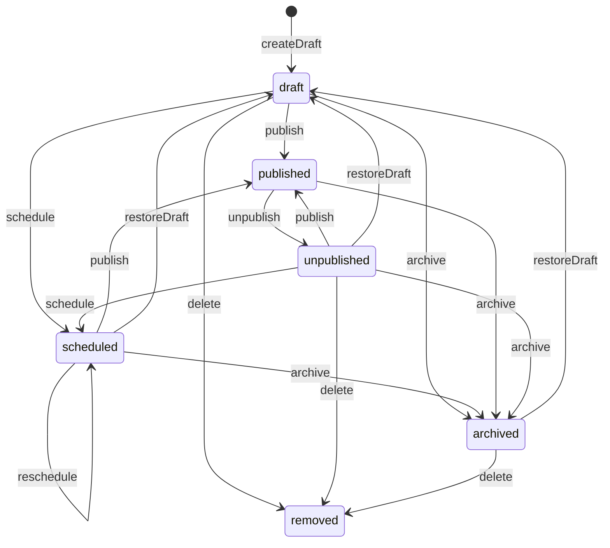
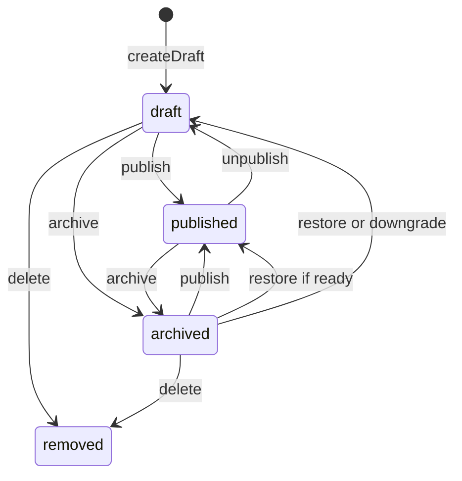
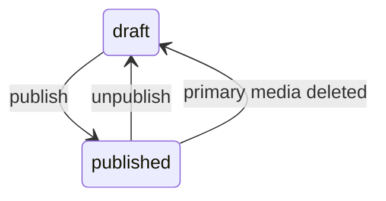
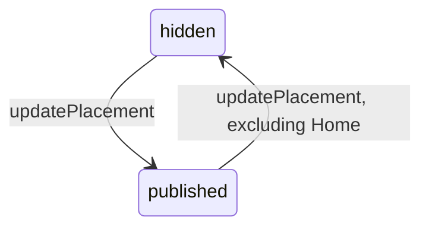
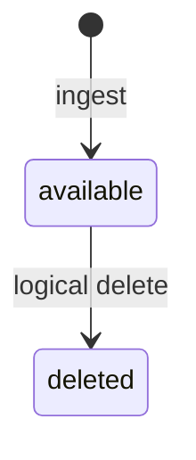

# Fachliche Lebenszyklen: Zustände, Guards und Seiteneffekte

Die fünf hier begonnenen Zustandsautomaten sind in [lifecycles.json](lifecycles.json) mit konkreten PHP-Quellpfaden und Textankern abgelegt. [generate-architecture-lifecycles.php](../../scripts/generate-architecture-lifecycles.php) erzeugt daraus reproduzierbare [Mermaid-Diagramme](generated/lifecycles/). Die Textanker werden geprüft, die **fachliche Korrektheit ist weiterhin manuell gegen die Methoden zu überprüfen**. Die Diagramme sind nicht das Ergebnis einer vollständigen dynamischen Laufzeitanalyse.

## 1. BlogPost



**Guards** ([BlogEditorialService](../../app/Domain/Content/BlogEditorialService.php)): Publish nur von Draft, Scheduled oder Unpublished, mit geeignetem Body und öffentlichen Medien. Schedule setzt ein zukünftiges Datum voraus. Aus Archived ist nur Restore-to-Draft möglich, bevor erneut publiziert werden kann. Delete verweigert Published und Scheduled.

**No-ops:** Die gemeinsame `transition()`-Methode gibt bei einem nicht erlaubten `onlyFrom`-Ausgangszustand einfach den unveränderten Datensatz zurück. Insbesondere kann ein falsches `unpublish()` oder `restoreDraft()` ohne Ausnahme enden. Bereits Published bei `publish()` ist ebenfalls ein No-op. `removed` im Diagramm bedeutet **gelöschte Zeile**, keinen gespeicherten Zustandswert.

**Unabhängige öffentliche Eligibility:** [BlogPost::scopePubliclyVisible()](../../app/Models/BlogPost.php) liefert Published mit `published_at <= now()` oder Scheduled mit `scheduled_at <= now()`. Ein fälliger Scheduled Post **wechselt nicht automatisch seinen gespeicherten Status**. Die zugehörige veröffentlichte SiteSection, das aktive Journal und Working/LIVE sind weitere Sichtbarkeitsgrenzen.

## 2. Exhibition



Die Grundlage ist [ExhibitionEditorialService](../../app/Domain/Content/ExhibitionEditorialService.php). Publish von Draft oder Archived erfordert `assertPublicReady()`: insbesondere gültige Datumsevidenz, Koordinaten für aktivierte Maps und geeignete Public-Medien. Unpublish setzt Draft, keinen eigenständigen Unpublished-Status. Archive speichert `archived_from_state`. Restore berücksichtigt die frühere Veröffentlichung, führt aber bei mangelnder aktueller Readiness sicher auf Draft zurück. Published kann nicht gelöscht werden.

**Eine zweite, unabhängige Achse** liefert [Exhibition::temporalState()](../../app/Models/Exhibition.php):

| Zeitbedingung | Präsentationswert |
| --- | --- |
| Kein `starts_on` | `unknown` |
| Vor Start | `upcoming` |
| Start erreicht, noch nicht nach `ends_on` | `current` |
| Nach Ende | `past` |
| Nur Startdatum, genau am Starttag | `current` |
| Nur Startdatum, nach dem Starttag | `past` |

Dies ist keine Datenbanktransitionsfolge. Eine Draft-Exhibition kann Upcoming sein; eine Published-Exhibition kann Past sein.

## 3. Artwork



Die Gallery-Action-Aufrufstellen in [GalleryWorkspaceArtworkActions](../../app/Filament/Pages/Concerns/GalleryWorkspaceArtworkActions.php) und [GalleryWorkspaceBatchActions](../../app/Filament/Pages/Concerns/GalleryWorkspaceBatchActions.php) verwenden den [ArtworkPublicationService](../../app/Domain/Artwork/ArtworkPublicationService.php). Publish erfordert eine Gallery mit publizierter SiteSection, genau ein Primärmedium, verfügbaren MediaAsset und passenden ALT-Text. Bilder brauchen die passende verfügbare Thumbnail-Variante; die Medienprüfung behandelt Video getrennt. Bereits Published erzeugt kein neues Publish-Audit-Ereignis.

**Indirekte Änderung:** [MediaAssetEditorialService](../../app/Domain/Media/MediaAssetEditorialService.php) kann bei der Löschung des Primärmediums ein veröffentlichtes Artwork auf Draft zurücksetzen und aus der Gallery lösen. Dieser bereichsübergreifende Übergang gehört ins Modell.

**Tatsächlich zwei verwendete Publish-Pfade:** Die Gallery nutzt `ArtworkPublicationService`, während `AdminLifecycleRegistry` als Undo-Inverse `ArtworkEditorialService::publish()` verwendet. Beide besitzen derzeit **nicht identische Medien-Readiness-Guards**: Asset-ALT versus ALT-Override sowie die Video-/Thumbnail-Anforderung. Belege, Auswirkungen und die noch ausstehende Testverifikation stehen unter [Importgrenzen und Undo-Publish](import-boundaries.md).

## 4. SiteSection



[SiteSectionEditorialService::updatePlacement()](../../app/Domain/Content/SiteSectionEditorialService.php) lässt `published` und `hidden` zu. Home muss Published bleiben. Parent-Validierung und Umpositionierungen gehören zur selben Mutation; ein unveränderter Zustand erzeugt keinen Audit-Eintrag. `published` in **Working** ist noch kein vollständiger LIVE-Commit.

## 5. MediaAsset



[MediaIngestService](../../app/Domain/Media/MediaIngestService.php) schreibt Original und gegebenenfalls Variante vor der DB-Erstellung und versucht bei einem Fehler die schon angelegten Binärdateien zu bereinigen. [MediaAssetEditorialService::delete()](../../app/Domain/Media/MediaAssetEditorialService.php) markiert den Datensatz und Varianten logisch als Deleted, trennt nötigenfalls Referenzen und kann andere Entitäten mitändern. Physische Löschung erfolgt gesondert mit Schutz von LIVE- und historisch restorablem Zustand. Ein `MediaAsset`-State ist nicht gleich der Existenz einer Datei im Storage.

**Hinweis zu weiteren persistierten Werten:** Die ursprünglichen DB-CHECK-Constraints erlaubten für Artworks und Exhibitions zusätzlich Hidden/Archived sowie für MediaAssets Quarantined. Die obigen Graphen zeigen **nachverfolgte aktuelle Workflow-Transitionen**, nicht bereits sämtliche historisch oder physisch zulässigen Werte. Details und ausstehende Endschema-Verifikation stehen in [Schemaentwicklung](schema-evolution.md).

## Quellen- und Vollständigkeitsregel

Die fünf Maschinen enthalten zunächst **35 kuratierte Kanten**, keine vollständige Lebenszykluskarte aller PHP-Objekte. Als Nächstes fehlen unter anderem Publication und Undo/Activity, Home-Routing und Template, Journal-Templatewechsel, MediaVariant-Recovery und UI-interne Zustände. Für jeden weiteren Workflow müssen auch No-op-, Fehler-, Rollback- und indirekte Fremdservicepfade erfasst werden.

```sh
php scripts/generate-architecture-lifecycles.php --write
php scripts/generate-architecture-lifecycles.php --check
```
