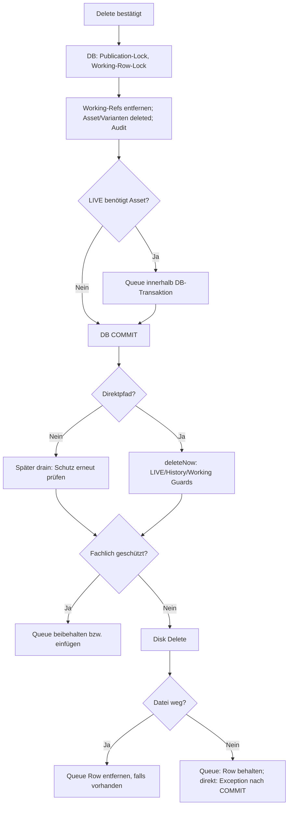
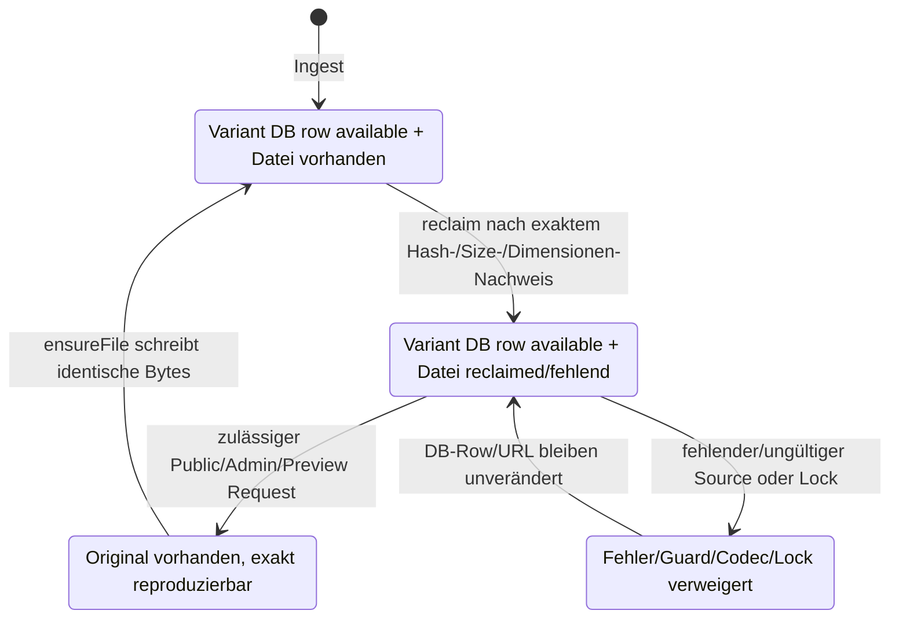

# Media-Referenzen und physische Bereinigung: Quellenpfade und Negativfälle

**Quellvergleich:** Medienlösch-/Cleanup-/Reclaim-Pfade erneut auf `dev@f69e0e7e3d857e717e9ed86102b0ee830ed9ebb0` geprüft; historische Beleglinien bleiben gesondert erhalten. **Statischer Source-Audit**, kein ausgeführter Datenbank-/Storage-/Browser-Test. Die [Media-Produktregeln](../MEDIA.md#deletion-and-cleanup) sind normativ; dieses Dokument macht ihre tatsächlichen Call-Pfade, Guards und Abweichungen sichtbar.

## Drei unabhängige Grenzen

| Grenze | Owner | Was tatsächlich passiert |
| --- | --- | --- |
| **Referenzermittlung** | [`MediaReferenceQuery`](../../app/Domain/Media/MediaReferenceQuery.php) | Eloquent-Relationen für Artwork/Journal/Site Identity und direktes JSON/Rich Text in Custom Page, Journal und Home entscheiden, ob ein MediaAsset *fachlich* referenziert ist. Diese Query benutzt **Working**; sie ist kein Beweis physisch ausgelieferter Bytes |
| **Logische Löschung** | [`MediaAssetEditorialService::delete()`](../../app/Domain/Media/MediaAssetEditorialService.php) | Unter Transaction-Advisory-Lock und Asset-Row-Lock: Schlüssel sichern, bekannte Canonical-Usages entfernen, Varianten und Asset auf `deleted` setzen und Audit schreiben. Ein Asset-Löschrequest ist keine sofortige Garantie, dass alle Bytes weg sind |
| **Physische Löschung** | [`PublicationMediaCleanupService`](../../app/Domain/Publication/PublicationMediaCleanupService.php) | Getrennter Dateilösch-Guard über aktuelles `committed.media_assets`, weiterhin verfügbare `publication_version_rows` und Working-State/Referenzen. Ein Queue-Eintrag kann warten, bis sein Schutz entfällt |

```mermaid
sequenceDiagram
    participant UI as Storage Action
    participant Service as MediaAssetEditorialService
    participant Ref as MediaReferenceQuery
    participant SQL as Working / LIVE / History
    participant Cleanup as PublicationMediaCleanupService
    participant Disk as Private Media Disk

    UI->>Service: delete(asset)
    Service->>SQL: BEGIN; Publication advisory lock; lock asset
    Service->>Ref: isReferenced(asset)
    opt Any recognized references
        Service->>SQL: Remove canonical artwork / journal / favicon / Custom / Home references
    end
    Service->>SQL: Mark variants and asset deleted; append Audit
    alt Current committed asset is still live
        Service->>Cleanup: queue(assetId, keys)
    end
    Service->>SQL: COMMIT
    alt Immediate-cleanup path
        Service->>Cleanup: deleteNow(keys)
    else Deferred-cleanup path
        Note over Cleanup: Wait for a later drain
    end
    Cleanup->>SQL: Check committed, version rows and Working references
    alt Still protected
        Cleanup-->>Cleanup: Keep / queue keys
    else Safe to delete
        Cleanup->>Disk: Delete original + variant keys
    end
```

## Vollständiger Delete-Boundary: DB-Commit ist nicht Dateisystem-Commit

**Gelesene Source-Owner:** [`MediaAssetEditorialService::delete()`](../../app/Domain/Media/MediaAssetEditorialService.php), [`PublicationMediaCleanupService`](../../app/Domain/Publication/PublicationMediaCleanupService.php) und [`SiteStorageReclaimService`](../../app/Domain/Storage/SiteStorageReclaimService.php).

Die Delete-Action besitzt einen **zweiphasigen** Effekt:

1. Innerhalb von `DB::transaction` wird der gemeinsame Publication-Advisory-Lock geholt. `committed.media_assets` entscheidet **zuerst**, ob LIVE dieses Asset noch nicht-deleted benötigt (`deferCleanup`). Die Working-Asset-Row samt Varianten wird per `lockForUpdate` geladen. Ihre Storage-Keys werden erfasst, bevor über `state=deleted` entschieden wird.
2. Bei noch nicht gelöschtem Working-Asset prüft `MediaReferenceQuery::isReferenced()` bekannte Working-Referenzen und ruft gegebenenfalls die kanonischen Detach-Owner auf; danach werden Varianten und Asset logisch als `deleted` gespeichert und **ein** `media.deleted`-Audit geschrieben. Der Lösch-Service erzeugt absichtlich keine zusätzlichen Undo-Receipts (`withoutReceipts`). Bei `deferCleanup=true` werden die Keys noch in derselben Transaktion in `publication_media_cleanups` eingefügt.
3. **Nach** Ende der Transaktion: Nur wenn `deferCleanup=false`, wird `deleteNow(keys)` direkt gestartet. Eine RuntimeException der physischen Löschung kann dann die **bereits gespeicherte logische Löschung nicht zurückrollen**. Bei defer bleiben Original/Varianten bis zu einem späteren `drain()` geschützt.
4. War das Working-Asset **vorher schon** `deleted`, kehrt die Transaktions-Closure früh zurück (kein neues Audit), aber der äußere Service durchläuft abhängig vom vorher ermittelten `deferCleanup` weiterhin den Cleanup-Pfad und liefert bei erfolgreichem Rücklauf `true`. Das ist keine zweite fachliche Löschung.

### Physische Schutzentscheidung als Wahrheitstabelle

[`PublicationMediaCleanupService::canDeletePhysicalMedia()`](../../app/Domain/Publication/PublicationMediaCleanupService.php) prüft nacheinander folgende **unabhängige** Quellen:

| Schutzquelle | Physische Löschung zulässig? | Tatsächliches Prüfverhalten |
| --- | --- | --- |
| `committed.media_assets` besitzt dieses Asset mit `state != deleted` | **Nein** | Schutz auch ohne aktuelle Working-Referenz |
| `publication_version_rows` enthält für das Asset einen nicht-deleted historischen Payload | **Nein** | Schützt vorhandene Snapshot-Bytes; der Guard fragt **keine** `snapshot_available`-Spalte ab, sondern die tatsächlich vorhandenen Version-Zeilen |
| Working-Asset nicht mehr vorhanden | **Ja**, sofern die obigen beiden Prüfungen frei sind | Darauf folgen gegebenenfalls konkrete Disk-Operations |
| Working-Asset vorhanden und noch nicht `deleted` | **Nein** | Verhindert Löschen aktiver Working-Medien |
| Working-Asset `deleted`, aber `MediaReferenceQuery::isReferenced` meldet Referenz | **Nein** | Fachlicher Referenzschutz; derzeit abhängig von der bekannten **Home-List-Coverage-Lücke** |
| Working-Asset `deleted`, keine Referenz und kein LIVE-/History-Guard | **Ja** | Physischer Cleanup kann beginnen; erfolgreiche Dateilöschung bleibt separat zu prüfen |

Der Queue-`drain()`-Pfad iteriert `publication_media_cleanups` und prüft bei jedem Durchlauf diesen Schutz erneut. Bei geschützter Datei bleibt der Eintrag bestehen. Nach fehlgeschlagenem `deleteKey()` bleibt die Queue-Row ebenfalls bestehen; nach tatsächlich erfolgreicher Löschung wird sie entfernt. **Demgegenüber** sammelt `deleteNow()` misslungene Keys, wirft nach Verarbeitung eine `RuntimeException`, **queue-t diese Fehlversuche aber nicht nachträglich automatisch**, sofern der Schutzguard die direkte Löschung ursprünglich erlaubt hatte. Das ist die asymmetrische Retry-Grenze.



**Sequenzgrenze:** Das Diagramm zeigt den typischen Fall eines noch nicht gelöschten Working-Assets; bei erneutem Delete entfällt Schritt `C` mit Audit. `isReferenced()` kann aufgrund der [Home-List-Lücke](#child--und-home-list-negativfälle-fachliche-ableitung) falsch `false` melden. Es darf daher weder aus einem leeren Storage-Referenzfeld noch aus `delete() === true` die sichere physische Entfernung abgeleitet werden. Bei einer direkt fehlgeschlagenen Dateilöschung müssen UI-/Retry-Pfad und Kapazitätssnapshot separat bewertet werden.

## Quellbasierte Medienreferenzmatrix

**Geprüfte Sourceversion `dev@9c01a9d0`, ohne ausgeführte DB-/HTTP-/Löschtests.** Die Medienbeziehungen haben **mehrere fachlich verschiedene Leser**, die nicht als äquivalent angenommen werden dürfen:

| Referenzquelle | Working-`MediaReferenceQuery` / `isReferenced` | Storage Usage / Detail | `PublicMedia` bei tatsächlich öffentlicher Quelle | `MediaAssetEditorialService` vor/bei Delete |
| --- | --- | --- | --- | --- |
| Custom Page Top-Level Image `media_asset_id` | Ja | Ja | Ja, bei veröffentlichtem Page/Block | Ja: ganze Image-Komponente entfernen |
| Custom Page Top-Level Text `media:<id>` | Ja | Ja | Ja, bei veröffentlichtem Page/Block | Ja: Rich Text säubern |
| Custom Page Top-Level List-Bild `media_asset_id` | Ja | Ja | **Nein:** Public-Guard prüft nur List-Entry-Rich-Text, nicht direktes List-Bild | Ja: List-Bild-ID entfernen |
| Custom Page Top-Level List-Item `body` | Ja | Ja | Ja, bei veröffentlichtem List-Item | Ja: Entry-Body bereinigen |
| **Dekoratives Image Child Text/List-Entry `media:<id>`** | **Nein:** kein rekursiver `idsFromCustomPageBlocks()` | **Nein:** kein Child-Durchlauf in `contentReferenceRowsByMediaId()` | **Nein:** keine Child-Rekursion in `publishedCustomPageReferencesAsset()` | **Nein:** vorgelagerter `customPageReferencesAsset()`-Guard kann false liefern; außerdem nur äußere Block-Mutation |
| Home Under Construction/Custom: Image `media_asset_id`, Text `body` | Ja | Ja | Ja im aktiven Home-Content-Template | Ja |
| **Home Under Construction/Custom: List `media_asset_id` / historische `items[].body`** | **Nein:** Home-Reader iteriert nur Image und Text | **Nein:** Home-Storage-Detail analog | **Nein:** `activeHomeReferencesAsset()` iteriert nur Image/Text | **Nein:** `removeHomeReferences()` iteriert nur Image/Text |

**Die Tabelle ist kein SQL-Resultat.** Sie beschreibt **explizit sichtbare** Branches der [Working Query](../../app/Domain/Media/MediaReferenceQuery.php), [Storage-Referenzen](../../app/Filament/Support/MediaReferenceCatalog.php), [PublicMedia](../../app/Domain/Media/PublicMedia.php) und [Edit-/Delete-Domain](../../app/Domain/Media/MediaAssetEditorialService.php). Ein `Nein` bei Public bedeutet: **Diese Referenz allein** schaltet das Asset nicht frei; eine weitere gleichzeitige erlaubte Galerie-/Favicon-/Journal-/Text-Referenz kann es trotzdem freigeben. `MediaReferenceQuery::isReferenced()` ist keine Veröffentlichungsberechtigung; Storage-Usage erfasst Working, nicht automatisch nur LIVE. Zu beachten sind bei allen öffentlichen Fällen zusätzliche Asset-Status-, Section-/Component- und Journal-Template-/Zeitfilter. Ein schon published Root-Image garantiert **nicht**, dass ein separat im Child eingebettetes Asset durch den Guard abgedeckt wird.

**Physische Schutzkette bleibt getrennt:** [`PublicationMediaCleanupService::canDeletePhysicalMedia()`](../../app/Domain/Publication/PublicationMediaCleanupService.php) prüft zunächst `committed.media_assets` (`state != deleted`), dann historische `publication_version_rows`, danach aktuellen Working-Asset-Status und `MediaReferenceQuery::isReferenced()`. Die beiden ersten Prüfungen sind ein starker **Asset-Zustandsschutz für LIVE und History**, aber **kein Nachweis vollständiger JSON-Referenzauflösung**; wenn diese Schutzwurzeln bereits frei sind, kann ein Working-only-Child/List-Ref im letzten Guard fehlen. Nach bereits kommittetem logischem Delete ist `deleteNow()` ein separater nicht vollständig kompensierter Dateisystemvorgang. Ziel einer Korrektur ist **eine konsistente kanonische Referenzprojektion**, aus der Working-Usage, Source-Removal, Public-Eligibility und Storage-Darstellung unter ihren jeweils **unterschiedlichen Publikations-/Zustandsfiltern** abgeleitet werden, nicht einfach ein überall identischer ungefilterter Media-ID-Satz.

## Child- und Home-List-Negativfälle: fachliche Ableitung

Die [Referenzmatrix](#quellbasierte-medienreferenzmatrix) dokumentiert sämtliche Readers/Mutatoren. **Image-Child-Only**: `CustomPageSetting::validateBlocks()` erlaubt bei einem dekorativen Image veröffentlichte Text-/List-Children mit kanonischem `media:<id>`, die [Public-View](../../resources/views/pages/partials/component-sequence.blade.php) rendert sie im Image-Float. Der [Rich-Text-Referenzscanner](../../app/Domain/Content/RichTextMediaReference.php) erhält nur Top-Level-`blocks`, die [Public-Media-Eligibility](../../app/Domain/Media/PublicMedia.php) steigt nicht hinab, [Storage-Detail](../../app/Filament/Support/MediaReferenceCatalog.php) ebenfalls nicht; [Cleanup-Mutation](../../app/Domain/Media/MediaAssetEditorialService.php) wird womöglich schon durch `customPageReferencesAsset()===false` übersprungen. **Das ist ein gemeinsamer Quell-Coverage-Befund, noch kein beobachteter Browser-/Delete-Fehler.**

**Home List**: `list.media_asset_id` und alte `items[].body` bleiben zulässige gespeicherte Referenzen; [`ComponentListEditor`](../../app/Filament/Support/ComponentListEditor.php) deaktiviert inzwischen lediglich das *Neueinfügen* eingebetteter Bilder, löscht aber ältere Media-Tokens nicht aus Daten und Normalisierung. Root-Custom-Lists werden vom Working-Scanner berücksichtigt, Home-Lists dagegen nicht. Auch die Referenzanzeige, `PublicMedia::activeHomeReferencesAsset()` und `removeHomeReferences()` behandeln bei Home nur Image/Text. Die Gefahr besteht gerade dann, wenn ein Asset **ausschließlich** über diese List referenziert wird; andere publizierte Referenzen können Public-Eligibility/History-Schutz unabhängig davon aufrechterhalten.

**Testdesign, nicht ausgeführt:** (1) Dekoratives Image mit einzigem veröffentlichten Text-Child ``; (2) entsprechendes Child-List-Item mit Body-Token; (3) Top-Level-Custom-List mit direktem `media_asset_id`; (4) Home Under Construction und Home Custom mit jeweils direktem List-Bild bzw. historischer `items[].body`-Referenz. Pro ID Working `isReferenced`, Storage-Destination/Detail, PublicMedia LIVE (und Working-Preview), logisches Entfernen ohne fremden Payload-Verlust, History-/Cleanup-Guard und physische Datei-Persistenz **getrennt** prüfen. Negativ auch unpublizierte Child-/List-Items, zweite unabhängige erlaubte Referenz, `deleted`-State, Reopen/Restore und fehlgeschlagene Dateilöschung. Die [Public-Sicherheitsarchitektur](public-security-privacy-boundaries.md#5-publicmedia-berechtigung-bei-verschachtelten-referenzen) hält nur die daraus folgende Public-404-/Authorization-Grenze fest. Eine spätere Produktkorrektur gehört zu den gemeinsamen Media-Ownern auf `dev`, nicht in neue Home-/Child-Sonderheuristiken auf `docs`.

## Recovery-Space und Retry-Semantik

[`SiteStorageReclaimService::reclaim()`](../../app/Domain/Storage/SiteStorageReclaimService.php) hält zunächst denselben Publication-Advisory-Lock. Es schützt den neuesten LIVE-Checkpoint und die im Working-Kontext eingetragene Source-Checkpoint-ID. Andere noch verfügbare Snapshots verlieren ihre `publication_version_rows` und werden auf `snapshot_available=false` gesetzt; **Checkpoint-Metadaten und Activity/Audit bleiben**. Die aktiven Admin-Undo-Receipts werden freigegeben. Die zu löschenden Keys werden vor dem Entfernen der Snapshot-Referenzen in der Cleanup-Queue hinterlegt. Erst **nach Transaction-Commit** laufen `mediaCleanup->drain()`, Reclaim der generierten Varianten und der Capacity-Refresh.

[`MediaVariantRegenerationService::reclaimRebuildableFiles()`](../../app/Domain/Media/MediaVariantRegenerationService.php) löscht nicht blind: nur verfügbare, rekonstruierbare WebP-Thumbnail-Varianten aktueller Transformprofile von verfügbaren Image-Originalen; pro Variante mit Cache-Lock. Vor dem Löschen prüft `renderExpectedBytes()` Quelle, Dimensionen, gespeicherte Byteanzahl und SHA-256. Ein späteres `ensureFile()` darf die gleiche öffentliche URL nur bei exakt passenden Bytes wieder bedienen. Die Variante bleibt als DB-Row erhalten.

**Wichtige asynchrone Fehlergrenzen:**

- `drain()` belässt geschützte oder nicht löschbare Queue-Einträge, statt den History-/Working-Schutz zu übergehen. `deleteNow()` kann wegen Schutz in die Queue überführen.
- Schlägt die **unmittelbare** physische Dateilöschung nach einer bereits committeten logischen Löschung fehl, meldet `deleteNow()` einen Fehler, fügt die fehlgeschlagenen Keys aber **nicht automatisch** derselben Queue hinzu. Der Storage-Action-Handler erkennt `state=deleted` und zeigt `File cleanup failed`; ein künftiger `Free storage`-Lauf kann Working-Deleted-Keys erneut aufnehmen. Das ist eine quellenbelegte **Retry-Lücke für die direkte Fehlerroute**, noch kein nachgewiesener dauerhafter Orphan.
- `MediaAssetEditorialService::delete()` gibt auch beim bereits zuvor auf `deleted` stehenden Asset `true` zurück, ohne neues Delete-Audit. Der normale Storage-UI-Handler zeigt nach erfolgreichem Service-Rücklauf `File deleted`. Ob ein bereits gelöschtes Asset durch einen **stalen** Livewire-Action-Request erneut erreichbar ist, ist noch zu prüfen; nicht als normale Benutzerreproduktion ausgeben.
- Die Transaction-Grenze des Reclaim endet **vor** `drain()`, Variantenlöschung und Capacity-Refresh. Ein späterer Fehler darf nicht als Rollback bereits freigegebener Undo-/Snapshot-Wurzeln missverstanden werden.

## Rekonstruierbare MediaVariants: ein File-Lifecycle ohne neue Identität

**Quellen:** [`MediaIngestService`](../../app/Domain/Media/MediaIngestService.php), [`MediaVariantRegenerationService`](../../app/Domain/Media/MediaVariantRegenerationService.php), [`EnsureMediaVariantFile`](../../app/Http/Middleware/EnsureMediaVariantFile.php), [`PublicMediaController`](../../app/Http/Controllers/PublicMediaController.php) und [`SiteStorageReclaimService`](../../app/Domain/Storage/SiteStorageReclaimService.php). Geprüft gegen `dev@470f2daa900f2d68db9c7e5fe2b227db20e44bc7`, keine Laufzeitausführung.

1. **Ingest:** Für unterstützte Bilder kopiert `MediaIngestService` das vom User gelieferte Original als `originals/<uuid>.<extension>`, schreibt ggf. ein durch GD erzeugtes WebP-`thumbnail` unter `variants/` und speichert für beide **bytes, SHA-256**, Dimensions- und Profildaten. Dateischreibvorgänge liegen **vor** der anschließenden DB-Transaktion; im Fehlerhandler werden zuvor geschriebene Keys bestmöglich entfernt. Ein DB-Rollback ist also allein **keine** Garantie, dass bei einem Storage-Fehler keine verwaiste Datei bleibt.
2. **Reclaim:** `SiteStorageReclaimService::reclaim()` ruft erst **nach** eigener DB-Transaktion `MediaVariantRegenerationService::reclaimRebuildableFiles()` auf. Der Service betrachtet nur `state=available`, `variant_kind=thumbnail`, gültiges `transform_profile` `public-v1`, `mime_type=image/webp`, verfügbares Image-Original und aktuell **lesbare** Variant-Datei. Für jeden Kandidaten wird ein **per-Variant Cache-Lock (60 s)** erworben. Unter Lock wird das Original neu dekodiert und exakt das gespeicherte Thumbnail nachgebildet; **Länge, SHA-256, Breite und Höhe** müssen mit dem Datensatz übereinstimmen. Fehlt die Quelle, weicht der Codec ab, schlägt der Lock zu oder verweigert der Disk-Delete: **nicht** als reclaimed zählen und die Variant-Row/URL unverändert lassen. Erfolgreicher Reclaim löscht **nur das physische generierte Derivat**, nicht Asset/Variant-DB-Row und nicht das archivierte Original.
3. **On-demand Request:** `GET /media/variant/{mediaVariant}` passiert [`EnsureMediaVariantFile`](../../app/Http/Middleware/EnsureMediaVariantFile.php). Nur bei *fehlender* Variant-Datei prüft es zunächst `PublicMedia::isPublicVariant()` gegen Live-Eligibility; Preview/Admin-Varianten verwenden stattdessen den **Web-Admin-Guard**. Erst dann ruft der Middleware-Owner `ensureFile()` auf. Ein vorhandener lesbarer Pfad oder erfolgreiches bitgenaues Regenerieren erlaubt den nachfolgenden [Controller](../../app/Http/Controllers/PublicMediaController.php), sonst bleibt dessen `exists/is_readable`-Check bei **404**. Der normale Public-Request liest weiterhin den LIVE-Kontext.
4. **`ensureFile()`:** Bei vorhandener lesbarer Datei sofort `true`; bei fehlender Datei Cache-Lock versuchen, **nach Lock-Erwerb erneut** prüfen, die gespeicherten Transformparameter aus dem Original rekonstruieren und Bytes nur nach vollständig übereinstimmender `renderExpectedBytes()`-Prüfung schreiben. Anschließend Lesbarkeit prüfen, bei Fehlschlag gerade geschriebene Datei wieder löschen, Capacity-Cache aktualisieren. Bei Exception: Reporting und `false`, Lock wird im `finally` freigegeben. Ein parallel laufender Regenerator mit belegtem Lock führt ohne bereits lesbare Datei zunächst zu `false` und damit ggf. einer vorübergehenden 404, **nicht** zur Anlage einer fremden Image-URL.
5. **Integritätsgrenze:** `usableFile()` prüft **nur Disk-Existenz, reguläre Datei, Readability**. Für eine **bereits vorhandene** Variante wird nicht bei jedem Request deren Inhalt gegen `sha256` / `byte_size` erneut gehasht. Die strenge Hash-/Dimensionen-Validierung betrifft den **neu generierten Kandidaten**, und der Public-Controller sendet den **gespeicherten** ETag, ohne bei jedem GET die Bytes neu zu prüfen. Daraus folgt ein konkret formulierbarer Negativtest »physisch korrupte, aber lesbare Variant-Datei«, nicht die Behauptung einer schon festgestellten Korrumpierung.
6. **Rights-Pipeline-Folgen:** Der noch geplante IPTC/XMP-/öffentliche-Media-Artefaktpfad darf die **immutable** Variant-ID/URL nicht mit inhaltlich geänderten Bytes hinter derselben gespeicherten Hash-Identität wiederverwenden. Entweder handelt es sich um bitgenaue Reproduktion oder bewusst **neu versionierte** öffentliche Artefakte. Die Zukunftsentscheidung gehört in [`PUBLIC-RIGHTS-AND-PRIVACY.md`](../PUBLIC-RIGHTS-AND-PRIVACY.md), nicht in einen zweiten Variant-Rebuild-Owner.



**Grenzen der Zustandsdarstellung:** `F/R/B/X` sind **temporäre fachliche Datei-/Requestzustände**, keine zusätzlichen gespeicherten MediaVariant-Enums; `X` ist ein fehlgeschlagener Versuch und nicht unbedingt persistierter Fehlerstatus. Ein vorhandener aber korrupter lesbarer Pfad kann die `usableFile()`-Heuristik erfüllen, ohne die dokumentierte bitgenaue Regenerationsgarantie auszulösen. Nachweise gehören in einen isolierten Storage-/HTTP-Test mit intaktem Original, Variante, fehlendem/schlecht lesbarem/wrong-hash-Payload, parallelen Cache-Locks und kontrolliertem File-Delete.

## Gezielte isolierte Regressionen

| Testfall | Erwarteter fachlicher Invariant |
| --- | --- |
| Home Custom List verweist ausschließlich über `media_asset_id` auf Asset A | A erscheint als **referenziert**; autorisierte Löschung bereinigt die List-Bildreferenz ohne andere Listdaten zu verlieren |
| Home Under Construction List verweist ausschließlich über `items[].body` auf Asset B | B erscheint als **referenziert**; autorisierte Löschung entfernt nur kanonische Rich-Text-Referenzen |
| Historische Home List wurde im neuen List-Editor geöffnet, enthält aber noch `media:<id>` aus dem alten Rich Text | Keine stillschweigende Löschung des `body`-Inhalts, Referenzindex und Remove-Path berücksichtigen die historische ID trotzdem; Einfüge-UI bleibt deaktiviert |
| Home List-Medium im Storage-Destination-Filter und in der Detailreferenz | Beide Projektionen sowie Gesamt-In-Use zeigen konsistent die Home-List-Referenz, statt parallele unvollständige Home-Scanner zu behalten |
| Gleichzeitige Home- und Custom-Page-List-Referenz, plus Artwork/Journal-Usage | Alle konkreten Referenz-Owner werden symmetrisch bereinigt; fremde MediaAssets bleiben unberührt |
| LIVE/History referenziert A nach Working-Deletion | A-Original/Variant-Dateien bleiben bestehen, bis **alle** tatsächlichen Recovery-Roots sicher entfallen |
| Fehlgeschlagene unmittelbare Storage-Disk-Löschung | Logisch gelöscht, wahrheitsgemäße Danger Notification, klarer Retry-/Queue-Pfad, kein falsches Success-Audit |
| Reclaim mit geschütztem LIVE/Working-Source und altem Snapshot | Nur freigebbare Manifeste/Receipts verschwinden, Checkpoint-/Activity-Historie bleibt; keine geschützten Media-Dateien löschen |
| Original fehlt, Thumbnail ist nicht bytegleich rekonstruierbar oder Varianten-Lock belegt | Variante nicht als sicher reclaimbar löschen; bestehende DB-Metadaten und öffentliche IDs bleiben unverändert |
| Bereits gelöschtes Asset über stale Action-ID | Keine neu behauptete fachliche Löschung oder Erfolgsmeldung ohne echte Änderung |

**Verifikationsgrenze:** Die bereits in einem anderen Workstream berichteten Storage-Tests ersetzen keine hier durchgeführte Prüfung dieser konkret abgegrenzten Home-List-Fälle. Kein Test/Database-Reset/Browser-Run/CI wurde für diesen Architekturbeleg ausgeführt.
