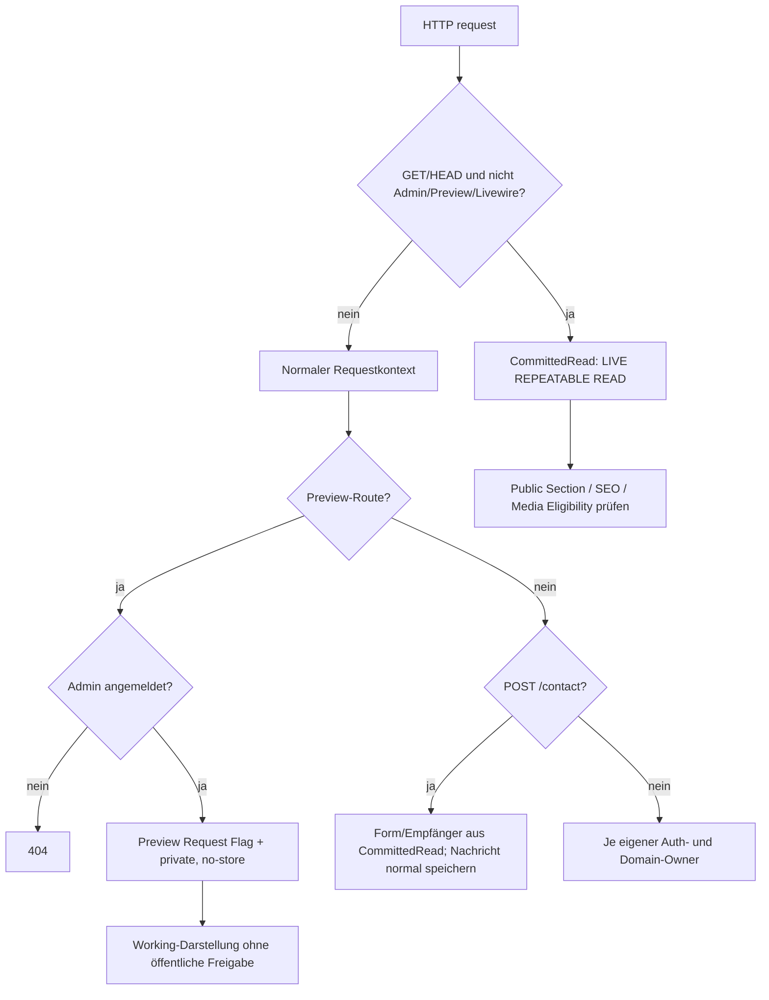

# Public-Sicherheitsgrenzen: LIVE, Preview, Medien, CSP und Datenschutz

**Quellstand:** `dev@81c12c836fdce03a478866ec3d147ebc818b24a6` (echt in `docs` gemergt). Hier geht es um **technische Request-, Datenschutz- und Medienauslieferungsgrenzen**, keine automatisch als korrekt bewertete Rechtserklärung. Die fachlich akzeptierte **noch unvollständige** Roadmap zu TDM, Copyright, Download-Erschwerung, General-Feldern, Media-IPTC/XMP und Matomo steht einmalig unter [Public Rights and Privacy](../public/rights-privacy.md). Die normative Public-Gestaltung steht unter [Public Implementation](../public/site.md). Dieser Source-Audit führt keine Tests/Browser/DB-/Ingress-Abfragen aus.

## 1. Eintrittsentscheidung und Datenkontext

[`bootstrap/app.php`](../../bootstrap/app.php) prepended `UseCommittedPublicState` und hängt `SecurityHeaders` im Web-Middleware-Pfad an. Die im [`routes/web.php`](../../routes/web.php) registrierten Wege verwenden bewusst **unterschiedliche** Lesekontexte:

| Route/Verfahren | Middleware-/Domain-Owner | Daten-/Zugriffsgrenze |
| --- | --- | --- |
| Normales GET/HEAD `/`, `/{section}`, `/{section}/{slug}`, `/artworks/{slug}`, `/sitemap.xml` | [`UseCommittedPublicState`](../../app/Http/Middleware/UseCommittedPublicState.php) → [`CommittedRead`](../../app/Domain/Publication/CommittedRead.php) | `PublicationReadContext::runCommitted()`, DB-Transaktion mit `REPEATABLE READ`. Der HTTP-Request soll LIVE-`committed.*` lesen. Inhalts-/Publication-Filter der Domain bleiben zusätzlich nötig |
| GET/HEAD `/preview*` | [`ProtectArtistPreview`](../../app/Http/Middleware/ProtectArtistPreview.php) und `SitePreviewContext` | Vorher **User mit `is_admin=true`** verlangen, sonst 404. Preview aktiviert einen Request-Flag und bleibt außerhalb der automatischen LIVE-Umschaltung; unveröffentlichte Inhalte können im Working-Kontext angezeigt werden |
| GET `/media/original/{mediaAsset}`, `/media/variant/{mediaVariant}` | [`PublicMediaController`](../../app/Http/Controllers/PublicMediaController.php), bei Varianten zusätzlich [`EnsureMediaVariantFile`](../../app/Http/Middleware/EnsureMediaVariantFile.php) | Asset/Variant verfügbar und durch `PublicMedia::isPublicAsset/isPublicVariant` über öffentlich berechtigte, referenzierende Inhalte erreichbar; Datei muss wirklich existieren. Auch öffentliche Media-GETs erhalten den LIVE-Lesekontext |
| GET `/preview/media/*`, `/admin/media-preview/*` | [`AdminMediaController`](../../app/Http/Controllers/AdminMediaController.php), Preview zusätzlich `ProtectArtistPreview` | Admin-Auth geprüft; private Working-Medien können geprüft werden, ohne die allgemeine PublicMedia-Publikationsfreigabe zu lockern |
| POST `/contact` | `EnforceHomePresentationGate`, `throttle:5,1`, [`PublicContactController`](../../app/Http/Controllers/PublicContactController.php) | **Kein** globaler `UseCommittedPublicState`-GET/HEAD-Pfad; Controller holt Form-Existenz und Empfängerkonfiguration ausdrücklich in einem separaten `CommittedRead::run()`, speichert danach die Nachricht im normalen Working-DB-Kontext |

[`EnforceHomePresentationGate`](../../app/Http/Middleware/EnforceHomePresentationGate.php) schützt die gewöhnlichen öffentlichen Section-/Artwork-Routen und Contact-POST, nicht automatisch Preview, sitemap oder Medien-URLs; `publicGateActive()` kann zu Home weiterleiten. Unveröffentlichte Ziel-Sections sind durch Domain- und Preview-Query-Bedingungen von veröffentlichten Sections zu trennen. Die Vorschau darf diese Gate- und Publication-Entscheidungen nicht durch globale Ausnahme in der gewöhnlichen Public-Route umgehen.

**Publikations- und HTTP-Cache-Grenze:** `PublicMediaController` setzt `Content-Disposition:inline`, `ETag` auf gespeicherten SHA-256, `Cache-Control:public, max-age=31536000, immutable` und einen `X-Sendfile`-Pfad. Solche Antwortmetadaten sind **keine** Kryptobindung an eine individuelle Person, kein Schutz gegen Download und kein ausgeführter 206-/Range-/Proxy-Test. Die späteren Metadaten-/Rechte-Pipelines dürfen den bereits veröffentlichten unveränderlichen URL-/Hash-/Cache-Vertrag nicht ohne dedizierte neue Public-Artifacts und kontrollierte Migration umschreiben.

## 2. Preview und Header

[`ProtectArtistPreview`](../../app/Http/Middleware/ProtectArtistPreview.php) verlangt einen Administrator, setzt `SitePreviewContext::REQUEST_ATTRIBUTE` und ergänzt `X-Robots-Tag:noindex,nofollow,noarchive`, `Cache-Control:private,no-store,max-age=0,must-revalidate` sowie `Pragma:no-cache`. [`SecurityHeaders`](../../app/Http/Middleware/SecurityHeaders.php) setzt bei Preview `X-Frame-Options:SAMEORIGIN` und `frame-ancestors 'self'`, während öffentliche Standardseiten `DENY` bzw. `'none'` verwenden. Die CSS-/Script-Policy für Public und Preview ist **nonce-basiert**; `unsafe-inline`/`unsafe-eval` gehören lediglich zur gesonderten **Pulse**-Policy. Die öffentliche CSP enthält `default-src 'self'`, Skripte/Styles `'self'` + frischen Request-Nonce, Bilder `'self' data: https://tile.openstreetmap.org` und bei aktiviertem Matomo nur die validierte HTTPS-Origin. Bei aktiver Tracking-Konfiguration ohne gültige HTTPS-URL wirft der CSP-Owner bewusst eine Exception statt `*` zuzulassen.

Der Public-Folio-/Image-Renderer schreibt geänderte bildspezifische Breiten als mit diesem Nonce autorisierte `<style>`-Regeln; die sechs Route-gebundenen Folio-Variablen werden im selben CSP-Modell behandelt. Das ist kein Freibrief, Filament-/Alpine-Skripte oder `style`-Attribute unter Public einzuschmuggeln. [Public-SPA-Lifecycle](public-spa-lifecycle.md) behandelt Nonce-Meta/Livewire-Head-Wechsel und noch ausstehende echte Browserprüfungen.

## 3. Rechte-Signale sind keine Zugangssperren

Neu implementiert sind die Site-weite Reservation in [`SecurityHeaders`](../../app/Http/Middleware/SecurityHeaders.php) auf **normalen Nicht-Preview-Public-Antworten** (`tdm-reservation:1`), die [`/.well-known/tdmrep.json`-Route](../../routes/web.php) und `robots.txt` aus [`PublicSeoController`](../../app/Http/Controllers/PublicSeoController.php) mit dokumentierten Opt-outs für GPTBot, Google-Extended, ClaudeBot und CCBot. Standard-Search-/Images-Sitemap bleiben vorgesehen. **Die Signale sind nicht technisch erzwingend**. Weder das HTML noch öffentlich freigegebene, hochaufgelöste Originale sind dadurch unkopierbar. Die fachliche Zielsetzung ist messbare Erschwerung von Bulk-Scraping ohne Qualitätsverlust; konkrete Rate-Limits am einen bestehenden Ingress-/App-Owner, Request-Metriken und Abnahme gegen Google Images sind **nicht** mit diesem Merge geliefert. Der [Public-Rights-Plan](../public/rights-privacy.md) bleibt der Owner für **noch nicht implementierte oder noch nicht abgenommene** Maßnahmen; die neuen General-Rechtsfelder und ihr Public-Renderer sind inzwischen als Code vorhanden, die geplante Medienmetadaten-/Missbrauchs-/Consent-Pipeline noch nicht.

Die tatsächliche TDM-Header-Weitergabe bei `X-Sendfile`, eine vom Proxy möglicherweise bereits beantwortete Media-URL, Range/206, Caching und dot-prefix-Ingress-Routing müssen gesondert geprüft werden. Die geschriebene Feature-Testdatei ist keine Prüfung des realen Reverse-Proxies.

### Neue General-/Public-Legal-Quelle (Stand `dev@c33d7e9c`)

[General](../../app/Filament/Pages/General.php) und [`PublicContentSetting`](../../app/Models/PublicContentSetting.php) verwalten jetzt zusätzlich zu geerbtem Medien-Copyright und bestehendem `legal_disclaimer` die optionalen Texte `legal_imprint`, `legal_privacy` und `legal_usage_rights`. [`PublicLegalContent::sections()`](../../app/Domain/Content/PublicLegalContent.php) übernimmt **nur tatsächlich gefüllte Werte** und projiziert die englischen Bezeichnungen **Imprint, Privacy Policy, Copyright & AI Use, External Links Notice**. Der persistierte Komponententyp und sichtbare Komponentenname bleiben **`legal_disclaimer` / Legal Disclaimer**, nicht „Rechtliches“. Die [Public-View](../../resources/views/pages/partials/component-sequence.blade.php) zeigt die vorhandenen Abschnitte als `details/summary` mit Anker-IDs `legal-imprint`, `legal-privacy`, `legal-copyright-ai`, `legal-external-links` und escaped Text; [`public-legal.js`](../../resources/js/public-legal.js) entfaltet direkt verlinkte Abschnitte nach Hash-/SPA-Wechsel. Die Artwork-Detailansicht rendert auf ausdrückliche Produktentscheidung **keine automatisch vererbte Copyright-Notice mehr**; vorhandene fotografische Credits bleiben sichtbar. `effectiveCopyrightNotice()` bleibt Daten-/Metadaten-Owner für andere zulässige Projektionen, nicht eine Pflicht zur sichtbaren Artwork-Zeile. General zeigt ein Default-Copyright-Feld über die volle Breite sowie vier große Rechts-Textareas als responsives 2×2-Raster; die Textareas bleiben scrollbar, ohne sichtbare Scrollbar.

**Abnahmegrenze:** Migrationsdatei, PHP-/JS-Testquellen und Rendering-Code **existieren**; weder PostgreSQL-Migration noch diese Tests oder ein Browser/Ingress-Check wurden in diesem Docs-Workstream ausgeführt. Echte Betreiberangaben, juristisch passende Texte, erforderliche rechtliche Erreichbarkeit und Publikationsentscheidungen sind nach dem aktuellen [Rechte-/Datenschutzvertrag](../public/rights-privacy.md) und der jeweils realen Betreiber-/Browserabnahme separat nachzuweisen; ein entfernter historischer Aufgaben-Snapshot ist kein aktueller Prüfbeleg. Auch mit diesen editorischen Feldern sind **Matomo-Einwilligung, IPTC/XMP, Bulk-Scraping-Erschwerung und Consent-Akzeptanz** nicht erledigt.

## 4. Rich Text: URL-Validierung vs CSP-Ladefreigabe

[`SafeRichTextRenderer`](../../app/Domain/Content/SafeRichTextRenderer.php) rendert nur zugelassene Markdown-Knoten und lehnt unsichere Links ab. [`SafeLinkPolicy`](../../app/Domain/Content/SafeLinkPolicy.php) akzeptiert ausschließlich syntaktisch gültige `http:`, `https:` und kontrollierte `mailto:`-Links (ohne Credentials, ASCII-Control-Zeichen oder Backslash). Bilder müssen entweder kanonische `media:<id>`-Storage-Referenzen mit PublicMedia-ALT/Thumbnail-Prüfung oder explizit validierte **HTTP(S)**-Bilder sein; der [`CanonicalMediaImageRenderer`](../../app/Domain/Content/CanonicalMediaImageRenderer.php) schreibt deren Original-URL als `` und escaped ALT in den HTML-Renderer.

**Quellbelegter Widerspruch:** Die Public-CSP erlaubt außer dem eigenen Origin grundsätzlich nur Daten-URLs, OSM-Tiles und (bei aktivem Matomo) dessen Origin für Bilder. Ein editorisch **valider externer HTTPS-Bildlink** von einem anderen Host wird somit im gerenderten HTML ausgegeben, ist aber im Browser voraussichtlich wegen der CSP nicht ladbar. **Validität im Rich-Text-Editor ist derzeit nicht gleich öffentliche Darstellung.** Eine sichere Produktentscheidung muss festlegen, ob kontrollierte Hosts oder das externe Bildformat überhaupt zum Public-Vertrag gehören; **keine Wildcard-/CSP-Abschwächung** als Quick-Fix. Die UI-/Link-Policy im [Admin-Control-Vertrag](../admin/controls.md) und der Public-Vertrag beschreiben diese Validität, nicht etwa garantierten Browsererfolg. Ein isolierter echter CSP-Test mit einer externen HTTPS-Testbild-Origin fehlt.

## 5. PublicMedia-Berechtigung bei verschachtelten Referenzen

[`CustomPageSetting`](../../app/Models/CustomPageSetting.php) validiert eine dekorative Image-`children[]`-Ebene und erlaubt dort kanonische Text-/List-Media-Tokens; [`component-sequence.blade.php`](../../resources/views/pages/partials/component-sequence.blade.php) rendert öffentlich freigegebene Child-Prose im nativen Float. **Aber:** [`PublicMedia::publishedCustomPageReferencesAsset()`](../../app/Domain/Media/PublicMedia.php) prüft nur unmittelbare veröffentlichte Blocks/Text/List-Items – **weder Image-Children noch ein direktes Top-Level-List-`media_asset_id`**. Ein eingebettetes Bild kann deshalb im öffentlichen HTML referenziert sein, während seine eigene Media-URL wegen fehlender Public-Eligibility abgelehnt wird. Eine weitere unabhängige freigegebene Referenz könnte die URL dennoch autorisieren; Public ist **kein** ungefilterter Working-Index.

Die vollständige, source-geprüfte [Coverage-/Delete-Matrix](media-reference-and-cleanup.md#quellbasierte-medienreferenzmatrix) enthält bewusst **auch** Working-Referenzsuche, Storage-Usage, logische Mutationen und physische LIVE-/History-Guards; hier keine zweite Referenzliste pflegen. Reproduzierbarer Negativfall: einziges veröffentlichtes Child-`` oder direktes List-Bild; die öffentliche Seite, `GET /media/variant/{id}`, Preview und andere ggf. unabhängige Freigaben gegenprüfen. HTTP-/Browser-/DB-Beobachtung fehlt. Die kanonische Produktkorrektur auf `dev` benötigt konsistente Medienreferenzen **unter unterschiedlichen Sichtbarkeitsfiltern**, keine pauschale Public-Freigabe aller Working-Assets.

## 6. Public-Datenschutz: getrennte Kontakt-, Tracking- und Kartendatenflüsse

**Source-Trace `dev@883ff5e0`; weder echte Browsernetzwerkdaten noch Servereinstellungen wurden hier geprüft.** Die verifizierten Verarbeitungsebenen dürfen nicht zu einem pauschalen „Website-Tracking ist aus“ oder „Kontakt nur per Mail“ zusammengezogen werden.

| Eintritt / Voraussetzung | Source-Owner und tatsächlich angelegte Daten | Offene Betriebs-/Rechtsprüfung |
| --- | --- | --- |
| `POST /contact` mit publiziertem Form-Guard | [`PublicContactController::submit()`](../../app/Http/Controllers/PublicContactController.php) liest Form/Delivery-Konfiguration über `CommittedRead`, prüft `name` ≤160, `email` ≤320 und `message` ≤5000 sowie den leeren Honeypot. Danach entsteht **immer zuerst** eine persistente `ContactMessage`-Row mit Name, E-Mail, Nachricht und Mail-Status. Bei konfiguriertem Mailer erfolgt zusätzlich `Mail::to()`; Status `delivered`/`failed`/`unavailable`, beim Ausfall bleibt die Row und der Besucher erhält weiterhin `Your message was received.`. [`DashboardFeed::deleteContact()`](../../app/Domain/Admin/DashboardFeed.php) löscht einen gespeicherten Eintrag explizit. | Kein allgemeiner automatischer `contact_messages`-Löschzeitraum aus diesen Quellen belegt; reale Mail-/Relay-/Backup-Retention und Umgang mit Support-Anfragen zu prüfen |
| Zustellempfänger vs öffentliches Kontaktfeld | [`ContactDeliveryReadiness::resolveRecipient()`](../../app/Domain/Contact/ContactDeliveryReadiness.php) wählt `General.contact_recipient_email` (privat), sonst `config('contact.recipient')`. Die öffentlich angezeigte `General.public_email` ist **kein** automatischer Versandempfänger. | Keine private Zustelladresse als öffentliche Impressumsangabe ausgeben; Betreiber-/Adressangaben bleiben redaktionell und juristisch zu verifizieren |
| Browser-Matomo, nur bei vorhandener Tracking-Konfiguration | [`resources/js/matomo.js`](../../resources/js/matomo.js) initiiert `_paq`, lädt `matomo.js`, `trackPageView`, Linktracking, Click/View-Events und Heartbeat bei 15 Sekunden. **Kein Consent-Gate** vor Script-/Request-Erzeugung. Public-Layout erzeugt das Tracking-Meta nur bei aktivierter Konfiguration und nicht im Preview. | Tatsächlich gesetzter Production-/Validation-Schalter **unbekannt**, Cookie/IP-Anonymisierung, Widerruf, DSGVO/TDDDG-Prüfung und Retention nicht aus Repositorysource ableitbar. Nutzerentscheidung: Consent-UI **vorerst zurückgestellt**, **nicht** als umgesetzt betrachten; browserseitiges Tracking nicht ohne erforderliche Freigabe betreiben |
| Exhibition Map | [`exhibitions.blade.php`](../../resources/views/pages/exhibitions.blade.php) rendert Map-Daten in einem zunächst geschlossenen `dialog`. Bei Nutzeröffnung initialisiert der Public-JS-Pfad lokales Leaflet, die eigentlichen Tiles kommen von OpenStreetMap. | Browser-Network-Trace bei Öffnen des Dialogs und Drittanbieter-/Datenschutzhinweis; lokale Leaflet-Datei ist keine Garantie lokaler Tiles |
| Server/Logs/Matomo Reporting | App-Repo beweist **keine** aktive Host-Konfiguration. Die [Server-Plattform-Baseline](../operations/server-boundary.md) und der [dauerhafte Rechte-/Datenschutzvertrag](../public/rights-privacy.md) behandeln Caddy-/Apache-Logs, möglichen separaten Matomo-Logimport, Mail/Backups und Retention als eigene Verarbeitungsgrenzen. | Browsertracking aus/Preview aus ⇒ **nicht** automatisch Server-Access-Logs, Matomo-Reporting oder Logimport aus. Host-, Log-, Backup- und Anonymisierungseinstellungen auf Betreiber-/Serverseite separat und ohne CI prüfen |

**Redaktionelle Position (bestehende Nutzerentscheidung auf `dev`):** Imprint und Privacy bleiben in der vorhandenen editierbaren **Legal Disclaimer**-Komponente unter About Artist/Contact. Kein neuer Footer, zusätzliche globale Impressumsnavigation oder neue Adressfelder ohne Genehmigung. Die tatsächliche rechtliche Erreichbarkeit muss dennoch eigenständig abgenommen werden. Die fünf vorhandenen General-Legal-Felder bleiben Editor-Quelle; keine Betreiberidentität oder rechtlich bindende Speicherfrist erfinden. Normative Rechts-/Produktentscheidungen stehen ausschließlich im [Rights-Plan](../public/rights-privacy.md).

**Evidenzgrenze:** Der Sourcepfad zeigt DB-vor-Mail und Tracking-ohne-Opt-in. Er beweist **nicht**, dass Produktionsbrowser tatsächlich Matomo lädt, wie lange Logs/Kontaktnachrichten/Backups gespeichert werden oder ob Drittanbieter-Requests vor der Kartenöffnung stattfinden. Negativtests: Mail unavailable/failed mit DB-Retention, Admin Delete, Public-Tracking deaktiviert/aktiviert ohne Consent, SPA-Navigation+Observer-Disposal, Map vor/nach Dialogöffnung, IPv6-/Reverse-Proxy-/Logimport-Konfiguration.
## 7. Fachlicher Source-Abschluss: Public-Read, CSP und Auslieferungsgrenzen

**Fixierte Quellen:** `dev@11f7e101` (Anwendungsstand) und `testing@14af6804` (eigenständige, **nur gelesene** Test-Assertions). Danach beobachtete Branchbewegungen sind **nicht Teil dieser Prüfung**. Keine PHP-/JS-/Browser-/Ingress-/DB-Ausführung, kein Test-Kompatibilitätsnachweis. Die [Medienreferenz-Symmetrie](media-reference-and-cleanup.md#fachlicher-abschluss-reader-symmetrie-zustandsfilter-und-schutzwurzeln) besitzt ihren getrennten Owner.

| HTTP-Eintritt | Source-Owner und tatsächlich belegte Grenze | Offene Nachweise |
| --- | --- | --- |
| Normale Public GET/HEAD einschließlich Home, Sections, Journal, Artwork, Sitemap, Media | [`UseCommittedPublicState`](../../app/Http/Middleware/UseCommittedPublicState.php) wird in [`bootstrap/app.php`](../../bootstrap/app.php) prepended; [`CommittedRead`](../../app/Domain/Publication/CommittedRead.php) verwendet einen `REPEATABLE READ`-Transaktionskontext. [`PublicationPostgresGrammar`](../../app/Database/PublicationPostgresGrammar.php) qualifiziert **nur unqualifizierte getrackte Tabellen** als `committed.*`; Domain-State, Journal-Template und Home-Gate filtern zusätzlich. | Keine automatische Umschaltung explizit qualifizierter Raw-SQL-Tabellen oder ungetrackter Tabellen; echte Response-/DB-Isolation noch nicht hier ausgeführt. |
| Admin, Preview, Livewire, Health | Der globale Guard nimmt `/admin*`, `/preview*`, `/livewire*`, `/up` aus. [`ProtectArtistPreview`](../../app/Http/Middleware/ProtectArtistPreview.php) fordert separat `is_admin`, aktiviert den Working-Preview-Flag und setzt noindex/private/no-store. | SPA-Linkfilter ist keine Autorisierung. 404/Header nach Cross-Context-Navigation separat prüfen. |
| Öffentliche Originale und Varianten | [`PublicMediaController`](../../app/Http/Controllers/PublicMediaController.php) verlangt [`PublicMedia`](../../app/Domain/Media/PublicMedia.php)-Eligibility, verfügbare Asset/Variant und Datei; [`EnsureMediaVariantFile`](../../app/Http/Middleware/EnsureMediaVariantFile.php) regeneriert fehlende Dateien nur nach Berechtigungsprüfung. | `X-Sendfile`, `ETag`, `Accept-Ranges` und `immutable` sind Header-Source; tatsächlicher Body, Range/206 und Reverse-Proxy ungeprüft. Child-/Home-List-/Top-List-Lücken bleiben ausschließlich in der [Referenzmatrix](media-reference-and-cleanup.md#quellbasierte-medienreferenzmatrix). |
| `POST /contact` | Die globale GET-Umschaltung greift nicht. [`PublicContactController`](../../app/Http/Controllers/PublicContactController.php) liest den freigegebenen Form-/Recipient-Kontext in einem **eigenen** `CommittedRead`, persistiert anschließend `ContactMessage` in Working und versucht ggf. SMTP. | Form-Auth, Body-Validierung, DB-Row, Mail-Status und endgültige HTTP-Antwort sind getrennte Zeitgrenzen. |
| robots / Sitemap / TDM | [`PublicSeoController`](../../app/Http/Controllers/PublicSeoController.php) liefert deklarative robots/TDM-Signale und LIVE-/Published-Sitemap (bei Home-Gate nur Home); [`CanonicalUrl`](../../app/Domain/Content/CanonicalUrl.php) verlangt in Production HTTPS. | Signale sind kein Kopierschutz. Canonical-Source ist kein realer HTTPS-/Ingress-/Crawler-Beleg. |

**CSP-Owner:** [`SecurityHeaders::handle()`](../../app/Http/Middleware/SecurityHeaders.php) erzeugt vor `$next` einen frischen Request-Nonce und schreibt **nach** `$next` die Policy. Nicht-Admin-/Nicht-Pulse-Responses nutzen `'self'` plus Nonce für `script-src`/`style-src`, ohne `unsafe-inline` oder `unsafe-eval`. Pulse besitzt die ausdrücklich abweichende Policy; normale öffentliche Seiten erlauben kein Framing, Preview nur Same-Origin. Public-`img-src` erlaubt Self, Data, OSM-Tiles und optional die konfigurierte Matomo-HTTPS-Origin. Andere vom `SafeLinkPolicy` akzeptierte externe HTTPS-Rich-Text-Bilder bleiben daher **nicht automatisch browserladbar**. Layout-/Komponenten-/Livewire-Head-Nonce-Verarbeitung liegt ausschließlich beim [SPA-Source-Owner](public-spa-lifecycle.md#public-head-und-nonce-über-den-dokumentwechsel).

**Neuer begrenzter Source-Negativfall – aktiviertes, ungültiges Matomo:** `SecurityHeaders::publicContentSecurityPolicy()` wirft bei aktiviertem Tracking mit fehlender, hostloser oder nicht-HTTPS-Base-URL eine `RuntimeException`. Das ist kein gewöhnlicher Matomo-Netzwerkausfall. Da die Header **nach dem Controller** aufgebaut werden, kann bei einem autorisierten `POST /contact` die Nachricht bereits persistiert und eventuell Mail versendet sein, bevor die CSP-Exception eine fehlerhafte HTTP-Antwort verursacht. **Kein ausgeführter Fehler-/Production-Nachweis.** Gezielt isoliert testen: fehlerhafte aktivierte Konfiguration, GET und Contact-POST, tatsächlicher HTTP-Status, DB/SMTP, Header, Logging, Retry-/Doppelübermittlung. Der [normative Analytics-Vertrag](../public/site.md#analytics-boundary) unterscheidet jetzt Konfigurationsfehler von Netzwerkausfällen; keinesfalls `unsafe-inline`/`unsafe-eval` oder Wildcards als Lösung.

**Autorisierte Testquellen `testing@14af6804` (authored, nicht ausgeführt):** [Public-LIVE/Working/Preview](https://github.com/Wiiii90/moeller-lars/blob/14af6804d5f3a298feaceb70020c62546017a2dc/tests/Feature/Public/Publication/CommittedPublicReadTest.php), [Preview Auth/no-store](https://github.com/Wiiii90/moeller-lars/blob/14af6804d5f3a298feaceb70020c62546017a2dc/tests/Integration/Publication/PublicationPreviewSecurityTest.php), [Media 404→200→404](https://github.com/Wiiii90/moeller-lars/blob/14af6804d5f3a298feaceb70020c62546017a2dc/tests/Feature/Public/Media/OriginalAccessTest.php), [CSP/Nonce/Livewire JS](https://github.com/Wiiii90/moeller-lars/blob/14af6804d5f3a298feaceb70020c62546017a2dc/tests/Feature/Public/SecurityHeadersTest.php), [SEO/Sitemap](https://github.com/Wiiii90/moeller-lars/blob/14af6804d5f3a298feaceb70020c62546017a2dc/tests/Feature/Public/Seo/SeoRoutesTest.php), [TDM/robots](https://github.com/Wiiii90/moeller-lars/blob/14af6804d5f3a298feaceb70020c62546017a2dc/tests/Feature/Public/RightsReservationTest.php). Keine dieser gelesenen Assertions beweist Browser-CSP über Head-Swaps, Proxy-/206-Media-Bytes oder den Matomo-/Contact-Konfigurationsfall.

**Endliche Entscheidung:** Source-Guards, Eintritts-/Datenkontexte und fachlich reproduzierbare Negativfälle sind dokumentiert; Produktfixes (Medienreferenzen, externes Bildformat, Consent, Config-Preflight) und echte Browser-/HTTP-/Ingress-Abnahme bleiben außerhalb `docs`.

## Verifikation und Schnittstellen zum weiteren Programm

Die neuen [`RightsReservationTest.php`](../../tests/Feature/Public/RightsReservationTest.php), [`SecurityHeadersTest.php`](../../tests/Feature/Public/SecurityHeadersTest.php) und [`SafeRichTextRendererTest.php`](../../tests/Unit/Content/SafeRichTextRendererTest.php) sind als Testquellen vorhanden. **Sie wurden hier nicht ausgeführt.** Offene konkrete Nachweise: öffentliche/Preview-/Admin-Header mit und ohne Proxy/X-Sendfile; 404/Authorization und Variant-Rebuild; echte CSP von Public-SPA bei externen Rich-Text-Bildern; nested `image.children` als alleiniger Media-Owner; Medien-Range/ETag/Cache; SEO-Crawling nach TDM; Consent `deny/accept/revoke` ohne Pre-consent-Traffic; Mailer unavailable/failed mit tatsächlicher Persistenz. Keine CI-/Preview-/Production-DB-/Server-Abfrage.

Die endliche [Abschlussmatrix](completion-criteria.md) muss diese Source-Befunde als **inhaltlich dokumentiert** und ihre Produkte-/Runtime-Fixes als getrennte ausstehende Schritte führen. Der [Public-Rights-Plan](../public/rights-privacy.md) bleibt als **lebender Produkt-Implementierungsplan** bestehen; die vorliegende Architekturuntersuchung ist nur sein technischer Evidence-Companion.
