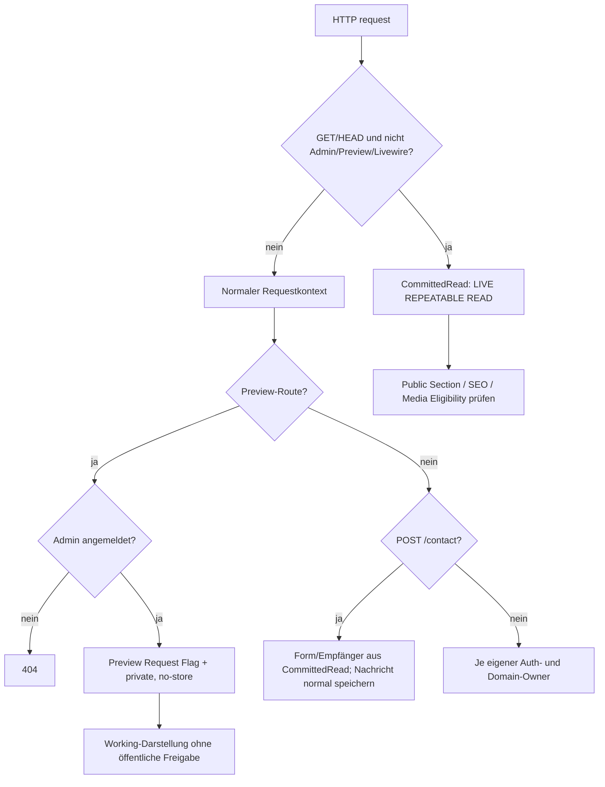

# Public-Sicherheitsgrenzen: LIVE, Preview, Medien, CSP und Datenschutz

**Quellstand:** `dev@81c12c836fdce03a478866ec3d147ebc818b24a6` (echt in `docs` gemergt). Hier geht es um **technische Request-, Datenschutz- und Medienauslieferungsgrenzen**, keine automatisch als korrekt bewertete Rechtserklärung. Die fachlich akzeptierte **noch unvollständige** Roadmap zu TDM, Copyright, Download-Erschwerung, General-Feldern, Media-IPTC/XMP und Matomo steht einmalig unter [Public Rights and Privacy](../PUBLIC-RIGHTS-AND-PRIVACY.md). Die normative Public-Gestaltung steht unter [Public Implementation](../PUBLIC-IMPLEMENTATION-CONTRACT.md). Dieser Source-Audit führt keine Tests/Browser/DB-/Ingress-Abfragen aus.

## 1. Eintrittsentscheidung und Datenkontext

[`bootstrap/app.php`](../../bootstrap/app.php) prepended `UseCommittedPublicState` und hängt `SecurityHeaders` im Web-Middleware-Pfad an. Die im [`routes/web.php`](../../routes/web.php) registrierten Wege verwenden bewusst **unterschiedliche** Lesekontexte:

| Route/Verfahren | Middleware-/Domain-Owner | Daten-/Zugriffsgrenze |
| --- | --- | --- |
| Normales GET/HEAD `/`, `/{section}`, `/{section}/{slug}`, `/artworks/{slug}`, `/sitemap.xml` | [`UseCommittedPublicState`](../../app/Http/Middleware/UseCommittedPublicState.php) → [`CommittedRead`](../../app/Domain/Publication/CommittedRead.php) | `PublicationReadContext::runCommitted()`, DB-Transaktion mit `REPEATABLE READ`. Der HTTP-Request soll LIVE-`committed.*` lesen. Inhalts-/Publication-Filter der Domain bleiben zusätzlich nötig |
| GET/HEAD `/preview*` | [`ProtectArtistPreview`](../../app/Http/Middleware/ProtectArtistPreview.php) und `SitePreviewContext` | Vorher **User mit `is_admin=true`** verlangen, sonst 404. Preview aktiviert einen Request-Flag und bleibt außerhalb der automatischen LIVE-Umschaltung; unveröffentlichte Inhalte können im Working-Kontext angezeigt werden |
| GET `/media/original/{mediaAsset}`, `/media/variant/{mediaVariant}` | [`PublicMediaController`](../../app/Http/Controllers/PublicMediaController.php), bei Varianten zusätzlich [`EnsureMediaVariantFile`](../../app/Http/Middleware/EnsureMediaVariantFile.php) | Asset/Variant verfügbar und durch `PublicMedia::isPublicAsset/isPublicVariant` über öffentlich berechtigte, referenzierende Inhalte erreichbar; Datei muss wirklich existieren. Auch öffentliche Media-GETs erhalten den LIVE-Lesekontext |
| GET `/preview/media/*`, `/admin/media-preview/*` | [`AdminMediaController`](../../app/Http/Controllers/AdminMediaController.php), Preview zusätzlich `ProtectArtistPreview` | Admin-Auth geprüft; private Working-Medien können geprüft werden, ohne die allgemeine PublicMedia-Publikationsfreigabe zu lockern |
| POST `/contact` | `EnforceHomePresentationGate`, `throttle:5,1`, [`PublicContactController`](../../app/Http/Controllers/PublicContactController.php) | **Kein** globaler `UseCommittedPublicState`-GET/HEAD-Pfad; Controller holt Form-Existenz und Empfängerkonfiguration ausdrücklich in einem separaten `CommittedRead::run()`, speichert danach die Nachricht im normalen Working-DB-Kontext |

[`EnforceHomePresentationGate`](../../app/Http/Middleware/EnforceHomePresentationGate.php) schützt die gewöhnlichen öffentlichen Section-/Artwork-Routen und Contact-POST, nicht automatisch Preview, sitemap oder Medien-URLs; `publicGateActive()` kann zu Home weiterleiten. Unveröffentlichte Ziel-Sections sind durch Domain- und Preview-Query-Bedingungen von veröffentlichten Sections zu trennen. Die Vorschau darf diese Gate- und Publication-Entscheidungen nicht durch globale Ausnahme in der gewöhnlichen Public-Route umgehen.

**Publikations- und HTTP-Cache-Grenze:** `PublicMediaController` setzt `Content-Disposition:inline`, `ETag` auf gespeicherten SHA-256, `Cache-Control:public, max-age=31536000, immutable` und einen `X-Sendfile`-Pfad. Solche Antwortmetadaten sind **keine** Kryptobindung an eine individuelle Person, kein Schutz gegen Download und kein ausgeführter 206-/Range-/Proxy-Test. Die späteren Metadaten-/Rechte-Pipelines dürfen den bereits veröffentlichten unveränderlichen URL-/Hash-/Cache-Vertrag nicht ohne dedizierte neue Public-Artifacts und kontrollierte Migration umschreiben.

## 2. Preview und Header

[`ProtectArtistPreview`](../../app/Http/Middleware/ProtectArtistPreview.php) verlangt einen Administrator, setzt `SitePreviewContext::REQUEST_ATTRIBUTE` und ergänzt `X-Robots-Tag:noindex,nofollow,noarchive`, `Cache-Control:private,no-store,max-age=0,must-revalidate` sowie `Pragma:no-cache`. [`SecurityHeaders`](../../app/Http/Middleware/SecurityHeaders.php) setzt bei Preview `X-Frame-Options:SAMEORIGIN` und `frame-ancestors 'self'`, während öffentliche Standardseiten `DENY` bzw. `'none'` verwenden. Die CSS-/Script-Policy für Public und Preview ist **nonce-basiert**; `unsafe-inline`/`unsafe-eval` gehören lediglich zur gesonderten **Pulse**-Policy. Die öffentliche CSP enthält `default-src 'self'`, Skripte/Styles `'self'` + frischen Request-Nonce, Bilder `'self' data: https://tile.openstreetmap.org` und bei aktiviertem Matomo nur die validierte HTTPS-Origin. Bei aktiver Tracking-Konfiguration ohne gültige HTTPS-URL wirft der CSP-Owner bewusst eine Exception statt `*` zuzulassen.

Der Public-Folio-/Image-Renderer schreibt geänderte bildspezifische Breiten als mit diesem Nonce autorisierte `<style>`-Regeln; die sechs Route-gebundenen Folio-Variablen werden im selben CSP-Modell behandelt. Das ist kein Freibrief, Filament-/Alpine-Skripte oder `style`-Attribute unter Public einzuschmuggeln. [Public-SPA-Lifecycle](public-spa-lifecycle.md) behandelt Nonce-Meta/Livewire-Head-Wechsel und noch ausstehende echte Browserprüfungen.

## 3. Rechte-Signale sind keine Zugangssperren

Neu implementiert sind die Site-weite Reservation in [`SecurityHeaders`](../../app/Http/Middleware/SecurityHeaders.php) auf **normalen Nicht-Preview-Public-Antworten** (`tdm-reservation:1`), die [`/.well-known/tdmrep.json`-Route](../../routes/web.php) und `robots.txt` aus [`PublicSeoController`](../../app/Http/Controllers/PublicSeoController.php) mit dokumentierten Opt-outs für GPTBot, Google-Extended, ClaudeBot und CCBot. Standard-Search-/Images-Sitemap bleiben vorgesehen. **Die Signale sind nicht technisch erzwingend**. Weder das HTML noch öffentlich freigegebene, hochaufgelöste Originale sind dadurch unkopierbar. Die fachliche Zielsetzung ist messbare Erschwerung von Bulk-Scraping ohne Qualitätsverlust; konkrete Rate-Limits am einen bestehenden Ingress-/App-Owner, Request-Metriken und Abnahme gegen Google Images sind **nicht** mit diesem Merge geliefert. Der [Public-Rights-Plan](../PUBLIC-RIGHTS-AND-PRIVACY.md) bleibt der Owner für **noch nicht implementierte oder noch nicht abgenommene** Maßnahmen; die neuen General-Rechtsfelder und ihr Public-Renderer sind inzwischen als Code vorhanden, die geplante Medienmetadaten-/Missbrauchs-/Consent-Pipeline noch nicht.

Die tatsächliche TDM-Header-Weitergabe bei `X-Sendfile`, eine vom Proxy möglicherweise bereits beantwortete Media-URL, Range/206, Caching und dot-prefix-Ingress-Routing müssen gesondert geprüft werden. Die geschriebene Feature-Testdatei ist keine Prüfung des realen Reverse-Proxies.

### Neue General-/Public-Legal-Quelle (Stand `dev@c33d7e9c`)

[General](../../app/Filament/Pages/General.php) und [`PublicContentSetting`](../../app/Models/PublicContentSetting.php) verwalten jetzt zusätzlich zu geerbtem Medien-Copyright und bestehendem `legal_disclaimer` die optionalen Texte `legal_imprint`, `legal_privacy` und `legal_usage_rights`. [`PublicLegalContent::sections()`](../../app/Domain/Content/PublicLegalContent.php) übernimmt **nur tatsächlich gefüllte Werte** und projiziert die englischen Bezeichnungen **Imprint, Privacy Policy, Copyright & AI Use, External Links Notice**. Der persistierte Komponententyp und sichtbare Komponentenname bleiben **`legal_disclaimer` / Legal Disclaimer**, nicht „Rechtliches“. Die [Public-View](../../resources/views/pages/partials/component-sequence.blade.php) zeigt die vorhandenen Abschnitte als `details/summary` mit Anker-IDs `legal-imprint`, `legal-privacy`, `legal-copyright-ai`, `legal-external-links` und escaped Text; [`public-legal.js`](../../resources/js/public-legal.js) entfaltet direkt verlinkte Abschnitte nach Hash-/SPA-Wechsel. Die Artwork-Detailansicht rendert auf ausdrückliche Produktentscheidung **keine automatisch vererbte Copyright-Notice mehr**; vorhandene fotografische Credits bleiben sichtbar. `effectiveCopyrightNotice()` bleibt Daten-/Metadaten-Owner für andere zulässige Projektionen, nicht eine Pflicht zur sichtbaren Artwork-Zeile. General zeigt ein Default-Copyright-Feld über die volle Breite sowie vier große Rechts-Textareas als responsives 2×2-Raster; die Textareas bleiben scrollbar, ohne sichtbare Scrollbar.

**Abnahmegrenze:** Migrationsdatei, PHP-/JS-Testquellen und Rendering-Code **existieren**; weder PostgreSQL-Migration noch diese Tests oder ein Browser/Ingress-Check wurden in diesem Docs-Workstream ausgeführt. Echte Betreiberangaben, juristisch passende Texte, erforderliche rechtliche Erreichbarkeit und Publikationsentscheidungen müssen in der parallelen [temporären Produkt-Ausführungsakte](../../PUBLIC_RIGHTS_WORKSTREAM.md) nachgewiesen werden. Auch mit diesen editorischen Feldern sind **Matomo-Einwilligung, IPTC/XMP, Bulk-Scraping-Erschwerung und Consent-Akzeptanz** nicht erledigt.

## 4. Rich Text: URL-Validierung vs CSP-Ladefreigabe

[`SafeRichTextRenderer`](../../app/Domain/Content/SafeRichTextRenderer.php) rendert nur zugelassene Markdown-Knoten und lehnt unsichere Links ab. [`SafeLinkPolicy`](../../app/Domain/Content/SafeLinkPolicy.php) akzeptiert ausschließlich syntaktisch gültige `http:`, `https:` und kontrollierte `mailto:`-Links (ohne Credentials, ASCII-Control-Zeichen oder Backslash). Bilder müssen entweder kanonische `media:<id>`-Storage-Referenzen mit PublicMedia-ALT/Thumbnail-Prüfung oder explizit validierte **HTTP(S)**-Bilder sein; der [`CanonicalMediaImageRenderer`](../../app/Domain/Content/CanonicalMediaImageRenderer.php) schreibt deren Original-URL als `` und escaped ALT in den HTML-Renderer.

**Quellbelegter Widerspruch:** Die Public-CSP erlaubt außer dem eigenen Origin grundsätzlich nur Daten-URLs, OSM-Tiles und (bei aktivem Matomo) dessen Origin für Bilder. Ein editorisch **valider externer HTTPS-Bildlink** von einem anderen Host wird somit im gerenderten HTML ausgegeben, ist aber im Browser voraussichtlich wegen der CSP nicht ladbar. **Validität im Rich-Text-Editor ist derzeit nicht gleich öffentliche Darstellung.** Eine sichere Produktentscheidung muss festlegen, ob kontrollierte Hosts oder das externe Bildformat überhaupt zum Public-Vertrag gehören; **keine Wildcard-/CSP-Abschwächung** als Quick-Fix. Die UI-/Link-Policy im [Admin-Control-Vertrag](../ADMIN-CONTROL-CONTRACT.md) und der Public-Vertrag beschreiben diese Validität, nicht etwa garantierten Browsererfolg. Ein isolierter echter CSP-Test mit einer externen HTTPS-Testbild-Origin fehlt.

## 5. Neue dekorative Image-Children: referenzielle Asymmetrie

[`CustomPageSetting`](../../app/Models/CustomPageSetting.php) validiert `image.children` für dekorative Bilder als eine geordnete Textebene: Text, imagefreie List, Contact ohne Form, höchstens ein Legal Disclaimer auf der Page; die rekursive Teilvalidierung erlaubt in Text- und List-Rich-Text weiterhin kanonische `media:<id>`-Markdown-Referenzen. [`DecorativeImageChildren`](../../app/Filament/Support/DecorativeImageChildren.php) verwendet für Text den vorhandenen `AdminRichText`-Medienpicker. [`component-sequence.blade.php`](../../resources/views/pages/partials/component-sequence.blade.php) rendert veröffentlichte Child-Prose innerhalb eines nativen Bild-Float-Kontexts.

**Es gibt aber mehrere nichtrekursive Leser:**

1. [`RichTextMediaReference::idsFromCustomPageBlocks()`](../../app/Domain/Content/RichTextMediaReference.php) iteriert **nur unmittelbare** Text/List-Blöcke, nicht `image.children`. [`MediaReferenceQuery::mediaIdsForCustomPage()`](../../app/Domain/Media/MediaReferenceQuery.php) übergibt ihm ausschließlich die Top-Level-Blocks; eine Child-Rich-Text-Media-ID wird so nicht als Working-Referenz erfasst.
2. [`PublicMedia::publishedCustomPageReferencesAsset()`](../../app/Domain/Media/PublicMedia.php) prüft veröffentlichte unmittelbare Images, Texts und List-`items[].body`, **nicht** eingebettete Child-Texte oder Child-Listen. Auch eine **direkte top-level `list.media_asset_id`** wird hier bisher nicht ausdrücklich freigeschaltet, obwohl der Public-Renderer entsprechende List-Medien-URLs baut.
3. [`MediaAssetEditorialService::removeCustomPageReferences()`](../../app/Domain/Media/MediaAssetEditorialService.php) und die einzelnen Storage-Referenzprojektionen sind auf rekursive Coverage zu prüfen, bevor die Nutzeroption zur Medienlöschung als sicher für Image-Children bezeichnet werden kann. Die vorhandene [Media-Analyse](media-reference-and-cleanup.md) erklärt daneben bereits die **Home-List**-Lücke.

**Begrenzter Source-Befund:** Ein nur in einem veröffentlichten dekorativen Child-Text eingebettetes internes MediaAsset kann im Public-Media-Eligibility-Check als nicht veröffentlicht gelten und gleichzeitig vom Working-Referenzindex übersehen werden. Das birgt Unterschiede zwischen sichtbarem Markdown, 404 bei der Medien-URL und Cleanup-Entscheidungen. Der Source-Beleg ersetzt noch keinen ausgeführten Browser-/DB-Negativtest. Die spätere Produktkorrektur gehört zum gemeinsamen Referenz-/PublicMedia-Owner auf `dev`, nicht zu einer zweiten Child-spezifischen Heuristik auf `docs`.

**Reproduzierbare Fälle:** Ein veröffentlichtes dekoratives Image besitzt ein ebenfalls veröffentlichtes Text-Child mit ``, ohne andere Referenzen; Gleiches für eine List-Entry-Body im Child. Gegenprüfen: Admin Storage Usage/Detail, `MediaReferenceQuery`, `PublicMedia::isPublicAsset`, HTTP media.variant, Public-Rendering, Media-Delete-Side-Effects, LIVE/History-Schutz, Preview, unpublizierte Children. Ein unmittelbares, publiziertes top-level List-Image gesondert prüfen.

## 6. Matomo-Tracking vs consent und Contact-Verarbeitung

[`resources/js/matomo.js`](../../resources/js/matomo.js) erzeugt bei vorhandenem `data-matomo-tracking` sofort die Matomo-`_paq`-Queue, initialisiert Link-Tracking und 15-Sekunden-Heartbeat, lädt das externe Script und sendet Pageview. [`layouts/app.blade.php`](../../resources/views/layouts/app.blade.php) liefert dieses Meta, wenn `MatomoConfiguration::browserTracking()` aktiviert ist und keine Preview vorliegt. Im gelesenen Flow liegt **keine affirmative Nutzerentscheidung vor dem Script-Laden/Tracking**. Die spätere Consent-Entscheidung muss technisch im Site-Owner vor `initializeMatomoTracking` liegen, Ablehnung und Revocation inklusive Livewire-SPA-Disposer behandeln und während der Umsetzung die öffentliche Browser-Verfolgung entsprechend deaktivieren. Die tatsächlichen Produktions-Flags/Matomo-Servereinstellungen sind **nicht** geprüft; dieser Source-Befund ist keine Behauptung über derzeit aktive Messung.

[`PublicContactController::submit()`](../../app/Http/Controllers/PublicContactController.php) schützt POST mit Honeypot, Rate-Limit, Form-Eligibility aus `CommittedRead`, validiert Name/Email/Nachricht und speichert `ContactMessage` **vor** dem E-Mail-Versand. Bei nicht bereitem Mailer wird `mail_delivery_status` auf unavailable gesetzt, bei Versandfehler auf failed; die Besucherantwort lautet weiterhin `Your message was received.`. **Dies sagt Eingang in die Datenbank zu, nicht erfolgreich zugestellte E-Mail.** Das datenschutzrechtliche Eigentum umfasst deshalb Datenbankaufbewahrung, interne Benachrichtigung/E-Mail, mögliche Serverlogs, Retention sowie ein wahrheitsgemäßes Hinweisfeld – kein vom Künstler frei formulierbarer technischer Consent-Guard. Aufbewahrungszeit, Löschjobs, reale Empfänger und Vertragsgrundlage sind aus diesem Source-Pfad **nicht abschließend bestimmt**.

## Verifikation und Schnittstellen zum weiteren Programm

Die neuen [`RightsReservationTest.php`](../../tests/Feature/Public/RightsReservationTest.php), [`SecurityHeadersTest.php`](../../tests/Feature/Public/SecurityHeadersTest.php) und [`SafeRichTextRendererTest.php`](../../tests/Unit/Content/SafeRichTextRendererTest.php) sind als Testquellen vorhanden. **Sie wurden hier nicht ausgeführt.** Offene konkrete Nachweise: öffentliche/Preview-/Admin-Header mit und ohne Proxy/X-Sendfile; 404/Authorization und Variant-Rebuild; echte CSP von Public-SPA bei externen Rich-Text-Bildern; nested `image.children` als alleiniger Media-Owner; Medien-Range/ETag/Cache; SEO-Crawling nach TDM; Consent `deny/accept/revoke` ohne Pre-consent-Traffic; Mailer unavailable/failed mit tatsächlicher Persistenz. Keine CI-/Preview-/Production-DB-/Server-Abfrage.

Die endliche [Abschlussmatrix](completion-criteria.md) muss diese Source-Befunde als **inhaltlich dokumentiert** und ihre Produkte-/Runtime-Fixes als getrennte ausstehende Schritte führen. Der [Public-Rights-Plan](../PUBLIC-RIGHTS-AND-PRIVACY.md) bleibt als **lebender Produkt-Implementierungsplan** bestehen; die vorliegende Architekturuntersuchung ist nur sein technischer Evidence-Companion.
