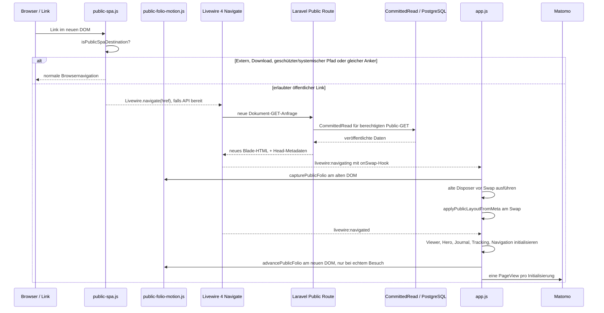

# Öffentliche SPA-Dokumentnavigation und Instanzlebenszyklus

**Code-Referenz:** `dev` bei `8fb60db6a1a427ce6f905e5d8a65454c7d39ec45`, nach `docs` übernommen. Dieser Ablauf wurde **aus den aktuellen JS-/Blade-/Middleware-Quellen abgeleitet**, aber nicht im Browser oder mit Laravel-End-to-End ausgeführt.

## Architekturentscheidung

Die öffentliche Website bleibt **serverseitig mit Laravel/Blade gerendert**, benutzt für interne Wechsel nun aber **Livewire 4 Document Navigation**. Das ist kein eigenes JavaScript-Routing, kein JSON-API-Frontend und kein Umbau der serverseitigen Domain-/Publication-Schicht. Die bestehenden Public-Routen und der `UseCommittedPublicState`-GET/HEAD-Kontext bleiben maßgeblich. [`public-spa.js`](../../resources/js/public-spa.js) entscheidet für einen einzigen dokumentweiten Click-Listener, welche bisher nicht mit `wire:navigate` versehenen Links via `Livewire.navigate()` delegiert werden; die Dokument-Swap-Implementierung gehört Livewire.

## Request- und Browsersequenz

Der `onSwap`-Callback wird vom `livewire:navigating`-Ereignis installiert und liest [`meta[data-public-layout]`](../../resources/views/layouts/app.blade.php) für die CSS-Variablen `--public-page`, `--public-shell-max`, `--public-art-max` und `--public-content-padding`. Der aktuell gelieferte CSP-Nonce macht serverseitige neue Inline-Styles nicht zur globalen Quelle; der Browser setzt die **serverautorisierten Werte** über CSSOM.

## CSP-sicheres Livewire-Asset und Framework-Grenze

Die Blade-Shell bindet Livewire 4 mit `@livewireScripts(['nonce' => $publicStyleNonce, 'url' => route('public.livewire.csp')])` an [die benannte Route](../../routes/web.php) `GET /site-assets/livewire-csp.js`. Das Route-Closure setzt `config('livewire.csp_safe')` **nur vorübergehend** auf `true`, erzeugt über `FrontendAssets::returnJavaScriptAsFile()` das öffentliche Script und stellt den vorherigen Wert in `finally` wieder her. Dies ist **keine globale Änderung** des Admin-/Filament-Livewire-Bundles; die Public-CSP braucht kein `unsafe-eval`. `public-spa.js` schließt das Asset-Präfix explizit von der SPA-Navigation aus.

Dieser Mechanismus ist aus [`routes/web.php`](../../routes/web.php), [`layouts/app.blade.php`](../../resources/views/layouts/app.blade.php) und [`public-spa.js`](../../resources/js/public-spa.js) geprüft. **Nicht ausgeführt:** ausgelieferte Script-Response, Content-Type/Caching, CSP-Header im Browser, temporäre Konfiguration bei parallelen Long-Lived-Worker-Anfragen oder eine echte Livewire-Navigation.

## Welche Links teilnehmen

[`isPublicSpaDestination()`](../../resources/js/public-spa.js) verlangt HTTP(S), denselben Origin, keinen fremden `target` und keinen Download. Die ausgeschlossenen Pfadpräfixe sind `/admin`, `/api`, `/pulse`, `/livewire`, `/logout`, `/media`, `/storage`, `/vendor` und `/site-assets`. Statische Medien-/Dokument-Endungen und bestimmte Preview-Systempfade werden ebenfalls ausgeschlossen. Zusätzlich bleiben Links mit `data-navigation-parent-link` bewusst bei ihrer bestehenden Menüebenen-Interaktion und werden **nicht** als gewöhnliche `wire:navigate`-Links markiert. `rel=external` und `data-public-full-load` verhindern den Delegationsaufruf ebenfalls. Vorhandene `wire:navigate`-Links lässt der Click-Listener Livewire selbst behandeln; bei fehlender `window.Livewire.navigate`-API bleibt normales Browser-Navigieren erhalten. Modifier-Klicks, bereits behandelte Events und andere Maustasten werden nicht abgefangen. Ein Fragmentlink zur **gleichen Pfad-/Query-Kombination** behält normales Browserscrollen. Diese Liste ist eine konkrete JS-Routinggrenze, **nicht** das vollständige Laravel-Sicherheits-/Autorisierungsmodell; die Route schützt weiterhin Preview/Media.

## Lebensdauer, Disposer und Seitenwechsel

| Initialisierung in [`app.js`](../../resources/js/app.js) | Scope | Bei neuem `#content` |
| --- | --- | --- |
| [Artwork Viewer](../../resources/js/artwork-viewer.js) | Aus der aktuellen Body-Komposition | Zurückgegebener Disposer; AbortController beendet globale Listener |
| [Home Hero](../../resources/js/home-hero.js) | DOM der aktuellen Seite | Keine globale Disposal-Rückgabe vom Bootstrap verwendet; konkrete Event-Owner im Modul |
| [Journal/Exhibition](../../resources/js/journal-presentation.js) | Journal-Slideshow und Map | Zurückgegebener Disposer, insbesondere Karteninstanzen |
| [Matomo](../../resources/js/matomo.js) | Tracker-Script global, deklarative Browser-Events je Seite | Alte Click/Observer-Liste entsorgen; Script nur einmal injizieren, `setCustomUrl`, `setDocumentTitle`, `trackPageView` pro Aufruf |
| [Public Navigation](../../resources/js/public-navigation.js) | Haupt- und Child-Rails, Window-State | Listener am Body entfernen und alle Window-/Resize-Observer entsorgen |
| [Public SPA Click Delegation](../../resources/js/public-spa.js) | Ein globaler Listener, beim Modulladen registriert | Zulässige bisher unmarkierte Links per `Livewire.navigate()`; ohne API nativer Fallback; kein per Seite neu registrierter Listener |

`initializePage()` speichert die letzte `#content`-Elementidentität. Ist sie unverändert, bricht der Bootstrap **ohne erneute Initialisierung oder zusätzliche PageView** ab. Beim aktuellen `dev`-Stand werden vorhandene Disposer **bereits bei `livewire:navigating` vor dem Body-Swap** aufgerufen und die `currentContent`-Identität gelöscht. Beim folgenden `livewire:navigated` entsorgt die Init-Routine verbleibende Disposer defensiv, setzt die neue Identity und baut die Instanzen auf. Das verhindert, dass Modal-/Map-/Tracking-Observer am abgelösten Body weiterlaufen. Ein erstmaliger Besuch erfolgt bei `DOMContentLoaded` bzw. sofort, wenn das Dokument bereits bereit ist; spätere Navigationswechsel nutzen `livewire:navigated`. Diese Regeln sind **Codeverhalten**, keine Zusage bereits bestandener Browser-Zustandsprüfung.

## Neuer DOM-Knoten, übertragene Folio-Geometrie und WAAPI-Animation

Der Folio-Lebenszyklus in [`public-folio-motion.js`](../../resources/js/public-folio-motion.js) beim Quellstand `dev` **`06ca0c00c8148787150800480d7cf1da4e7ffb81`** verwendet keinen persistierten Knoten und keinen eigenen Router. Blade rendert die zwei verbundenen, nichtinteraktiven HTML-Konturen in `.public-folio-decoration` auf jedem `#content`. Variante 1 bleibt das ursprünglich akzeptierte statische Atelier-Folio für Initialloads, fehlendes JS und reduzierte Bewegung.

Aus [`app.js`](../../resources/js/app.js) und dem Modul ergibt sich:

1. Initial wird die Page normal aufgebaut, ohne Folio-Transition. Ein echter `livewire:navigate` markiert die nächste SPA-Seite.
2. `livewire:navigating` ruft `capturePublicFolio()` auf und übernimmt bei aktiver alter Dekoration deren aktuelle berechnete `top`, `bottom` und `width`-Werte, auch bei unterbrochener WAAPI-Animation. Page-Disposer entfernen die alten Instanzen; Layout-Metadaten werden im Swap erneut angewandt.
3. `livewire:navigated` initialisiert die neue Page und `advancePublicFolio()` wählt eine **andere** der zehn kuratierten Varianten. Die sechs Parameter beschreiben vier vertikale Eckpositionen und die Breiten der zwei horizontalen Returns.
4. Zielgeometrie wird zuerst unmittelbar am neuen DOM-Knoten gesetzt; falls unterstützt, interpoliert die native Web Animations API die beiden Konturen **850ms** lang. Ohne WAAPI bleibt das gültige statische Ziel. Alle Returns sind **höchstens .55rem** tief und liegen vollständig außerhalb der weißen Content-Fläche.
5. `prefers-reduced-motion: reduce` und fehlende Konturelemente verhindern die Animation. Menü-Konturen bleiben statisch. Es gibt keinen Content-Slide/Fade, keine Änderung an Content-/Artwork-Geometrie und kein eigenes History-/Fetch-/Polling-System.

**Aktuelle Rücknahme:** Die zwischenzeitlich eingeführten lokalen `?folio-motion=debug/off`-Parameter, `sessionStorage`-Debugflags, auffälligen Zusatzkonturen und Content-Settling-Effekte wurden auf `dev` entfernt. Sie sind **keine** gültigen Konfigurationen oder Test-/Designverträge mehr.

**Verifikation:** Aktuelle Source-Dateien, Public-Vertrag und vorhandene Testdateien betrachtet; kein Test oder Browserlauf in diesem Dokumentationsdurchgang. Das reale Zusammenspiel bei schnellem SPA-Wechsel, Back/Forward, WAAPI-Fallback, Reduced Motion und die visuelle Produktabnahme bleiben offen.

## Fachliche und technische Grenzen

- Öffentliche GET/HEAD-Anfragen bleiben an `UseCommittedPublicState` und Publication-Media-Policy gebunden; SPA-Navigation darf keine Entwurfsdaten öffentlich ausliefern. Nicht-GET-Formulare wie Contact folgen ihrem normalen HTTP-Schutz.
- Die bestehende zyklische ganze-Item-Navigation behält ihren eigenen `sessionStorage`-Handoff; der Document-Swap soll ihn nicht durch Pixel-Scrolling ersetzen.
- Der Admin benutzt ebenfalls Filament/Livewire-SPA, aber mit eigener Auth-/Lifecycle-Policy. Aus dem Public-SPA-Skript ist **keine** Admin-Route ableitbar.
- **Zu überprüfen:** tatsächliche Livewire-Head-/Nonce-Updates, Scroll-/Focus-Restoration, Back/Forward, Wechsel zwischen Parent/Child-Menüs, erneute offene Viewer/Map-Instanzen, Matomo pro echtem Seitenwechsel und Escape/Hydration-Verhalten. Ein Quell-Diagramm allein ist kein Browsertest.
