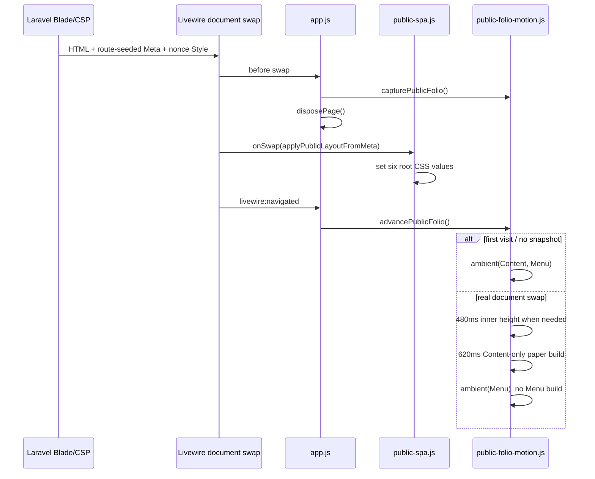

# Öffentliche SPA-Dokumentnavigation und Instanzlebenszyklus

**Code-Referenz:** `dev@62a104a0beef093aaa71ecf5c882e066b0dadca9` (einheitlicher `.public-content-reveal`-Seitenhöhenbesitzer, native Paper-Impuls- und Ambient-Lebenszyklen). Alle hier beschriebenen Zeitwerte/Guards aus den aktuell gemergten JS-/Blade-/CSS-Quellen; kein Browser-/Laravel-End-to-End-Lauf.

## Architekturentscheidung

Die öffentliche Website bleibt **serverseitig mit Laravel/Blade gerendert**, benutzt für interne Wechsel nun aber **Livewire 4 Document Navigation**. Das ist kein eigenes JavaScript-Routing, kein JSON-API-Frontend und kein Umbau der serverseitigen Domain-/Publication-Schicht. Die bestehenden Public-Routen und der `UseCommittedPublicState`-GET/HEAD-Kontext bleiben maßgeblich. [`public-spa.js`](../../resources/js/public-spa.js) entscheidet für einen einzigen dokumentweiten Click-Listener, welche bisher nicht mit `wire:navigate` versehenen Links via `Livewire.navigate()` delegiert werden; die Dokument-Swap-Implementierung gehört Livewire.

## Request- und Browsersequenz

Der `onSwap`-Callback wird vom `livewire:navigating`-Ereignis installiert und liest [`meta[data-public-layout]`](../../resources/views/layouts/app.blade.php) für die CSS-Variablen `--public-page`, `--public-shell-max`, `--public-art-max` und `--public-content-padding`. Der aktuell gelieferte CSP-Nonce macht serverseitige neue Inline-Styles nicht zur globalen Quelle; der Browser setzt die **serverautorisierten Werte** über CSSOM.

## CSP-sicheres Livewire-Asset und Framework-Grenze

Die Blade-Shell bindet Livewire 4 mit `@livewireScripts(['nonce' => $publicStyleNonce, 'url' => route('public.livewire.csp')])` an [die benannte Route](../../routes/web.php) `GET /site-assets/livewire-csp.js`. Das Route-Closure setzt `config('livewire.csp_safe')` **nur vorübergehend** auf `true`, erzeugt über `FrontendAssets::returnJavaScriptAsFile()` das öffentliche Script und stellt den vorherigen Wert in `finally` wieder her. Dies ist **keine globale Änderung** des Admin-/Filament-Livewire-Bundles; die Public-CSP braucht kein `unsafe-eval`. `public-spa.js` schließt das Asset-Präfix explizit von der SPA-Navigation aus.

Dieser Mechanismus ist aus [`routes/web.php`](../../routes/web.php), [`layouts/app.blade.php`](../../resources/views/layouts/app.blade.php) und [`public-spa.js`](../../resources/js/public-spa.js) geprüft. **Nicht ausgeführt:** ausgelieferte Script-Response, Content-Type/Caching, CSP-Header im Browser, temporäre Konfiguration bei parallelen Long-Lived-Worker-Anfragen oder eine echte Livewire-Navigation.

## Welche Links teilnehmen

[`isPublicSpaDestination()`](../../resources/js/public-spa.js) verlangt HTTP(S), denselben Origin, keinen fremden `target` und keinen Download. Die ausgeschlossenen Pfadpräfixe sind `/admin`, `/api`, `/pulse`, `/livewire`, `/logout`, `/media`, `/storage`, `/vendor` und `/site-assets`. Statische Medien-/Dokument-Endungen und bestimmte Preview-Systempfade werden ebenfalls ausgeschlossen. Zusätzlich bleiben Links mit `data-navigation-parent-link` bewusst bei ihrer bestehenden Menüebenen-Interaktion und werden **nicht** als gewöhnliche `wire:navigate`-Links markiert. `rel=external` und `data-public-full-load` verhindern den Delegationsaufruf ebenfalls. Vorhandene `wire:navigate`-Links lässt der Click-Listener Livewire selbst behandeln; bei fehlender `window.Livewire.navigate`-API bleibt normales Browser-Navigieren erhalten. Modifier-Klicks, bereits behandelte Events und andere Maustasten werden nicht abgefangen. Ein Fragmentlink zur **gleichen Pfad-/Query-Kombination** behält normales Browserscrollen. Diese Liste ist eine konkrete JS-Routinggrenze, **nicht** das vollständige Laravel-Sicherheits-/Autorisierungsmodell; die Route schützt weiterhin Preview/Media.

## Lebensdauer, Disposer und Seitenwechsel

| Initialisierung in [`app.js`](../../resources/js/app.js) | Scope | Bei neuem `#content` |
| --- | --- | --- |
| [Artwork Viewer](../../resources/js/artwork-viewer.js) | Aus der aktuellen Body-Komposition | Zurückgegebener Disposer; AbortController beendet globale Listener |
| [Home Hero](../../resources/js/home-hero.js) | DOM der aktuellen Seite | Keine globale Disposal-Rückgabe vom Bootstrap verwendet; konkrete Event-Owner im Modul |
| [Journal/Exhibition](../../resources/js/journal-presentation.js) | Journal-Slideshow und Map | Zurückgegebener Disposer, insbesondere Karteninstanzen |
| [Matomo](../../resources/js/matomo.js) | Tracker-Script global, deklarative Browser-Events je Seite | Alte Click/Observer-Liste entsorgen; Script nur einmal injizieren, `setCustomUrl`, `setDocumentTitle`, `trackPageView` pro Aufruf |
| [Public Navigation](../../resources/js/public-navigation.js) | Haupt- und Child-Rails, Window-State | Listener am Body entfernen und alle Window-/Resize-Observer entsorgen |
| [Public SPA Click Delegation](../../resources/js/public-spa.js) | Ein globaler Listener, beim Modulladen registriert | Zulässige bisher unmarkierte Links per `Livewire.navigate()`; ohne API nativer Fallback; kein per Seite neu registrierter Listener |

`initializePage()` speichert die letzte `#content`-Elementidentität. Ist sie unverändert, bricht der Bootstrap **ohne erneute Initialisierung oder zusätzliche PageView** ab. Beim aktuellen `dev`-Stand werden vorhandene Disposer **bereits bei `livewire:navigating` vor dem Body-Swap** aufgerufen und die `currentContent`-Identität gelöscht. Beim folgenden `livewire:navigated` entsorgt die Init-Routine verbleibende Disposer defensiv, setzt die neue Identity und baut die Instanzen auf. Das verhindert, dass Modal-/Map-/Tracking-Observer am abgelösten Body weiterlaufen. Ein erstmaliger Besuch erfolgt bei `DOMContentLoaded` bzw. sofort, wenn das Dokument bereits bereit ist; spätere Navigationswechsel nutzen `livewire:navigated`. Diese Regeln sind **Codeverhalten**, keine Zusage bereits bestandener Browser-Zustandsprüfung.

## Journal-Slideshow, Exhibition-Map, Home-Hero und Viewer: Instanzgrenzen

Die breite SPA-Tabelle oben beschreibt nur die Besitzer. Die folgenden konkreten Quellpfade zeigen, wie ihre Unterinstanzen auf einem neuen Server-Dokument erneut entstehen und was bei Abbruch oder fehlender API geschieht.

| UI-Einheit | Initialisierung und positiver Pfad | Negativ-/Cleanup-Pfad |
| --- | --- | --- |
| [Journal-Slideshow](../../resources/js/journal-presentation.js) | Blade-`journal-gallery` setzt `data-journal-slideshow` und für jedes Medium `data-journal-slide`; bei mindestens zwei Folien schaltet JS nur `hidden`, `aria-hidden` und den `n / total`-Text um. Prev/Next ist zyklisch, ohne autoplay, Timer oder Fetch | Bei null/einer Folie keine Navigation-Listener; Click-Handler hängen ausschließlich an den seitenlokalen Schaltflächen und verschwinden beim Content-Swap mit deren DOM. Kein globaler Slider-Disposer nötig |
| [Exhibition-Map](../../resources/js/journal-presentation.js) | Nur bei explizitem Öffnen des `HTMLDialogElement` werden die lokale, versionsgebundene Leaflet-CSS/-JS und anschließend OpenStreetMap-Tiles nachgeladen. Bei vorhandener Map wird lediglich das sichtbare Canvas neu vermessen | Vor dem abgeschlossenen `await loadLeaflet()` prüft der Callback `disposed`, `dialog.isConnected` und `dialog.open`. Navigation/Unmount löst `ResizeObserver.disconnect()`, `map.remove()` und `dialog.close()` aus. Ungültige Koordinaten oder Ladefehler setzen einen kontrollierten Status („Map unavailable…“) statt stiller Karte. Das Modul hält ein gemeinsames Promise für Asset-Laden, nicht einen Timer |
| [Home Hero](../../resources/js/home-hero.js) | Listener sitzt direkt am Home-Hero-Gruppenknoten. Nur bei mindestens zwei serverseitig berechtigten Slides kann Prev/Next zyklisch schalten, das vorherige Video pausieren und den nächsten Fokus setzen | Beim neuen Content verschwindet der lokale Gruppenknoten samt Listener. Es wird kein eigener globaler Listener und kein offener Autoplay-/Polling-Prozess gehalten |
| [Artwork Viewer](../../resources/js/artwork-viewer.js) | Der Viewer normalisiert ausschließlich kanonische Image-/Video-Daten und behält die registrierte Sequenz als Grenze für Prev/Next. Image-Zoom/Pan unterscheidet sich vom nativen Videomodus | `AbortController` beendet globale `visibilitychange`, `pagehide`, `resize` und `orientationchange`-Listener bei SPA-Disposal. Offene Attention-Zeit wird geflusht, Video pausiert und geplante `requestAnimationFrame`-Neuberechnung abgebrochen. Escape bleibt native Dialogschließung |
| [Matomo](../../resources/js/matomo.js) | `matomo.js` wird bei passender Konfiguration nur einmal eingebunden; nach jedem echten Seiten-Boot werden `setCustomUrl`, `setDocumentTitle` und `trackPageView` zur bestehenden Queue geschrieben | Deklarative Click-Listener und `IntersectionObserver` werden mit dem Page-Disposer aufgehoben; fehlende Konfiguration bedeutet keinen neuen Track. Das einmal geladene SDK selbst ist nicht pro Seite neu zu laden |

**Grenze der Behauptung:** Diese Tabelle beschreibt Codepfade; kein reales SPA-Reentry, Scroll-/Focus-Restoration, Leaflet-Laden, Karten-Tile-Ausfall oder Reviewer-Akzeptanz wurde hier ausgeführt. Die asynchrone Map-Race-Abwehr ist belegbar, eine vollständige Browsergarantie daraus nicht.

## Native Public-Folio-Papiermaschine, Home Hero und Gallery-Puffer

**Quellstand:** `dev@f69e0e7e3d857e717e9ed86102b0ee830ed9ebb0`. Die normative UI-Vorgabe steht ausschließlich im [Public-Vertrag](../PUBLIC-IMPLEMENTATION-CONTRACT.md). Dieser Abschnitt rekonstruiert Implementierungs- und Zustandsverantwortung aus [`layouts/app.blade.php`](../../resources/views/layouts/app.blade.php), [`public-spa.js`](../../resources/js/public-spa.js), [`public-folio-motion.js`](../../resources/js/public-folio-motion.js), [`app.js`](../../resources/js/app.js) und [`public-presentation.css`](../../resources/css/public-presentation.css). **Quellprüfung und Lektüre von Tests; keine ausgeführten Browser-/JS-/PHP-Läufe.**

### Route → statische Pose → Livewire-Swap

1. **Server/Initial-HTML:** `layouts/app.blade.php` bildet aus `sha256('/' . request()->path())` einen deterministischen Integer-Seed. Daraus entstehen sechs Eckverbindungen: vier Content-Abstände (`leftTop`, `leftBottom`, `rightTop`, `rightBottom`) und zwei Menu-Bottom-Abstände. Die Werte stehen sowohl in `meta[data-public-layout]` als auch in einem mit dem [CSP-Nonce](../../app/Http/Middleware/SecurityHeaders.php) autorisierten `:root`-Style. Derselbe Pfad ergibt dieselben Eckpositionen, **ohne clientseitige Zufallsquelle**; Query-Parameter sind kein Seed-Eingang. Verschiedene URLs müssen nicht mathematisch garantiert verschiedene Posen besitzen, weil der endliche Wertebereich Kollisionen zulässt.
2. **Vor dem Dokumenttausch:** `app.js` ruft über das Livewire-Swap-Ereignis `capturePublicFolio()` und `disposePage()` auf. Das Snapshot enthält die aktuell sichtbaren Content-Pseudo-Ecken, Content-Shadow und die gemessene innere Höhe, **kein Menü-Snapshot**. Die per-Page-Disposer gehören dem Page-Lifecycle, nicht der Domänenpersistenz.
3. **Nach dem Swap:** `event.detail.onSwap?.(applyPublicLayoutFromMeta)` aktualisiert auf der bestehenden `documentElement.style`-Fläche die sechs URL-gebundenen CSS-Variablen und die Layoutwerte aus den vom Server gelieferten Meta-Feldern. `livewire:navigated` initialisiert die neuen Seiteninstanzen und ruft `advancePublicFolio()` auf. Keine zweite Router- oder Polling-Instanz. Diese Anwendung nutzt einen einzigen bereits autorisierten CSSOM-Owner statt je Komponente dynamische `style`-Attribute.
4. **Reine Erstinitialisierung:** Ohne Snapshot startet nur `startAmbient()` für Content und Menü. Beim echten Swap erhält **nur Content** einen kurzen Build-Impuls; das Menü beginnt ausschließlich neue Ambient-Bewegungen.
5. **Home-Hero-Slidewechsel:** `animatePublicHeroChange()` misst vor dem vorhandenen Hero-Toggle die gerenderte Pose, cancelt konkurrierende Content-/Height-Effekte und baut denselben Content-Impuls in place. Kein künstlicher History-/Router-Wechsel, kein Menü-Impuls. Viewer-/Slide-Auswahl bleiben beim Home-Hero-Owner.

### Geometrie, Animation und Ressourcen

| Owner/Phase | Aktueller Quellwert | Konsequenz |
| --- | --- | --- |
| Menü-/Content-Basis | `FOLIO_PLANE_BASE.content = menu = [-3,4]` | Weiße Konturen und Papier näher an den Flächen; Menü-Backing als bestehende L-Form, nicht über ein zweites Shadow-Overlay |
| Content-Ambient | Eckperioden **98/113 s**; einzelner Shadow **129 s** | `buildCornerFrames()` und `buildShadowFrames()` mit langen Pausen, Eckauslenkung ungefähr 1–2 px, Shadow höchstens ~0,5 px |
| Menü-Ambient | Eckperioden **117/133 s**; Sheet **145 s** | `buildMenuCornerFrames()` hält `top:0`; `buildMenuBackingFrames()` animiert CSS-Variablen des einen Sheet-Owners; keine Page-Build-Sequenz |
| Seitenwechsel | `BUILD_DURATION=620` ms, `HEIGHT_DURATION=480` ms | Impuls für Content-Ecken/Sheet; `animatePageHeight()` nur bei mindestens **7 px** sichtbarer Differenz |
| Sichtbare Höhe | `visibleHeightTransition()` kappt auf Viewporthöhe zuzüglich Sicherheitsrand | Temporäres `overflow:clip` nur auf `#content > .public-content-reveal`; danach wieder natürliches Layout |
| Wiederholter Hero-Klick | `activeHeightAnimations` und `activePaperPulses` als `WeakMap` | Nur aktuelle Animation darf Overflow restaurieren beziehungsweise Ambient fortsetzen; Tokenprüfung plus aktuelles `#content` vor Promise-Fortsetzung |
| Native WAAPI-Endlosschleifen | `startAmbient()` auf Pseudo-Elementen und Backing | Ein möglicher Retention-Pfad nach DOM-Tausch ist **unbestätigt**; bisher kein Browser-Handle-Lifetime-Test |

**Fehlergrenzen:** Fehlen die benötigten Pseudogeometrien oder die WAAPI, bleibt das CSS-Papier sichtbar; es wird kein alternativer DOM-/Animationseigentümer installiert. Fehlende oder identische Höhen erzeugen keinen künstlichen Height-Film. Ein abgebrochener alter Hero-Impuls darf über seinen `finished`-Promise-Handler kein neueres Ambient überschreiben. Keine dieser Aussagen ersetzt einen ausgeführten echten Livewire-/CSP-/Browserwechsel.

### CSP und strukturierte Image-Größe

Das in [CustomPageSetting](../../app/Models/CustomPageSetting.php) normalisierte `image_scale_percent` wird öffentlich in [`component-sequence.blade.php`](../../resources/views/pages/partials/component-sequence.blade.php) nur bei von 100 % abweichendem Wert in **einem nonce-autorisierten `<style>` am Head-Stack `public-component-styles`** abgebildet. Die CSS-Variablen `--custom-page-image-width` und `--custom-page-image-width-narrow` hängen an `#custom-page-image-{blockIndex}`. Das vorherige direkte `style`-Attribut am `<figure>` wurde wegen der strikten Public-CSP entfernt. Der Content-Renderer validiert die Größe nicht selbst, sondern verwendet die Model-Fallback-Logik. Als offene Negativfälle gelten insbesondere mehrere unterschiedlich skalierte Images, SPA-Wechsel zwischen ihnen, wiederholte Indizes auf unterschiedlichen Seiten und fehlende Nonces. Die neue [SecurityHeaders-Testdatei](../../tests/Feature/Public/SecurityHeadersTest.php) ist **gelesene Testquelle, keine Testausführung**.

### Gallery-Bildladepuffer und Quellenwiderspruch

Der unveränderte [`public-gallery-loading.js`](../../resources/js/public-gallery-loading.js) besitzt weiterhin seinen separaten `IntersectionObserver` (960px Puffer, höchstens zwei aktiv promotete Bilder), `AbortController` und `disposePage()`-Disposer. Die Galerie behält ihre vollständige veröffentlichte HTML-/Viewer-Reihenfolge, es findet kein Backend-Paging statt. [`artworks/index.blade.php`](../../resources/views/pages/artworks/index.blade.php) übergibt weiterhin `:eager="$loop->index < 2"` und `:priority="$loop->first"`: **zwei eager Bilder, nur das erste high-priority**. Der neueste [Public-Vertrag](../PUBLIC-IMPLEMENTATION-CONTRACT.md) beschreibt dagegen **nur das erste** als eager. Das ist ein **konkreter Dokumentations-/Implementierungswiderspruch** auf dem geprüften Stand und keine bestätigte Browserregression. Erst fachlich entscheiden, dann einen einzigen Besitzer der Regel korrigieren; nicht durch stilles Umetikettieren des Blade-Befunds.

### Offene Nachweise

- Tatsächliche Browser-/Netzwerk-Prüfung von Livewire Head-Meta-/Nonce-Aktualisierung, Back/Forward, Scroll/Focus, wiederholten URL-Posen und allen Public-Seitentypen.
- WAAPI-Handle-Lebensdauer auf abgelösten SPA-Knoten (nicht mit dem bereits abgewehrten Hero-Promise-Race gleichsetzen).
- Gallery initiales Request-Priority-Verhalten sowie DOM-/Viewer-Vollständigkeit und der dokumentierte **1-vs-2-eager**-Widerspruch.
- Unit-/Browser-Tests unter [`tests/js/public-folio-motion.test.mjs`](../../tests/js/public-folio-motion.test.mjs) und [`tests/browser/public-folio-spa.spec.mjs`](../../tests/browser/public-folio-spa.spec.mjs) sind vorhanden und wurden für diese Arbeit **nicht ausgeführt**.

## Public Head und Nonce über den Dokumentwechsel

**Source `dev@11f7e101`; authored `testing@14af6804`, nicht ausgeführt.** [`SecurityHeaders`](../../app/Http/Middleware/SecurityHeaders.php) erzeugt pro Request den Nonce. [`layouts/app.blade.php`](../../resources/views/layouts/app.blade.php) nutzt ihn bei Root-Folio-`<style>`, `@stack('public-component-styles')`, `@livewireStyles` und `@livewireScripts`. Die CSP-safe [`/site-assets/livewire-csp.js`-Route](../../routes/web.php) setzt `livewire.csp_safe` für den Public-FrontendAsset-Response mit `finally` temporär zurück; kein belegtes Umschalten des Admin-Bundles.

[`app.js`](../../resources/js/app.js) entsorgt auf `livewire:navigating` die alte Page, überträgt mit `onSwap(applyPublicLayoutFromMeta)` die serverseitigen Meta-Werte per CSSOM und initialisiert auf `livewire:navigated` neu. [`public-spa.js`](../../resources/js/public-spa.js) delegiert nur passende Same-Origin-Links an `Livewire.navigate()`. Auch ein vom JS akzeptierter `/preview*`-Link benötigt **erneute Backend-Admin-Autorisierung**; ein SPA-Linkfilter ist kein Working-Zugriffsschutz. Die Quelllogik beweist **nicht**, dass bei unterschiedlichen Response-Nonces alle Head-Styles/Canonical-/Robots-Metadaten nach realen Swaps korrekt reconciliert werden.

**Gelesene Tests:** [`SecurityHeadersTest.php`](https://github.com/Wiiii90/moeller-lars/blob/14af6804d5f3a298feaceb70020c62546017a2dc/tests/Feature/Public/SecurityHeadersTest.php) enthält CSP-/Nonce-/Asset-Assertions; [`public-spa.test.mjs`](https://github.com/Wiiii90/moeller-lars/blob/14af6804d5f3a298feaceb70020c62546017a2dc/tests/js/public-spa.test.mjs) Linkfilter-/CSSOM-Assertions; [`public-spa-navigation.spec.mjs`](https://github.com/Wiiii90/moeller-lars/blob/14af6804d5f3a298feaceb70020c62546017a2dc/tests/browser/e2e/public/public-spa-navigation.spec.mjs) Browser-Back/Forward/DOM-Identity-Szenario. **Kein Test wurde hier ausgeführt**; insbesondere kein realer CSP-/Head-/Network-Check.

**Spätere Browserabnahme:** Public Home→Custom (unterschiedliche Image-Skalen/Nonces)→Journal/Gallery→Back/Forward; pro Response CSP-Header vs Style-/Script-Nonce, Canonical/Robots, Console/`securitypolicyviolation`, Preview 404 oder autorisiert no-store, JS-Bundle/Media-Requests; Admin-/Public-Asset-Isolation. Für Media-, TDM- und Matomo-Konfigurationsgrenzen gilt die [einzige Public-Security-Matrix](public-security-privacy-boundaries.md#7-fachlicher-source-abschluss-public-read-csp-und-auslieferungsgrenzen).

## Fachliche und technische Grenzen

- Öffentliche GET/HEAD-Anfragen bleiben an `UseCommittedPublicState` und Publication-Media-Policy gebunden; SPA-Navigation darf keine Entwurfsdaten öffentlich ausliefern. Nicht-GET-Formulare wie Contact folgen ihrem normalen HTTP-Schutz.
- Die bestehende zyklische ganze-Item-Navigation behält ihren eigenen `sessionStorage`-Handoff; der Document-Swap soll ihn nicht durch Pixel-Scrolling ersetzen.
- Der Admin benutzt ebenfalls Filament/Livewire-SPA, aber mit eigener Auth-/Lifecycle-Policy. Aus dem Public-SPA-Skript ist **keine** Admin-Route ableitbar.
- **Zu überprüfen:** tatsächliche Livewire-Head-/Nonce-Updates, Scroll-/Focus-Restoration, Back/Forward, Wechsel zwischen Parent/Child-Menüs, erneute offene Viewer/Map-Instanzen, Matomo pro echtem Seitenwechsel und Escape/Hydration-Verhalten. Ein Quell-Diagramm allein ist kein Browsertest.

## Statische Papierkontur, Vite-Version und Videos (dev@434975e1bd09)

Der frühere Eigentümer `resources/js/public-folio-motion.js` wurde entfernt. `resources/js/public-paper-frame.js` und ein zusammenhängender Public-Paper-Frame bilden die statischen Menü-/Content-Konturen. Ein Kontur-Ende orientiert sich am letzten tatsächlich gerenderten Artwork/Journal-Inhalt, nicht an zusätzlicher Leerseitenhöhe. Die Divider-Optionen einschließlich Menu-only-/Full-width-Varianten sind getrennte Public-Appearance-Einstellungen; sie dürfen keine konkurrierenden weißen Striche erzeugen. Bestehende Beschreibungen der animierten Folio-Kanten in älteren Abschnitten sind damit historische Präsentationsstände, nicht aktuelle Laufzeit-Invarianten.

`AppServiceProvider` versieht gebaute Vite-Einträge über `createAssetPathsUsing`/`manifestHash` mit einer einheitlichen Revision, damit Livewire-Navigation einen neuen Assetbuild erkennen kann. `public-media-playback.js` besitzt den page-scoped Inline-Videolifecycle: sichtbare, erlaubte Videos starten stumm und in Schleife; außerhalb der Sichtbarkeit oder bei Inaktivität werden sie angehalten und Listener beim SPA-Swap entfernt. Viewer-Video bleibt separat, kein zweiter Scheduler/Timer. Browserprüfungen für wiederholte Navigation, Poster, Tonfreigabe, Konturende, Browser-CSP und Restyles wurden hier nicht ausgeführt.

