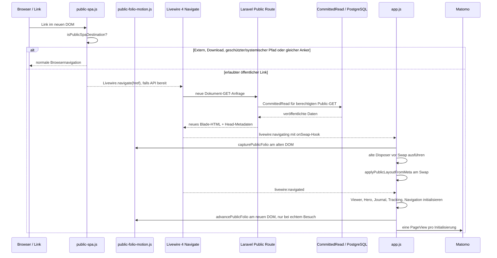

# Öffentliche SPA-Dokumentnavigation und Instanzlebenszyklus

**Code-Referenz:** `dev` bei `8fb60db6a1a427ce6f905e5d8a65454c7d39ec45`, nach `docs` übernommen. Dieser Ablauf wurde **aus den aktuellen JS-/Blade-/Middleware-Quellen abgeleitet**, aber nicht im Browser oder mit Laravel-End-to-End ausgeführt.

## Architekturentscheidung

Die öffentliche Website bleibt **serverseitig mit Laravel/Blade gerendert**, benutzt für interne Wechsel nun aber **Livewire 4 Document Navigation**. Das ist kein eigenes JavaScript-Routing, kein JSON-API-Frontend und kein Umbau der serverseitigen Domain-/Publication-Schicht. Die bestehenden Public-Routen und der `UseCommittedPublicState`-GET/HEAD-Kontext bleiben maßgeblich. [`public-spa.js`](../../resources/js/public-spa.js) entscheidet für einen einzigen dokumentweiten Click-Listener, welche bisher nicht mit `wire:navigate` versehenen Links via `Livewire.navigate()` delegiert werden; die Dokument-Swap-Implementierung gehört Livewire.

## Request- und Browsersequenz

Der `onSwap`-Callback wird vom `livewire:navigating`-Ereignis installiert und liest [`meta[data-public-layout]`](../../resources/views/layouts/app.blade.php) für die CSS-Variablen `--public-page`, `--public-shell-max`, `--public-art-max` und `--public-content-padding`. Der aktuell gelieferte CSP-Nonce macht serverseitige neue Inline-Styles nicht zur globalen Quelle; der Browser setzt die **serverautorisierten Werte** über CSSOM.

## CSP-sicheres Livewire-Asset und Framework-Grenze

Die Blade-Shell bindet Livewire 4 mit `@livewireScripts(['nonce' => $publicStyleNonce, 'url' => route('public.livewire.csp')])` an [die benannte Route](../../routes/web.php) `GET /site-assets/livewire-csp.js`. Das Route-Closure setzt `config('livewire.csp_safe')` **nur vorübergehend** auf `true`, erzeugt über `FrontendAssets::returnJavaScriptAsFile()` das öffentliche Script und stellt den vorherigen Wert in `finally` wieder her. Dies ist **keine globale Änderung** des Admin-/Filament-Livewire-Bundles; die Public-CSP braucht kein `unsafe-eval`. `public-spa.js` schließt das Asset-Präfix explizit von der SPA-Navigation aus.

Dieser Mechanismus ist aus [`routes/web.php`](../../routes/web.php), [`layouts/app.blade.php`](../../resources/views/layouts/app.blade.php) und [`public-spa.js`](../../resources/js/public-spa.js) geprüft. **Nicht ausgeführt:** ausgelieferte Script-Response, Content-Type/Caching, CSP-Header im Browser, temporäre Konfiguration bei parallelen Long-Lived-Worker-Anfragen oder eine echte Livewire-Navigation.

## Welche Links teilnehmen

[`isPublicSpaDestination()`](../../resources/js/public-spa.js) verlangt HTTP(S), denselben Origin, keinen fremden `target` und keinen Download. Die ausgeschlossenen Pfadpräfixe sind `/admin`, `/api`, `/pulse`, `/livewire`, `/logout`, `/media`, `/storage`, `/vendor` und `/site-assets`. Statische Medien-/Dokument-Endungen und bestimmte Preview-Systempfade werden ebenfalls ausgeschlossen. Zusätzlich bleiben Links mit `data-navigation-parent-link` bewusst bei ihrer bestehenden Menüebenen-Interaktion und werden **nicht** als gewöhnliche `wire:navigate`-Links markiert. `rel=external` und `data-public-full-load` verhindern den Delegationsaufruf ebenfalls. Vorhandene `wire:navigate`-Links lässt der Click-Listener Livewire selbst behandeln; bei fehlender `window.Livewire.navigate`-API bleibt normales Browser-Navigieren erhalten. Modifier-Klicks, bereits behandelte Events und andere Maustasten werden nicht abgefangen. Ein Fragmentlink zur **gleichen Pfad-/Query-Kombination** behält normales Browserscrollen. Diese Liste ist eine konkrete JS-Routinggrenze, **nicht** das vollständige Laravel-Sicherheits-/Autorisierungsmodell; die Route schützt weiterhin Preview/Media.

## Lebensdauer, Disposer und Seitenwechsel

| Initialisierung in [`app.js`](../../resources/js/app.js) | Scope | Bei neuem `#content` |
| --- | --- | --- |
| [Artwork Viewer](../../resources/js/artwork-viewer.js) | Aus der aktuellen Body-Komposition | Zurückgegebener Disposer; AbortController beendet globale Listener |
| [Home Hero](../../resources/js/home-hero.js) | DOM der aktuellen Seite | Keine globale Disposal-Rückgabe vom Bootstrap verwendet; konkrete Event-Owner im Modul |
| [Journal/Exhibition](../../resources/js/journal-presentation.js) | Journal-Slideshow und Map | Zurückgegebener Disposer, insbesondere Karteninstanzen |
| [Matomo](../../resources/js/matomo.js) | Tracker-Script global, deklarative Browser-Events je Seite | Alte Click/Observer-Liste entsorgen; Script nur einmal injizieren, `setCustomUrl`, `setDocumentTitle`, `trackPageView` pro Aufruf |
| [Public Navigation](../../resources/js/public-navigation.js) | Haupt- und Child-Rails, Window-State | Listener am Body entfernen und alle Window-/Resize-Observer entsorgen |
| [Public SPA Click Delegation](../../resources/js/public-spa.js) | Ein globaler Listener, beim Modulladen registriert | Zulässige bisher unmarkierte Links per `Livewire.navigate()`; ohne API nativer Fallback; kein per Seite neu registrierter Listener |

`initializePage()` speichert die letzte `#content`-Elementidentität. Ist sie unverändert, bricht der Bootstrap **ohne erneute Initialisierung oder zusätzliche PageView** ab. Beim aktuellen `dev`-Stand werden vorhandene Disposer **bereits bei `livewire:navigating` vor dem Body-Swap** aufgerufen und die `currentContent`-Identität gelöscht. Beim folgenden `livewire:navigated` entsorgt die Init-Routine verbleibende Disposer defensiv, setzt die neue Identity und baut die Instanzen auf. Das verhindert, dass Modal-/Map-/Tracking-Observer am abgelösten Body weiterlaufen. Ein erstmaliger Besuch erfolgt bei `DOMContentLoaded` bzw. sofort, wenn das Dokument bereits bereit ist; spätere Navigationswechsel nutzen `livewire:navigated`. Diese Regeln sind **Codeverhalten**, keine Zusage bereits bestandener Browser-Zustandsprüfung.

## Native CSS-Pseudoelemente, übertragene Folio-Geometrie und WAAPI

Der Quellstand [`public-folio-motion.js`](../../resources/js/public-folio-motion.js) auf `dev` **`1cf6aa5cccf82c54820f26225b4e66f6723523ac`** animiert direkt die **ursprünglichen** CSS-Pseudoelemente `#content::before` und `#content::after`. Die zwei akzeptierten Konturen sind zugleich die statische Fallback-Darstellung. Es gibt **keine** zusätzlichen Deko-DOM-Knoten, Overlays, Konturkopien, `@persist` oder einen zweiten Router.

Aus [`app.js`](../../resources/js/app.js), dem Folio-Modul und [`public-presentation.css`](../../resources/css/public-presentation.css) ergibt sich folgende Quellsequenz:

1. Auf initialem Laden bleibt die Originalkontur statisch. Ein echtes `livewire:navigate` markiert den nächsten SPA-Wechsel; nicht jeder Seiten-Boot erzeugt eine Animation.
2. Beim `livewire:navigating` erfasst `capturePublicFolio()` über `getComputedStyle(content, '::before'/'::after')` **vier** aktuelle `top`-/`bottom`-Werte sowie den berechneten `boxShadow`, gegebenenfalls aus einer laufenden Animation. Page-Disposer entfernen die alten Listener, Livewire ersetzt den Inhalt und überträgt die Layoutmetadaten.
3. Bei `livewire:navigated` wählt `advancePublicFolio()` eine **andere** von zehn kuratierten Varianten. Vier CSS-Variablen (`--public-folio-left-top`, `--public-folio-left-bottom`, `--public-folio-right-top`, `--public-folio-right-bottom`) setzen unmittelbar die Zielpositionen der vorhandenen Pseudoelemente.
4. Wenn vorhanden, animieren zwei native `KeyframeEffect`-Instanzen mit `pseudoElement: '::before'` und `pseudoElement: '::after'` die Randpositionen mittels `new Animation(effect, document.timeline).play()` **1150ms** lang. Bei API-Fehlern oder fehlender Pseudoelement-Unterstützung bleibt das bestehende statische CSS gültig; es wird kein weiterer Renderer aufgebaut.
5. Unsichtbare/fehlende Konturen unterbinden die Bewegung. **Der aktuelle Code ignoriert `prefers-reduced-motion: reduce` für diese ausdrücklich angeforderte kleine Dekoration.** Die seitlichen Offsets, Farben, Skew und beiden festen **.55rem**-Returns bleiben unverändert. Die zwei hinteren Ebenen des bereits vorhandenen dreiteiligen `box-shadow` verändern nur ihre vertikalen Offsets um wenige Pixel, die vorderste bleibt fest. Ohne Pseudo-WAAPI bleiben statische Kanten; unabhängig davon wird der bestehende `#content`-Schatten per `content.animate()` über **1150ms** (von berechnetem `boxShadow` zum neuen Ziel) animiert, sofern die API verfügbar ist. Die Pseudo-Animation verwendet ebenfalls **1150ms**. Content-Größe, Artwork und das eigenständig statische Menü bleiben unbewegt.

**Abgelöster Pfad:** Der ältere `.public-folio-decoration`-HTML-Knoten sowie die Debug-Queryparameter, Debug-`sessionStorage` und Content-Settling-Bewegungen sind entfernt und keine gültigen Produktverträge mehr. Die öffentliche Navigation bleibt serverseitig mit Laravel/Blade und Livewire-4-Document-Navigation ohne eigenen Fetch-/History-Router und ohne Polling.

**Verifikationsgrenze:** JS, CSS, Layout und Tests auf `dev` quellengeprüft. Der nun bewusst fehlende Reduced-Motion-Guard ist eine konkrete Barrierefreiheits-/Abnahmefrage, **keine** durch Dokumentation gewährte allgemeine Ausnahme. Die Tests und das Browserverhalten der Pseudoelement- und Shadow-Effekte wurden hier **nicht ausgeführt**; WAAPI-Unterstützung, schnelle Navigation, Back/Forward, Motion-Präferenzen und visuelle Abnahme bleiben offen.

## Fachliche und technische Grenzen

- Öffentliche GET/HEAD-Anfragen bleiben an `UseCommittedPublicState` und Publication-Media-Policy gebunden; SPA-Navigation darf keine Entwurfsdaten öffentlich ausliefern. Nicht-GET-Formulare wie Contact folgen ihrem normalen HTTP-Schutz.
- Die bestehende zyklische ganze-Item-Navigation behält ihren eigenen `sessionStorage`-Handoff; der Document-Swap soll ihn nicht durch Pixel-Scrolling ersetzen.
- Der Admin benutzt ebenfalls Filament/Livewire-SPA, aber mit eigener Auth-/Lifecycle-Policy. Aus dem Public-SPA-Skript ist **keine** Admin-Route ableitbar.
- **Zu überprüfen:** tatsächliche Livewire-Head-/Nonce-Updates, Scroll-/Focus-Restoration, Back/Forward, Wechsel zwischen Parent/Child-Menüs, erneute offene Viewer/Map-Instanzen, Matomo pro echtem Seitenwechsel und Escape/Hydration-Verhalten. Ein Quell-Diagramm allein ist kein Browsertest.
