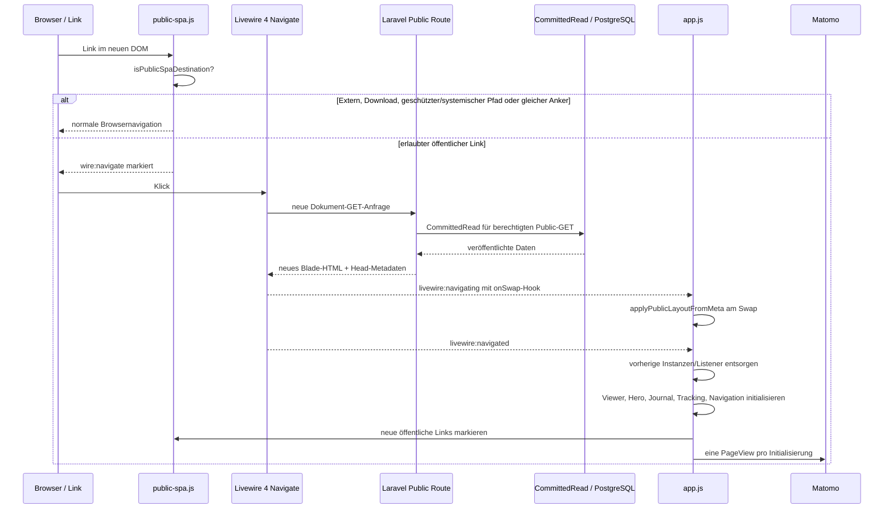

# Öffentliche SPA-Dokumentnavigation und Instanzlebenszyklus

**Code-Referenz:** `dev` bei `7c332b32762029b7e9da83491f52b12860bef9ed`, durch echten Merge nach `docs` übernommen. Dieser Ablauf wurde **aus den aktuellen JS-/Blade-/Middleware-Quellen abgeleitet**, aber nicht im Browser oder mit Laravel-End-to-End ausgeführt.

## Architekturentscheidung

Die öffentliche Website bleibt **serverseitig mit Laravel/Blade gerendert**, benutzt für interne Wechsel nun aber **Livewire 4 `wire:navigate` als SPA-Transport**. Das ist kein eigenes JavaScript-Routing, kein JSON-API-Frontend und kein Umbau der serverseitigen Domain-/Publication-Schicht. Die bestehenden Public-Routen und der `UseCommittedPublicState`-GET/HEAD-Kontext bleiben maßgeblich. [`public-spa.js`](../../resources/js/public-spa.js) entscheidet nur, welche bereits gerenderten Links für Livewire-Navigation markiert werden; die Dokument-Swap-Implementierung gehört Livewire.

## Request- und Browsersequenz

Der `onSwap`-Callback wird vom `livewire:navigating`-Ereignis installiert und liest [`meta[data-public-layout]`](../../resources/views/layouts/app.blade.php) für die CSS-Variablen `--public-page`, `--public-shell-max`, `--public-art-max` und `--public-content-padding`. Der aktuell gelieferte CSP-Nonce macht serverseitige neue Inline-Styles nicht zur globalen Quelle; der Browser setzt die **serverautorisierten Werte** über CSSOM.

## Welche Links teilnehmen

[`isPublicSpaDestination()`](../../resources/js/public-spa.js) verlangt HTTP(S), denselben Origin, keinen fremden `target` und keinen Download. Die ausgeschlossenen Pfadpräfixe sind `/admin`, `/api`, `/pulse`, `/livewire`, `/logout`, `/media`, `/storage` und `/vendor`. `rel=external` und `data-public-full-load` verhindern die `wire:navigate`-Markierung ebenfalls. Ein Fragmentlink zur **gleichen Pfad-/Query-Kombination** behält normales Browserscrollen. Diese Liste ist eine konkrete JS-Routinggrenze, **nicht** das vollständige Laravel-Sicherheits-/Autorisierungsmodell; die Route schützt weiterhin Preview/Media.

## Lebensdauer, Disposer und Seitenwechsel

| Initialisierung in [`app.js`](../../resources/js/app.js) | Scope | Bei neuem `#content` |
| --- | --- | --- |
| [Artwork Viewer](../../resources/js/artwork-viewer.js) | Aus der aktuellen Body-Komposition | Zurückgegebener Disposer; AbortController beendet globale Listener |
| [Home Hero](../../resources/js/home-hero.js) | DOM der aktuellen Seite | Keine globale Disposal-Rückgabe vom Bootstrap verwendet; konkrete Event-Owner im Modul |
| [Journal/Exhibition](../../resources/js/journal-presentation.js) | Journal-Slideshow und Map | Zurückgegebener Disposer, insbesondere Karteninstanzen |
| [Matomo](../../resources/js/matomo.js) | Tracker-Script global, deklarative Browser-Events je Seite | Alte Click/Observer-Liste entsorgen; Script nur einmal injizieren, `setCustomUrl`, `setDocumentTitle`, `trackPageView` pro Aufruf |
| [Public Navigation](../../resources/js/public-navigation.js) | Haupt- und Child-Rails, Window-State | Listener am Body entfernen und alle Window-/Resize-Observer entsorgen |
| [Public SPA Link Marker](../../resources/js/public-spa.js) | Gerade vorhandene Links | Zugelassene Links mit `wire:navigate` markieren; kein eigener Router/Disposer |

`initializePublicApplication()` speichert die letzte `#content`-Elementidentität. Ist sie unverändert, bricht der Bootstrap **ohne erneute Initialisierung oder zusätzliche PageView** ab. Beim aktuellen `dev`-Stand werden vorhandene Disposer **bereits bei `livewire:navigating` vor dem Body-Swap** aufgerufen und die `currentContent`-Identität gelöscht. Beim folgenden `livewire:navigated` entsorgt die Init-Routine verbleibende Disposer defensiv, setzt die neue Identity und baut die Instanzen auf. Das verhindert, dass Modal-/Map-/Tracking-Observer am abgelösten Body weiterlaufen. Ein erstmaliger Besuch erfolgt bei `DOMContentLoaded` bzw. sofort, wenn das Dokument bereits bereit ist; spätere Navigationswechsel nutzen `livewire:navigated`. Diese Regeln sind **Codeverhalten**, keine Zusage bereits bestandener Browser-Zustandsprüfung.

## Fachliche und technische Grenzen

- Öffentliche GET/HEAD-Anfragen bleiben an `UseCommittedPublicState` und Publication-Media-Policy gebunden; SPA-Navigation darf keine Entwurfsdaten öffentlich ausliefern. Nicht-GET-Formulare wie Contact folgen ihrem normalen HTTP-Schutz.
- Die bestehende zyklische ganze-Item-Navigation behält ihren eigenen `sessionStorage`-Handoff; der Document-Swap soll ihn nicht durch Pixel-Scrolling ersetzen.
- Der Admin benutzt ebenfalls Filament/Livewire-SPA, aber mit eigener Auth-/Lifecycle-Policy. Aus dem Public-SPA-Skript ist **keine** Admin-Route ableitbar.
- **Zu überprüfen:** tatsächliche Livewire-Head-/Nonce-Updates, Scroll-/Focus-Restoration, Back/Forward, Wechsel zwischen Parent/Child-Menüs, erneute offene Viewer/Map-Instanzen, Matomo pro echtem Seitenwechsel und Escape/Hydration-Verhalten. Ein Quell-Diagramm allein ist kein Browsertest.
