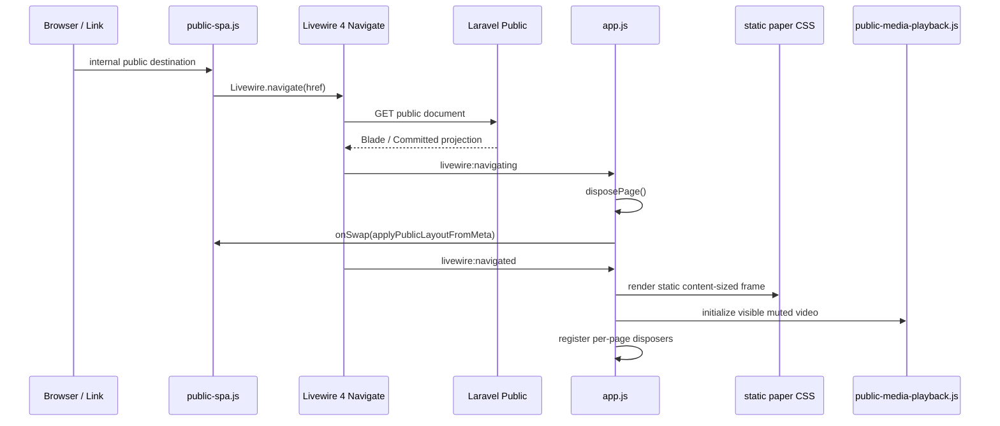

# Öffentliche SPA-Dokumentnavigation und Instanzlebenszyklus

**Historischer Ausgangsbeleg:** `dev@62a104a0` (frühere Folio-Bewegung). **Aktueller Abgleich:** `dev@2ad31502ea4eb352da2c9da4f8334a0d614f1b71` (intrinsisches statisches Paper-CSS statt observergetriebener Kontur, page-scoped Videos, Vite-Revision). Alte WAAPI-/Folio-Tests sind kein aktueller Runtimebeleg. Keine Browser-/Laravel-/JS-Ausführung.

## Architekturentscheidung

Die öffentliche Website bleibt **serverseitig mit Laravel/Blade gerendert**, benutzt für interne Wechsel nun aber **Livewire 4 Document Navigation**. Das ist kein eigenes JavaScript-Routing, kein JSON-API-Frontend und kein Umbau der serverseitigen Domain-/Publication-Schicht. Die bestehenden Public-Routen und der `UseCommittedPublicState`-GET/HEAD-Kontext bleiben maßgeblich. [`public-spa.js`](../../resources/js/public-spa.js) entscheidet für einen einzigen dokumentweiten Click-Listener, welche bisher nicht mit `wire:navigate` versehenen Links via `Livewire.navigate()` delegiert werden; die Dokument-Swap-Implementierung gehört Livewire.

## Request- und Browsersequenz

Der `onSwap`-Callback wird vom `livewire:navigating`-Ereignis installiert und liest [`meta[data-public-layout]`](../../resources/views/layouts/app.blade.php) für die CSS-Variablen `--public-page`, `--public-shell-max`, `--public-art-max` und `--public-content-padding`. Der aktuell gelieferte CSP-Nonce macht serverseitige neue Inline-Styles nicht zur globalen Quelle; der Browser setzt die **serverautorisierten Werte** über CSSOM.

## CSP-sicheres Livewire-Asset und Framework-Grenze

Die Blade-Shell bindet Livewire 4 mit `@livewireScripts(['nonce' => $publicStyleNonce, 'url' => route('public.livewire.csp')])` an [die benannte Route](../../routes/web.php) `GET /site-assets/livewire-csp.js`. Das Route-Closure setzt `config('livewire.csp_safe')` **nur vorübergehend** auf `true`, erzeugt über `FrontendAssets::returnJavaScriptAsFile()` das öffentliche Script und stellt den vorherigen Wert in `finally` wieder her. Dies ist **keine globale Änderung** des Admin-/Filament-Livewire-Bundles; die Public-CSP braucht kein `unsafe-eval`. `public-spa.js` schließt das Asset-Präfix explizit von der SPA-Navigation aus.

Dieser Mechanismus ist aus [`routes/web.php`](../../routes/web.php), [`layouts/app.blade.php`](../../resources/views/layouts/app.blade.php) und [`public-spa.js`](../../resources/js/public-spa.js) geprüft. **Nicht ausgeführt:** ausgelieferte Script-Response, Content-Type/Caching, CSP-Header im Browser, temporäre Konfiguration bei parallelen Long-Lived-Worker-Anfragen oder eine echte Livewire-Navigation.

## Welche Links teilnehmen

[`isPublicSpaDestination()`](../../resources/js/public-spa.js) verlangt HTTP(S), denselben Origin, keinen fremden `target` und keinen Download. Die ausgeschlossenen Pfadpräfixe sind `/admin`, `/api`, `/pulse`, `/livewire`, `/logout`, `/media`, `/storage`, `/vendor` und `/site-assets`. Statische Medien-/Dokument-Endungen und bestimmte Preview-Systempfade werden ebenfalls ausgeschlossen. Zusätzlich bleiben Links mit `data-navigation-parent-link` bewusst bei ihrer bestehenden Menüebenen-Interaktion und werden **nicht** als gewöhnliche `wire:navigate`-Links markiert. `rel=external` und `data-public-full-load` verhindern den Delegationsaufruf ebenfalls. Vorhandene `wire:navigate`-Links lässt der Click-Listener Livewire selbst behandeln; bei fehlender `window.Livewire.navigate`-API bleibt normales Browser-Navigieren erhalten. Modifier-Klicks, bereits behandelte Events und andere Maustasten werden nicht abgefangen. Ein Fragmentlink zur **gleichen Pfad-/Query-Kombination** behält normales Browserscrollen. Diese Liste ist eine konkrete JS-Routinggrenze, **nicht** das vollständige Laravel-Sicherheits-/Autorisierungsmodell; die Route schützt weiterhin Preview/Media.

## Lebensdauer, Disposer und Seitenwechsel

| Initialisierung in [`app.js`](../../resources/js/app.js) | Scope | Bei neuem `#content` |
| --- | --- | --- |
| [Artwork Viewer](../../resources/js/artwork-viewer.js) | Aus der aktuellen Body-Komposition | Zurückgegebener Disposer; AbortController beendet globale Listener |
| [Home Hero](../../resources/js/home-hero.js) | DOM der aktuellen Seite | Keine globale Disposal-Rückgabe vom Bootstrap verwendet; konkrete Event-Owner im Modul |
| [Journal/Exhibition](../../resources/js/journal-presentation.js) | Journal-Slideshow und Map | Zurückgegebener Disposer, insbesondere Karteninstanzen |
| [Matomo](../../resources/js/matomo.js) | Tracker-Script global, deklarative Browser-Events je Seite | Alte Click/Observer-Liste entsorgen; Script nur einmal injizieren, `setCustomUrl`, `setDocumentTitle`, `trackPageView` pro Aufruf |
| [Public Navigation](../../resources/js/public-navigation.js) | Haupt- und Child-Rails, Window-State | Listener am Body entfernen und alle Window-/Resize-Observer entsorgen |
| [Public SPA Click Delegation](../../resources/js/public-spa.js) | Ein globaler Listener, beim Modulladen registriert | Zulässige bisher unmarkierte Links per `Livewire.navigate()`; ohne API nativer Fallback; kein per Seite neu registrierter Listener |

`initializePage()` speichert die letzte `#content`-Elementidentität. Ist sie unverändert, bricht der Bootstrap **ohne erneute Initialisierung oder zusätzliche PageView** ab. Beim aktuellen `dev`-Stand werden vorhandene Disposer **bereits bei `livewire:navigating` vor dem Body-Swap** aufgerufen und die `currentContent`-Identität gelöscht. Beim folgenden `livewire:navigated` entsorgt die Init-Routine verbleibende Disposer defensiv, setzt die neue Identity und baut die Instanzen auf. Das verhindert, dass Modal-/Map-/Tracking-Observer am abgelösten Body weiterlaufen. Ein erstmaliger Besuch erfolgt bei `DOMContentLoaded` bzw. sofort, wenn das Dokument bereits bereit ist; spätere Navigationswechsel nutzen `livewire:navigated`. Diese Regeln sind **Codeverhalten**, keine Zusage bereits bestandener Browser-Zustandsprüfung.

## Journal-Slideshow, Exhibition-Map, Home-Hero und Viewer: Instanzgrenzen

Die breite SPA-Tabelle oben beschreibt nur die Besitzer. Die folgenden konkreten Quellpfade zeigen, wie ihre Unterinstanzen auf einem neuen Server-Dokument erneut entstehen und was bei Abbruch oder fehlender API geschieht.

| UI-Einheit | Initialisierung und positiver Pfad | Negativ-/Cleanup-Pfad |
| --- | --- | --- |
| [Journal-Slideshow](../../resources/js/journal-presentation.js) | Blade-`journal-gallery` setzt `data-journal-slideshow` und für jedes Medium `data-journal-slide`; bei mindestens zwei Folien schaltet JS nur `hidden`, `aria-hidden` und den `n / total`-Text um. Prev/Next ist zyklisch, ohne autoplay, Timer oder Fetch | Bei null/einer Folie keine Navigation-Listener; Click-Handler hängen ausschließlich an den seitenlokalen Schaltflächen und verschwinden beim Content-Swap mit deren DOM. Kein globaler Slider-Disposer nötig |
| [Exhibition-Map](../../resources/js/journal-presentation.js) | Nur bei explizitem Öffnen des `HTMLDialogElement` werden die lokale, versionsgebundene Leaflet-CSS/-JS und anschließend OpenStreetMap-Tiles nachgeladen. Bei vorhandener Map wird lediglich das sichtbare Canvas neu vermessen | Vor dem abgeschlossenen `await loadLeaflet()` prüft der Callback `disposed`, `dialog.isConnected` und `dialog.open`. Navigation/Unmount löst `ResizeObserver.disconnect()`, `map.remove()` und `dialog.close()` aus. Ungültige Koordinaten oder Ladefehler setzen einen kontrollierten Status („Map unavailable…“) statt stiller Karte. Das Modul hält ein gemeinsames Promise für Asset-Laden, nicht einen Timer |
| [Home Hero](../../resources/js/home-hero.js) | Listener sitzt direkt am Home-Hero-Gruppenknoten. Nur bei mindestens zwei serverseitig berechtigten Slides kann Prev/Next zyklisch schalten, das vorherige Video pausieren und den nächsten Fokus setzen | Beim neuen Content verschwindet der lokale Gruppenknoten samt Listener. Es wird kein eigener globaler Listener und kein offener Autoplay-/Polling-Prozess gehalten |
| [Artwork Viewer](../../resources/js/artwork-viewer.js) | Der Viewer normalisiert ausschließlich kanonische Image-/Video-Daten und behält die registrierte Sequenz als Grenze für Prev/Next. Image-Zoom/Pan unterscheidet sich vom nativen Videomodus | `AbortController` beendet globale `visibilitychange`, `pagehide`, `resize` und `orientationchange`-Listener bei SPA-Disposal. Offene Attention-Zeit wird geflusht, Video pausiert und geplante `requestAnimationFrame`-Neuberechnung abgebrochen. Escape bleibt native Dialogschließung |
| [Matomo](../../resources/js/matomo.js) | `matomo.js` wird bei passender Konfiguration nur einmal eingebunden; nach jedem echten Seiten-Boot werden `setCustomUrl`, `setDocumentTitle` und `trackPageView` zur bestehenden Queue geschrieben | Deklarative Click-Listener und `IntersectionObserver` werden mit dem Page-Disposer aufgehoben; fehlende Konfiguration bedeutet keinen neuen Track. Das einmal geladene SDK selbst ist nicht pro Seite neu zu laden |

**Grenze der Behauptung:** Diese Tabelle beschreibt Codepfade; kein reales SPA-Reentry, Scroll-/Focus-Restoration, Leaflet-Laden, Karten-Tile-Ausfall oder Reviewer-Akzeptanz wurde hier ausgeführt. Die asynchrone Map-Race-Abwehr ist belegbar, eine vollständige Browsergarantie daraus nicht.

## Statischer Public-Paper-Frame, Home Hero und Gallery-Puffer

**Quellstand `dev@2ad31502ea4e`:** Die alte Folio-Motion-Engine und **auch** der zwischenzeitliche `resources/js/public-paper-frame.js`-Beobachter sind entfernt. Blade entscheidet nur den Frame-/Sheet-Modus; der statische Content-Sheet-Frame ist ein intrinsisch hohes Flex-Element. Seine Konturen enden anhand der CSS-Boxgröße des tatsächlich gerenderten Inhalts und des einzigen Return-Insets; der Body trägt die übrige Viewport-Höhe. Kein Positionsmesser, observergetriebener Layout-Schreibpfad, WAAPI-Loop, Polling oder Timer ist im aktuellen Paper-Lifecycle enthalten. Leere/min-height Sheets besitzen weiterhin bewusst eigene Geometrie. Die Frame-/Divider-Optionen gehören `PublicAppearance`, nicht einem zweiten JS-Rendering-Owner.

`app.js` installiert einen einzigen documentweiten Livewire-Navigation-Lifecycle. `initializePublicPaperFrame()` ist kein Bootstrap-Disposer mehr. Vor dem Swap werden Seiteninstanzen entsorgt; `applyPublicLayoutFromMeta` synchronisiert Frame-Style und aktuelle CSS-Werte mit dem serverseitig autorisierten Stylesheet, bevor neue Viewer-, Home-Hero-, Journal-, Navigation-, Gallery-/Video- und Paper-Instanzen starten. Vite-Asset-URLs enthalten bei einem gebauten Manifest dieselbe revisionsfähige Query, um veraltete SPA-Bundle-Kombinationen zu erkennen.

Die Gallery behält alle öffentlichen Artwork-/Viewer-Einträge im Markup; ihre ersten **zwei** Images werden eager, nur das erste mit hoher Priorität geladen. Nachfolgende Images nutzt `public-gallery-loading.js` mit dem begrenzten Beobachter-/Prefetch-Budget, ohne Backend-Paging. Der Video-Poster-Reader nutzt `MediaPreviewVariant::videoPoster()`; `public-media-playback.js` startet erlaubte sichtbare Inline-Videos stumm/looping und pausiert bei verstecktem Slide oder inaktivem Dokument. Der separate Viewer besitzt seine eigenen Videocontrols. Browser, Netzwerk, Nonce, Focus-/Back-Forward- und Artist-Akzeptanz wurden **nicht** erneut ausgeführt.

## Public Head und Nonce über den Dokumentwechsel

**Source `dev@11f7e101`; authored `testing@14af6804`, nicht ausgeführt.** [`SecurityHeaders`](../../app/Http/Middleware/SecurityHeaders.php) erzeugt pro Request den Nonce. [`layouts/app.blade.php`](../../resources/views/layouts/app.blade.php) nutzt ihn bei Root-Folio-`<style>`, `@stack('public-component-styles')`, `@livewireStyles` und `@livewireScripts`. Die CSP-safe [`/site-assets/livewire-csp.js`-Route](../../routes/web.php) setzt `livewire.csp_safe` für den Public-FrontendAsset-Response mit `finally` temporär zurück; kein belegtes Umschalten des Admin-Bundles.

[`app.js`](../../resources/js/app.js) entsorgt auf `livewire:navigating` die alte Page, überträgt mit `onSwap(applyPublicLayoutFromMeta)` die serverseitigen Meta-Werte per CSSOM und initialisiert auf `livewire:navigated` neu. [`public-spa.js`](../../resources/js/public-spa.js) delegiert nur passende Same-Origin-Links an `Livewire.navigate()`. Auch ein vom JS akzeptierter `/preview*`-Link benötigt **erneute Backend-Admin-Autorisierung**; ein SPA-Linkfilter ist kein Working-Zugriffsschutz. Die Quelllogik beweist **nicht**, dass bei unterschiedlichen Response-Nonces alle Head-Styles/Canonical-/Robots-Metadaten nach realen Swaps korrekt reconciliert werden.

**Gelesene Tests:** [`SecurityHeadersTest.php`](https://github.com/Wiiii90/moeller-lars/blob/14af6804d5f3a298feaceb70020c62546017a2dc/tests/Feature/Public/SecurityHeadersTest.php) enthält CSP-/Nonce-/Asset-Assertions; [`public-spa.test.mjs`](https://github.com/Wiiii90/moeller-lars/blob/14af6804d5f3a298feaceb70020c62546017a2dc/tests/js/public-spa.test.mjs) Linkfilter-/CSSOM-Assertions; [`public-spa-navigation.spec.mjs`](https://github.com/Wiiii90/moeller-lars/blob/14af6804d5f3a298feaceb70020c62546017a2dc/tests/browser/e2e/public/public-spa-navigation.spec.mjs) Browser-Back/Forward/DOM-Identity-Szenario. **Kein Test wurde hier ausgeführt**; insbesondere kein realer CSP-/Head-/Network-Check.

**Spätere Browserabnahme:** Public Home→Custom (unterschiedliche Image-Skalen/Nonces)→Journal/Gallery→Back/Forward; pro Response CSP-Header vs Style-/Script-Nonce, Canonical/Robots, Console/`securitypolicyviolation`, Preview 404 oder autorisiert no-store, JS-Bundle/Media-Requests; Admin-/Public-Asset-Isolation. Für Media-, TDM- und Matomo-Konfigurationsgrenzen gilt die [einzige Public-Security-Matrix](public-security-privacy-boundaries.md#7-fachlicher-source-abschluss-public-read-csp-und-auslieferungsgrenzen).

## Fachliche und technische Grenzen

- Öffentliche GET/HEAD-Anfragen bleiben an `UseCommittedPublicState` und Publication-Media-Policy gebunden; SPA-Navigation darf keine Entwurfsdaten öffentlich ausliefern. Nicht-GET-Formulare wie Contact folgen ihrem normalen HTTP-Schutz.
- Die bestehende zyklische ganze-Item-Navigation behält ihren eigenen `sessionStorage`-Handoff; der Document-Swap soll ihn nicht durch Pixel-Scrolling ersetzen.
- Der Admin benutzt ebenfalls Filament/Livewire-SPA, aber mit eigener Auth-/Lifecycle-Policy. Aus dem Public-SPA-Skript ist **keine** Admin-Route ableitbar.
- **Zu überprüfen:** tatsächliche Livewire-Head-/Nonce-Updates, Scroll-/Focus-Restoration, Back/Forward, Wechsel zwischen Parent/Child-Menüs, erneute offene Viewer/Map-Instanzen, Matomo pro echtem Seitenwechsel und Escape/Hydration-Verhalten. Ein Quell-Diagramm allein ist kein Browsertest.

## Cross-page rendering changes since the last static frame audit (`dev@74e629274ac2`)

The shared `public-spa.js` still delegates eligible same-origin links to Livewire; `app.js` disposes page-scoped viewer, Gallery image loading, video, Journal, header and navigation owners at swaps. Public image metadata/ALT and layout must not flash placeholder text while the high-resolution Artwork image loads. `public-header.js` and the shared styles preserve the chosen Beside/Inside title layout and full-width versus Menu-width divider in **the same canonical geometry**: the full-width divider is not permission to enable separate-surface backing, and Beside title alignment cannot invent a Center option. Gradient styling uses existing nonce-authorized CSS properties instead of a second render/observer pipeline.

New Journal image-viewer opt-in reuses `artwork-viewer.js` with a Journal scope rather than mounting another viewer; [Journal owner](journal-content-lifecycle.md#shared-rich-text-and-optional-journal-image-viewer) defines which image occurrences are eligible. Source and authored tests were read, not executed as a new Browser/SPA/CSP acceptance pass.
