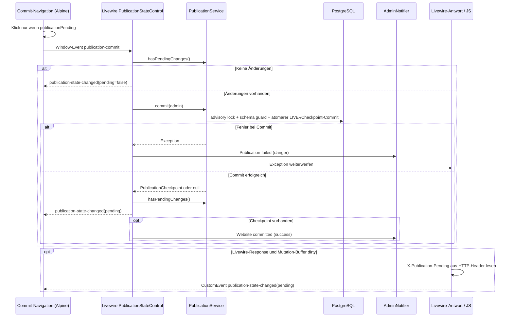

# Publication: Working, LIVE und öffentlicher Lesezugriff

**Quellbelege:** `PublicationSnapshot.php`, `PublicationService.php`, `PublicationVersionService.php`, `PublicationReadContext.php`, `CommittedRead.php`, `PublicationPostgresGrammar.php`, `UseCommittedPublicState.php`, `bootstrap/app.php` (Beleg-HEAD siehe [Inventar](inventory.md)). Vertragsregeln verbleiben vorläufig in [ADMIN-ACTIVITY-PUBLICATION-CONTRACT.md](../ADMIN-ACTIVITY-PUBLICATION-CONTRACT.md).

## Physische und logische Zustände

- **Working:** `public.<tracked_table>` — editorielle Änderungen.
- **LIVE:** `committed.<tracked_table>` — nur ausdrücklich committed Änderungen.
- **Commit-History:** `publication_checkpoints`, logische Version-Row-Schnittstelle, Manifeste und Shared Payloads.
- **Activity/Audit:** `audit_events` plus Zuordnung `publication_checkpoint_events`; keine zweite Content-Quelle.
- **Recovery:** Undo-Receipts und restorable Versionen mit eigenen Aufbewahrungsbedingungen.

Die Konstante `PublicationSnapshot::TABLES` enthält genau 15 fachliche Tabellen. Gleiche Tabellennamen in Working und LIVE bedeuten **nicht**, dass ein öffentlicher Request einfach die PostgreSQL-`search_path`-Variable umschaltet.

## Öffentlicher GET-/HEAD-Ablauf

```mermaid
sequenceDiagram
    participant Browser
    participant Middleware as UseCommittedPublicState
    participant Scope as CommittedRead
    participant Context as PublicationReadContext
    participant Grammar as PublicationPostgresGrammar
    participant DB as PostgreSQL

    Browser->>Middleware: GET/HEAD public URL
    alt admin, preview, livewire oder up
        Middleware-->>Browser: Normaler Requestpfad
    else öffentlicher Lesezugriff
        Middleware->>Scope: run(callback)
        Scope->>Context: runCommitted(callback)
        Scope->>DB: transaction; REPEATABLE READ bei Level 1
        Note over Context,Grammar: Scoped committedDepth > 0
        Middleware->>Grammar: Eloquent-Query erzeugen
        Grammar->>Grammar: Trackbare unqualifizierte Tabelle?
        alt Ja
            Grammar->>DB: SELECT FROM committed.<table>
        else Nein
            Grammar->>DB: Unveränderte Tabellenreferenz
        end
        DB-->>Browser: Read-only HTML/Response
        Scope->>Context: committedDepth im finally zurücksetzen
    end
```

**Genauigkeit:** Das Diagramm vereinfacht die tatsächliche Aufrufverschachtelung und stellt die Grammatik als eigenständige Phase dar; sie wird bei Query-Compilation über die PostgreSQL-Connection verwendet. Die Read-Kontext-Depth läuft über ein `try/finally` wieder zurück. `wrapTable` qualifiziert nur unqualifizierte Namen aus `PublicationSnapshot::TABLES` und respektiert explizite Schemanamen und Aliasnamen. `CommittedRead` setzt bei der ersten Transaktionsebene `REPEATABLE READ`. Das ist eine wesentliche Architekturgrenze gegenüber einer pauschalen `search_path`-Erklärung.

## Explicit Commit

```mermaid
sequenceDiagram
    participant Admin
    participant Service as PublicationService
    participant DB as PostgreSQL
    participant Versions as PublicationVersionService
    participant Cleanup as PublicationMediaCleanupService

    Admin->>Service: commit(actor, message)
    Service->>DB: BEGIN
    Service->>DB: pg_advisory_xact_lock
    Service->>DB: assert schema parity; lock Working tables
    Service->>DB: Working-vs-LIVE row diff
    alt Keine fachlichen Änderungen
        Service->>Versions: clearWorkingContext()
        DB-->>Service: COMMIT (kein neuer Checkpoint)
        Service-->>Admin: null
    else Fachliche Änderungen vorhanden
        Service->>DB: uncommitted Audit-IDs und Parent bestimmen
        Service->>DB: TRUNCATE committed.<tracked tables>
        Service->>DB: INSERT SELECT * FROM public.<tracked tables>
        Service->>DB: neuen publication_checkpoint anlegen
        Service->>Versions: capture(checkpoint, parent, operation, source)
        Versions->>DB: Snapshot und History manifestieren
        Service->>DB: Audit-Events an Checkpoint binden
        Service->>DB: betroffene Undo-Receipts löschen
        Service->>Versions: clearWorkingContext()
        DB-->>Service: COMMIT
        Service->>Cleanup: drain()
        Service-->>Admin: PublicationCheckpoint
    end
```

**Sicherheitsgrenzen und Negativpfade:**

1. Commit/Restore/Reset/Revert besitzen eine **gemeinsame** transaktionale Advisory-Lock-Grenze für ihre **geschützten** Operationsteile; Commit sperrt zusätzlich die Working-Tabellen in `SHARE MODE` und liest den Pending-Diff **unter** Lock erneut. Das beweist keine vollständige Serialisierung von **vorherigen** UI-/Preflight-Reads. **Revert liest insbesondere LIVE/Parent vor seinem Lock** und validiert den LIVE-Head darunter nicht erneut; die belegte hypothetische Interleaving-/Source-Provenienz-Grenze gehört ausschließlich zur [Working-Operations-Analyse](publication-working-operations.md#statische-race-sequenz-revert-ziel-vor-dem-lock). Ein Schema-Paritätsfehler verhindert die jeweilige geschützte Operation.
2. Kein fachlicher Diff bedeutet **keinen neuen Commit**. Ein bloßer `updated_at`-Unterschied ist nicht publikationsrelevant.
3. Der Commit schließt noch nicht zugeordnete Audit-Ereignisse zur aktuellen Generation; einzelne Undo-Receipts für diese Events werden entfernt.
4. **Restore** lädt einen kompatiblen historischen Zustand in **Working**, nicht unmittelbar nach LIVE. **Revert** ist auf den Parent des aktuellen LIVE-Commits beschränkt und wird ebenfalls zunächst nur staged.
5. History-Metadaten können vorhanden sein, obwohl kein kompatibler Restore-Payload mehr verfügbar ist (`snapshot_available`, `schema_hash`).
6. `PublicationMediaCleanupService::drain` läuft nach erfolgreichem Commit; Medienreferenzen aus einem geschützten historischen Snapshot dürfen nicht durch vorzeitiges Löschen physischer Originale entwertet werden.

## Admin-Commit: Navigation, Livewire und Notification

Der App-Commit ist nicht einfach ein Link auf einen Controller. Der tatsächliche Einstieg ergibt sich aus [`AdminPanelProvider`](../../app/Providers/Filament/AdminPanelProvider.php), dem [Panel-Render-Hook](../../resources/views/filament/partials/publication-state-control-hook.blade.php), der [Livewire-View](../../resources/views/livewire/admin/publication-state-control.blade.php), [`PublicationStateControl`](../../app/Livewire/Admin/PublicationStateControl.php), [`AttachPublicationState`](../../app/Http/Middleware/AttachPublicationState.php) und dem [`AdminNotifier`](../../app/Domain/Admin/AdminNotifier.php).



Der Aufbau hat mehrere konkrete Kontrollpunkte:

1. **Initialzustand:** `AdminPanelProvider::navigation()` fragt `PublicationService::hasPendingChanges()` ab und schreibt den Anfangszustand in das Alpine-Attribut `publicationPending`. Der Commit-Navigationseintrag dispatcht beim Klick nur bei aktivem Pending-Status das Window-Event `publication-commit`.
2. **Einziger Window-Empfänger im Hook:** `publication-state-control-hook.blade.php` mountet `<livewire:admin.publication-state-control />` im Panel-`BODY_END`. Die View lauscht auf `publication-commit.window` und ruft über `$wire.commitPublication()` die [Livewire-Methode](../../app/Livewire/Admin/PublicationStateControl.php) auf. Das ist kein gewöhnlicher HTML-Submit.
3. **No-op bei leerem Working-Diff:** Nach `AdminAuditService::requireActor()` wird erneut `hasPendingChanges()` geprüft. Bei Null-Diff dispatcht Livewire `publication-state-changed(false)` und bricht ab, **ohne** erfolgreichen Commit oder Notification zu behaupten.
4. **Fehlerfall:** `PublicationService::commit()` läuft innerhalb der DB-Transaktion. Falls er wirft, versucht das Control eine **Danger-Notification** mit Activity-Link zu speichern und sichtbar zu machen; schlägt auch diese Benachrichtigung fehl, wird deren Exception separat berichtet. Die ursprüngliche Commit-Exception wird erneut geworfen. Keine Success-Notification für den Fehler.
5. **Erfolgsfall:** Nach Commit wird der Pending-Status erneut ermittelt und über Livewire `publication-state-changed` gesendet. Nur wenn tatsächlich ein Checkpoint zurückkommt, folgt ein expliziter `AdminNotifier::notification('Website committed', status: 'success')`. Der Notifier kann einen zuvor gespeicherten Activity-Kontext konsumieren; deshalb ist „immer genau eine Notification mit diesem Titel“ **keine** belegte Invariante.
6. **Zweiter Statuskanal:** Bei Livewire-Antworten hängt `AttachPublicationState` den Header `X-Publication-Pending` **nur** an, wenn der scoped `AdminMutationSnapshotBuffer` Veränderungen signalisiert. Das in der Control-View einmalig registrierte `Livewire.interceptRequest(...onResponse...)` liest nur `0` oder `1` und dispatcht dann ebenfalls `publication-state-changed` als Browser-CustomEvent. Livewire-Event und Header-Event sind also **zwei Statuslieferanten** an dieselbe Alpine-Navigation; der Header ist nicht auf jeder Antwort vorhanden.

### Quelle, Qualität und offene End-to-End-Checks

Die komplette beschriebene Kette wurde **quellseitig** bis zum Aufruf belegt, nicht im Browser interaktiv ausgeführt. Der PHP-Service-Commit selbst ist im obigen [Explicit-Commit](#explicit-commit)-Abschnitt modelliert. Zu testen bleiben unter anderem: Doppel-Klicks während laufender Requests, konkurrierende Änderung des Working-Diffs, UI-Feedback bei Fehler und Verhalten bei späteren SPA-Navigationen. Die Doppelquelle des Status darf nicht durch Timer oder einen neuen globalen Polling-Mechanismus ersetzt werden.


### Noch ausdrücklich nicht untersucht

- vollständiges SQL-Schema der History-/Undo-Tabellen und sämtliche FK-/Indexgrenzen;
- Transaktions- und Konkurrenzszenarien durch ausgeführte Tests;
- ein durchgeführter Browser-/DB-Test der inzwischen beschriebenen Activity-Restore-, Revert- und Reset-Einstiege (siehe [Working-Operationen](publication-working-operations.md));
- externe Binary-Storage-Fehler und Recovery bei fehlgeschlagenem Cleanup.

Diese Punkte werden nicht durch das obige Diagramm als bereits verifiziert ausgegeben.
