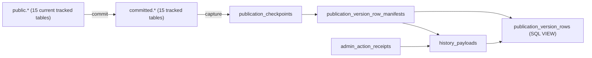

# PostgreSQL-Schemaentwicklung und bewusste Kompatibilitätsgrenzen

**Quellenstand:** `28219ef962178602340989d49d2f4329286b0697` auf `dev`, in `docs` enthalten. Diese Aufnahme basiert auf konkret gelesenen Up-Migrationspfaden und relevanten Domain-Services. **Keine** der 73 Migrationen wurde in dieser Arbeitsumgebung gegen eine Datenbank ausgeführt. Der physische PostgreSQL-Katalog bleibt die endgültige Quelle für aktuelles Schema und tatsächlich vorhandene Constraints.

## Arbeitsregel: Migration ist Historie, Snapshot ist Runtime

| Ebene | Quelle | Aussage |
| --- | --- | --- |
| Historische Schema-Evolution | `database/migrations/*.php` in Ausführungsreihenfolge, jeweils `up()` | Wie der aktuelle Aufbau erreicht werden **soll**; Down-Pfade sind kein Nachweis für aktuelle Objekte |
| Tatsächliches physisches Schema | `pg_catalog` einer isolierten, vollständig migrierten DB | Tabellen, Views, Indizes, FKs, Constraints, Trigger |
| Current Publication Contract | [PublicationSnapshot::TABLES](../../app/Domain/Publication/PublicationSnapshot.php) | **15** aktuelle Working/LIVE-Snapshot-Tabellen, nicht alle SQL-Tabellen |
| Eloquent-Anwendungsmodell | [Model-Relationen](eloquent-relations.md) | PHP-Referenz-API, nicht alle FKs, JSON-Referenzen oder SQL-Views |
| Runtime-Wahrheit | Controller/Services/Query Grammar und Domain-Validierung | Was aktuelle Applikationspfade tatsächlich tun |

Die ursprüngliche Publication-Migration [`2026_08_29_000001_add_staged_publication.php`](../../database/migrations/2026_08_29_000001_add_staged_publication.php) führte **16** historisch getrackte Tabellen an, darunter `cv_entries`. Die aktuelle [`PublicationSnapshot::TABLES`](../../app/Domain/Publication/PublicationSnapshot.php) enthält 15 und **nicht** mehr `cv_entries`. Das ist eine bewusst unterschiedliche **Zeitversion** des Publication-Vertrags; die eingefrorene alte Liste darf nicht dem Runtime-Konstantenwert angepasst werden.

## Fachliche Kern- und Eigentümertabellen

| Migrationsschritt | Nachweisbarer Mechanismus |
| --- | --- |
| [`2026_08_15_000003_create_domain_tables.php`](../../database/migrations/2026_08_15_000003_create_domain_tables.php) | Basis u. a. für Artwork, Media, Exhibition, Blog, Redirect, Audit, Metriken; enthält State-CHECKs und partielle Unique-Indizes |
| [`2026_08_19_000002_create_site_sections.php`](../../database/migrations/2026_08_19_000002_create_site_sections.php) | Typisierte Seitenstruktur, Positions-/Typ-/Navigationsconstraints |
| [`2026_08_21_000013_add_configurable_site_pages.php`](../../database/migrations/2026_08_21_000013_add_configurable_site_pages.php) | Aktuelle SiteSection-Typfamilie (`home/gallery/navigation_group/custom/journal`), separate Settings für Custom Page und Journal |
| [`2026_08_25_000001_create_journal_entry_media.php`](../../database/migrations/2026_08_25_000001_create_journal_entry_media.php) | **Genau ein** Eigentümer: entweder `blog_post_id` oder `exhibition_id`; Rolle `cover/inline/gallery` mit individuellen Eintrags-/Positions-Indizes |
| [`2026_08_26_020000_create_home_presentation_settings.php`](../../database/migrations/2026_08_26_020000_create_home_presentation_settings.php) und [`2026_09_14_184000_separate_home_skip_routing.php`](../../database/migrations/2026_09_14_184000_separate_home_skip_routing.php) | Ursprünglicher vierter Templatewert `skip_home` wird durch eigenständigen Routingzustand ersetzt, aktuelle Templates sind Artwork, Under Construction, Custom |
| [`2026_10_12_000001_make_public_navigation_follow_publication.php`](../../database/migrations/2026_10_12_000001_make_public_navigation_follow_publication.php) | Einzigartige Navigation-Positionsindizes entfallen; neue partielle **nicht eindeutige** Positionsindizes schützen historische Wiederherstellbarkeit |
| [`2026_10_13_000001_add_exhibition_postal_code.php`](../../database/migrations/2026_10_13_000001_add_exhibition_postal_code.php) | `postal_code` wird in **beiden** Schemas ergänzt |

Wichtig für das spätere ERD: `journal_entry_media` ist kein generisch polymorphes Eloquent-Morphing. Der SQL-Owner-CHECK verlangt genau eine der beiden expliziten Eigentümerspalten.

### Neuer Journal-Presentation-Schritt (Merge aus `dev`, 2026-10-13)

[`2026_10_13_000002_add_blog_gallery_presentation.php`](../../database/migrations/2026_10_13_000002_add_blog_gallery_presentation.php) ergänzt `blog_posts.gallery_presentation` mit `varchar(24) NOT NULL DEFAULT 'sequence'` in Working und ausdrücklich auch in `committed.blog_posts`. Damit bleibt die 15-Tabellen-Publication-Parität erhalten, **ohne** eine neue Publication-Tabelle einzuführen. Die Migration ist absichtlich forward-only.

[`BlogPost::galleryPresentation()`](../../app/Models/BlogPost.php) normalisiert die akzeptierten Darstellungswerte `sequence`, `grid`, `mosaic` und `slideshow` und fällt bei unbekanntem Altwert auf `sequence` zurück. [`BlogEditorialService::validate()`](../../app/Domain/Content/BlogEditorialService.php) prüft die Benutzer-Eingabe. [`journal-gallery.blade.php`](../../resources/views/components/journal-gallery.blade.php) rendert die Gallery entsprechend, für `mosaic` über `JournalMosaicColumns`, für `slideshow` mit dedizierten Prev-/Next-/Status-Knoten. Die Gallery-Medien bleiben `JournalEntryMedia` und werden **nicht** zu neuen Eloquent-Relationen. Die exakte DOM-/JS-Lifecycle-Verifikation bleibt separat offen.

### Aktuelle Media-Rechte-Schema-Parität (Migration `2026_10_15_180000`)

[`2026_10_15_180000_add_media_file_rights.php`](../../database/migrations/2026_10_15_180000_add_media_file_rights.php) fügt `media_assets` vier optionale Spalten hinzu: `file_creator varchar(240)`, `file_rights_holder varchar(240)`, `rights_usage_terms text`, `license_inquiry_url varchar(2048)`. Bei PostgreSQL schreibt `up()` dieselben vier Spalten ausdrücklich nach `committed.media_assets`; `down()` entfernt sie auf beiden Seiten. Die Migration verändert **keine** der aktuellen 15 Publication-Tabellenidentitäten und ist **kein** physischer Schema-Nachweis. Die [kanonische Rechteprojektion](../../app/Domain/Media/MediaRightsProjection.php) nutzt die neuen Eloquent-Felder, aber die in DB gesicherte LIVE-Äquivalenz, die korrekte Snapshot-History-Payload und alte Checkpoints sind **erst** nach isoliertem Migrations-/Commit-/Restore-/Revert- und `pg_catalog`-Test belegbar. PostgreSQL-Zweig ist explizit; SQLite-/andere isolierte Testpfade können die `committed`-DDL überspringen.

## Geschützter Validation-Zustand vs v0.5-Produktionsdaten

**Quell-/Vertragsstand `dev@46683562`:** Eine frühere Legacy-Datenbank ist Provenienz und wiederholbare *Importprobe*, nach dem ursprünglichen Import aber **nicht** automatisch die spätere Produktionsinhaltsquelle. Das vom Künstler redaktionell bearbeitete und freigegebene **Validation-`public` + `committed` samt kanonischen Originalmedien** soll unter explizitem Freeze als konsistenter Cutover-Kandidat dienen. Die vorhandenen [Forward-Migrationen](../MIGRATION-PLAN.md#6-protected-validation-and-editorial-authority) müssen diesen geschützten Zustand erhalten. Der lokal benutzte Test-/Entwicklungsdatenbestand ist weder Approval- noch Cutover-Quelle.

**Zwei getrennte Prüfungen:** (1) **Migration/Provenienz:** Jeder ursprüngliche Legacy-Satz wird historisch nachvollzogen; spätere genehmigte Abweichungen in Anzahl, Reihenfolge, Parent/Artwork/Medienreferenz sind **gewollte redaktionelle Deltas**, keine automatisch fehlerhafte Migration. (2) **Production-Rekonstruktion:** Freeze und Restore in **ein neues isoliertes Target**, mit expliziter Whitelist/Negativliste der übernommenen Daten (Content, Originale, zulässige LIVE-/History-Referenzen) gegenüber test-/umgebungsspezifischen Sitzungen, Zugangsdaten, Tokens, Mail- und Analytics-Konfiguration. Publication-Referenzen, MediaAsset-Hashes, App-/Schema-SHA, Recovery und Rollback getrennt validieren. Die Plattform-/Runbook-Ausführung gehört nicht in diesen Dokumentationsbranch; ein `pg_catalog`- oder echter PostgreSQL-Export wurde **nicht** durchgeführt.

Der [normative Migrationsplan](../MIGRATION-PLAN.md#6-protected-validation-and-editorial-authority) und die [Invarianten](../MIGRATION-INVARIANTS.md#fresh-import-versus-protected-canonical-data) besitzen die Anforderungen; hier nur die unterschiedliche **Quell-/Schemaevidenz**. v0.3-Historienabnahme kann keine v0.4-Abnahme ersetzen, und die spätere v0.5-Datenfreigabe ist nochmals eigenständig.

## Publication-Snapshot und History-Payloads

Die Pfeile zeigen hier **fachliche Datenbeziehungen**, nicht behauptete FK-Kardinalitäten. Quellen:

- [`2026_08_29_000001_add_staged_publication.php`](../../database/migrations/2026_08_29_000001_add_staged_publication.php): initiales `committed`-Schema; Kopieren der damals getrackten Tabellen; PublicationCheckpoints und Media-Cleanup.
- [`2026_09_15_000001_add_restorable_publication_versions.php`](../../database/migrations/2026_09_15_000001_add_restorable_publication_versions.php): Commit-Linie, Hashes, initiale `publication_version_rows`-**Tabelle**.
- [`2026_09_17_000001_control_history_storage_growth.php`](../../database/migrations/2026_09_17_000001_control_history_storage_growth.php): inhaltsadressierte Payload-Deduplikation und Wechsel zu Manifests/SQL-View.
- [`2026_09_17_000003_share_history_payload_store.php`](../../database/migrations/2026_09_17_000003_share_history_payload_store.php): gemeinsames `history_payloads` für Undo-Receipts und Publication-Manifeste; **`publication_version_rows` ist nun eine View mit INSTEAD-OF-Triggern** für Insert/Delete. Zusätzlich existieren Trigger/Funktionen für Unveränderlichkeit und freigabegesteuerte Garbage Collection.
- [`2026_09_29_191500_rebuild_admin_activity_ordering_projection.php`](../../database/migrations/2026_09_29_191500_rebuild_admin_activity_ordering_projection.php): getrennte Tabellen für fachliche Ordering-Projektionen und Raw-Event-Verknüpfung.
- [`2026_09_30_010000_drop_publication_event_states.php`](../../database/migrations/2026_09_30_010000_drop_publication_event_states.php): Entfernung einer alten, inzwischen obsoleten Publication-Zwischentabelle.

Ein rein aus Eloquent generiertes Diagramm könnte die `publication_version_rows`-View irrtümlich als physische Tabelle interpretieren und dabei die Trigger und den geteilten Payloadstore verlieren. Beides wäre sachlich falsch.

## Legacy-Reste und getrennte Zustandsbegriffe

1. [`2026_09_15_000004_retire_obsolete_blog_settings.php`](../../database/migrations/2026_09_15_000004_retire_obsolete_blog_settings.php) entfernt `blog_settings` aus dem aktuellen Arbeits-Schema; Werte gehören in SiteSection/JournalSetting.
2. [`2026_09_16_235901_finalize_legacy_cv_retirement.php`](../../database/migrations/2026_09_16_235901_finalize_legacy_cv_retirement.php) entfernt `cv_entries` aus `public` und `committed`. Das weiterhin existierende Eloquent-Modell macht die Tabelle nicht wieder aktiv.
3. `exhibition_media` und die historische `map_shape`-Spalte müssen wegen Snapshot-/Schema-Kompatibilität getrennt von aktuell genutzten UI-Funktionen betrachtet werden.
4. **Datenbank-akzeptierte Werte ≠ aktive Service-Transitionen.** Die ursprünglichen CHECK-Constraints aus `2026_08_15_000003` erlaubten für Artworks und Exhibitions neben Draft/Published auch Hidden/Archived, für MediaAssets neben Available/Deleted auch Quarantined; MediaVariants kennen außerdem Stale. Die [ersten Lifecycle-Diagramme](lifecycles.md) bilden nur bereits nachverfolgte **aktuelle Mutationspfade** ab. Ob diese historischen Werte im vollständig migrierten Endschema weiterhin zulässig sind, muss der DB-Katalogexport belegen. Bestehende Daten dürfen nicht allein aus fehlenden UI-Übergängen für unmöglich erklärt werden.

## Präzisierte Migrationsreihenfolge: CV und historische Backfill-Hashes

Die tatsächliche **Quellreihenfolge** ist für den späteren isolierten Migrationsnachweis relevant:

1. **29.08.2026** — [Staged-Publication-Migration](../../database/migrations/2026_08_29_000001_add_staged_publication.php): ihre eingefrorene `TRACKED_TABLES` enthält 16 Einträge, darunter `cv_entries`; `up()` erzeugt `committed.cv_entries` aus der damals vorhandenen `public.cv_entries` und initialisiert `publication_checkpoints`.
2. **15.09.2026** — [Restore-Versionen-Migration](../../database/migrations/2026_09_15_000001_add_restorable_publication_versions.php): Nur **der jeweils neueste** vorhandene Checkpoint erhält `snapshot_available=true`, `snapshot_hash` und `schema_hash`. Der Backfill nach `publication_version_rows` iteriert `PublicationSnapshot::TABLES` aus dem **jetzt installierten** Anwendungscode. Dieselbe veränderliche Liste bestimmt `schemaHash()` (aus `information_schema.columns`) und `snapshotHash('committed')` (alle Tabellenzeilen). Frühere Checkpoints erhalten statt eines vollständigen Snapshots lediglich ihren Legacy-Hashanteil.
3. **16.09.2026** — [CV-Retirement-Migration](../../database/migrations/2026_09_16_235901_finalize_legacy_cv_retirement.php): Migrationscode versucht die vorhandenen CV-Datensätze beider Schemas in `custom_page_settings.blocks` umzuwandeln und entfernt erst danach `public.cv_entries` sowie `committed.cv_entries`.
4. **Aktueller Code** — [`PublicationSnapshot::TABLES`](../../app/Domain/Publication/PublicationSnapshot.php) enthält noch 15 Tabellen und kein `cv_entries`.

**Konkrete statische Folge:** Beim erneuten Abarbeiten der 15.09.-Migration mit aktuellem Anwendungscode ist `cv_entries` noch physisch vorhanden, wird aber **nicht** in `publication_version_rows`, den `schema_hash`-Input oder den `snapshot_hash`-Input einbezogen. Frühere historische CV-Tabellenänderungen nach erneuter Codeentwicklung beeinflussen daher die Hash-/Backfill-Abdeckung nicht so wie beim ursprünglichen 16-Tabellen-Vertrag. Ob dies einen konkreten späteren Restore/Hash-Fehler oder einen regulär erfolgreichen `migrate:fresh` bewirkt, lässt sich **nicht** aus dieser Abweichung allein ableiten.

Die korrekte Reparatur benötigt eine getrennt autorisierte Application-/Migration-Entscheidung und eine **vollständig isolierte, ausdrücklich wegwerfbare PostgreSQL-Rekonstruktion** mit anschließender Prüfung der erzeugten Versionen/History-Payloads. Hier wurden nur statische Quellanker gelesen; das eingefrorene historische 16er-Schema wird auf `docs` weder entfernt noch durch eine ungeprüfte alternative Liste ersetzt.

## Konkreter Quellenkonflikt, noch nicht bereinigt

Die Dokumentationsregel in [ADMIN-ACTIVITY-PUBLICATION-CONTRACT.md](../ADMIN-ACTIVITY-PUBLICATION-CONTRACT.md) verlangt, dass historische Migrationen ihre damaligen Publication-Tabellen **fest einbetten** und nicht die spätere Runtime-Konstante importieren.

Die frühe Migration vom 29.08. hält das ein. Dagegen verwendet [`2026_09_15_000001_add_restorable_publication_versions.php`](../../database/migrations/2026_09_15_000001_add_restorable_publication_versions.php) für den Snapshot-Backfill **und** die beiden internen Methoden `schemaHash()`/`snapshotHash()` den veränderlichen Wert `PublicationSnapshot::TABLES`. Das ist eine reale Abhängigkeit der Schemahistorie vom aktuellen Code und verletzt den normativen [Self-Containment-Vertrag](../MIGRATION-INVARIANTS.md#historical-migration-self-containment). Ein fehlgeschlagener isolierter Migrationslauf wurde daraus **nicht** abgeleitet. Hier wird kein Laufzeitcode auf dem Dokumentationsbranch verändert; für eine spätere Korrektur wäre eine gezielte Prüfung der Migrations-Evolution notwendig, bevor man die historische Tabelleliste festschreibt.

## Noch nicht nachgewiesen

Ein erfolgreich in einer isolierten DB ausgeführtes `migrate:fresh`, sämtliche endgültigen Constraintdefinitionen, aktuelle FK-Target-Schemata, alle SQL-Funktionskörper, Trigger-Grenzen und die Korrektheit des vollständigen Restore-Laufs. [export-architecture-postgres.php](../../scripts/export-architecture-postgres.php) bereitet die **lesende** Katalogabfrage vor; ein Export wurde noch nicht ausgeführt.

## Forward-only Entwicklung bis 20. Oktober 2026 (Quellenstand dev@2ad31502ea4e)

Die Migration `2026_10_17_020000_create_media_rights_artifacts.php` ergänzt die optionale Rechte-Artefaktregistrierung (`media_rights_artifacts`) und versionierte Auswahlen (`media_rights_artifact_selections`). Die nachfolgenden Gallery-Migrationen ergänzen `artwork_categories` und die Committed-Projektion unter PostgreSQL um Landscape-/Endnavigation, Artwork-Divider, Manual-/Newest-Sortierung, optionalen Video-Ton, Artwork-Information, Media-Credits, Copyright-Sichtbarkeit und Caption-Layout. Die Erscheinungsbildmigrationen ergänzen Public-/Committed-Content-Settings um globale Background/Menu/Page-Paints, wiederholbare Multistop-Gradienten, Title-/Header-Ausrichtung, Divider- und Frame-Styles sowie Breiten-/Padding-Einstellungen.

Weitere **nicht ausgeführte** Quellmigrationen vom 19.–20. Oktober erweitern `public_content_settings` in Working/Committed um artist-name-Gradienten (`2026_10_19_120000_add_header_title_gradient_settings.php`) und eigenständige Divider-Paint-Gradienten (`2026_10_20_020000_add_header_divider_paint_gradient.php`). `2026_10_20_010000_separate_exhibition_organizer_and_vernissage.php` ergänzt `organizer` und `show_vernissage` in beiden Schemas. Nur belegte `legacy-public-vita`-Einträge werden von historischer `venue` nach `organizer` umgestellt; alle anderen Venue-Werte bleiben unverändert. `2026_10_20_040000_add_artwork_home_exclusion.php` führt das vom Gallery-Publish getrennte `artworks.exclude_from_home`-Flag ebenfalls in Working und Committed ein. Diese Regeln gehören normativ in [Exhibition Editorial](../EXHIBITION-EDITORIAL-CONTRACT.md), [Public](../PUBLIC-IMPLEMENTATION-CONTRACT.md) beziehungsweise [Gallery / Artwork](artwork-gallery-publication.md).

Diese Änderungen sind **Migrationsquellen**, kein Nachweis angewendeter Migrationen oder einer validierten physikalischen Datenbank. Die `committed`-Spalten und reversiblen Publication-Snapshots sind gesondert zu prüfen. Die durch den Künstler für den Cutover vorbereitete **Validation-Datenbank ist geschützt**: keine `migrate:fresh`, `db:wipe`, Test-Seeds oder ungeprüften Schreiboperationen dort. Für ein echtes `pg_catalog`-Audit nur eine nachweislich isolierte, vollständig migrierte Wegwerf-PostgreSQL verwenden.

