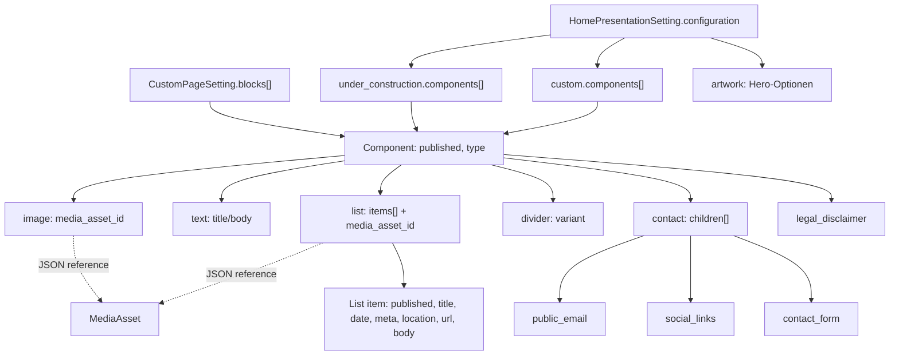

# Strukturierte Content-Daten: Custom Pages, Home, Contact

**Quellenstand:** `a71ec7d1b28d09cec1399998239b09bdaefdea11` (Anwendungscode). [Maschinenlesbarer Typkatalog](structured-components.json) mit normalisierten Feldern, Quellen und Geltungsgrenzen. Er ist **kein ausführbarer JSON-Schema-Validator**, sondern die dokumentierte Form der aktuellen PHP-Implementierung.

Ein klassisches Eloquent- oder SQL-ERD bildet diese Zusammenhänge nicht ab: `CustomPageSetting.blocks` und `HomePresentationSetting.configuration` enthalten **geordnete, geschachtelte JSON-Daten**. Medienreferenzen sind IDs im Payload, nicht automatisch Datenbank-Fremdschlüssel. Die genauen SQL-Spaltentypen und Constraints bleiben Aufgabe des gesonderten PostgreSQL-Katalogexports.

## Struktur- und Verantwortungsgraph

**Kanonischer Owner:** [`CustomPageSetting`](../../app/Models/CustomPageSetting.php) normalisiert und validiert `blocks` beim Speichern; `assertReadyForPublic()` zieht strengere Medienvoraussetzungen nach. [`CustomPageEditorialService`](../../app/Domain/Content/CustomPageEditorialService.php) besitzt die strukturierten Admin-Mutationen. [`HomePresentationEditorialService`](../../app/Domain/Content/HomePresentationEditorialService.php) verwendet für Under Construction und Custom **denselben Komponentenvalidator** über `CustomPageSetting::assertEditableComponents()`. Kein paralleles Home-Typsystem.

## Sechs persistierte Komponententypen

Die folgenden Werte entsprechen `CustomPageSetting::COMPONENT_TYPES`:

| Typ | Normalisierte Felder | Wichtige Regeln |
| --- | --- | --- |
| `image` | `type, published, media_asset_id, image_decorative` | Image-Medium im Editor optional; öffentlich nur verfügbarer MediaAsset, ALT-Text wenn nicht dekorativ |
| `text` | `type, published, title, body` | Titel höchstens 160 Zeichen, Body über kanonische Rich-Text-Validierung |
| `list` | `type, published, title, media_asset_id, items` | Titel höchstens 160 Zeichen; Liste geordneter Untereinträge; optionale Bildreferenz |
| `divider` | `type, published, variant` | `thin`, `subtle`, `strong` oder `dotted`, Default `thin` (siehe [DividerVariant](../../app/Domain/Content/DividerVariant.php)) |
| `contact` | `type, published, children` | Unterkomponenten sind geordnet; jeder Untertyp höchstens einmal |
| `legal_disclaimer` | `type, published` | Maximal einmal je Komponentenfolge |

`published` ist bei allen Komponenten und Untereinträgen separat. Fehlt das Flag, werten die jeweiligen PHP-Methoden es standardmäßig als `true`. Es handelt sich **nicht** um den Veröffentlichungszustand der Seite oder den globalen LIVE-Commit.

### Ebene 2: `list.items[]`

Die Normalisierung erzeugt je Eintrag die Felder `published, date, title, meta, location, url, body`. Der Titel muss nichtleer und höchstens 240 Zeichen lang sein. `url` darf nur eine über `SafeLinkPolicy` zulässige HTTP-/HTTPS-Adresse sein. `body` wird als Rich Text validiert; verschachtelte Medien müssen öffentlich bereit sein, wenn sowohl die umgebende Komponente als auch der Eintrag publiziert werden.

### Ebene 2: `contact.children[]`

| Untertyp | Felder | Datenquelle / Bedingung |
| --- | --- | --- |
| `public_email` | `type, published` | General Settings enthalten die tatsächlich angezeigte Adresse |
| `social_links` | `type, published, social_platforms[]` | Auswahl erlaubter Plattformen; Rendering filtert bereits konfigurierte Social-Links |
| `contact_form` | `type, published, form_state, status_text` | `enabled` oder `under_construction`; letzterer Zustand braucht Statustext bis 500 Zeichen |

Die Normalisierung dedupliziert Contact-Kinder anhand ihres Typs. [`contact.blade.php`](../../resources/views/components/contact.blade.php) blendet ihre nicht publizierten Einträge außerhalb der Preview aus.

## Home: drei verschiedene Ebenen

1. **Inhaltstemplate:** [`HomeTemplate::options()`](../../app/Domain/Content/HomeTemplate.php) bietet `artwork`, `under_construction`, `custom`. Der Enum-Rest `skip_home` ist historische Kompatibilität, **keine vierte auswählbare Inhaltsart**.
2. **Moduskonfiguration:** `artwork` enthält unter anderem `hero_mode` (`automatic`, `fixed`, `random`), `pool_rule` (`newest`, `year`), feste Artwork-ID, Kandidatenliste und Anzeigeoptionen. Fixed/Year/Random besitzen eigene Eligibility-Guards. `under_construction` hat `public_site_gate` und `components[]`; `custom` enthält `components[]`. Beide Component-Arrays nutzen die oben beschriebenen sechs Typen.
3. **Routingzustand:** `skip_home` (Bool) und `skip_target_section_id` (optionale SiteSection) sind eigene Spalten bzw. Verantwortlichkeiten des [HomeRoutingSettingsService](../../app/Domain/Content/HomeRoutingSettingsService.php). Inhalt bleibt dabei gespeichert.

**Editor-Mapping:** Die Home-Bearbeitungsarten `heading` und `rich_text` sind **beide** als `type = text` serialisiert: einmal Titel, einmal Body. Sie dürfen nicht als zusätzliche gespeicherte Component-Typen oder SQL-Tabellen erscheinen.

## Tatsächliche Reihenfolge: Kandidat, Normalisierung und öffentliche Readiness

Die drei ähnlich benannten Prüfungen haben **unterschiedliche Eingangssemantik**:

| Aufruf | Prüfreihenfolge und Reichweite |
| --- | --- |
| `CustomPageSetting::saving` (Eloquent-Modell) | Setzt `blocks = normalizedBlocks()` **vor** `validateBlocks(requirePublicMedia: false)`. Validiert damit im Modell-Hook den **normalisierten** Zustand, nicht jede einzelne Roh-Eingabeform |
| `CustomPageSetting::assertEditableComponents()` | Prüft `validateBlocks(false)` unmittelbar gegen den gerade gesetzten `blocks`-Wert; [HomePresentationEditorialService::validateComponents()](../../app/Domain/Content/HomePresentationEditorialService.php) nutzt diesen Weg für beide Home-Component-Arrays **vor** dem Speichern |
| `CustomPageSetting::assertReadyForPublic()` | Prüft `validateBlocks(true)`: Nur publizierte Top-Level-Components und darin publizierte Listeneinträge verlangen zusätzlich öffentlich bereite Medien/Embedded-Rich-Text; gespeichert-editierbar und aktuell öffentlich lieferbar sind getrennte Zustände |

**Quellbasierte Beispiele für Normalisierung im Eloquent-`saving`-Hook:**

- Ein nicht geordnetes `blocks`-Array wird von `normalizedBlocks()` zu `[]` normalisiert, **bevor** der nachfolgende Validator dessen Arrayform prüft. Nichtarray-Einträge in einer geordneten Liste werden übersprungen. Das ist nicht identisch mit der ValidationException eines unnormalisierten Home-Kandidaten.
- Unbekannte Component-`type`-Werte bleiben als Minimaldatensatz erhalten und werden anschließend **abgewiesen**. Ein ungültiger Divider-`variant` wird dagegen auf `thin` zurückgeführt.
- Fehlende `published`-Flags gelten als `true`; andere Rohwerte werden durch die `=== true`-Semantik zu Boolean normalisiert. `image_decorative` wird zu Boolean konvertiert.
- Eine nicht geordnete List-`items`-Sammlung wird zu `[]`; ein normalisierter, aber weiterhin vorhandener Listeneintrag braucht einen gültigen Titel. Contact-`children` werden nach bekanntem Untertyp gefiltert und beim Normalisieren **dedupliziert**; der Validator sieht dadurch im Modell-`saving`-Pfad nicht mehr jede zuvor doppelte Rohkomponente. Dagegen verhindert der konkrete [Home-Child-Mutation-Owner](../../app/Domain/Content/HomePresentationEditorialService.php) das Hinzufügen eines zweiten gleichnamigen Contact-Kinds schon vor Persistenz.
- Die öffentliche Image-Readiness erfordert einen existierenden Bild-Asset im State `available`, bei nicht dekorativen Bildern Canonical ALT; List-Bilder brauchen ALT unabhängig von Dekorativ-Flags. Bei Rich Text hängt `requirePublicMedia` auch vom eigenen `published`-Status des Listeneintrags ab.

**Abgrenzung:** Das sind direkte PHP-Aussagen, keine Empfehlungen, künftig Rohdaten stillschweigend zu verändern. Besonders direkte Model-Saves, importierte historische Blöcke und Home-/Custom-Editor-Pfade sollten separat gegen unerwarteten **Datenverlust durch Normalisierung** und gegen korrekte Validation-/Audit-/Undo-Semantik geprüft werden. Eine schematische JSON-Beschreibung allein kann diese effektive Operationsreihenfolge nicht beweisen.

## Sicherheits- und Dokumentationsgrenzen

Der Typkatalog ist aus [`normalizedBlocks()` und `validateBlocks()`](../../app/Models/CustomPageSetting.php), Home-Konfigurationsvalidierung und dem tatsächlich verwendeten Rendering-Pfad abgeleitet. Bei Änderungen die Quellen erneut vergleichen. Es ist **keine** Aussage über bereits gelaufene Datenbankmigrationen oder vorhandene SQL-Fremdschlüssel. JSON-Medienreferenzen, Medienlöschung und Rich-Text-Verweise müssen zusätzlich in der kanonischen Media-Referenzarchitektur behandelt werden. Speziell die Undo-/Activity-Semantik von List-/Contact-Child-Aktionen darf nicht allein aus dem JSON-Format abgeleitet werden.
