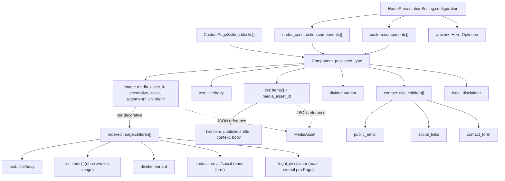

# Strukturierte Content-Daten: Custom Pages, Home, Contact

**Aktueller Quellvergleich:** `dev@81c12c836fdce03a478866ec3d147ebc818b24a6` für Custom-Page-Image-Children, List/Contact, Repeater-Ordnung, Adoption und den Public-Float-Renderer. Der [maschinenlesbare Typkatalog](structured-components.json) ist weiterhin ein **eingefrorener älterer Quellstand `a71ec7d1b28d09cec1399998239b09bdaefdea11`**. Er enthält die neuen Felder `context` und `contact.title` noch nicht; ohne vollständigen Regenerierungslauf darf seine Quellreferenz nicht umetikettiert werden. Er ist kein ausführbarer JSON-Schema-Validator.

Ein klassisches Eloquent- oder SQL-ERD bildet diese Zusammenhänge nicht ab: `CustomPageSetting.blocks` und `HomePresentationSetting.configuration` enthalten **geordnete, geschachtelte JSON-Daten**. Medienreferenzen sind IDs im Payload, nicht automatisch Datenbank-Fremdschlüssel. Die genauen SQL-Spaltentypen und Constraints bleiben Aufgabe des gesonderten PostgreSQL-Katalogexports.

## Struktur- und Verantwortungsgraph

**Kanonischer Owner:** [`CustomPageSetting`](../../app/Models/CustomPageSetting.php) normalisiert und validiert `blocks` beim Speichern; `assertReadyForPublic()` zieht strengere Medienvoraussetzungen nach. [`CustomPageEditorialService`](../../app/Domain/Content/CustomPageEditorialService.php) besitzt die strukturierten Admin-Mutationen. [`HomePresentationEditorialService`](../../app/Domain/Content/HomePresentationEditorialService.php) verwendet für Under Construction und Custom **denselben Komponentenvalidator** über `CustomPageSetting::assertEditableComponents()`. Kein paralleles Home-Typsystem.

## Sechs persistierte Komponententypen

Die folgenden Werte entsprechen `CustomPageSetting::COMPONENT_TYPES`:

| Typ | Normalisierte Felder | Wichtige Regeln |
| --- | --- | --- |
| `image` | `type, published, media_asset_id, image_decorative, image_scale_percent?, image_alignment?, children?` | Größe 25–200 % (100 % implizit), Ausrichtung `left|right` (`left` implizit und nicht gespeichert); unabhängig von `image_decorative`. `children` nur bei dekorativen Images als eine Ebene unterstützter Komponenten; öffentlich verfügbarer MediaAsset und ALT-Text bei nichtdekorativen Bildern |
| `text` | `type, published, title, body` | Titel höchstens 160 Zeichen, Body über kanonische Rich-Text-Validierung |
| `list` | `type, published, title, media_asset_id, items` | Titel höchstens 160 Zeichen; Liste geordneter Untereinträge; optionale Bildreferenz |
| `divider` | `type, published, variant` | `thin`, `subtle`, `strong` oder `dotted`, Default `thin` (siehe [DividerVariant](../../app/Domain/Content/DividerVariant.php)) |
| `contact` | `type, published, title, children` | Optionale Überschrift bis 160 Zeichen; geordnete Untertypen, jeder höchstens einmal |
| `legal_disclaimer` | `type, published` | Maximal einmal pro Custom-Page-Komponentenfolge **inklusive zulässiger Image-Children** |

`published` ist bei allen Komponenten und Untereinträgen separat. Fehlt das Flag, werten die jeweiligen PHP-Methoden es standardmäßig als `true`. Es handelt sich **nicht** um den Veröffentlichungszustand der Seite oder den globalen LIVE-Commit.

### Image size: optionales Persistenzfeld

`CustomPageSetting::DEFAULT_IMAGE_SCALE_PERCENT = 100`, `MIN = 25`,
`MAX = 200`. Der **Custom-Page-Image-Editor** bietet den ganzzahligen
Prozentwert mit 1-%-Schritten. `normalizedImageScale()` speichert
`image_scale_percent` nur, wenn der gültige Wert **nicht 100** ist:
Ein historisches Image ohne Feld bleibt bei unveränderter Editor-Eingabe
ein **No-op**, statt unnötig JSON- und Audit-Diffs zu erzeugen.
`imageScalePercent()` liefert für fehlende oder historisch ungültige
Werte einen sicheren Layout-Fallback von 100 %. Ausdrücklich gesetzte
ungültige neue Werte werden beim Speichern abgelehnt, nicht still
korrigiert. In
[`component-sequence.blade.php`](../../resources/views/pages/partials/component-sequence.blade.php)
skaliert der Prozentsatz die etablierten Breiten von 28 rem bzw.
20 rem im Narrow-Layout, jeweils durch `min(100%, ...)` auf den
Elterncontainer begrenzt. Der Bildinhalt selbst erhält kein Zoom,
kein zweites Media-Asset und keine neue Upload-Pipeline.

Diese Feldoption ist am geprüften Stand explizit **im Custom-Page-Dialog**
vorhanden. Der gemeinsame Public-Komponentenrenderer kann den
Wert auch bei Home lesen; daraus folgt aber **nicht**, dass bereits
eine entsprechende Home-Edit-Kontrolle eingebaut wurde. Der
[Featuretest](../../tests/Feature/Admin/SitePages/CustomPageWorkspaceTest.php)
prüft laut Quelltext Default, explizite 150 %, Rückkehr zum impliziten
100-%-Zustand und No-op; dieser Test wurde hier nicht ausgeführt.

### Image alignment: getrennt vom dekorativen Verhalten (seit `dev@ebbf6e1d`)

[`CustomPageSetting::imageAlignment()`](../../app/Models/CustomPageSetting.php) liest `image_alignment=right` oder verwendet das historische implizite `left`. `normalizedBlocks()` und [`CustomPageWorkspaceSecondaryForms::imageAlignmentPayload()`](../../app/Filament/Pages/Concerns/CustomPageWorkspaceSecondaryForms.php) persistieren **nur Right** und validieren `left|right`; im [Image-Edit-Schema](../../app/Filament/Pages/Concerns/CustomPageWorkspaceForms.php) ist dies eine eigene Select-Einstellung, **unabhängig von Decorative Image**. [Public Blade](../../resources/views/pages/partials/component-sequence.blade.php) setzt den Alignment-Klassennamen; [`custom-pages.css`](../../resources/css/custom-pages.css) richtet Standalone-Images durch Auto-Margin rechts aus, dekorative Images mit Children hingegen durch links-/rechtsseitigen **Float**. Ein Bild ohne Children erzeugt weiterhin keinen Child-Wrapper. No-op bei historischem Left/neu gewähltem Left ist eine Persistenzregel aus dem Source, kein ausgeführter Featuretest.

### Zusätzliche geordnete Ebene: `image.children[]` (seit `dev@81c12c83`)

Die öffentliche **Top-Level-Komponentenliste bleibt geordnet und flach**. Ein **dekoratives** Image kann jedoch optional die zweite geordnete JSON-Ebene `children[]` besitzen. Das ist eine echte Ownership-Beziehung, nicht eine CSS-Nachbarschaftsheuristik oder ein generischer Baum beliebiger Tiefe. [`CustomPageSetting::normalizedImageChildren()`](../../app/Models/CustomPageSetting.php) übergibt deren Werte erneut an `normalizedBlocks()`; [`validateBlocks()`](../../app/Models/CustomPageSetting.php) verbietet Kinder unter nichtdekorativen Images, unsupported Child-Typen, ineinander verschachtelte Images und tiefere Children, List mit eigenem `media_asset_id`, aktive Contact Forms sowie die Wiederholung von Legal Disclaimer über die **gesamte** Page. Children besitzen jeweils eigenes `published`-Flag und die gewöhnlichen `text`-/`list`-/`divider`-/`contact`-Normalisierer. Fehlende `children`-Keys werden nicht künstlich als leere Listen persistiert; vorhandene Reihenfolgen müssen echte JSON-Listen ergeben.

| Kindtyp | Vererbte Datenstruktur | Abweichender Kontext |
| --- | --- | --- |
| `text` | `published, title?, body?` | Überschrift/Rich-Text, einschließlich bereits vorhandener kanonischer Storage-Media-Markdownreferenzen; **kein** zweites `image`-Element |
| `list` | `published, title?, items[]` | Liste ohne eigene Bildreferenz; Entry/Context/Published/Details bleiben erhalten, eingebettete Alt-Media-Referenzen in Details sind separat zu berücksichtigen |
| `divider` | `published, variant` | Auch neben einem Image erlaubt; zentrale Varianten `thin`, `subtle`, `strong`, `dotted`; in der öffentlichen Darstellung mit `flow-root`, damit die Regel nicht unter einen Float läuft |
| `contact` | `published, title?, children[]` | Erlaubt Public Email und Social Links als Details, **keine** publizierte Contact Form |
| `legal_disclaimer` | `published` | Allgemeiner General-Legal-Text; maximal einmal über Top-Level und Image-Children |

**Editor-Projektion (aktuell `dev@4efcfba3`):** Ein dekoratives Image besitzt die geordnete persistierte JSON-Liste `children[]`, **nicht mehr** einen Child-Repeater im Image-Edit-Dialog. [`CustomPageWorkspacePresentationHelpers::imageChildSummaries()`](../../app/Filament/Pages/Concerns/CustomPageWorkspacePresentationHelpers.php) liefert pro Kind `image_index`, `index`, `position`, `type/type_label`, `content{primary,secondary,meta}`, `published`, Move-Flags, `editable` und einen positionsbasierten `target`. Die [neue gemeinsame Zeilen-View](../../resources/views/filament/pages/partials/custom-page-component-row.blade.php) rendert Parent und Child über dieselben sechs Spalten und bindet Child-Edit/Publish/Move/Delete/Type-Change an die existierenden Filament-/Livewire-Action-Owner. [`custom-page-workspace-sequence.blade.php`](../../resources/views/filament/pages/partials/custom-page-workspace-sequence.blade.php) bindet sie für beide Hierarchieebenen ein; der zwischenzeitlich unvollständige alte `child['title']/['meta']`-Renderer wurde in `dev@8982c562` ersetzt. `DecorativeImageChildren.php` ist **gelöscht** und darf nicht als aktiver UI-Owner genannt werden.

**Eigenständige Child-Mutationen:** [`CustomPageWorkspaceComponentActions`](../../app/Filament/Pages/Concerns/CustomPageWorkspaceComponentActions.php) stellt `editImageChildAction`, `setImageChildPublished`, `moveImageChildSibling`, `deleteImageChildAction` und `changeImageChildTypeAction`. [`CustomPageEditorialService`](../../app/Domain/Content/CustomPageEditorialService.php) führt `updateImageChild`, `deleteImageChild`, `moveImageChildByDirection`, `convertImageChild` unter Row-Lock und DB-Transaktion aus; `editImageChildAction` verwendet dasselbe Component-Editor-Schema wie Top-Level und kombiniert bei Bedarf Content-Save plus Unnest/Reparent in einer **äußeren** Transaktion. Image Edit sichert beim Fehlen von `image_children` im Form-Payload die vorhandenen Children, ändert sie aber nicht direkt. Der alte `adopt_component_index`-Formzweig ist entfernt; vorhandene `updateImageAndNest`-Domainsemantik nicht automatisch als neuen UI-Weg deuten.

**Noch offene Quellgrenzen (Quellabgleich bis `dev@57eafe78`):** Die `imageChildTarget`-Validierung kontrolliert `imageIndex/childIndex/type`, nicht eine dauerhafte Child-ID/Revision; parallel vertauschte gleichartige Children bleiben Stale-Target-Risiko. **Die frühere Parent-only-Selection-Aussage ist überholt:** [`selectedComponentTargetData()`](../../app/Filament/Pages/Concerns/CustomPageWorkspaceTargetHelpers.php) parst auch `imageIndex.childIndex:type`, und `moveSelected()` verarbeitet Children vor Root-Parents. Bulk Delete besitzt eine äußere Transaktion. Die weiterhin offenen Failure-/Audit-/No-op-/Concurrency-Fälle gehören zum [einzigen UI-Detail-Owner](ui-surfaces.md#custom-page-image-children-komponentenaktionen-und-selektionsgrenze); der Quellpfad ist **nicht** browser-/DB-getestet.

**Native Hierarchie-Placement (Stand `dev@a316e59b`):** `CustomPageWorkspaceComponentActions::sortComponent()/sortImageChild()` führen nun über `placeSortedComponent()` zur einzigen Domainmethode [`CustomPageEditorialService::placeComponent()`](../../app/Domain/Content/CustomPageEditorialService.php). Die ursprünglichen JS-Drop-Marker und `admin-hierarchy-drag.js` sind entfernt. `placeComponent` akzeptiert `root` oder dekorativen Imageindex als Target-Gruppe, verarbeitet root/Child-Locators unter Settings-Row-Lock und setzt JSON nach Validierung in einer Transaktion. Andere explizite Move-/Unnest-/Edit-Methoden existieren weiterhin als UI-Alternativen. [Native Sort-Trace](ui-surfaces.md#native-hierarchie-placement-pages-und-custom-pages). Der neue Domain-Guard verbietet `parent === sourceIndex` explizit; gleichartige Index/Typ-Target-Races bleiben ohne erwartete Revision offen.

[CustomPageEditorialService](../../app/Domain/Content/CustomPageEditorialService.php) hält die JSON-Mutation mit Row-Lock in DB-Transaktionen: `nestBlock(sourceIndex,type,imageIndex)` verschiebt erlaubte Top-Level-Prose in ein dekoratives Image; `unnestImageChild(imageIndex,childIndex)` stellt ein Child **hinter** dem Image auf Page-Ebene; `moveImageChild(fromImage,childIndex,toImage)` verschiebt den tatsächlichen Child-Payload zwischen zwei dekorativen Images; `sortImageChild(imageIndex,childIndex,position)` ändert ausschließlich die Child-Sibling-Reihenfolge. Ein Umzug zum **gleichen** Image ist No-op; ungültige Ziele führen zur ValidationException, nicht zu einer stillen Kopie. `updateAndNestBlock(settings,sourceIndex,type,updated,imageIndex)` kombiniert **erst** `updateBlock`, **dann** `nestBlock` unter einer äußeren DB-Transaktion; eine fehlschlagende zweite Operation muss die erste Persistenz samt Audit im DB-Transaktionskontext zurückrollen. Dass beide Mutationsmethoden gesonderte Audit-Vorgänge auslösen können, ist bei Notification-/Receipt-Kardinalität zu prüfen, nicht als garantiert genau eine Activity zu behaupten.

Der gemeinsame [`HierarchyParentField`](../../app/Filament/Support/HierarchyParentField.php) erscheint in Custom-Page-Edit als `parent_image_index` vor Text/List/Contact-Daten **nur** für nestbare Kombinationen (List ohne eigenes MediaAsset, Contact ohne aktive Form, passender Typ); alte Angaben wie `move_into_image` sind nicht der aktuelle Formvertrag. Der Parent-Select `Page level` ist in dieser **Top-Level-Edit-Aktion** ein Nullwert/kein neuer Nest-Wunsch; Child-Unnesting ist über den nativen Root-Gruppen-Drop oder die Parentwahl im eigenen Child-Edit möglich; einen besonderen `Move out`-Button gibt es im aktuellen Child-Row-Design nicht. Die editierte List enthält weiterhin `Entry / Context / Published / Details`.

**Offener Source-Negativpfad:** Auch die neuen Image-Child-Edit-/Delete-/Move-Actions verwenden absolute JSON-Indizes (`imageIndex/childIndex`) und den gespeicherten Typ statt einer stabilen Komponentenidentität. Ein konkurrierendes Umordnen zweier gleichartiger Top-Level-Blocks oder Image-Children kann bei späterem Action-Save/Child-Drop ein veraltetes Ziel referenzieren; der Row-Lock allein ersetzt keine erwartete Revision. Kanonische Regression: zwei gleichartige Texte/Listen, Edit in Fenster A offen, Reorder/Nest/Move in B, dann Save/Drop in A; Ergebnis muss A betreffen oder eine sichtbare Konfliktvalidierung auslösen, keinesfalls Daten von B überschreiben. Der frühere JS-Gesture-Test wurde zusammen mit dem nicht mehr vorhandenen Drag-Controller entfernt; die aktuellen PHP-/Livewire-Quellen für native Cross-Group-Sortierung sind **nur quellengeprüft**, hier nicht ausgeführt. **Normativer UI-Owner:** [Admin Table Contract](../ADMIN-TABLE-CONTRACT.md#component-sequences).

**Öffentliche Darstellung:** [`component-sequence.blade.php`](../../resources/views/pages/partials/component-sequence.blade.php) ruft für `image.children` dieselbe View **einmal eingebettet** auf, mit Prefix für eindeutige Heading-IDs und ohne zusätzliches `aria-label`. Image und Children teilen die Containerklasse `custom-page__image-group`, das Figure wird gefloatet; Text fließt nativ erst neben und dann unter dem Bild. Ein nächster **Top-Level**-Contact-Block samt Form beginnt danach im normalen vollen Fluss. Ein reguläres Image ohne Children absorbiert keine Geschwister; es findet kein automatischer Typwechsel oder zweiter Gallery-Renderer statt. Die normative UI-/Responsive-Regel steht ausschließlich im [Public-Vertrag](../PUBLIC-IMPLEMENTATION-CONTRACT.md#custom-pages-cv-and-contact).

**Neu entdeckte Referenzlücke:** Die öffentliche Teilvalidierung steigt für Rich Text in published Children hinab; [`RichTextMediaReference::idsFromCustomPageBlocks()`](../../app/Domain/Content/RichTextMediaReference.php), [`MediaReferenceQuery`](../../app/Domain/Media/MediaReferenceQuery.php) und [`PublicMedia::publishedCustomPageReferencesAsset()`](../../app/Domain/Media/PublicMedia.php) lesen dagegen bisher **keine rekursiven Children-Medienreferenzen**. Dadurch können ausschließlich dort verwendete `media:<id>`-Bilder zugleich für Storage als unreferenziert und für PublicMedia als nicht veröffentlicht gelten. [Sicherheits-/Mediennegativefälle](public-security-privacy-boundaries.md#5-neue-dekorative-image-children-referenzielle-asymmetrie) dokumentieren die Testmatrix; **kein ausgeführter Runtime-/DB-Test**. Der Fix gehört auf `dev`, nicht als redundanter Reader auf `docs`.

### Ebene 2: `list.items[]`

`CustomPageSetting::normalizeListItems()` persistiert pro List-Eintrag die Felder **`published, title, context, body`**. Der Titel ist erforderlich und auf 240 Zeichen begrenzt; `context` ist optionaler Freitext mit maximal **600 Zeichen**, etwa für Jahr, Organisation oder andere Angaben. `body` bleibt der kanonische Rich-Text-Inhalt. Der gemeinsame [`ComponentListEditor`](../../app/Filament/Support/ComponentListEditor.php) für Home und Custom Page zeigt **Entry, Context, Published und Details**. Der Details-Editor hat keine Embedded-Media-Einfügeaktion (`allowEmbeddedMedia: false`); die getrennte Modelvalidierung älterer Rich-Text-Daten bleibt weiterhin maßgeblich. Im [Public-Renderer](../../resources/views/pages/partials/component-sequence.blade.php) nutzt jeder List-Record eine eigene `.custom-page__list-line`: Title und optionaler Context sind zwei Zellen eines lokalen Grids, auch innerhalb des umflossenen Child-Textes dekorativer Bilder. Diese Zeilengestaltung ersetzt nicht den nativen Float der Image-Gruppe; [Public-Vertrag](../PUBLIC-IMPLEMENTATION-CONTRACT.md#custom-pages-cv-and-contact).

**Legacy-Eingabedaten:** `listItemContext()` bevorzugt einen gesetzten nichtleeren `context`; andernfalls kombiniert es vorhandene `date`, `meta` und `location`-Werte mit ` · `. `listItemDetails()` hängt einen optionalen gültigen HTTP(S)-`url`-Wert als Markdown-Link **More information** an den bestehenden Body an. Die nachfolgende Normalisierung schreibt ausschließlich die vier neuen Felder und entfernt die separaten alten Schlüssel. Auch `HomePresentation` projiziert bestehende Einträge beim Öffnen des gemeinsamen Editors über diese beiden Methoden. Das ist **Quellbeleg für eine Kompatibilitätsprojektion**, kein tatsächlich ausgeführter historischer Datenmigrations- oder Undo-Test.

### Ebene 2: `contact.children[]`

| Untertyp | Felder | Datenquelle / Bedingung |
| --- | --- | --- |
| `public_email` | `type, published` | General Settings enthalten die tatsächlich angezeigte Adresse |
| `social_links` | `type, published, social_platforms[]` | Auswahl erlaubter Plattformen; Rendering filtert bereits konfigurierte Social-Links |
| `contact_form` | `type, published, form_state, status_text` | `enabled` oder `under_construction`; letzterer Zustand braucht Statustext bis 500 Zeichen |

Die Normalisierung dedupliziert Contact-Kinder anhand ihres Typs. [`contact.blade.php`](../../resources/views/components/contact.blade.php) blendet ihre nicht publizierten Einträge außerhalb der Preview aus.

**Custom Page UI:** Contact ist **eine einzige Parent-Tabellenzeile**. Im Parent-Create-/Edit-Dialog werden die optionale Heading (Default-Anzeige `Contact`) sowie Public Email, Social Media Links und Contact Form einschließlich Plattformwahl, Formdarstellung und Statustext bearbeitet. Neue Komponenten starten mit drei aktivierten Optionen. Die bisherigen Child-Mutation-Traits und Child-Zeilen sind auf Custom Page entfernt; die JSON-Kinder bleiben aber persistierte Untertypen. `CustomPageWorkspaceSecondaryForms::contactComponentPayload()` bewahrt bereits verfasste Social-Plattformen, Formmodus und Statustext, auch wenn ihr jeweiliges Toggle die Eingabe vorübergehend ausblendet. `contact.blade.php` rendert die optionale Überschrift. **Home** hat derzeit weiterhin eine eigene Contact-Child-Tabellenprojektion mit eigenen Targets; die gleiche JSON-Domain erzwingt keine identische Editor-UI.

## Home: drei verschiedene Ebenen

1. **Inhaltstemplate:** [`HomeTemplate::options()`](../../app/Domain/Content/HomeTemplate.php) bietet `artwork`, `under_construction`, `custom`. Der Enum-Rest `skip_home` ist historische Kompatibilität, **keine vierte auswählbare Inhaltsart**.
2. **Moduskonfiguration:** `artwork` enthält unter anderem `hero_mode` (`automatic`, `fixed`, `random`), `pool_rule` (`newest`, `year`), feste Artwork-ID, Kandidatenliste und Anzeigeoptionen. Fixed/Year/Random besitzen eigene Eligibility-Guards. `under_construction` hat `public_site_gate` und `components[]`; `custom` enthält `components[]`. Beide Component-Arrays nutzen die oben beschriebenen sechs Typen.
3. **Routingzustand:** `skip_home` (Bool) und `skip_target_section_id` (optionale SiteSection) sind eigene Spalten bzw. Verantwortlichkeiten des [HomeRoutingSettingsService](../../app/Domain/Content/HomeRoutingSettingsService.php). Inhalt bleibt dabei gespeichert.

**Editor-Mapping:** Die Home-Bearbeitungsarten `heading` und `rich_text` sind **beide** als `type = text` serialisiert: einmal Titel, einmal Body. Sie dürfen nicht als zusätzliche gespeicherte Component-Typen oder SQL-Tabellen erscheinen.

## Tatsächliche Reihenfolge: Kandidat, Normalisierung und öffentliche Readiness

Die drei ähnlich benannten Prüfungen haben **unterschiedliche Eingangssemantik**:

| Aufruf | Prüfreihenfolge und Reichweite |
| --- | --- |
| `CustomPageSetting::saving` (Eloquent-Modell) | Setzt `blocks = normalizedBlocks()` **vor** `validateBlocks(requirePublicMedia: false)`. Validiert damit im Modell-Hook den **normalisierten** Zustand, nicht jede einzelne Roh-Eingabeform |
| `CustomPageSetting::assertEditableComponents()` | Prüft `validateBlocks(false)` unmittelbar gegen den gerade gesetzten `blocks`-Wert; [HomePresentationEditorialService::validateComponents()](../../app/Domain/Content/HomePresentationEditorialService.php) nutzt diesen Weg für beide Home-Component-Arrays **vor** dem Speichern |
| `CustomPageSetting::assertReadyForPublic()` | Prüft `validateBlocks(true)`: Publizierte Top-Level-Components **einschließlich veröffentlichter dekorativer Image-Children** und veröffentlichter Listeneinträge verlangen zusätzlich öffentlich bereite Medien/Embedded-Rich-Text; gespeichert-editierbar und aktuell öffentlich lieferbar sind getrennte Zustände |

**Quellbasierte Beispiele für Normalisierung im Eloquent-`saving`-Hook:**

- Ein nicht geordnetes `blocks`-Array wird von `normalizedBlocks()` zu `[]` normalisiert, **bevor** der nachfolgende Validator dessen Arrayform prüft. Nichtarray-Einträge in einer geordneten Liste werden übersprungen. Das ist nicht identisch mit der ValidationException eines unnormalisierten Home-Kandidaten.
- Unbekannte Component-`type`-Werte bleiben als Minimaldatensatz erhalten und werden anschließend **abgewiesen**. Ein ungültiger Divider-`variant` wird dagegen auf `thin` zurückgeführt.
- Fehlende `published`-Flags gelten als `true`; andere Rohwerte werden durch die `=== true`-Semantik zu Boolean normalisiert. `image_decorative` wird zu Boolean konvertiert.
- Eine nicht geordnete List-`items`-Sammlung wird zu `[]`; ein normalisierter, aber weiterhin vorhandener Listeneintrag braucht einen gültigen Titel. Contact-`children` werden nach bekanntem Untertyp gefiltert und beim Normalisieren **dedupliziert**; der Validator sieht dadurch im Modell-`saving`-Pfad nicht mehr jede zuvor doppelte Rohkomponente. Dagegen verhindert der konkrete [Home-Child-Mutation-Owner](../../app/Domain/Content/HomePresentationEditorialService.php) das Hinzufügen eines zweiten gleichnamigen Contact-Kinds schon vor Persistenz.
- Die öffentliche Image-Readiness erfordert einen existierenden Bild-Asset im State `available`, bei nicht dekorativen Bildern Canonical ALT; List-Bilder brauchen ALT unabhängig von Dekorativ-Flags. Bei Rich Text hängt `requirePublicMedia` auch vom eigenen `published`-Status des Listeneintrags ab.

**Abgrenzung:** Das sind direkte PHP-Aussagen, keine Empfehlungen, künftig Rohdaten stillschweigend zu verändern. Besonders direkte Model-Saves, importierte historische Blöcke und Home-/Custom-Editor-Pfade sollten separat gegen unerwarteten **Datenverlust durch Normalisierung** und gegen korrekte Validation-/Audit-/Undo-Semantik geprüft werden. Eine schematische JSON-Beschreibung allein kann diese effektive Operationsreihenfolge nicht beweisen.

## Sicherheits- und Dokumentationsgrenzen

Der Typkatalog ist aus [`normalizedBlocks()` und `validateBlocks()`](../../app/Models/CustomPageSetting.php), Home-Konfigurationsvalidierung und dem tatsächlich verwendeten Rendering-Pfad abgeleitet. Bei Änderungen die Quellen erneut vergleichen. Es ist **keine** Aussage über bereits gelaufene Datenbankmigrationen oder vorhandene SQL-Fremdschlüssel. JSON-Medienreferenzen, Medienlöschung und Rich-Text-Verweise müssen zusätzlich in der kanonischen Media-Referenzarchitektur behandelt werden. Speziell die Undo-/Activity-Semantik von Home-Contact-Child-Aktionen, Custom-Image-Child-Edits und der Adoption einer bestehenden Parent-Komponente darf nicht allein aus dem JSON-Format abgeleitet werden. Die reale Publication- und Medienreferenz-Coverage muss **rekursiv** geprüft werden.
