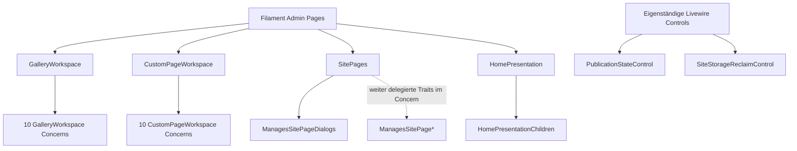

# Filament- und Livewire-Komposition

**Untersuchter Code:** `app/Filament/Pages/*.php`, `app/Filament/Pages/Concerns/*.php` und `app/Livewire/Admin/*.php` auf `dev` (Stand `337da15bc7d4fcbae45f0bb3ed38a99fa4a5e4b7`). 9 direkt deklarierte Filament-Page-Klassen, 26 Concern-Dateien und 2 eigenständige Livewire-Komponenten. Dies ist **Quellstruktur**, keine Aussage darüber, welche dynamisch registrierten Routen gerade erreichbar sind.

## Pages und tatsächliche Slug-Deklarationen

| Page | `$slug` aus der Klasse | Besonderheit |
| --- | --- | --- |
| [Dashboard](../../app/Filament/Pages/Dashboard.php) | `''` | eigene Feed-, Auswahl- und Notification-Actions |
| [General](../../app/Filament/Pages/General.php) | `general` | Form, Social Links, Appearance |
| [SitePages](../../app/Filament/Pages/SitePages.php) | `pages` | besitzt Trait `ManagesSitePageDialogs` |
| [HomePresentation](../../app/Filament/Pages/HomePresentation.php) | `pages/home` | nutzt `HomePresentationChildren`, zusätzlich `WithFileUploads` von Livewire |
| [GalleryWorkspace](../../app/Filament/Pages/GalleryWorkspace.php) | `pages/gallery/{gallery}` | nutzt zehn interne `GalleryWorkspace*`-Concerns |
| [CustomPageWorkspace](../../app/Filament/Pages/CustomPageWorkspace.php) | `pages/custom/{section}` | nutzt zehn interne `CustomPageWorkspace*`-Concerns |
| [JournalWorkspace](../../app/Filament/Pages/JournalWorkspace.php) | `pages/journal/{section}` | `getView()` wählt View dynamisch anhand des Journal-Templates |
| [Activity](../../app/Filament/Pages/Activity.php) | kein explizites `$slug` | Undo, Restore und Revert im Workspace |
| [Analytics](../../app/Filament/Pages/Analytics.php) | kein explizites `$slug` | eigene Reporting- und Filterlogik |

Diese Slugs sind **Page-Eigenschaften**, keine behaupteten vollständigen URL-Pfade. `AdminPanelProvider` setzt zusätzlich den Panelpfad `admin`; Filament leitet daraus und seiner Discovery weitere Routen ab. Für die endgültige URL-/Middleware-Liste ist ein isoliertes `artisan route:list` nötig.

## Composition statt scheinbarer Monolithen



Der erzeugte Graph weist **22 direkte Page-zu-Concern-Kanten** und **vier Concern-zu-Concern-Kanten** aus. Letztere kommen von `ManagesSitePageDialogs`, das die vier weiteren `ManagesSitePage*`-Traits nutzt. Trait-Use ist eine belegte PHP-Strukturbeziehung, noch kein Runtime-Aufruf. Fachliche Methode ≠ Filament-Action ≠ HTML-/Livewire-Event.

## Eigenständige Livewire-Komponenten

- [`PublicationStateControl`](../../app/Livewire/Admin/PublicationStateControl.php) besitzt `commitPublication()` und `render()`. Der Commit-Aktionspfad muss mit `PublicationService`, Header-State und tatsächlich eingebundenem Blade-Hook betrachtet werden.
- [`SiteStorageReclaimControl`](../../app/Livewire/Admin/SiteStorageReclaimControl.php) besitzt `freeStorageAction()` mit einer Filament-Action sowie `render()`. Der Action-Name ist keine eigenständige HTTP-Route.

## Source-Extractor

[generate-architecture-ui-surfaces.php](../../scripts/generate-architecture-ui-surfaces.php) erzeugt beim manuellen lokalen Aufruf:

```sh
php scripts/generate-architecture-ui-surfaces.php --write
php scripts/generate-architecture-ui-surfaces.php --check
```

Ergebnis: `generated/ui-surfaces.json` mit Klassen, direktem Trait-Use, deklarierten öffentlichen Methoden, statisch benannten `Action::make('...')`-Actions sowie Quellzeilen; `generated/ui-composition.mmd` zeigt Page-zu-Concern-Traits. Der Extraktor ist **bewusst syntaktisch**, erkennt keine berechneten Action-Namen, vererbten Methoden, Dialog-Closures oder JavaScript-Interaktionen vollständig.

**Eingecheckte Ergebnisse:** [JSON-Gesamtkatalog](generated/ui-surfaces.json) mit **37 Einheiten**, **26** internen Trait-Kanten und **72** statisch benannten `Action::make('...')`-Fundstellen; [Mermaid-Kompositionsgraph](generated/ui-composition.mmd). Beide wurden aus den 37 GitHub-Quelldateien mit den angegebenen Extraktionsregeln zusammengestellt, einschließlich Originalpfaden und Zeilen.

**Verifizierung und Einschränkung:** PHP 8.4-Syntax, `--write`, `--check` und ein absichtlich veralteter Action-Katalog wurden in einem isolierten Fixture tatsächlich geprüft. Zusätzlich wurde der Typkörper-Parser gegen `::class` in einem Trait und verschachtelte Trait-Nutzung geprüft und repariert. **Ein nativer Lauf des PHP-Generators auf einem vollständigen Checkout aller 37 Originaldateien steht noch aus.** Der eingecheckte Gesamtkatalog ist daher ein remote extrahiertes Quelleninventar, nicht ein bereits erfolgreich ausgeführter Laravel-/PHP-Full-Repo-Check.

**Weitere Untersuchungen:** dynamisch angelegte Filament-Actions, Mount-/Autosave-Reihenfolgen, JavaScript-Event-Dispatch, Modal-State und Notification-Pipeline. Diese müssen an konkreten Quellstellen erhoben werden, nicht aus Dateinamen extrapoliert werden.
