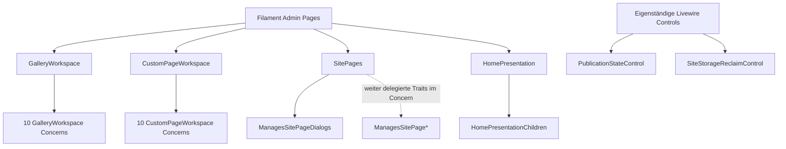

# Filament- und Livewire-Komposition

**Untersuchter Code:** `app/Filament/Pages/*.php`, `app/Filament/Pages/Concerns/*.php` und `app/Livewire/Admin/*.php` auf `dev` (Stand `337da15bc7d4fcbae45f0bb3ed38a99fa4a5e4b7`). 9 direkt deklarierte Filament-Page-Klassen, 26 Concern-Dateien und 2 eigenständige Livewire-Komponenten. Dies ist **Quellstruktur**, keine Aussage darüber, welche dynamisch registrierten Routen gerade erreichbar sind.

## Pages und tatsächliche Slug-Deklarationen

| Page | `$slug` aus der Klasse | Besonderheit |
| --- | --- | --- |
| [Dashboard](../../app/Filament/Pages/Dashboard.php) | `''` | eigene Feed-, Auswahl- und Notification-Actions |
| [General](../../app/Filament/Pages/General.php) | `general` | Form, Social Links, Appearance |
| [SitePages](../../app/Filament/Pages/SitePages.php) | `pages` | besitzt Trait `ManagesSitePageDialogs` |
| [HomePresentation](../../app/Filament/Pages/HomePresentation.php) | `pages/home` | nutzt `HomePresentationChildren`, zusätzlich `WithFileUploads` von Livewire |
| [GalleryWorkspace](../../app/Filament/Pages/GalleryWorkspace.php) | `pages/gallery/{gallery}` | nutzt zehn interne `GalleryWorkspace*`-Concerns |
| [CustomPageWorkspace](../../app/Filament/Pages/CustomPageWorkspace.php) | `pages/custom/{section}` | nutzt zehn interne `CustomPageWorkspace*`-Concerns |
| [JournalWorkspace](../../app/Filament/Pages/JournalWorkspace.php) | `pages/journal/{section}` | `getView()` wählt View dynamisch anhand des Journal-Templates |
| [Activity](../../app/Filament/Pages/Activity.php) | kein explizites `$slug` | Undo, Restore und Revert im Workspace |
| [Analytics](../../app/Filament/Pages/Analytics.php) | kein explizites `$slug` | eigene Reporting- und Filterlogik |

Diese Slugs sind **Page-Eigenschaften**, keine behaupteten vollständigen URL-Pfade. `AdminPanelProvider` setzt zusätzlich den Panelpfad `admin`; Filament leitet daraus und seiner Discovery weitere Routen ab. Für die endgültige URL-/Middleware-Liste ist ein isoliertes `artisan route:list` nötig.

## Composition statt scheinbarer Monolithen



Der erzeugte Graph weist **22 direkte Page-zu-Concern-Kanten** und **vier Concern-zu-Concern-Kanten** aus. Letztere kommen von `ManagesSitePageDialogs`, das die vier weiteren `ManagesSitePage*`-Traits nutzt. Trait-Use ist eine belegte PHP-Strukturbeziehung, noch kein Runtime-Aufruf. Fachliche Methode ≠ Filament-Action ≠ HTML-/Livewire-Event.

## Eigenständige Livewire-Komponenten

- [`PublicationStateControl`](../../app/Livewire/Admin/PublicationStateControl.php) besitzt `commitPublication()` und `render()`. Der Commit-Aktionspfad muss mit `PublicationService`, Header-State und tatsächlich eingebundenem Blade-Hook betrachtet werden.
- [`SiteStorageReclaimControl`](../../app/Livewire/Admin/SiteStorageReclaimControl.php) besitzt `freeStorageAction()` mit einer Filament-Action sowie `render()`. Der Action-Name ist keine eigenständige HTTP-Route.

## Source-Extractor

[generate-architecture-ui-surfaces.php](../../scripts/generate-architecture-ui-surfaces.php) erzeugt beim manuellen lokalen Aufruf:

```sh
php scripts/generate-architecture-ui-surfaces.php --write
php scripts/generate-architecture-ui-surfaces.php --check
```

Ergebnis: `generated/ui-surfaces.json` mit Klassen, direktem Trait-Use, deklarierten öffentlichen Methoden, statisch benannten `Action::make('...')`-Actions sowie Quellzeilen; `generated/ui-composition.mmd` zeigt Page-zu-Concern-Traits. Der Extraktor ist **bewusst syntaktisch**, erkennt keine berechneten Action-Namen, vererbten Methoden, Dialog-Closures oder JavaScript-Interaktionen vollständig.

**Eingecheckte Ergebnisse:** [JSON-Gesamtkatalog](generated/ui-surfaces.json) mit **37 Einheiten**, **26** internen Trait-Kanten und **72** statisch benannten `Action::make('...')`-Fundstellen; [Mermaid-Kompositionsgraph](generated/ui-composition.mmd). Beide wurden aus den 37 GitHub-Quelldateien mit den angegebenen Extraktionsregeln zusammengestellt, einschließlich Originalpfaden und Zeilen.

**Verifizierung und Einschränkung:** PHP 8.4-Syntax, `--write`, `--check` und ein absichtlich veralteter Action-Katalog wurden in einem isolierten Fixture tatsächlich geprüft. Zusätzlich wurde der Typkörper-Parser gegen `::class` in einem Trait und verschachtelte Trait-Nutzung geprüft und repariert. **Ein nativer Lauf des PHP-Generators auf einem vollständigen Checkout aller 37 Originaldateien steht noch aus.** Der eingecheckte Gesamtkatalog ist daher ein remote extrahiertes Quelleninventar, nicht ein bereits erfolgreich ausgeführter Laravel-/PHP-Full-Repo-Check.


## Pages → Edit: Titel, Navigation Label und No-op (statischer Negativpfad)

**Geprüfte Quellen:** [SitePages::sectionLabel()](../../app/Filament/Pages/SitePages.php),
[ManagesSitePageEditDialog](../../app/Filament/Pages/Concerns/ManagesSitePageEditDialog.php),
[SiteSectionIdentityService](../../app/Domain/Content/SiteSectionIdentityService.php),
[JournalSettingsService](../../app/Domain/Content/JournalSettingsService.php),
[GalleryEditorialService](../../app/Domain/Artwork/GalleryEditorialService.php).
Quellstand nach Merge von `dev@b3439bbfeb48ddbaf1f1949c276155c737136e31`;
**keine ausgeführte Livewire-Reproduktion**.

1. `SitePages::sectionLabel()` (Zeile 808 ff.) priorisiert ein nichtleeres
   `navigation_label` gegenüber `title`. Als Tabellen-/Parent-Label ist
   diese Darstellung sinnvoll; in `editPageAction()->fillForm()` (Zeile 45)
   landet dieselbe Präsentationsangabe jedoch als editierbares `data.name`.
2. `savePageFromDialog()` (Zeilen 142–192) lädt den neuesten Persistenzstand,
   kann zuerst `convertType()` ausführen und gibt anschließend `data.name`
   immer an `updateDialogIdentity()` weiter – **auch ohne manuelle
   Namensänderung**. Für Journal, Custom Page und Navigation Node ruft diese
   `SiteSectionIdentityService::update($section, $name, $slug)` ohne viertes
   `navigationLabel`-Argument auf. Dort wird ein `null`-Label zu `$name`
   aufgelöst und `title` **und** `navigation_label` werden gespeichert.
3. Beispiel: Titel `Journal`, eigenes Navigation Label `Neuigkeiten`.
   `Pages → Edit` zeigt im Feld **Name** `Neuigkeiten`. Ein sonstiger
   erfolgreicher Edit oder ein unverändertes `callMountedAction` kann danach
   `title = Neuigkeiten` speichern; im Journal kann zusätzlich das ursprünglich
   dem alten Titel folgende `listing_title` mitsynchronisiert werden.
   `pageDialogPersistedState()` vergleicht ausdrücklich beide Identitätswerte;
   dadurch wird ein solcher scheinbarer No-op als echte Änderung behandelt,
   einschließlich Audit und Erfolgsmeldung. Mit gleichen Ausgangswerten
   (`title === navigation_label`) tritt diese spezifische Abweichung nicht auf.
4. Der **Gallery**-Zweig ist anders, aber ebenfalls betroffen:
   `updateDialogIdentity()` ruft `GalleryEditorialService::update()`
   mit dem präsentierten Label als `name` auf. Dessen Sync aktualisiert
   Gallery-`name` und SiteSection-`title`; ein unabhängig angepasstes
   `navigation_label` kann bestehen bleiben. Auch hier wird also eine
   Anzeige-Eigenschaft ungewollt zur kanonischen Titelquelle.
5. Ein Typwechsel schützt davor nicht: `convertType()` übernimmt
   `title`/`navigation_label` zunächst unverändert, anschließend läuft
   dieselbe Identitätszuweisung auf dem neuen Typ. Nicht ausführbare
   Typwechsel haben eigene Domain-Guards und dürfen nicht als erfolgreicher
   Regressionsfall deklariert werden.

**Bestehende Testgrenze:** [SiteSectionHierarchyTest](../../tests/Feature/Admin/SitePages/SiteSectionHierarchyTest.php)
(Zeilen 825–875) testet Successive Edit, No-op und Invalid Slug **nur für
anfangs identische** Titel/Labels. [JournalSettingsAutosaveTest](../../tests/Feature/Admin/Journal/JournalSettingsAutosaveTest.php)
(Zeilen 71–105) bestätigt zwar das individuell gesetzte Journal-Label,
führt danach aber kein Pages-Edit aus. Es fehlt die Kombination.

**Gezielte Regressionstests auf `testing`/`dev`, nicht hier auszuführen
oder durch geänderte Erwartungen zu kaschieren:**

| Ausgangszustand / Aktion | Zu prüfende Invariante |
| --- | --- |
| Journal `title=Journal`, `navigation_label=Neuigkeiten`, Pages Edit unverändert ausführen | Titel und Label bleiben unverändert; kein neuer Audit, keine Success-Notification |
| Gleiches Journal, nur Position/Slug/Template ändern | Geänderte Eigenschaft persistiert, getrennte Identität bleibt erhalten; Listing Title und Redirect nur nach ihrer eigenen Policy |
| Gleiches Journal, Pages Name tatsächlich ändern | Editor-Semantik klar festlegen: Titel ändern, ohne ein eigenes Navigation Label implizit zu überschreiben |
| Custom Page und Navigation Node mit verschiedenem Titel/Label | No-op sowie gewöhnliche Edit-Felder lassen beide Identitätswerte intakt |
| Gallery mit verschiedenem Titel/Label | Pages Edit verändert ohne explizite Namensänderung weder Gallery-Name noch SiteSection-Titel |
| Sicherer Typwechsel mit getrenntem Titel/Label | Keine stille Umdeutung durch nachfolgende Identity-Aktion; Domain-Conversion-Guards bleiben gültig |
| Reopen und mehrfaches `callMountedAction` | Kein neuer Audit/Notifier bei echtem No-op; Anzeige- und Identitätsfelder weiterhin korrekt |

**Architekturursache:** Ein für Navigation/Tabellen richtiger
**Presentation-Resolver** wird als **Persistenzwert für den Seitentitel**
wiederverwendet. Eine Korrektur gehört in den einzigen bestehenden
Pages-Dialog-/Identity-Datenfluss; keine parallele Identity-Pipeline einführen.
Das ist ein **quellbelegter produktiver Fehlerpfad**, kein hier ausgeführter
Browser- oder Datenbanknachweis.

## Custom Page: komponentenbezogene Edit-Zielauflösung

**Source-Fix auf `dev@21e907f` (drei neue Commits nach dem
Folio-Detailstand):** [CustomPageWorkspaceTargetHelpers](../../app/Filament/Pages/Concerns/CustomPageWorkspaceTargetHelpers.php)
hat wieder einen einzigen `componentAt(int $index, string $expectedType)`-
Leseweg. `actionComponentTarget()` prüft `componentIndex` und
`componentType`; `actionComponent()` liest über `componentAt()` den
persistierten Komponentenblock **am absoluten Sequenzindex** aus
`settings()->components()`. Stimmt die gespeicherte Komponente nicht
mit dem beim Action-Mount übergebenen Typ überein oder fehlt sie, folgt
eine `ValidationException` mit Reload-Hinweis. Das schützt vor
stiller Bearbeitung eines falschen Blocks nach Reorder/Conversion.

Der neue [CustomPageWorkspaceTest](../../tests/Feature/Admin/SitePages/CustomPageWorkspaceTest.php)
(ungefähr Zeilen 463–493) montiert `editComponent` ausdrücklich auf Index
2 einer `text/divider/text`-Sequenz und erwartet eine Änderung **nur des
dritten Rich-Text-Blocks**. Der frühere fehlende Methodenpfad ist
**quellseitig wieder vorhanden**; der zugehörige Livewire-Test wurde
hier lediglich gelesen, nicht ausgeführt. Die UI-Akzeptanz und
fehlende/stale Zieltypen sind weitere gezielte Runtime-Negativfälle.

**Weitere Untersuchungen:** dynamisch angelegte Filament-Actions, Mount-/Autosave-Reihenfolgen, JavaScript-Event-Dispatch, Modal-State und Notification-Pipeline. Diese müssen an konkreten Quellstellen erhoben werden, nicht aus Dateinamen extrapoliert werden.
