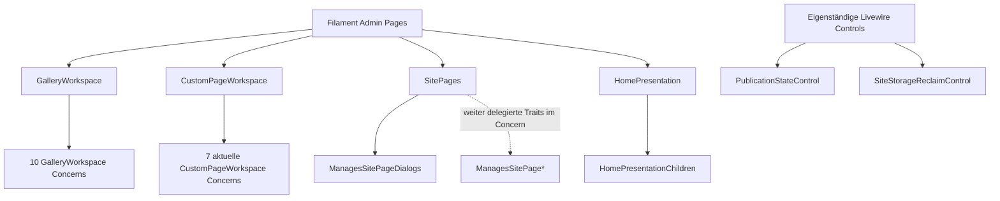

# Filament- und Livewire-Komposition

**Eingefrorener Generator-Quellstand:** `dev@337da15bc7d4fcbae45f0bb3ed38a99fa4a5e4b7`, damals 9 Filament Pages, 26 Concern-Dateien und 2 Livewire-Komponenten. **Separater aktueller Git-Tree-Abgleich:** `docs@597559f93bc0f5031273291d6a0f12bf644a75e4` hat weiterhin 9 Pages und 2 Komponenten, aber nur noch **23 Concern-Dateien**, nachdem drei veraltete Custom-Page-Child-Owner entfernt wurden. Diese aktuellen Zahlen sind ein gezielter Pfad-/Trait-Use-Delta, **keine neu generierte vollständige Action-Inventur** und kein Nachweis dynamisch registrierter Routen.

## Pages und tatsächliche Slug-Deklarationen

| Page | `$slug` aus der Klasse | Besonderheit |
| --- | --- | --- |
| [Dashboard](../../app/Filament/Pages/Dashboard.php) | `''` | eigene Feed-, Auswahl- und Notification-Actions |
| [General](../../app/Filament/Pages/General.php) | `general` | Form, Social Links, Appearance |
| [SitePages](../../app/Filament/Pages/SitePages.php) | `pages` | besitzt Trait `ManagesSitePageDialogs` |
| [HomePresentation](../../app/Filament/Pages/HomePresentation.php) | `pages/home` | nutzt `HomePresentationChildren`, zusätzlich `WithFileUploads` von Livewire |
| [GalleryWorkspace](../../app/Filament/Pages/GalleryWorkspace.php) | `pages/gallery/{gallery}` | nutzt zehn interne `GalleryWorkspace*`-Concerns |
| [CustomPageWorkspace](../../app/Filament/Pages/CustomPageWorkspace.php) | `pages/custom/{section}` | nutzt aktuell **sieben** interne `CustomPageWorkspace*`-Concerns (eingefrorener Katalog: zehn) |
| [JournalWorkspace](../../app/Filament/Pages/JournalWorkspace.php) | `pages/journal/{section}` | `getView()` wählt View dynamisch anhand des Journal-Templates |
| [Activity](../../app/Filament/Pages/Activity.php) | kein explizites `$slug` | Undo, Restore und Revert im Workspace |
| [Analytics](../../app/Filament/Pages/Analytics.php) | kein explizites `$slug` | eigene Reporting- und Filterlogik |

Diese Slugs sind **Page-Eigenschaften**, keine behaupteten vollständigen URL-Pfade. `AdminPanelProvider` setzt zusätzlich den Panelpfad `admin`; Filament leitet daraus und seiner Discovery weitere Routen ab. Für die endgültige URL-/Middleware-Liste ist ein isoliertes `artisan route:list` nötig.

## Composition statt scheinbarer Monolithen



Der **eingefrorene generierte** Graph weist 22 direkte Page-zu-Concern-Kanten und vier Concern-zu-Concern-Kanten aus. Der **aktuelle** Custom-Page-Quelltext nutzt drei Traits weniger (sieben statt zehn); damit ergeben sich gegenüber dem alten Graph **19 direkte Page-zu-Concern-Kanten**, sofern die übrigen damals erfassten 12 nicht veränderten Page-Trait-Uses gleich bleiben. Dies ist ein quellengeprüfter begrenzter Delta, **kein vollständiger nativer Regenerierungslauf**. Letztere kommen von `ManagesSitePageDialogs`, das die vier weiteren `ManagesSitePage*`-Traits nutzt. Trait-Use ist eine belegte PHP-Strukturbeziehung, noch kein Runtime-Aufruf. Fachliche Methode ≠ Filament-Action ≠ HTML-/Livewire-Event.

### Entfallene Custom-Page-Child-Owner

`CustomPageWorkspaceChildOrdering.php`,
`CustomPageWorkspaceChildProjection.php` und
`CustomPageWorkspaceListContactActions.php` wurden im aktuellen
`dev`-Quellpfad **gelöscht**, ebenso ihre Trait-Nutzung und die
separaten Child-Selection-/Action-Routen. Die **Custom-Page-Tabelle**
stellt nur noch Elternkomponenten dar; die List-Einträge und Contact-
Kindoptionen werden über deren bestehende Parent-Edit-Actions
konfiguriert. Home zeigt weiterhin eine eigene Contact-Child-
Präsentation. Der archivierte
[JSON-UI-Katalog](generated/ui-surfaces.json) und sein
[Mermaid-Graph](generated/ui-composition.mmd) enthalten
**absichtlich noch den historischen Stand** und sind als Generator-
Outputs bei der nächsten vollständigen `--write/--check`-Ausführung
mit dem aktuellen Tree neu zu erstellen, nicht von Hand zu patchen.

## Eigenständige Livewire-Komponenten

- [`PublicationStateControl`](../../app/Livewire/Admin/PublicationStateControl.php) besitzt `commitPublication()` und `render()`. Der Commit-Aktionspfad muss mit `PublicationService`, Header-State und tatsächlich eingebundenem Blade-Hook betrachtet werden.
- [`SiteStorageReclaimControl`](../../app/Livewire/Admin/SiteStorageReclaimControl.php) besitzt `freeStorageAction()` mit einer Filament-Action sowie `render()`. Der Action-Name ist keine eigenständige HTTP-Route.

## Source-Extractor

[generate-architecture-ui-surfaces.php](../../scripts/generate-architecture-ui-surfaces.php) erzeugt beim manuellen lokalen Aufruf:

```sh
php scripts/generate-architecture-ui-surfaces.php --write
php scripts/generate-architecture-ui-surfaces.php --check
```

Ergebnis: `generated/ui-surfaces.json` mit Klassen, direktem Trait-Use, deklarierten öffentlichen Methoden, statisch benannten `Action::make('...')`-Actions sowie Quellzeilen; `generated/ui-composition.mmd` zeigt Page-zu-Concern-Traits. Der Extraktor ist **bewusst syntaktisch**, erkennt keine berechneten Action-Namen, vererbten Methoden, Dialog-Closures oder JavaScript-Interaktionen vollständig.

**Eingecheckte Ergebnisse:** [JSON-Gesamtkatalog](generated/ui-surfaces.json) mit **37 Einheiten**, **26** internen Trait-Kanten und **72** statisch benannten `Action::make('...')`-Fundstellen; [Mermaid-Kompositionsgraph](generated/ui-composition.mmd). Beide wurden aus den 37 GitHub-Quelldateien mit den angegebenen Extraktionsregeln zusammengestellt, einschließlich Originalpfaden und Zeilen. **Versionierungsgrenze:** Diese 72/26/37-Zahlen beschreiben ausschließlich den ausdrücklich oben ausgewiesenen **eingefrorenen Quellstand `dev@337da15bc7d4fcbae45f0bb3ed38a99fa4a5e4b7`**. Die inzwischen auf `docs` aufgenommenen späteren Gallery-/Journal-Edit-Header-Actions (u. a. `AdminDialog::headerAction()`), Shared-Artwork-Felder und Dialog-Refactors werden durch die alte `literal_actions`-Zählung **nicht aktuell nachgezählt**; dynamisch zusammengesetzte Header-Rollen wurden vom Extraktor ohnehin nicht vollständig erfasst. Der neue Katalog wird erst durch einen ausdrücklich vollständig ausgeführten `generate-architecture-ui-surfaces.php --write`/`--check`-Lauf auf dem realen Checkout verifiziert, nicht durch bloßes Umetikettieren der bestehenden JSON-/Mermaid-Dateien.

**Verifizierung und Einschränkung:** PHP 8.4-Syntax, `--write`, `--check` und ein absichtlich veralteter Action-Katalog wurden in einem isolierten Fixture tatsächlich geprüft. Zusätzlich wurde der Typkörper-Parser gegen `::class` in einem Trait und verschachtelte Trait-Nutzung geprüft und repariert. **Ein nativer Lauf des PHP-Generators auf einem vollständigen Checkout aller 37 Originaldateien steht noch aus.** Der eingecheckte Gesamtkatalog ist daher ein remote extrahiertes Quelleninventar, nicht ein bereits erfolgreich ausgeführter Laravel-/PHP-Full-Repo-Check.


## Pages → Edit: Titel, Navigation Label und No-op (statischer Negativpfad)

**Geprüfte Quellen:** [SitePages::sectionLabel()](../../app/Filament/Pages/SitePages.php),
[ManagesSitePageEditDialog](../../app/Filament/Pages/Concerns/ManagesSitePageEditDialog.php),
[SiteSectionIdentityService](../../app/Domain/Content/SiteSectionIdentityService.php),
[JournalSettingsService](../../app/Domain/Content/JournalSettingsService.php),
[GalleryEditorialService](../../app/Domain/Artwork/GalleryEditorialService.php).
Quellstand erneut mit `dev@470f2daa900f2d68db9c7e5fe2b227db20e44bc7` verglichen; neue gemeinsame `PageHeadingFields` ändern **nicht** die unten beschriebene Name-/Navigationslabel-Zielzuordnung. **Keine ausgeführte Livewire-Reproduktion**.

1. `SitePages::sectionLabel()` priorisiert ein nichtleeres
   `navigation_label` gegenüber `title`. Als Tabellen-/Parent-Label ist
   diese Darstellung sinnvoll; in `editPageAction()->fillForm()`
   landet dieselbe Präsentationsangabe jedoch als editierbares `data.name`.
2. `savePageFromDialog()` lädt den neuesten Persistenzstand,
   kann zuerst `convertType()` ausführen und gibt anschließend `data.name`
   immer an `updateDialogIdentity()` weiter – **auch ohne manuelle
   Namensänderung**. Für Journal, Custom Page und Navigation Node ruft diese
   `SiteSectionIdentityService::update($section, $name, $slug)` ohne viertes
   `navigationLabel`-Argument auf. Dort wird ein `null`-Label zu `$name`
   aufgelöst und `title` **und** `navigation_label` werden gespeichert.
3. Beispiel: Titel `Journal`, eigenes Navigation Label `Neuigkeiten`.
   `Pages → Edit` zeigt im Feld **Name** `Neuigkeiten`. Ein sonstiger
   erfolgreicher Edit oder ein unverändertes `callMountedAction` kann danach
   `title = Neuigkeiten` speichern; im Journal kann zusätzlich das ursprünglich
   dem alten Titel folgende `listing_title` mitsynchronisiert werden.
   `pageDialogPersistedState()` vergleicht ausdrücklich beide Identitätswerte;
   dadurch wird ein solcher scheinbarer No-op als echte Änderung behandelt,
   einschließlich Audit und Erfolgsmeldung. Mit gleichen Ausgangswerten
   (`title === navigation_label`) tritt diese spezifische Abweichung nicht auf.
4. Der **Gallery**-Zweig ist anders, aber ebenfalls betroffen:
   `updateDialogIdentity()` ruft `GalleryEditorialService::update()`
   mit dem präsentierten Label als `name` auf. Dessen Sync aktualisiert
   Gallery-`name` und SiteSection-`title`; ein unabhängig angepasstes
   `navigation_label` kann bestehen bleiben. Auch hier wird also eine
   Anzeige-Eigenschaft ungewollt zur kanonischen Titelquelle.
5. Ein Typwechsel schützt davor nicht: `convertType()` übernimmt
   `title`/`navigation_label` zunächst unverändert, anschließend läuft
   dieselbe Identitätszuweisung auf dem neuen Typ. Nicht ausführbare
   Typwechsel haben eigene Domain-Guards und dürfen nicht als erfolgreicher
   Regressionsfall deklariert werden.

**Neue, separat korrekt besessene Page-Heading-Achse:** [`PageHeadingFields`](../../app/Filament/Support/PageHeadingFields.php) ist nun gemeinsames Add-/Edit-/Home-Schema für die **optionale sichtbare Content-Überschrift**, nicht für SiteSection-`title` oder `navigation_label`. Im Pages **Edit** ruft jedes `afterStateUpdated` gezielt `SiteSectionEditorialService::updatePageHeading()` auf (Row-Lock, validierte Field-Änderung, No-op ohne Audit); **Add** speichert diese Daten erst nach Anlage des neuen Nodes und nicht beim bloßen Ausfüllen. [`SitePageHeadingAutosaveTest.php`](../../tests/Feature/Admin/SitePages/SitePageHeadingAutosaveTest.php) beschreibt mehrere Livewire-Feldänderungen, anschließenden Action-No-op, Reopen und Public-Render, sowie das Home Heading bei Root-Route `/`. Diese neue Quelle ist **nicht** der fehlende Test für getrennte Title/Navigationlabels.

**Home Edit neu integriert:** [`ManagesSitePageEditDialog::editHomeAction()`](../../app/Filament/Pages/Concerns/ManagesSitePageEditDialog.php) kombiniert `HomeSettingsDialog` mit editierbarem **Name** und den absichtlich read-only Feldern **Public slug = /**, **Parent = Top level**, **Position = 1**. Der Save ruft `SiteSectionIdentityService::update($home, $name, null)` und danach `HomeSettingsDialog::save()` innerhalb der äußeren DB-Transaktion. Da der Identity-Service den fehlenden vierten `navigationLabel`-Parameter als `$name` interpretiert, gilt hier zusätzlich: Ein **von `title` abweichendes** explizites Home-`navigation_label` könnte schon bei ansonsten unverändertem Edit auf den Seitennamen zurückgesetzt werden. Das ist ein weiterführender **statischer Negativfall**. Der neue Home-Test prüft die unveränderliche Root-Route und wiederholten Save bei Standardzustand, **nicht** diese getrennte Label-Konstellation.

**Bestehende Testgrenze:** [SiteSectionHierarchyTest](../../tests/Feature/Admin/SitePages/SiteSectionHierarchyTest.php)
(Zeilen 825–875) testet Successive Edit, No-op und Invalid Slug **nur für
anfangs identische** Titel/Labels. [JournalSettingsAutosaveTest](../../tests/Feature/Admin/Journal/JournalSettingsAutosaveTest.php)
(Zeilen 71–105) bestätigt zwar das individuell gesetzte Journal-Label,
führt danach aber kein Pages-Edit aus. Es fehlt die Kombination.

**Gezielte Regressionstests auf `testing`/`dev`, nicht hier auszuführen
oder durch geänderte Erwartungen zu kaschieren:**

| Ausgangszustand / Aktion | Zu prüfende Invariante |
| --- | --- |
| Journal `title=Journal`, `navigation_label=Neuigkeiten`, Pages Edit unverändert ausführen | Titel und Label bleiben unverändert; kein neuer Audit, keine Success-Notification |
| Gleiches Journal, nur Position/Slug/Template ändern | Geänderte Eigenschaft persistiert, getrennte Identität bleibt erhalten; Listing Title und Redirect nur nach ihrer eigenen Policy |
| Gleiches Journal, Pages Name tatsächlich ändern | Editor-Semantik klar festlegen: Titel ändern, ohne ein eigenes Navigation Label implizit zu überschreiben |
| Custom Page und Navigation Node mit verschiedenem Titel/Label | No-op sowie gewöhnliche Edit-Felder lassen beide Identitätswerte intakt |
| Gallery mit verschiedenem Titel/Label | Pages Edit verändert ohne explizite Namensänderung weder Gallery-Name noch SiteSection-Titel |
| Home mit `title=Atelier`, eigenem `navigation_label=Studio` | Home Edit ohne Namensänderung behält beide Werte getrennt, kein Audit/Notifier aufgrund impliziter Label-Rücksetzung |
| Sicherer Typwechsel mit getrenntem Titel/Label | Keine stille Umdeutung durch nachfolgende Identity-Aktion; Domain-Conversion-Guards bleiben gültig |
| Reopen und mehrfaches `callMountedAction` | Kein neuer Audit/Notifier bei echtem No-op; Anzeige- und Identitätsfelder weiterhin korrekt |

**Architekturursache:** Ein für Navigation/Tabellen richtiger
**Presentation-Resolver** wird als **Persistenzwert für den Seitentitel**
wiederverwendet. Eine Korrektur gehört in den einzigen bestehenden
Pages-Dialog-/Identity-Datenfluss; keine parallele Identity-Pipeline einführen.
Das ist ein **quellbelegter produktiver Fehlerpfad**, kein hier ausgeführter
Browser- oder Datenbanknachweis.

## Native Hierarchie-Placement: Pages und Custom Pages

**Quellstand `dev@883ff5e0`; keine hier ausgeführte Livewire-/Browser-Validierung.** Der frühere, delegierte JS-Controller `admin-hierarchy-drag.js` samt gesondertem JS-Gesture-Test wurde bewusst entfernt. Stattdessen deklarieren [Pages](../../resources/views/filament/pages/site-pages.blade.php) und [Custom Pages](../../resources/views/filament/pages/partials/custom-page-workspace-sequence.blade.php) jeweils **eine native Livewire-`wire:sort:group` für alle erlaubten Sibling-Gruppen** derselben Editorfläche; `wire:sort:group-id` kennzeichnet den Zielparent (`root` oder konkrete ID/Index). Die vormaligen `data-hierarchy-drop`-Sonderziele sind aus den beiden Blades entfernt; Drag ist kein unabhängiger JS-Owner mehr.

| Ebene | Source-Dispatch | Änderung und Guard |
| --- | --- | --- |
| Pages root/children | `wire:sort="sortSection"`, gemeinsame `site-pages`-Gruppe, `root` oder Parent-ID → [`SitePages::sortSection()`](../../app/Filament/Pages/SitePages.php) | `SiteSectionOrderService::moveTo()` validiert Platzierung und schreibt kanonische DB-Reihenfolge; nur bei aktivem `reorderEnabled` |
| Custom root/children | gemeinsame `custom-components`-Gruppe, `wire:sort="sortComponent"` bzw. `sortImageChild`, Ziel-`root` oder Image-Index → [`placeSortedComponent()`](../../app/Filament/Pages/Concerns/CustomPageWorkspaceComponentActions.php) | [`CustomPageEditorialService::placeComponent()`](../../app/Domain/Content/CustomPageEditorialService.php) parst `index:type` oder `imageIndex.childIndex:type`, sperrt Settings-Row, entfernt Source, korrigiert beim vorhergehenden Top-Level-Source-Entfernen den Zielindex, verweigert zusätzlich Root-Selbstparenting, validiert dekoratives Image/zulässigen Typ/kein Image-List-Medium/keine aktive Contact Form und fügt an Zielposition atomar ein. No-op läuft über persistierten Vergleich, UI nur bei Change erfolgreich. |

Der [gemeinsame Child-Row-Renderer](../../resources/views/filament/pages/partials/custom-page-component-row.blade.php) besitzt ein echtes `wire:sort:handle`; `wire:sort:item` verwendet die normalisierte Position/Typ-Locator-Zeichenfolge beider Ebenen. Eine leere dekorative Image-Zielgruppe bleibt als Sortable-Container im DOM, damit ein Child direkt hineingezogen werden kann. Parentwahl im Edit-Dialog über [`HierarchyParentField`](../../app/Filament/Support/HierarchyParentField.php) bleibt ein zusätzlicher **User-Eingabeweg zum bestehenden Domainowner**, keine zweite Drag-Engine.

**Gezielte offene Negativfälle:** Native Cross-Group-Drops root→Image, Image→root, ImageA→ImageB, leeres Image, identischer Parent/Position, ungültige Form/List mit Media, gleichartige Komponenten nach Concurrent-Reorder, Position bei verschobenen Rootindizes, Keyboard/Touch und die Wechselwirkung mit gemischter Selection. Weder ein entfernter JS-Test noch ungelesene Filament-/Sortable-Implementierungsdetails beweisen diese Browsergesten. Die JSON-Mutation gehört weiterhin dem [Structured-Content-Audit](structured-components.md), der normative Interaktionsvertrag dem [Admin Table Contract](../ADMIN-TABLE-CONTRACT.md#component-sequences).

## Custom Page Image-Children: Komponentenaktionen und Selektionsgrenze

**Quellstand `dev@4efcfba3`, keine in diesem Workstream ausgeführte Browser-/DB-/Livewire-Verifikation.** Die [Child-Projektion](../../app/Filament/Pages/Concerns/CustomPageWorkspacePresentationHelpers.php) liefert je eingebetteter Komponente ihre vollständige Content-/Position-/Action-Projektion. [`custom-page-component-row.blade.php`](../../resources/views/filament/pages/partials/custom-page-component-row.blade.php) ist derselbe Zeilen-Owner für Top-Level und Child; [Sequence Blade](../../resources/views/filament/pages/partials/custom-page-workspace-sequence.blade.php) setzt beide ein. Das behebt die kurzzeitig vorhandene Source-Divergenz `title/meta` vs `content` der ersten Child-Projektion. Das entfernte `DecorativeImageChildren`-Repeater-Form ist kein paralleler Eingabeweg.

[`editImageChildAction()`](../../app/Filament/Pages/Concerns/CustomPageWorkspaceComponentActions.php) teilt `componentEditorSchema` und `componentPayload` mit normalen Komponenten. `updateImageChild` speichert Content, `unnestImageChild` oder `moveImageChild` verschiebt bei geändertem Parent in der **gleichen äußeren Transaktion**; einzelne `persist()`-Aufrufe dürfen nicht ohne Beleg als genau ein Audit-Receipt zusammengezogen werden. Separate Publish-/Move-/Delete-/Convert-Methoden verwenden [`CustomPageEditorialService`](../../app/Domain/Content/CustomPageEditorialService.php) mit Settings-Row-Lock. `imageChildTarget()` prüft Parentindex, Childindex und Typ, **nicht** eine feste Child-ID oder erwartete JSON-Revision: ein Concurrent-Reorder gleichartiger Children kann dieselbe Typprüfung bestehen.

**Child-Selection samt gemischtem Bulk-Owner (Quellstand `dev@883ff5e0`):** [`selectedComponentTargetData()`](../../app/Filament/Pages/Concerns/CustomPageWorkspaceTargetHelpers.php) parst `imageIndex.childIndex:type` für alle sichtbaren Child-Ziele; Select-All/Toolbar und Bulk Publish/Move/Delete verwenden sie. [`moveSelected()`](../../app/Filament/Pages/Concerns/CustomPageWorkspaceComponentActions.php) sortiert jetzt **zuerst Children nach ihrem noch gültigen Imageindex, zuletzt Root-Parents**, innerhalb **einer äußeren DB-Transaktion**. Das zuvor dokumentierte konkrete Parent-vor-Child-Indexdrift-Risiko ist damit im aktuellen Quellpfad adressiert. [`deleteSelectedAction()`](../../app/Filament/Pages/Concerns/CustomPageWorkspaceComponentActions.php) umschließt jetzt ebenfalls sämtliche Child-Delete-Aufrufe und das abschließende Parent-`deleteBlocks()` in **einem äußeren `DB::transaction`**. Ein späterer Domain-Fehler soll alle vorherigen SQL-Löschungen dieser Action zurückrollen; **kein ausgeführter Rollback-Test**. Bei der Auswahl von Parent und dessen Child wird das Child explizit nicht separat gelöscht; das Parent-Delete ist Owner des gesamten JSON-Baums.

**Weiter offen:** Absolute Image-/Child-Index + Typ sind **keine** stabile Identität über konkurrierende Reorders oder andere Sessions. Die Bulk-Delete-Action meldet nach normaler Ausführung weiterhin bedingungslos `Selection deleted` / `items processed`, ohne No-op-/Change-Kardinalität abzuleiten; Audit-Receipts können je einzelnem Domain-`persist()` entstehen. Leerer-/bereits-verschobener Target, kombinierte Selektion von mehreren Children eines Images, gleichzeitiges Edit+Sort und Browser-Drop müssen real geprüft werden. Die neue äußere Transaktion ist eine **Source-Garantie des Aufrufrahmens**, kein ausgeführter Isolationstest.

**Reproduzierbare Negativfälle:** zwei verschachtelte Text-Children mit identischem Typ gleichzeitig in zwei Tabs reordern/editieren; Edit plus Reparent, im Ziel ungültiger Parent nach Content-Änderung (Rollback + Audit), Child Publish/Unpublish und Type-Change, Child-Checkbox und Select-All unter Livewire-Reprojektion, gemischter Parent-/Child-Bulk Move in zwei Sitzungen, Child-Bulk Delete mit späterem Validationfehler und behauptetem vollständig atomarem Rollback, No-op-/Audit-/Notification-Kardinalität und Zeilen-Alignment. Die Testquellen/Status ersetzen keinen ausgeführten Livewire- oder Browsernachweis. [JSON-Domain](structured-components.md#zusätzliche-geordnete-ebene-imagechildren-seit-dev81c12c83) und [Admin Table Contract](../ADMIN-TABLE-CONTRACT.md#component-sequences) sind getrennte Owners.

## Custom Page: komponentenbezogene Edit-Zielauflösung

**Source-Fix auf `dev@21e907f` (drei neue Commits nach dem
Folio-Detailstand):** [CustomPageWorkspaceTargetHelpers](../../app/Filament/Pages/Concerns/CustomPageWorkspaceTargetHelpers.php)
hat wieder einen einzigen `componentAt(int $index, string $expectedType)`-
Leseweg. `actionComponentTarget()` prüft `componentIndex` und
`componentType`; `actionComponent()` liest über `componentAt()` den
persistierten Komponentenblock **am absoluten Sequenzindex** aus
`settings()->components()`. Stimmt die gespeicherte Komponente nicht
mit dem beim Action-Mount übergebenen Typ überein oder fehlt sie, folgt
eine `ValidationException` mit Reload-Hinweis. Das erkennt fehlende Indizes und **Typkonvertierungen oder Reorder
auf einen anderen Typ**, garantiert aber keine stabile Identität bei einem
Index, dessen nachfolgender Block denselben Typ wie der ursprüngliche hat.

Der neue [CustomPageWorkspaceTest](../../tests/Feature/Admin/SitePages/CustomPageWorkspaceTest.php)
(ungefähr Zeilen 463–493) montiert `editComponent` ausdrücklich auf Index
2 einer `text/divider/text`-Sequenz und erwartet eine Änderung **nur des
dritten Rich-Text-Blocks**. Der frühere fehlende Methodenpfad ist
**quellseitig wieder vorhanden**; der zugehörige Livewire-Test wurde
hier lediglich gelesen, nicht ausgeführt. Die UI-Akzeptanz und
fehlende/stale Zieltypen sind weitere gezielte Runtime-Negativfälle.

**Zusätzliche quellenbelegte Konkurrenzlücke:** Der Edit-Action-Mount trägt
nur `componentIndex` und `componentType`. Sowohl
`CustomPageWorkspaceTargetHelpers::componentAt()` als auch
`CustomPageEditorialService::assertTarget()` vergleichen lediglich
`blocks[$index]['type']` mit diesem Typ. Gleichzeitig kann
`CustomPageEditorialService::reorderBlocks()` eine vollständige
Komponentenfolge auf Basis derselben absoluten Indexreferenzen umordnen.
Wenn zwei verschiedene `text`-Blöcke A/B die Positionen wechseln, während
ein anderes Fenster einen Edit von A unter dem alten Index offen hat,
bleibt die Typprüfung erfolgreich, aber `updateBlock()` kann den
**nunmehr dort liegenden Block B** mit dem Payload von A überschreiben.
Die neue Text/Divider/Text-Assertion überprüft dieses Interleaving nicht.
Dies ist ein **statischer Race-/Stale-Target-Negativpfad**, keine hier
ausgeführte gleichzeitige Livewire-Reproduktion.

**Gezielter Regressionstest:** Editor 1 mountet `editComponent` für
`text A` am Index 0; Editor 2 ordnet `text B` (ebenfalls `text`)
auf Index 0 um; Editor 1 speichert. Erwartet wird eine explizite
Konfliktvalidierung **oder** ein gezieltes Update von A anhand einer
kanonischen stabilen Identität. Keinesfalls darf B unbeabsichtigt
überschrieben werden. Ebenso eine Variante für zwei gleichartige
`list`-Komponenten mit verschachteltem Item-Edit prüfen. Die Lösung
gehört in den bestehenden Domain-Target-/Revision-Guard, nicht in eine
zweite Action-Pipeline.

### Home-Komponenten: dieselbe Identitätsgrenze

Der [HomePresentation-Editor](../../app/Filament/Pages/HomePresentation.php)
(`homeComponentEditingAction()`, ungefähr Zeilen 525–626) lädt über
`componentFromArguments()` (ungefähr Zeilen 1461–1482) nur anhand
von `index` und `type`. Auf Speichern setzt
[HomePresentationEditorialService::updateComponent()](../../app/Domain/Content/HomePresentationEditorialService.php)
innerhalb von `mutateComponents()` die neue Komponente an
`components[$index]`; `assertTarget()` kontrolliert den gespeicherten
Typ, nicht eine eindeutige unveränderliche Block-Identität.
`moveComponent()` und `reorderComponents()` können zwei Blöcke
desselben Typs permutieren, ohne diese Typprüfung zu verändern.

Der zuvor beschriebene Konkurrenzfall gilt deshalb **auch für Home**
in den strukturierte-Komponenten-Templates: Ein offener Editor für
`text A` an Index 0 und eine zwischenzeitliche Vertauschung mit
`text B` gleicher Persistenzart können beim späteren Save B überschreiben.
Auch `heading` und `rich_text` sind dort beide gespeicherte `text`-
Komponenten; die UI-Unterarten sind keine eindeutigen Persistenzidentitäten.
Dies ist eine **statisch belegte Identitäts-/Interleaving-Lücke**,
kein hier ausgeführter Mehrfenster-Test.

[Test HomeComponentTypeEditingTest](../../tests/Feature/Admin/Home/HomeComponentTypeEditingTest.php)
prüft direkte Typumwandlung, Content-Regeln und Zieltypen, aber keinen
konkurrierenden Edit/Reorder zweier gleichartiger Blöcke. Ergänzungsfall:
Home Custom mit `text A` und `text B`, Editor A öffnen, in anderem
Livewire-Kontext beide Blöcke tauschen, ursprünglichen Editor absenden;
das Ergebnis muss A gezielt treffen oder als Stale-Target abgelehnt
werden, niemals B überarbeiten. Zweite Variante:
`heading`/`rich_text` (beide `type=text`) und List mit
verschachtelten Child-Änderungen. Für Home und Custom Page soll
**ein gemeinsam begründetes** Target-/Revision-Konzept gelten, keine
unabhängigen lokalen Sonderlösungen.

**Weitere Untersuchungen:** dynamisch angelegte Filament-Actions, Mount-/Autosave-Reihenfolgen, JavaScript-Event-Dispatch, Modal-State und Notification-Pipeline. Diese müssen an konkreten Quellstellen erhoben werden, nicht aus Dateinamen extrapoliert werden.
