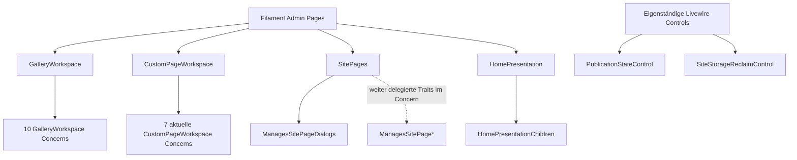

# Filament- und Livewire-Komposition

**Nativer Generator-Quellstand:** `docs@8c9bd0a0f0fca46b1aa5637049372726d6970c4c`, ausgeführt am 19.10.2026 mit PHP 8.3.33: **9 Pages, 23 Concerns, 2 Livewire-Komponenten**, insgesamt 34 Einheiten. `--write` und `--check` bestätigen 23 interne Trait-Kanten und 73 literale Actions; dynamische Registrierungen bleiben außerhalb der Extraktion. Später auf `dev` gelesene fachliche Traces behalten ihre separat angegebenen SHAs.

## Pages und tatsächliche Slug-Deklarationen

| Page | `$slug` aus der Klasse | Besonderheit |
| --- | --- | --- |
| [Dashboard](../../app/Filament/Pages/Dashboard.php) | `''` | eigene Feed-, Auswahl- und Notification-Actions |
| [General](../../app/Filament/Pages/General.php) | `general` | Form, Social Links, Appearance |
| [SitePages](../../app/Filament/Pages/SitePages.php) | `pages` | besitzt Trait `ManagesSitePageDialogs` |
| [HomePresentation](../../app/Filament/Pages/HomePresentation.php) | `pages/home` | nutzt `HomePresentationChildren`, zusätzlich `WithFileUploads` von Livewire |
| [GalleryWorkspace](../../app/Filament/Pages/GalleryWorkspace.php) | `pages/gallery/{gallery}` | nutzt zehn interne `GalleryWorkspace*`-Concerns |
| [CustomPageWorkspace](../../app/Filament/Pages/CustomPageWorkspace.php) | `pages/custom/{section}` | nutzt aktuell **sieben** interne `CustomPageWorkspace*`-Concerns (historischer Vorgängerkatalog: zehn) |
| [JournalWorkspace](../../app/Filament/Pages/JournalWorkspace.php) | `pages/journal/{section}` | `getView()` wählt View dynamisch anhand des Journal-Templates |
| [Activity](../../app/Filament/Pages/Activity.php) | kein explizites `$slug` | Undo, Restore und Revert im Workspace |
| [Analytics](../../app/Filament/Pages/Analytics.php) | kein explizites `$slug` | eigene Reporting- und Filterlogik |

Diese Slugs sind **Page-Eigenschaften**, keine behaupteten vollständigen URL-Pfade. `AdminPanelProvider` setzt zusätzlich den Panelpfad `admin`; Filament leitet daraus und seiner Discovery weitere Routen ab. Für die endgültige URL-/Middleware-Liste ist ein isoliertes `artisan route:list` nötig.

## Composition statt scheinbarer Monolithen



Der nativ regenerierte Graph enthält **19 direkte Page-zu-Concern- und vier Concern-zu-Concern-Kanten**. Die vier Concern-Kanten stammen von `ManagesSitePageDialogs`. Trait-Use ist eine PHP-Strukturbeziehung, kein Runtime-Aufruf. Fachliche Methode ≠ Filament-Action ≠ HTML-/Livewire-Event.

### Entfallene Custom-Page-Child-Owner

`CustomPageWorkspaceChildOrdering.php`,
`CustomPageWorkspaceChildProjection.php` und
`CustomPageWorkspaceListContactActions.php` wurden beim früheren Child-Cleanup gelöscht, ebenso ihre Trait-Nutzung und die damaligen separaten Child-Selection-/Action-Routen. Die damalige Parent-only-Tabelle und List-/Contact-Child-Konfiguration sind historische Refactor-Provenienz, keine Beschreibung des später wieder erweiterten dekorativen Image-Child-Modells. Dessen aktuelle, separat versionierte Pfade stehen weiter unten. Der [JSON-UI-Katalog](generated/ui-surfaces.json) und [Mermaid-Graph](generated/ui-composition.mmd) wurden nun nativ regeneriert; die drei entfernten Traits sind darin nicht mehr enthalten. Die spätere dekorative Image-Child-Fachentwicklung wird in den folgenden getrennt versionierten Source-Traces beschrieben.

## Eigenständige Livewire-Komponenten

- [`PublicationStateControl`](../../app/Livewire/Admin/PublicationStateControl.php) besitzt `commitPublication()` und `render()`. Der Commit-Aktionspfad muss mit `PublicationService`, Header-State und tatsächlich eingebundenem Blade-Hook betrachtet werden.
- [`SiteStorageReclaimControl`](../../app/Livewire/Admin/SiteStorageReclaimControl.php) besitzt `freeStorageAction()` mit einer Filament-Action sowie `render()`. Der Action-Name ist keine eigenständige HTTP-Route.

## Source-Extractor

[generate-architecture-ui-surfaces.php](../../scripts/generate-architecture-ui-surfaces.php) erzeugt beim manuellen lokalen Aufruf:

```sh
php scripts/generate-architecture-ui-surfaces.php --write
php scripts/generate-architecture-ui-surfaces.php --check
```

Ergebnis: `generated/ui-surfaces.json` mit Klassen, direktem Trait-Use, deklarierten öffentlichen Methoden, statisch benannten `Action::make('...')`-Actions sowie Quellzeilen; `generated/ui-composition.mmd` zeigt Page-zu-Concern-Traits. Der Extraktor ist **bewusst syntaktisch**, erkennt keine berechneten Action-Namen, vererbten Methoden, Dialog-Closures oder JavaScript-Interaktionen vollständig.

**Eingecheckte Ergebnisse:** [JSON](generated/ui-surfaces.json) und [Mermaid](generated/ui-composition.mmd) sind auf dem oben genannten Checkout nativ regeneriert und geprüft: **34 Einheiten, 23 interne Trait-Kanten und 73 literale Actions**. Die obsolete 37/26/72-Version wurde ersetzt. Geprüfter Diff: drei entfernte Traits, veränderte Methoden-/Action-Fundstellen und Quellzeilen. Berechnete Header-Actions, vererbte Methoden, Eventpfade und Laufzeitverhalten werden dadurch weiterhin nicht vollständig erfasst. Kein Laravel-/Livewire-/Browserlauf.

## Pages → Edit: Titel, Navigation Label und No-op (statischer Negativpfad)

**Geprüfte Quellen:** [SitePages::sectionLabel()](../../app/Filament/Pages/SitePages.php),
[ManagesSitePageEditDialog](../../app/Filament/Pages/Concerns/ManagesSitePageEditDialog.php),
[SiteSectionIdentityService](../../app/Domain/Content/SiteSectionIdentityService.php),
[JournalSettingsService](../../app/Domain/Content/JournalSettingsService.php),
[GalleryEditorialService](../../app/Domain/Artwork/GalleryEditorialService.php).
Quellstand erneut mit `dev@470f2daa900f2d68db9c7e5fe2b227db20e44bc7` verglichen; neue gemeinsame `PageHeadingFields` ändern **nicht** die unten beschriebene Name-/Navigationslabel-Zielzuordnung. **Keine ausgeführte Livewire-Reproduktion**.

1. `SitePages::sectionLabel()` priorisiert ein nichtleeres
   `navigation_label` gegenüber `title`. Als Tabellen-/Parent-Label ist
   diese Darstellung sinnvoll; in `editPageAction()->fillForm()`
   landet dieselbe Präsentationsangabe jedoch als editierbares `data.name`.
2. `savePageFromDialog()` lädt den neuesten Persistenzstand,
   kann zuerst `convertType()` ausführen und gibt anschließend `data.name`
   immer an `updateDialogIdentity()` weiter – **auch ohne manuelle
   Namensänderung**. Für Journal, Custom Page und Navigation Node ruft diese
   `SiteSectionIdentityService::update($section, $name, $slug)` ohne viertes
   `navigationLabel`-Argument auf. Dort wird ein `null`-Label zu `$name`
   aufgelöst und `title` **und** `navigation_label` werden gespeichert.
3. Beispiel: Titel `Journal`, eigenes Navigation Label `Neuigkeiten`.
   `Pages → Edit` zeigt im Feld **Name** `Neuigkeiten`. Ein sonstiger
   erfolgreicher Edit oder ein unverändertes `callMountedAction` kann danach
   `title = Neuigkeiten` speichern; im Journal kann zusätzlich das ursprünglich
   dem alten Titel folgende `listing_title` mitsynchronisiert werden.
   `pageDialogPersistedState()` vergleicht ausdrücklich beide Identitätswerte;
   dadurch wird ein solcher scheinbarer No-op als echte Änderung behandelt,
   einschließlich Audit und Erfolgsmeldung. Mit gleichen Ausgangswerten
   (`title === navigation_label`) tritt diese spezifische Abweichung nicht auf.
4. Der **Gallery**-Zweig ist anders, aber ebenfalls betroffen:
   `updateDialogIdentity()` ruft `GalleryEditorialService::update()`
   mit dem präsentierten Label als `name` auf. Dessen Sync aktualisiert
   Gallery-`name` und SiteSection-`title`; ein unabhängig angepasstes
   `navigation_label` kann bestehen bleiben. Auch hier wird also eine
   Anzeige-Eigenschaft ungewollt zur kanonischen Titelquelle.
5. Ein Typwechsel schützt davor nicht: `convertType()` übernimmt
   `title`/`navigation_label` zunächst unverändert, anschließend läuft
   dieselbe Identitätszuweisung auf dem neuen Typ. Nicht ausführbare
   Typwechsel haben eigene Domain-Guards und dürfen nicht als erfolgreicher
   Regressionsfall deklariert werden.

**Neue, separat korrekt besessene Page-Heading-Achse:** [`PageHeadingFields`](../../app/Filament/Support/PageHeadingFields.php) ist nun gemeinsames Add-/Edit-/Home-Schema für die **optionale sichtbare Content-Überschrift**, nicht für SiteSection-`title` oder `navigation_label`. Im Pages **Edit** ruft jedes `afterStateUpdated` gezielt `SiteSectionEditorialService::updatePageHeading()` auf (Row-Lock, validierte Field-Änderung, No-op ohne Audit); **Add** speichert diese Daten erst nach Anlage des neuen Nodes und nicht beim bloßen Ausfüllen. [`SitePageHeadingAutosaveTest.php`](https://github.com/Wiiii90/moeller-lars/blob/81c12c836fdce03a478866ec3d147ebc818b24a6/tests/Feature/Admin/SitePages/SitePageHeadingAutosaveTest.php) beschreibt mehrere Livewire-Feldänderungen, anschließenden Action-No-op, Reopen und Public-Render, sowie das Home Heading bei Root-Route `/`. Diese neue Quelle ist **nicht** der fehlende Test für getrennte Title/Navigationlabels.

**Home Edit neu integriert:** [`ManagesSitePageEditDialog::editHomeAction()`](../../app/Filament/Pages/Concerns/ManagesSitePageEditDialog.php) kombiniert `HomeSettingsDialog` mit editierbarem **Name** und den absichtlich read-only Feldern **Public slug = /**, **Parent = Top level**, **Position = 1**. Der Save ruft `SiteSectionIdentityService::update($home, $name, null)` und danach `HomeSettingsDialog::save()` innerhalb der äußeren DB-Transaktion. Da der Identity-Service den fehlenden vierten `navigationLabel`-Parameter als `$name` interpretiert, gilt hier zusätzlich: Ein **von `title` abweichendes** explizites Home-`navigation_label` könnte schon bei ansonsten unverändertem Edit auf den Seitennamen zurückgesetzt werden. Das ist ein weiterführender **statischer Negativfall**. Der neue Home-Test prüft die unveränderliche Root-Route und wiederholten Save bei Standardzustand, **nicht** diese getrennte Label-Konstellation.

**Bestehende Testgrenze:** [SiteSectionHierarchyTest](https://github.com/Wiiii90/moeller-lars/blob/81c12c836fdce03a478866ec3d147ebc818b24a6/tests/Feature/Admin/SitePages/SiteSectionHierarchyTest.php)
(Zeilen 825–875) testet Successive Edit, No-op und Invalid Slug **nur für
anfangs identische** Titel/Labels. [JournalSettingsAutosaveTest](../../tests/Feature/Admin/Journal/JournalSettingsAutosaveTest.php)
(Zeilen 71–105) bestätigt zwar das individuell gesetzte Journal-Label,
führt danach aber kein Pages-Edit aus. Es fehlt die Kombination.

**Gezielte Regressionstests auf `testing`/`dev`, nicht hier auszuführen
oder durch geänderte Erwartungen zu kaschieren:**

| Ausgangszustand / Aktion | Zu prüfende Invariante |
| --- | --- |
| Journal `title=Journal`, `navigation_label=Neuigkeiten`, Pages Edit unverändert ausführen | Titel und Label bleiben unverändert; kein neuer Audit, keine Success-Notification |
| Gleiches Journal, nur Position/Slug/Template ändern | Geänderte Eigenschaft persistiert, getrennte Identität bleibt erhalten; Listing Title und Redirect nur nach ihrer eigenen Policy |
| Gleiches Journal, Pages Name tatsächlich ändern | Editor-Semantik klar festlegen: Titel ändern, ohne ein eigenes Navigation Label implizit zu überschreiben |
| Custom Page und Navigation Node mit verschiedenem Titel/Label | No-op sowie gewöhnliche Edit-Felder lassen beide Identitätswerte intakt |
| Gallery mit verschiedenem Titel/Label | Pages Edit verändert ohne explizite Namensänderung weder Gallery-Name noch SiteSection-Titel |
| Home mit `title=Atelier`, eigenem `navigation_label=Studio` | Home Edit ohne Namensänderung behält beide Werte getrennt, kein Audit/Notifier aufgrund impliziter Label-Rücksetzung |
| Sicherer Typwechsel mit getrenntem Titel/Label | Keine stille Umdeutung durch nachfolgende Identity-Aktion; Domain-Conversion-Guards bleiben gültig |
| Reopen und mehrfaches `callMountedAction` | Kein neuer Audit/Notifier bei echtem No-op; Anzeige- und Identitätsfelder weiterhin korrekt |

**Architekturursache:** Ein für Navigation/Tabellen richtiger
**Presentation-Resolver** wird als **Persistenzwert für den Seitentitel**
wiederverwendet. Eine Korrektur gehört in den einzigen bestehenden
Pages-Dialog-/Identity-Datenfluss; keine parallele Identity-Pipeline einführen.
Das ist ein **quellbelegter produktiver Fehlerpfad**, kein hier ausgeführter
Browser- oder Datenbanknachweis.

## Native Hierarchie-Placement: Pages und Custom Pages

**Quellstand `dev@883ff5e0`; keine hier ausgeführte Livewire-/Browser-Validierung.** Der frühere, delegierte JS-Controller `admin-hierarchy-drag.js` samt gesondertem JS-Gesture-Test wurde bewusst entfernt. Stattdessen deklarieren [Pages](../../resources/views/filament/pages/site-pages.blade.php) und [Custom Pages](../../resources/views/filament/pages/partials/custom-page-workspace-sequence.blade.php) jeweils **eine native Livewire-`wire:sort:group` für alle erlaubten Sibling-Gruppen** derselben Editorfläche; `wire:sort:group-id` kennzeichnet den Zielparent (`root` oder konkrete ID/Index). Die vormaligen `data-hierarchy-drop`-Sonderziele sind aus den beiden Blades entfernt; Drag ist kein unabhängiger JS-Owner mehr.

| Ebene | Source-Dispatch | Änderung und Guard |
| --- | --- | --- |
| Pages root/children | `wire:sort="sortSection"`, gemeinsame `site-pages`-Gruppe, `root` oder Parent-ID → [`SitePages::sortSection()`](../../app/Filament/Pages/SitePages.php) | `SiteSectionOrderService::moveTo()` validiert Platzierung und schreibt kanonische DB-Reihenfolge; nur bei aktivem `reorderEnabled` |
| Custom root/children | gemeinsame `custom-components`-Gruppe, `wire:sort="sortComponent"` bzw. `sortImageChild`, Ziel-`root` oder Image-Index → [`placeSortedComponent()`](../../app/Filament/Pages/Concerns/CustomPageWorkspaceComponentActions.php) | [`CustomPageEditorialService::placeComponent()`](../../app/Domain/Content/CustomPageEditorialService.php) parst `index:type` oder `imageIndex.childIndex:type`, sperrt Settings-Row, entfernt Source, korrigiert beim vorhergehenden Top-Level-Source-Entfernen den Zielindex, verweigert zusätzlich Root-Selbstparenting, validiert dekoratives Image/zulässigen Typ/kein Image-List-Medium/keine aktive Contact Form und fügt an Zielposition atomar ein. No-op läuft über persistierten Vergleich, UI nur bei Change erfolgreich. |

Der [gemeinsame Child-Row-Renderer](../../resources/views/filament/pages/partials/custom-page-component-row.blade.php) besitzt ein echtes `wire:sort:handle`; `wire:sort:item` verwendet die normalisierte Position/Typ-Locator-Zeichenfolge beider Ebenen. Eine leere dekorative Image-Zielgruppe bleibt als Sortable-Container im DOM, damit ein Child direkt hineingezogen werden kann. `CustomPageWorkspaceProjectionState::componentReorderEnabled()` verlangt eine ungefilterte, vollständig sichtbare Root-Sequenz (kein Search-/Type-Filter, erste Seite, Gesamtzahl innerhalb Page-Size), **aber nicht mindestens zwei Siblings**. Daher erhält auch die einzige Child-/Root-Zeile einen `wire:sort:handle`, wenn native Cross-Level-Platzierung möglich ist; die expliziten Move-Up/Down-Buttons bleiben getrennt an Positionsgrenzen deaktiviert. [Normativer Owner](../ADMIN-TABLE-CONTRACT.md#component-sequences). Parentwahl im Edit-Dialog über [`HierarchyParentField`](../../app/Filament/Support/HierarchyParentField.php) bleibt ein zusätzlicher **User-Eingabeweg zum bestehenden Domainowner**, keine zweite Drag-Engine.

**Gezielte offene Negativfälle:** Native Cross-Group-Drops root→Image, Image→root, ImageA→ImageB, leeres Image, identischer Parent/Position, ungültige Form/List mit Media, gleichartige Komponenten nach Concurrent-Reorder, Position bei verschobenen Rootindizes, Keyboard/Touch und die Wechselwirkung mit gemischter Selection. Weder ein entfernter JS-Test noch ungelesene Filament-/Sortable-Implementierungsdetails beweisen diese Browsergesten. Die JSON-Mutation gehört weiterhin dem [Structured-Content-Audit](structured-components.md), der normative Interaktionsvertrag dem [Admin Table Contract](../ADMIN-TABLE-CONTRACT.md#component-sequences).

### Livewire-Hydration: veraltete Child-Projektionen

[`CustomPageWorkspaceLifecycle::hydrate()`](../../app/Filament/Pages/Concerns/CustomPageWorkspaceLifecycle.php) führt seit `dev@9c01a9d0` vor Action-/Sortable-Callbacks einen **Shape-Guard** für aus alten Livewire-Snapshots wiederhergestellte Root- und Child-Projektionen aus: `target/content/index/type`, Parent-`accepts_children/can_move_*` und ein Array `children` sowie Child-`image_index/position/can_move_*`. Bei unvollständiger Projektion lädt er `loadComponentProjection()` einmal neu. Diese neue Defensivmaßnahme verhindert die Wiederverwendung einer **alten vierteiligen Child-Zeilenform** im aktuellen gemeinsamen Blade; sie prüft ausdrücklich **nicht**, ob gleichartige Komponenten seit dem Öffnen in anderer Reihenfolge gespeichert wurden. Ein syntaktisch vollständiger Snapshot mit veraltetem `index:type` besteht den Shape-Guard weiterhin; stabile Component-ID/Revision bleibt deshalb offen. Browser-/Livewire-Regression: vor Refactor geöffnetes Tab, anschließend Parent-/Child-Edit und Drag; daneben neuer vollständiger Snapshot mit konkurrierendem gleichartigen Reorder. Testquellen lediglich inspiziert.

### Divider-Parent-Feld und Dialogschema für bereits gespeicherten Typ

Ab `dev@b82da472` wird in den [Root- und Child-Edit-Actions](../../app/Filament/Pages/Concerns/CustomPageWorkspaceComponentActions.php) der **persistierte `editingType`** explizit an [`componentEditorSchema()`](../../app/Filament/Pages/Concerns/CustomPageWorkspaceForms.php) übergeben. Dadurch wird der Parent-Selektor auch beim Edit eines **Divider-Child** zuverlässig erstellt; die frühere Sichtbarkeit, die vom reaktiven Grid-`Get('type')` abhing, entscheidet nicht mehr über die Existenz des Felds. Nur zugelassene `IMAGE_CHILD_TYPES` können Parent wählen; `list` mit eigener Bildreferenz und `contact` mit aktiver Form werden **deaktiviert**, nicht als zulässige Image-Children akzeptiert. [`CustomPageSetting::IMAGE_CHILD_TYPES`](../../app/Models/CustomPageSetting.php) enthält jetzt `divider`. Quelle beweist weder das erfolgreiche Livewire-Rehydratisieren eines geöffneten Dialogs noch stabile `index:type`-Identität bei konkurrierendem Reorder; die entsprechenden Negativtests gehören zum folgenden **Child-Actions-Owner**. [Normative UI-Regeln](../ADMIN-UI.md#10-custom-page-component-table-and-home-child-hierarchy).

## Custom Page Image-Children: Komponentenaktionen und Selektionsgrenze

**Quellstand `dev@4efcfba3`, keine in diesem Workstream ausgeführte Browser-/DB-/Livewire-Verifikation.** Die [Child-Projektion](../../app/Filament/Pages/Concerns/CustomPageWorkspacePresentationHelpers.php) liefert je eingebetteter Komponente ihre vollständige Content-/Position-/Action-Projektion. [`custom-page-component-row.blade.php`](../../resources/views/filament/pages/partials/custom-page-component-row.blade.php) ist derselbe Zeilen-Owner für Top-Level und Child; [Sequence Blade](../../resources/views/filament/pages/partials/custom-page-workspace-sequence.blade.php) setzt beide ein. Das behebt die kurzzeitig vorhandene Source-Divergenz `title/meta` vs `content` der ersten Child-Projektion. Das entfernte `DecorativeImageChildren`-Repeater-Form ist kein paralleler Eingabeweg.

[`editImageChildAction()`](../../app/Filament/Pages/Concerns/CustomPageWorkspaceComponentActions.php) teilt `componentEditorSchema` und `componentPayload` mit normalen Komponenten. `updateImageChild` speichert Content, `unnestImageChild` oder `moveImageChild` verschiebt bei geändertem Parent in der **gleichen äußeren Transaktion**; einzelne `persist()`-Aufrufe dürfen nicht ohne Beleg als genau ein Audit-Receipt zusammengezogen werden. Separate Publish-/Move-/Delete-/Convert-Methoden verwenden [`CustomPageEditorialService`](../../app/Domain/Content/CustomPageEditorialService.php) mit Settings-Row-Lock. `imageChildTarget()` prüft Parentindex, Childindex und Typ, **nicht** eine feste Child-ID oder erwartete JSON-Revision: ein Concurrent-Reorder gleichartiger Children kann dieselbe Typprüfung bestehen.

**Child-Selection samt gemischtem Bulk-Owner (Quellstand `dev@883ff5e0`):** [`selectedComponentTargetData()`](../../app/Filament/Pages/Concerns/CustomPageWorkspaceTargetHelpers.php) parst `imageIndex.childIndex:type` für alle sichtbaren Child-Ziele; Select-All/Toolbar und Bulk Publish/Move/Delete verwenden sie. [`moveSelected()`](../../app/Filament/Pages/Concerns/CustomPageWorkspaceComponentActions.php) sortiert jetzt **zuerst Children nach ihrem noch gültigen Imageindex, zuletzt Root-Parents**, innerhalb **einer äußeren DB-Transaktion**. Das zuvor dokumentierte konkrete Parent-vor-Child-Indexdrift-Risiko ist damit im aktuellen Quellpfad adressiert. [`deleteSelectedAction()`](../../app/Filament/Pages/Concerns/CustomPageWorkspaceComponentActions.php) umschließt jetzt ebenfalls sämtliche Child-Delete-Aufrufe und das abschließende Parent-`deleteBlocks()` in **einem äußeren `DB::transaction`**. Ein späterer Domain-Fehler soll alle vorherigen SQL-Löschungen dieser Action zurückrollen; **kein ausgeführter Rollback-Test**. Bei der Auswahl von Parent und dessen Child wird das Child explizit nicht separat gelöscht; das Parent-Delete ist Owner des gesamten JSON-Baums.

**Weiter offen:** Absolute Image-/Child-Index + Typ sind **keine** stabile Identität über konkurrierende Reorders oder andere Sessions. Die Bulk-Delete-Action meldet nach normaler Ausführung weiterhin bedingungslos `Selection deleted` / `items processed`, ohne No-op-/Change-Kardinalität abzuleiten; Audit-Receipts können je einzelnem Domain-`persist()` entstehen. Leerer-/bereits-verschobener Target, kombinierte Selektion von mehreren Children eines Images, gleichzeitiges Edit+Sort und Browser-Drop müssen real geprüft werden. Die neue äußere Transaktion ist eine **Source-Garantie des Aufrufrahmens**, kein ausgeführter Isolationstest.

**Reproduzierbare Negativfälle:** zwei verschachtelte Text-Children mit identischem Typ gleichzeitig in zwei Tabs reordern/editieren; Edit plus Reparent, im Ziel ungültiger Parent nach Content-Änderung (Rollback + Audit), Child Publish/Unpublish und Type-Change, Child-Checkbox und Select-All unter Livewire-Reprojektion, gemischter Parent-/Child-Bulk Move in zwei Sitzungen, Child-Bulk Delete mit späterem Validationfehler und behauptetem vollständig atomarem Rollback, No-op-/Audit-/Notification-Kardinalität und Zeilen-Alignment. Die Testquellen/Status ersetzen keinen ausgeführten Livewire- oder Browsernachweis. [JSON-Domain](structured-components.md#zusätzliche-geordnete-ebene-imagechildren-seit-dev81c12c83) und [Admin Table Contract](../ADMIN-TABLE-CONTRACT.md#component-sequences) sind getrennte Owners.

## Custom Page: komponentenbezogene Edit-Zielauflösung

**Source-Fix auf `dev@21e907f` (drei neue Commits nach dem
Folio-Detailstand):** [CustomPageWorkspaceTargetHelpers](../../app/Filament/Pages/Concerns/CustomPageWorkspaceTargetHelpers.php)
hat wieder einen einzigen `componentAt(int $index, string $expectedType)`-
Leseweg. `actionComponentTarget()` prüft `componentIndex` und
`componentType`; `actionComponent()` liest über `componentAt()` den
persistierten Komponentenblock **am absoluten Sequenzindex** aus
`settings()->components()`. Stimmt die gespeicherte Komponente nicht
mit dem beim Action-Mount übergebenen Typ überein oder fehlt sie, folgt
eine `ValidationException` mit Reload-Hinweis. Das erkennt fehlende Indizes und **Typkonvertierungen oder Reorder
auf einen anderen Typ**, garantiert aber keine stabile Identität bei einem
Index, dessen nachfolgender Block denselben Typ wie der ursprüngliche hat.

Der neue [CustomPageWorkspaceTest](https://github.com/Wiiii90/moeller-lars/blob/81c12c836fdce03a478866ec3d147ebc818b24a6/tests/Feature/Admin/SitePages/CustomPageWorkspaceTest.php)
(ungefähr Zeilen 463–493) montiert `editComponent` ausdrücklich auf Index
2 einer `text/divider/text`-Sequenz und erwartet eine Änderung **nur des
dritten Rich-Text-Blocks**. Der frühere fehlende Methodenpfad ist
**quellseitig wieder vorhanden**; der zugehörige Livewire-Test wurde
hier lediglich gelesen, nicht ausgeführt. Die UI-Akzeptanz und
fehlende/stale Zieltypen sind weitere gezielte Runtime-Negativfälle.

**Zusätzliche quellenbelegte Konkurrenzlücke:** Der Edit-Action-Mount trägt
nur `componentIndex` und `componentType`. Sowohl
`CustomPageWorkspaceTargetHelpers::componentAt()` als auch
`CustomPageEditorialService::assertTarget()` vergleichen lediglich
`blocks[$index]['type']` mit diesem Typ. Gleichzeitig kann
`CustomPageEditorialService::reorderBlocks()` eine vollständige
Komponentenfolge auf Basis derselben absoluten Indexreferenzen umordnen.
Wenn zwei verschiedene `text`-Blöcke A/B die Positionen wechseln, während
ein anderes Fenster einen Edit von A unter dem alten Index offen hat,
bleibt die Typprüfung erfolgreich, aber `updateBlock()` kann den
**nunmehr dort liegenden Block B** mit dem Payload von A überschreiben.
Die neue Text/Divider/Text-Assertion überprüft dieses Interleaving nicht.
Dies ist ein **statischer Race-/Stale-Target-Negativpfad**, keine hier
ausgeführte gleichzeitige Livewire-Reproduktion.

**Gezielter Regressionstest:** Editor 1 mountet `editComponent` für
`text A` am Index 0; Editor 2 ordnet `text B` (ebenfalls `text`)
auf Index 0 um; Editor 1 speichert. Erwartet wird eine explizite
Konfliktvalidierung **oder** ein gezieltes Update von A anhand einer
kanonischen stabilen Identität. Keinesfalls darf B unbeabsichtigt
überschrieben werden. Ebenso eine Variante für zwei gleichartige
`list`-Komponenten mit verschachteltem Item-Edit prüfen. Die Lösung
gehört in den bestehenden Domain-Target-/Revision-Guard, nicht in eine
zweite Action-Pipeline.

### Home-Komponenten: dieselbe Identitätsgrenze

Der [HomePresentation-Editor](../../app/Filament/Pages/HomePresentation.php)
(`homeComponentEditingAction()`, ungefähr Zeilen 525–626) lädt über
`componentFromArguments()` (ungefähr Zeilen 1461–1482) nur anhand
von `index` und `type`. Auf Speichern setzt
[HomePresentationEditorialService::updateComponent()](../../app/Domain/Content/HomePresentationEditorialService.php)
innerhalb von `mutateComponents()` die neue Komponente an
`components[$index]`; `assertTarget()` kontrolliert den gespeicherten
Typ, nicht eine eindeutige unveränderliche Block-Identität.
`moveComponent()` und `reorderComponents()` können zwei Blöcke
desselben Typs permutieren, ohne diese Typprüfung zu verändern.

Der zuvor beschriebene Konkurrenzfall gilt deshalb **auch für Home**
in den strukturierte-Komponenten-Templates: Ein offener Editor für
`text A` an Index 0 und eine zwischenzeitliche Vertauschung mit
`text B` gleicher Persistenzart können beim späteren Save B überschreiben.
Auch `heading` und `rich_text` sind dort beide gespeicherte `text`-
Komponenten; die UI-Unterarten sind keine eindeutigen Persistenzidentitäten.
Dies ist eine **statisch belegte Identitäts-/Interleaving-Lücke**,
kein hier ausgeführter Mehrfenster-Test.

[Test HomeComponentTypeEditingTest](../../tests/Feature/Admin/Home/HomeComponentTypeEditingTest.php)
prüft direkte Typumwandlung, Content-Regeln und Zieltypen, aber keinen
konkurrierenden Edit/Reorder zweier gleichartiger Blöcke. Ergänzungsfall:
Home Custom mit `text A` und `text B`, Editor A öffnen, in anderem
Livewire-Kontext beide Blöcke tauschen, ursprünglichen Editor absenden;
das Ergebnis muss A gezielt treffen oder als Stale-Target abgelehnt
werden, niemals B überarbeiten. Zweite Variante:
`heading`/`rich_text` (beide `type=text`) und List mit
verschachtelten Child-Änderungen. Für Home und Custom Page soll
**ein gemeinsam begründetes** Target-/Revision-Konzept gelten, keine
unabhängigen lokalen Sonderlösungen.

## Abschlussbefund: Identität, Stale-Edit und Serialisierung

**Fachlicher Source-Abschluss, nicht Produktfix:** ursprünglicher Code-Trace `dev@45ec3a0d30b6898ca121573a33544094f89bd7c6`; damals unabhängig geschriebene Test-Assertions `testing@636f4972` sind nach dem Merge **in der einzigen aktuellen `dev`-Teststruktur** unter den gleichen Dateipfaden vorhanden (erneut auf `dev@fbc93f71` als Testquelle eingesehen, nicht ausgeführt). Die drei folgenden Konfliktklassen dürfen nicht zu einem pauschalen „Concurrency geschützt/ungeschützt“ vermischt werden. Die ausführlichen Mutationspfade stehen in den vorhergehenden Abschnitten, der [Admin-Tabellenvertrag](../ADMIN-TABLE-CONTRACT.md#component-sequences) bleibt alleiniger normativer UI-Owner.

| Grenze | Was der Source-Guard tatsächlich leistet | Reproduzierbare Interleaving-Frage / Ausführungsgrenze |
| --- | --- | --- |
| **Pages Identität statt Presentation** | [`SitePages::sectionLabel()`](../../app/Filament/Pages/SitePages.php) bevorzugt Navigation Label zur Anzeige; [`ManagesSitePageEditDialog`](../../app/Filament/Pages/Concerns/ManagesSitePageEditDialog.php) befüllt daraus `name` und übergibt dieses bei Save an [`SiteSectionIdentityService::update()`](../../app/Domain/Content/SiteSectionIdentityService.php). Dessen fehlendes viertes Label-Argument ersetzt ein eigenes Navigationslabel durch `name`. | Beginne mit `title=Journal`, `navigation_label=Neuigkeiten`; öffne Pages Edit, speichere unverändert oder ändere nur ein anderes Feld. Invariante: **beide Identitätswerte bleiben korrekt; echter No-op ohne Audit/Notifier**. Der [`PageEditDialogTest`](https://github.com/Wiiii90/moeller-lars/blob/636f497260103eef8e1ff8d7df8afd05f2669223/tests/Feature/Admin/Pages/PageEditDialogTest.php) erwartet Schutz gegen konkurrierende **Name-/Slug-Änderungen**, prüft aber nicht diesen getrennten Label-Fall. |
| **Gleichzeitiger Content-Edit derselben Position** | [`CustomPageEditorialService::updateBlock()/updateImageChild()`](../../app/Domain/Content/CustomPageEditorialService.php) serialisieren ihre Einzelmutation über die gesperrte Settings-Row, gleichen beim Schreiben aber **Index + gespeicherten Typ** ab. Ein erfolgreicher Lock löst nicht die Frage, ob ein *vorher geöffnetes* Dialogpayload noch auf den ursprünglich gesehenen Inhalt referiert. | Editor A offen; Editor B ändert den Block **ohne** Reorder; A speichert alten Payload. `CustomPageComponentEditingTest` auf [aktuellem `dev`](https://github.com/Wiiii90/moeller-lars/blob/fbc93f71cecc2eacde63466b9988bc9296ec4645/tests/Feature/Admin/Pages/CustomPageComponentEditingTest.php) erwartet für Root-, Child-, Image-Autosave- und Parent-Änderungen einen **Formfehler `type`, keine neue Notification/Audit und erhaltenen B-Inhalt**. Das sind **Test-Assertions**, kein hier verifizierter Runtime-Schutz. |
| **Edit A, dann gleichartiger Reorder A↔B, dann Save A** | [`CustomPageWorkspaceTargetHelpers::componentAt()/imageChildAt()`](../../app/Filament/Pages/Concerns/CustomPageWorkspaceTargetHelpers.php) und der Domain-Owner prüfen `index:type` beziehungsweise `imageIndex.childIndex:type`, **keine feste Komponenten-ID oder erwartete Revision**. [Home `componentFromArguments()`](../../app/Filament/Pages/HomePresentation.php) und [`HomePresentationEditorialService::assertTarget()`](../../app/Domain/Content/HomePresentationEditorialService.php) haben dieselbe Locator-Grenze. [`CustomPageWorkspaceLifecycle::hydrate()`](../../app/Filament/Pages/Concerns/CustomPageWorkspaceLifecycle.php) prüft die **Form** alter Projektionen, nicht einen Reorder. | Zwei unterschiedliche `text`-Blöcke A/B (oder Image-Children) vertauschen sich während A offen bleibt; der alte Index zeigt anschließend auf B **mit identischem Typ**. Erwartet: A gezielt ändern **oder** Konflikt ablehnen; nie B still überschreiben. Varianten: Home `heading`↔`rich_text` (beide `type=text`), Child unter verschobenem Image, Home-/Custom-List gleicher Art. [`CustomPageOrderingTest`](https://github.com/Wiiii90/moeller-lars/blob/636f497260103eef8e1ff8d7df8afd05f2669223/tests/Feature/Admin/Pages/CustomPageOrderingTest.php) prüft Root↔Image und No-op **in einer Abfolge**, nicht zwei parallele Sitzungen. [`HomeComponentTypeEditingTest`](https://github.com/Wiiii90/moeller-lars/blob/636f497260103eef8e1ff8d7df8afd05f2669223/tests/Feature/Admin/Home/HomeComponentTypeEditingTest.php) erwartet Stale-Reject **nach Typänderung** (Text→Divider), nicht nach gleicher Typpermutation. |
| **Sibling/Parent-Bulk-Mutation** | [`moveSelected()` und `deleteSelectedAction()`](../../app/Filament/Pages/Concerns/CustomPageWorkspaceComponentActions.php) verwenden eine äußere SQL-Transaktion; Move verarbeitet zuerst Child-Locators und dann Parents. [`placeComponent()`](../../app/Domain/Content/CustomPageEditorialService.php) schützt einzelne Placement-Mutationen mit Row-Lock und Parent-/Type-Guards. | Die atomare SQL-Grenze **verhindert nicht**, dass eine Selektion aus einem älteren Browserzustand fachlich die falsche gleichartige Zeile bezeichnet. Prüfen: gemischte Parent-/Child-Selektion, zweiter Tab reordnet vor Submit, Fehler nach einer Teilaktion, No-op-/Audit-/Notifier-Kardinalität. [`CustomPageOrderingTest`](https://github.com/Wiiii90/moeller-lars/blob/636f497260103eef8e1ff8d7df8afd05f2669223/tests/Feature/Admin/Pages/CustomPageOrderingTest.php) enthält auch einen Audit-Failure-Rollback-Fall, **keinen** parallelen Bulk-Race-Nachweis. |

**Sinnvolle, begrenzte Anschlussabnahme:** zwei getrennte Livewire-Sessions an **einer ausdrücklich wegwerfbaren PostgreSQL-Datenbank** mit festgelegter zeitlicher Folge (Mount A → Mutation B → Submit A). Für den ersten Test zusätzlich den No-op mit explizit verschiedenen Page-`title/navigation_label`; für den zweiten Content-Update ohne Reorder; für den dritten Vertauschung zweier *gleichartiger* Root-, Child- und Home-Komponenten. Immer (a) erhaltene Originalidentität/Inhalte, (b) SQL-Rollback, (c) Audit-/Receipt-/Notification-Kardinalität und (d) Reopen-Projektion prüfen. Browser-DnD/Keyboard und Focus bleiben separate UI-Akzeptanz. **Diese Tests wurden hier nicht ausgeführt.** Alle aktuellen Testfälle stammen aus der einen `dev`-Suite; die alten Link-SHAs in der oberen Matrix sind datierte Quellenbelege, keine getrennt gepflegte Testarchitektur.

**Dokumentationsentscheidung:** Der kombinierte Source-/Testnachweis dieser Identitätsgrenzen ist **fachlich abgeschlossen**. Produktfix, belastbare concurrent Laufzeitabnahme und ihre Ausführungsergebnisse gehören zum aktuellen `dev`-Implementierungs-/Testworkflow, nicht in weitere Architektur-Zwischenschichten auf `docs`. Gleichartige Locators nicht irreführend als „stable child target“ verstehen; sie sind **positions- und typgebundene** Ziele.

## Abschlussaudit: neun Admin-Workspaces, Mutation bis Feedback

**Fachlicher Source-Abschluss auf `dev@25bc40144f315189d6768fa698a624f280c9f95f`.** Erfasst sind die neun redaktionellen Hauptoberflächen mit ihren durch die aktuelle PHP-Quelle erreichbaren Action-/Callback-Familien, **nicht** ein generierter Vollkatalog jeder dynamischen Filament-Action. Die [Notification-Norm](../ADMIN-NOTIFICATION-CONTRACT.md#admin-mutation-feedback-integration), [Tabellen-/Dialog-Owner](../README.md#normative-ownership-and-conflict-resolution) und die bisher modellierten [Identity-Races](#abschlussbefund-identität-stale-edit-und-serialisierung) bleiben eigenständig. Die frühere Aufteilung `testing`/ `dev` ist **historisch**: Beide Referenzen stehen jetzt auf demselben Merge-HEAD; neue Tests werden ausschließlich unter diesem `dev`-SHA inspiziert, **hier nicht ausgeführt**.

| Workspace / aktuelle Einstiegspunkte | Mutations- und Persistenz-Owner | No-op / Fehlschlag, Audit und Erfolgsmeldung — Source-Grenze |
| --- | --- | --- |
| **Dashboard**: [`Dashboard`](../../app/Filament/Pages/Dashboard.php) Feed-Pin/Read/Unread/Delete, Selection, Settings | [`DashboardFeed`](../../app/Domain/Admin/DashboardFeed.php), `DashboardFeedPins`, Release-State, `ContactMessage`/`AdminNotification`; persönliche Settings direkt an `User` mit `isDirty()` + Retention-Prune | Inbox-/Read-/Pin-Aktionen sind **bewusst still**; sie erzeugen kein eigenes redaktionelles Audit/Notification. Settings meldet Erfolg nur bei `isDirty()`. **Feedback-Differenz:** Dialog-`deleteContactMessage()` meldet Erfolg, Tabellen-`deleteFeedEntry()`/Bulk-`bulkDelete()` löschen dieselbe Kontaktkategorie ohne Success-Notifier; Row-/Bulk-Feedbacknorm bewusst entscheiden, kein daraus abgeleiteter Datenverlust. Bulk verwendet eine gemeinsame DB-Transaktion. |
| **General**: [`General::persistChangedFields()`/`saveSocialLinks()`](../../app/Filament/Pages/General.php), Social Edit/Move/Delete | [`AdminSettingsService::updatePublicContent()`](../../app/Domain/Admin/AdminSettingsService.php), inklusive Social-Profile-Cascade; `PublicContentSetting` | UI-Vergleich blockiert identische Werte; Service liest `lockForUpdate`, prüft bei Social die erwartete frühere `social_links`-Liste und auditiert nur `isDirty()`. Notification nur bei tatsächlicher Änderung; ValidationException führt bei Feld-Persistenz zu Danger, bei Social-Dialog zu Field-Error. **Früherer zweiparametriger Service-Snapshot ist nach dem Merge veraltet.** |
| **Pages**: [`SitePages`](../../app/Filament/Pages/SitePages.php), [Edit-/Create-Concerns](../../app/Filament/Pages/Concerns/ManagesSitePageEditDialog.php), Sort/Move/Publish/Delete/Convert/Template | `SiteSectionEditorialService`, `SiteSectionOrderService`, Galerie- und Journal-Domain-Services | Sort/Move meldet nur bei `changed`; invalid/filtered → Warning/Danger. **Bulk-State/Delete iteriert einzelne Domainmutationen ohne gemeinsame äußere DB-Transaktion**: einige Elemente können gespeichert/auditiert sein, andere blocked; die Nachricht fasst `changed/blocked` zusammen. Frühere [Title-vs-Navigation-Identity-Grenze](#abschlussbefund-identität-stale-edit-und-serialisierung) bleibt eine gesonderte fachliche Source-Frage. |
| **Home**: [`HomePresentation`](../../app/Filament/Pages/HomePresentation.php), Settings, Hero, Components inkl. Child-Selection, Source-Gallery | `HomeSettingsDialog`, `HomeHeroConfigurationService`, [`HomePresentationEditorialService`](../../app/Domain/Content/HomePresentationEditorialService.php), `GalleryEditorialService` | Settings/Child-Publish/Move/Sort und Gallery-Source-Bulk haben tatsächlichen `changed`-Guard; Domain-Komponentenmutationen laufen in Row-locked Transaktionen mit `bool`-Result. **`deleteSelectedComponentsAction()` ignoriert dagegen das `bool`-Result von `changeSelection(...,'delete')` und sendet für jede nichtleere Selektion Success**, selbst wenn eine künftige/vom Service als No-op beantwortete Operation keine Änderung auslöst. Ob der Negativfall bei gültigen heutigen Selektionen erreichbar ist, **nicht** ausgeführt. |
| **Gallery**: [`GalleryWorkspace`](../../app/Filament/Pages/GalleryWorkspace.php) + [Artwork-/Batch-](../../app/Filament/Pages/Concerns/GalleryWorkspaceBatchActions.php), [Move-](../../app/Filament/Pages/Concerns/GalleryWorkspaceMoveActions.php) und [Settings-Concern](../../app/Filament/Pages/Concerns/GalleryWorkspaceUploadSettings.php) | `ArtworkDraftService`, `ArtworkPublicationService`, `ArtworkGalleryAssignmentService`, `GalleryEditorialService` | Selection validiert Zugehörigkeit und vollständige ID-Menge. Publish-/Unpublish-Batches zählen echte Statewechsel unter **einer äußeren DB-Transaktion**; 0 Änderungen → kein Success. Settings vergleicht `wasChanged()`/Slug. Remove/Delete/Reassign-Batches laufen ebenfalls transaktional, haben aber eigene Auswahl-/Validation-Fehler. Audits aus Domain-Service, Notification an Action-Grenze, keine behauptete Browserprüfung. |
| **Journal**: [`JournalWorkspace`](../../app/Filament/Pages/JournalWorkspace.php) Schedule/Edit/Create, Entry Publish/Archive/Restore, Sort und Bulk | `BlogEditorialService`, `ExhibitionEditorialService`, `JournalSettingsService`, `JournalEntryOrderService` | Einzelaktionen vergleichen gespeicherten Mutation-State; Settings bewahren Originalwerte und melden nur Differenzen. **`runEntryBatch()` hat eine gemeinsame äußere DB-Transaktion**: bei Validation-/Throwable-Fehler werden `[0,1]` und Warning statt behaupteter partieller Erfolge zurückgegeben. Gleiches zukünftiges Schedule-Datum mit erneutem Audit ist bereits im [Journal-Owner](journal-content-lifecycle.md) source-traced, nicht hier erneut modelliert. |
| **Custom Page**: [`CustomPageWorkspace`](../../app/Filament/Pages/CustomPageWorkspace.php), [ComponentActions-Concern](../../app/Filament/Pages/Concerns/CustomPageWorkspaceComponentActions.php), Edit/Child/Sort/Bulk | [`CustomPageEditorialService`](../../app/Domain/Content/CustomPageEditorialService.php); gesperrte `CustomPageSetting`-Row und geordnete JSON-Komponenten | Publizieren/Sortieren/Verschieben prüft `bool changed`; gemischte Parent-/Child-Selektion in einer äußeren Bulk-Transaktion, Child-Löschung vor Parents. **Bulk Delete meldet die Anzahl ausgewählter Targets als „processed“ unabhängig vom Domain-`bool`**; Validation/Rollback-Kardinalität und Same-Type-Stale-Locators bleiben getrennte [Source-Negativfälle](#abschlussbefund-identität-stale-edit-und-serialisierung). |
| **Storage**: [`ListMediaAssets`](../../app/Filament/Resources/MediaAssets/Pages/ListMediaAssets.php), Direct Upload, Metadata-Edit, Einzel-/Bulk-Delete, Reclaim | `MediaIngestService`, `MediaAssetEditorialService`, `SiteStorageReclaimService` über getrennten Livewire-Reclaim-Control; [Referenz-/Cleanup-Owner](media-reference-and-cleanup.md) | Metadata-Edit nur bei Changed Success; Direct Upload unterscheidet Added/Duplicates/Failures. **Bulk-Delete arbeitet bewusst pro Asset**: Fehler führen zu Restselektion und Warning; eine bereits `state=deleted` gespeicherte Datei mit fehlgeschlagener physischer Bereinigung wird als logisch gelöscht **und** Warnfall gezählt. Kein implizit atomarer Byte-Cleanup aller Dateien. |
| **Activity**: [`Activity`](../../app/Filament/Pages/Activity.php), Einzel-/Selected Undo, Reset, Restore, Revert | `AdminUndoService`, `PublicationVersionService`, `PublicationService`, `AdminAuditService`; [Lock-/Context-Matrix](publication-working-operations.md#fachlicher-abschluss-bestätigtes-revert-ziel-locks-und-zweiphasiger-commit) | Selected Undo läuft **pro Receipt**, zählt `undone/skipped`, kein Gesamtrollback; Undo einzelner Fehler → Warning. Reset ohne Staging zeigt **Info**, keine vorgetäuschte Mutation. Restore/Revert auditiert Staging, nicht sofortigen LIVE-Wechsel; bestätigte Revert-Ziel-ID/Lock-Probleme bleiben eigene Domain-Befunde. |

### Konkrete, abgrenzbare Feedback-/Atomizitäts-Negativtests (nicht ausgeführt)

1. **Dashboard Kontaktlöschung, gleicher Datentyp, verschiedene Aktionen:** einen gespeicherten Contact zuerst über Dialog-Delete, separat über Tabellen-Delete und Bulk-Delete entfernen. Persistenz, Contact-Zählung, Fehlschlagsstatus und **ob eine Success-Notification fachlich beabsichtigt ist** getrennt prüfen. Header-/Inbox-Read/Pin-Silent-Policy nicht versehentlich auf redaktionelle Mutation verallgemeinern.
2. **Home Bulk Delete No-op-Resultat:** eine gültige Root-/Child-Selektion, Parent-plus-Child-Selektion und eine durch frischen State effektiv unveränderte Aktion (nur soweit Domain akzeptiert) durch `changeSelection()` verfolgen. Erwartet: eine Erfolgsmeldung **nur nach tatsächlich persistiertem Change**, sonst keine neue Erfolgsnachricht/Audit. Source beweist derzeit nur, dass der Action-Callback das vorhandene `bool` nicht abfragt, **keine beobachtete No-op-Regression**.
3. **Pages vs Journal vs Storage vs Activity Bulk:** einen absichtlich ungültigen Eintrag zwischen zwei gültigen platzieren; prüfen, dass Pages pro Element teilweise persistieren kann, Journal alle Entry-Writes zurückrollt, Storage einzelne logisch gelöschte Assets mit Cleanup-Warning zählt und Activity getrennte Undo-Receipts verarbeitet. **Nicht** aus gemeinsamem „Delete selected“-Label eine globale Transaktionsgarantie ableiten.
4. **General-Social-Concurrency auf aktuellem `dev`:** zwei Editor-Sessions mit unterschiedlichen `social_links`-Vorversionen; die erwartete Liste muss beim Service-`lockForUpdate` abgeglichen werden. Der dritte `expected`-Parameter ist im **aktuellen** `AdminSettingsService` vorhanden. Nicht den früheren Legacy-Quellstand als aktuelle fehlende Funktion dokumentieren.

**Source-Einordnung:** Diese neun Familien besitzen jetzt benannte Eintritte, Persistenz-Owner, Success-/No-op-Guards, domänenabhängige Transaktionsgrenzen und benannte spätere Negativfälle. Der **fachliche Breiten-Audit ist abgeschlossen**, keine neuen Backend-/CI-/Playwright-/DB-Läufe. Ein vollständiger dynamisch aufgelöster Filament-/Livewire-Action- und Callgraph mit allen möglichen Framework-Callback-Registrierungen ist **nicht** durch die neun Quell-Ausschnitte bewiesen und gehört, falls weiterhin gewünscht, in die spätere sichere Generator-/Runtime-Prüfung. Die ursprünglich auf getrennten Branches geschriebenen Tests sind jetzt **eine** aktuelle `dev`-Teststruktur; die selektive [Assertion-Matrix](completion-criteria.md#testabdeckung-eine-dev-testsuite-authored-assertions) hält die offenen Runtime-/Concurrency-Fälle ohne paralleles Testsuite-System fest.

## Aktueller Admin-Änderungskorridor (selektiv bis dev@2ad31502ea4e)

**Neue gemeinsame Komposition (dev@74e629274ac2, nur Source):** `AdminRichText` verwendet jetzt den Native RichEditor mit `RichTextEditorPlugin`, `MediaRichTextAttachmentProvider` (kein direkter File-Upload), eingebetteter zentraler `MediaAssetSelect`-Selektion und gemeinsamer Inline-Link-/Bildkontext-Toolbar. Die Benutzer-Sprache gehört zum Account und zum persistenten `SetAdminLocale`-Middleware-Owner; `RegionalFormats` trennt Admin-/Public-Date-/Numbers. Filament-Journal-Einträge besitzen eigenes Viewer-Opt-in für Bildmedien und Exhibition-Feldsichtbarkeit, aber keine zweite Gallery, keine separaten Medien-IDs. Die [Cross-feature-Matrix](cross-feature-compositions.md#4-regression-risk-seams-and-evidence) führt **alle Konsumenten und Prüfungsebenen** auf. Pages/Custom Page Drag sowie Modal-Klickfläche müssen gegen die akzeptierten jeweiligen UI-Gesten geprüft werden, bevor Refactors gemeinsame Sort- oder Modal-Owner verändern. Die historischen UI-Katalogzahlen/Workspace-Matrizen wurden nicht auf neuestem `dev` neu generiert.

Seit dem ursprünglichen neun-Workspace-Audit wurden die Gallery-Actions (eigener Upload, Artwork-Edit, direktes Unpublish, Draft-/Primärmedien-Detach, optionaler Delete), die General-Appearance-Stage und Dashboard-Release-Kommunikation weiterentwickelt. `PublicAppearance` zentralisiert drei Hintergrund-Surfaces, Artist-Title- und Menu-Divider-Paint mit Solid/Linear/Radial/Conic, 2–12 Stops und gemeinsamem Angle-/Color-Control; General stellt dafür dieselbe `AdminTableRepeater`-/`x-admin.table`-Komposition und Stage-Primitives bereit; nur der aktive Tab darf beim Expand die Höhe und Scroll-Grenze bestimmen. `DashboardFeedReleaseState` hält userbezogene Read-/Auto-Pin-Informationen zur versionierten Release-Kommunikation. Bei nicht-destruktiven Header-Actions bleibt der editierende Dialog offen, soweit der Action-Lifecycle das ausdrücklich vorsieht.

Die alten fixen UI-Zählungen und das `generated/ui-surfaces.json` sind ein **historischer Checkout-Generatorstand** und beweisen keine Neun-Workspace-Vollinventur auf diesem aktuell gelesenen `dev`-SHA. Für eine neu aktuelle Gesamtzahl ist nach explizitem Import des passenden Quellstands der native Inventargenerator im vollständig synchronisierten `docs`-Worktree erneut zu prüfen; hier keine Browserabnahme oder Filament-Lifecycle-Ausführung.

